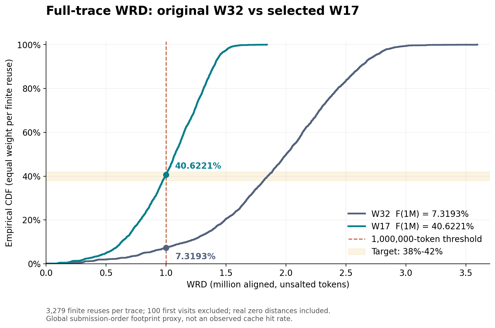
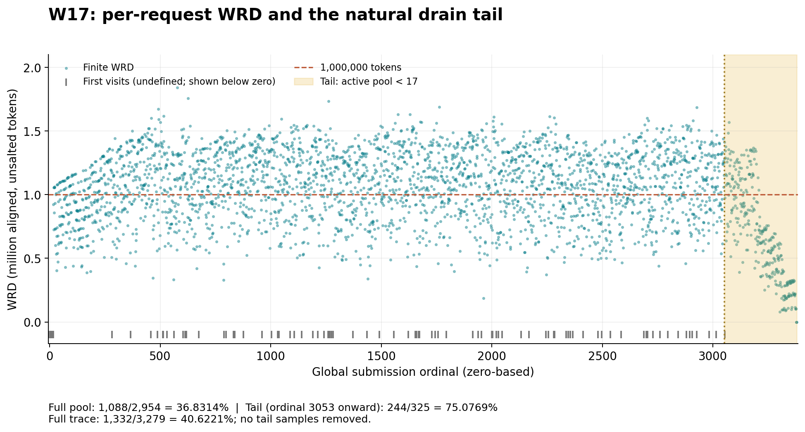

# W17：3379 请求的 WRD 目标数据集

此数据集只将原 W32 的活跃会话池改为 **W17**，沿用 seed=20260725 与原因果交错算法。全量 **1332/3279 = 40.6221%** 的有限 WRD 不超过 1,000,000 token，距 40% 为 **+0.6221 个百分点**，满足 38%～42% 目标。

原 100 个 trajectory、3379 个请求、内容、token 长度、原轮次、请求 ID、同会话顺序、depends_on、salt、tokenizer、模板与无 primer 设定均保留。回放仍为 **C32、固定 order、等待依赖完成**。降低 W 可能降低有效并发，不能据此宣称性能对照的有效并发相同。

| 指标 | 原 W32 | 新 W17 |
|---|---:|---:|
| 首次访问 / 有限 WRD | 100 / 3279 | 100 / 3279 |
| F(1,000,000) | 7.3193% | **40.6221%** |
| mean | 1,937,369.9787 | 1,040,838.0701 |
| P50 | 2,002,944 | 1,075,200 |
| P90 | 2,620,160 | 1,397,401.6 |
| P95 | 2,743,116.8 | 1,446,656 |
| P99 | 2,934,220.8 | 1,542,681.6 |

枚举 W=1～100，W17 最接近 40%，且是唯一落入目标区间的整数。W16 为 48.9478%，W18 为 34.7362%。搜索没有假定单调性：存在 31 次相邻 W 增大而 CDF 上升。

## 文件与口径

可回放数据位于 [`generated/closed-loop-w17-64k128k/`](generated/closed-loop-w17-64k128k/)，包含 order、profiles、intervals、manifest、BUNDLE-IDENTITY 与 replay-inputs。**发布副本中的运行路径均相对本 README 所在目录**；脚本根据自身位置解析，不依赖生成机器上的旧工作区。只改变了发布元数据的路径及对应校验和，order、profiles、intervals、搜索结果、WRD 文件和图与原离线交付相同。

| 文件 | 用途 |
|---|---|
| [全部候选 CSV](generated/analysis/search-all-w.csv) | 所有 W 的全量、满额、收尾 CDF、计数和分位数 |
| [逐请求 WRD CSV](generated/analysis/w17-per-request-wrd.csv) / [JSON](generated/analysis/w17-per-request-wrd.json) | 3379 行，首次访问为空值 / null，真实相邻复用为 0 |
| [完整对比](generated/analysis/comparison.json) | 基线、选定 W、相邻候选与收尾影响 |
| [发布副本校验](generated/validation/validation.json) | 从新位置读取的实际校验结果，包含全部 token 内容验证 |
| [请求 token 哈希](generated/validation/prompt-token-hashes.jsonl) | 含 salt 的 token IDs，uint32 little-endian SHA256 |
| [输入锁定](inputs/SOURCE-LOCK.json) | 原件路径作为溯源记录；snapshot_path 指向包内快照 |
| [原离线报告](evidence/ORIGINAL-OFFLINE-REPORT.md) | 原生成环境与审计过程；其中主机绝对路径属于历史记录 |
| [SHA256SUMS](SHA256SUMS) | 当前发布副本全部文件的相对路径校验和 |

WRD 取同一 trajectory 两次相邻访问之间的请求，按中间 trajectory 去重，求每组**最大** `chunk_aligned_prompt_tokens` 的和。长度按 256 token 向下对齐，不含 salt。首次访问不计入 CDF，3279 次有限复用等权，真实 0 计入。分位数为线性插值。

W17 满额阶段为 1088/2954 = **36.8314%**；收尾阶段为 244/325 = **75.0769%**。收尾从 ordinal 3053 开始，占有限样本的 9.9116%，使全量 CDF 比满额阶段高 3.7907 个百分点。阶段按当前请求 `active_sessions_at_emit == W` 或 `< W` 划分，跨界间隔不截断，没有人为删减收尾。





这只是**全局提交顺序的会话前缀足迹代理**，不是各 DP 的实际 block/shard 距离、L1 命中率或 Early 性能收益。

## 离线使用

需要 Python 3.12。`requirements.lock.txt` 是独立离线工具环境的依赖锁；可在新的工具 venv 中安装，勿覆盖推理环境。生成仅需标准库；内容校验需要 pyarrow、transformers/tokenizers、jinja2；绘图需要 matplotlib。

将下面两个变量替换为当前机器的绝对路径。命令不会启动模型或发送 HTTP；`validate.py` 禁止网络连接。

```bash
TASK_BUNDLE=/absolute/checkout/benchmarks/workloads/wrd-1m-target40-seed-20260725
TASK_PYTHON=/absolute/offline-tools-venv/bin/python
cd "$TASK_BUNDLE"

sha256sum --check "$TASK_BUNDLE/SHA256SUMS"
"$TASK_PYTHON" -B "$TASK_BUNDLE/scripts/validate.py" \
  --generated "$TASK_BUNDLE/generated" --verify-content

# 输出路径必须不存在。保留原 profiles，枚举 W=1～100 并重生成最优数据集。
"$TASK_PYTHON" -B "$TASK_BUNDLE/scripts/generate.py" \
  --output-dir /absolute/new-output-directory
```

`--check-originals` 仅在能访问原生成机器路径时使用；默认验证完整包内快照及其哈希。`--verify-content` 离线调用原回放器的 tokenizer/template，验证全部正文长度和新旧 token 内容。校验脚本会刷新 `generated/validation/` 下的本地报告；因此 SHA256SUMS 应在刷新前检查，刷新后的报告路径可能与发布时不同。

原生成脚本的 CLI 属于另一种文本筛选负载。本包只调用已证明能逐字节复现原 W32 的 `causal_merge(existing_profiles, BuildConfig(active_sessions=W))`，不执行其文本重采样入口。原 order SHA256 为 `9cf0b970efa0bc4bb1c755f0ab0cf6d8dfea67eb216c894603064f280eb99392`；新 order 为：

```text
9e45168e61f540331525edb23738099ca4dee10374c317a33e9b0b3bb012de01
```

原 W32 的 intervals、P50/P90/P99 已精确复现；独立流式算法逐条验证 WRD，并复核全部 100 个候选。第二次独立生成的 order、intervals、profiles、统计文件逐字节一致。原回放器解析与本地完成回调的固定顺序/依赖调度检查通过；mock 不是并发或性能测量。

## 未来回放入口

`scripts/replay_command.py` 读取相对路径，解析成当前 checkout 的绝对路径，**只打印命令，不执行**：

```bash
"$TASK_PYTHON" -B "$TASK_BUNDLE/scripts/replay_command.py" \
  --inputs "$TASK_BUNDLE/generated/closed-loop-w17-64k128k/replay-inputs.json" \
  --python /absolute/validated-client-environment/bin/python \
  --base-url http://127.0.0.1:8000 --model YOUR_SERVED_MODEL \
  --run-id w17-c32-YOUR_NEW_RUN_ID --results-dir /absolute/new-results-directory
```

后续需由操作者另行启动回放。命令固定 `--max-concurrency 32 --session-pool 17`；不使用硬编码 W32 的旧 wrapper，不跳过依赖，不引入 arrival schedule。**salt 仍为 `swe-rebench-w32-noprimer-seed-20260725`**，其中 w32 是历史内容命名空间，改名会改变请求 token。

`full_submit_order_sha256` 沿用原回放器对 ordinal 列表的哈希，无法证明不同数据集的 request ID 顺序相同；新增的 `request_id_sequence_sha256` 和 order 文件哈希用于核验实际交错顺序。

新数据集未生成 tier-model。`inputs/baseline/` 中的 W32 tier-model 仅作原始输入证据，不用于 W17 的预测。包内不含模型权重、凭据、编译产物或虚拟环境；compact parquet 的来源与许可见 `inputs/source-metadata/README.md` 和 `LICENSE`。
