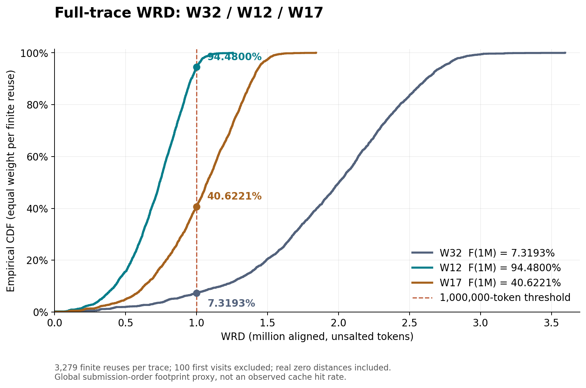
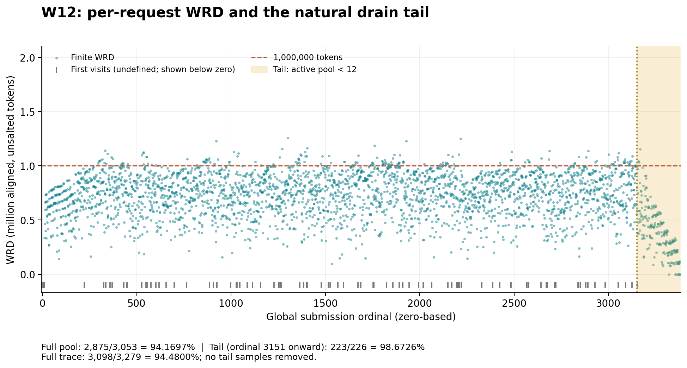

# 固定 W12 的 3379 请求数据集

2026-09-21，按用户指定 **W=12** 生成，不再以 40% CDF 为选参目标。只改变活跃会话池 W 及其产生的因果交错顺序；seed=20260725、全部 100 个 trajectory / 3379 个请求、内容、长度、请求 ID、原轮次、同会话顺序、依赖、salt、tokenizer、模板和无 primer 设定不变。回放仍为 **C32、固定 order、等待 depends_on 完成**。

新数据在 [`generated-w12/closed-loop-w12-64k128k/`](generated-w12/closed-loop-w12-64k128k/)，stem 为 `causal_w12_noprimer.seed-20260725`。同目录包含 order、profiles、intervals、manifest、BUNDLE-IDENTITY 和 replay-inputs。输入快照与工具复用本包已有的 `inputs/`、`vendor/`、`scripts/`，无需旧服务器工作区。

## 全量统计

WRD 单位为 token，按原定义对中间 trajectory 取最大 256-token 对齐正文长度后求和，不含 salt。首次访问不计入分母，真实相邻访问的 0 计入，3279 个有限复用等权。分位数使用线性插值。

| 指标 | W32 | W17 | **W12** |
|---|---:|---:|---:|
| 请求 / trajectory | 3379 / 100 | 3379 / 100 | 3379 / 100 |
| 首次访问 / 有限 WRD | 100 / 3279 | 100 / 3279 | 100 / 3279 |
| WRD≤1,000,000 | 240 | 1332 | **3098** |
| F(1,000,000) | 7.3193% | 40.6221% | **94.4800%** |
| mean | 1,937,369.98 | 1,040,838.07 | **715,604.16** |
| P50 | 2,002,944 | 1,075,200 | **740,352** |
| P90 | 2,620,160 | 1,397,401.6 | **963,635.2** |
| P95 | 2,743,116.8 | 1,446,656 | **1,005,875.2** |
| P99 | 2,934,220.8 | 1,542,681.6 | **1,088,025.6** |
| maximum | 3,596,800 | 1,842,432 | **1,256,192** |
| 真正的 WRD=0 | 4 | 3 | **8** |

W12 的 F(100 万) 为 **3098/3279 = 94.4800244%**，其余 181 个有限 WRD 大于 100 万。它不满足此前为 W17 设置的 38%～42% 区间；本次验收要求是固定 W12，并非继续逼近 40%。统计文件保留的 target 字段仅作历史对照，`selection_mode=fixed_W`、`target_is_acceptance_requirement=false` 明确标记本次选择。

## 满额与收尾

阶段按当前请求 `active_sessions_at_emit == W` 或 `< W` 划分。跨越分界的复用间隔仍完整计算，不裁掉任何请求。

| W12 阶段 | 请求 | 首次访问 | 有限 WRD | WRD≤100 万 | 阶段 CDF | mean | P50 |
|---|---:|---:|---:|---:|---:|---:|---:|
| 满额 | 3151 | 98 | 3053 | 2875 | **94.1697%** | 739,398.10 | 757,248 |
| 收尾 | 228 | 2 | 226 | 223 | **98.6726%** | 394,175.43 | 376,832 |
| 全量 | 3379 | 100 | 3279 | 3098 | **94.4800%** | 715,604.16 | 740,352 |

收尾从 **ordinal 3151（第 3152 条请求）** 开始，占有限样本的 **6.8923%**。纳入收尾后，全量 CDF 比满额阶段高 **0.3104 个百分点**。满额阶段自身已超过 94%，不是主要由收尾拉高。





## 产物与验证

- [逐请求 WRD CSV](generated-w12/analysis/w12-per-request-wrd.csv) / [JSON](generated-w12/analysis/w12-per-request-wrd.json)：3379 行，首次访问为空/null。
- [完整统计](generated-w12/analysis/comparison.json) 与 [W1～100 搜索表](generated-w12/analysis/search-all-w.csv)：全量及分阶段的 mean、P50/P90/P95/P99、零值数与 CDF。
- [实际离线校验](generated-w12/validation/validation.json)：独立流式 WRD 重算、原回放器解析和依赖调度、活跃池补入、请求集合、全部 token 内容。
- [独立进程重生成校验](generated-w12/validation/independent-process-regeneration.json)：order、profiles、intervals 和统计文件逐字节一致。
- [逐请求 token 哈希](generated-w12/validation/prompt-token-hashes.jsonl) 与 [校验和清单](SHA256SUMS)。

原 W32 顺序及给定 P50/P90/P99 再次精确复现。W12 新统计与此前独立枚举表中的 W12 行完全一致。3379 个请求无增删、复制或内容变更；只有 ordinal、虚拟 ready time、emit 时活跃会话数、未激活会话数可变化。未生成 tier-model，未把原 W32 的预测数据当作 W12 结果。

新 order SHA256：

```text
1d21beb3b6fd9732df1369839a1b8599dbd3b49a42c34e0f2d8781dcd8fb3e73
```

## 离线复现与未来回放

将变量替换为当前机器的绝对路径；`TASK_BUNDLE` 是本文件所在目录。依赖锁在 `requirements.lock.txt`，使用独立 Python 3.12 工具环境，不改推理依赖。输出目录必须不存在。

```bash
TASK_BUNDLE=/absolute/checkout/benchmarks/workloads/wrd-1m-target40-seed-20260725
TASK_PYTHON=/absolute/offline-tools-venv/bin/python
cd "$TASK_BUNDLE"
sha256sum --check "$TASK_BUNDLE/SHA256SUMS"

"$TASK_PYTHON" -B "$TASK_BUNDLE/scripts/generate.py" \
  --active-sessions 12 --portable-paths --output-dir /absolute/new-w12-output

"$TASK_PYTHON" -B "$TASK_BUNDLE/scripts/validate.py" \
  --generated "$TASK_BUNDLE/generated-w12" --verify-content

"$TASK_PYTHON" -B "$TASK_BUNDLE/scripts/plot.py" \
  --generated "$TASK_BUNDLE/generated-w12" --reference-generated "$TASK_BUNDLE/generated"
```

`--active-sessions 12` 固定选择 W12；省略时仍保留原先从 100 个整数中选最接近 40% 的行为。`--portable-paths` 将包内路径写为包根目录相对路径；包外新输出仍使用实际绝对路径。验证脚本禁止网络连接；执行后会刷新本地验证报告，因此先检查发布版 SHA256SUMS。

下面只打印未来回放命令，不执行：

```bash
"$TASK_PYTHON" -B "$TASK_BUNDLE/scripts/replay_command.py" \
  --inputs "$TASK_BUNDLE/generated-w12/closed-loop-w12-64k128k/replay-inputs.json" \
  --python /absolute/validated-client-environment/bin/python \
  --base-url http://127.0.0.1:8000 --model YOUR_SERVED_MODEL \
  --run-id w12-c32-YOUR_NEW_RUN_ID --results-dir /absolute/new-results-directory
```

命令固定 C32、W12、seed=20260725，保留原 salt `swe-rebench-w32-noprimer-seed-20260725`，严格等待依赖，不使用跳过依赖的发送策略。

本次仅离线生成、验证和绘图，没有启动模型或发送 HTTP。**W12 会限制可活跃推进的会话数；保留 C32 不等于保留相同有效并发。94.48% 是全局顺序的前缀足迹 CDF，不是 L1 命中率或 Early 性能收益。**
