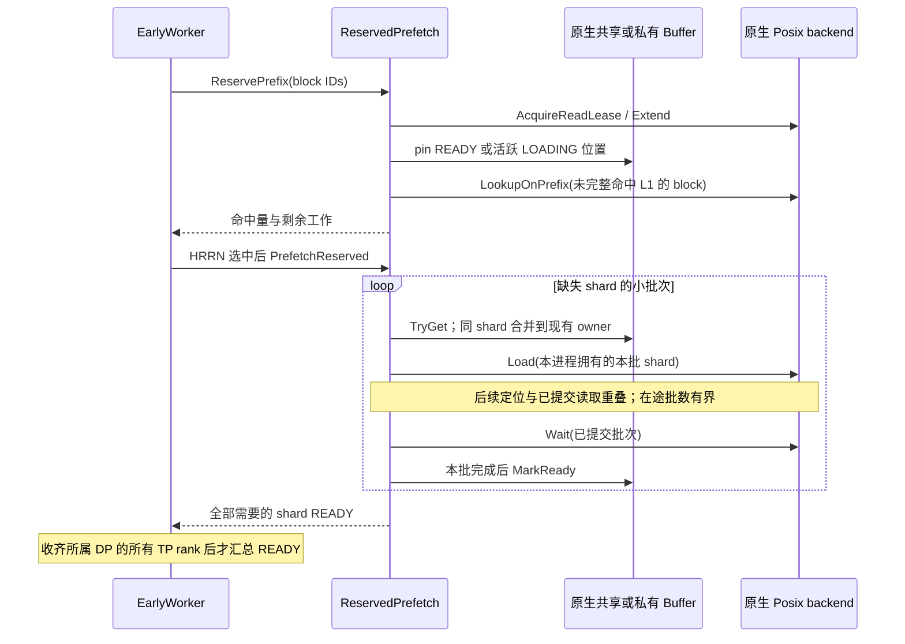
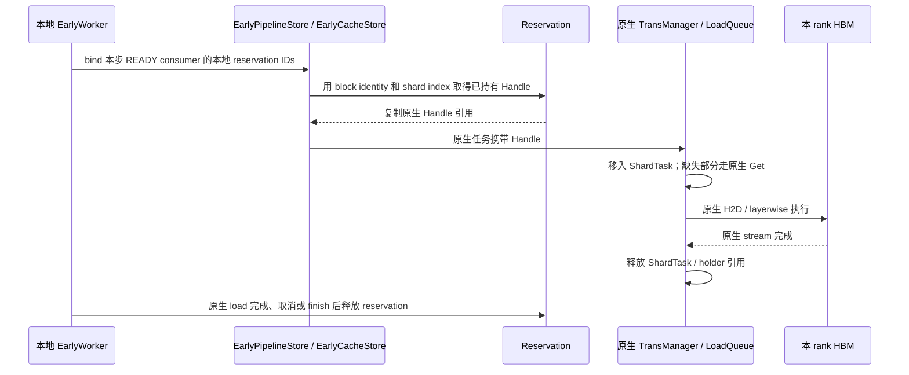

# Early Prefetch：原生加载与引用交接

Early 在 UCM 内提前准备当前可用的 KV。Scheduler 继续使用原生 waiting /
skipped_waiting、block allocation 和 metadata；PENDING 返回 `(None, False)`。
READY 通过保存的 block IDs 和所有 rank 的最小命中结果进入原生 token 计算。
不等待其他请求未来产出，不维护 producer prefix、持久化观察或 revalidation。

## 职责与复用

| 组件 | 职责与关系 |
|---|---|
| EarlyDirectConnector / EarlyLayerWiseConnector | 薄子类；继承原生初始化、metadata、逐层执行和 KV load，只接入请求生命周期与保存结果 |
| EarlyScheduler / EarlyWorker / Control | 请求实例 identity、异步提交、PENDING/READY/FAILED/CANCELLED、Stan HRRN、rank 汇总、handoff 和结束清理 |
| EarlyPipelineStore | 继承原生 builder、load/load_data 参数转换、任务对象和完成检查；组合 `_ReservedLoad` 路由同一个 C++ PipelineStore 的 Load |
| EarlyCacheStore | 继承 CacheStore；使用父类已创建的 BufferManager、TransManager；为原生加载任务附加已有 Handle |
| ReservedPrefetch | reservation、连续命中、工作量快照、分批 L2→L1、worker 内的引用交接 |
| PosixReadLease | 使用原生 SpaceLayout 定位 backend，在既有锁文件中保护 block；GC 仍通过原有删除 guard 与读者互斥 |

`_ReservedLoad` 不创建 Store、buffer 或线程。C++ EarlyLoad 绑定调用原生私有
MakeTaskDesc，通过原有 Self 入口及 health wrapper 提交；不复制参数解析。

## Reservation 与可用前缀

按有界候选段获取 read lease，然后检查该段的 shard。只有全部 shard 已 READY
且持有 pin 的 block 才能直接作为 L1 命中，包括已经不在 L2 的 block。
其余 block 通过原生 LookupOnPrefix 判断当前 L2 可用性；遇到第一个两层均不能
满足的 block 后停止后续候选段。没有当前 KV 的部分由原生推理计算。

Posix lease 的 Extend 继续使用同一 SpaceLayout 与同一组 OFD，避免每段新开 FD。
不支持 Extend 的其他 lease 保持独立 RAII 所有权。追加中途失败时，整个未发布的
reservation 销毁并释放先前及部分追加的保护。锁文件不随请求删除。

PinReady 可借用具有活跃 owner 的 LOADING 位置，不在 reservation 阶段分配新位置
或接管其 I/O。已经借用的位置在 owner 完成、释放后仍有引用保护，预取阶段无需
再次定位。真正不存在的位置不能作为可信的长期负查询结果：进入数据阶段后，
TryGet 必须重新确认其他 rank 是否已经创建同一 shard，再决定获取或分配。

total_hit_blocks 表示连续总命中；remaining_l2_work 是 reservation 时尚未 READY
的 shard 数，包含其他 owner 的在途工作，不等于本 rank 最终的 SSD 读取字节。
HRRN 保持 `1 + waiting_time / max(remaining_l2_work, 1)`。

当剩余工作为零时不进入数据队列，不调用 PrefetchReserved。零长度 miss 也满足
这个条件，因此分析日志时必须与正长度的 L1 命中分开。

## 分批搬运

仅 owner 提交读取；READY shard 和其他 owner 的在途 shard 不重复读。
局部 Transfer 容器只保存已提交的原生 task handle，不新增 I/O 线程或调度队列。
取消、后续提交失败、准备下一批时抛异常，都先 Wait 回收已接受的任务，再标记
尚未完成的本进程 owner 为 FAILED。此处沿用原生 Wait 返回前回收 I/O 的契约。
共享位置的失败仍会唤醒消费者进入可回退状态。

## 原生加载交接

reservation 中的 blockOffsets 只索引本请求保存的 block 列表，用于定位其 Handle
数组；它不记录共享 buffer 布局，不是另一套全局 KV 索引。交接仍需检查本地
reservation 存在、未取消、已 READY、block identity 匹配及 shard 范围合法。

原生 Handle 的复制通过既有节点引用计数取得保护，避免重新查找共享哈希桶。
加载队列接管该引用，继续使用原生 H2D 与完成清理；已有完整 block reservation
的 shard 无需再执行下一 shard 的 Prealloc。未交接的 shard 完整保留原生路径。
即使 reservation 在任务排队期间释放，任务引用仍保护数据直到传输完成。

所有地址与 Handle 只在持有它们的 worker 内使用。MLA shared L1 的创建/挂接、
unique_id、owner、物理范围和容量，以及非 MLA private L1 的语义均交给原生。
不同 rank 从自己的本地映射取得 Handle，并加载到各自 HBM。

Early 关闭继续选择原生工厂。没有预取结果或 FAILED/CANCELLED 时继续走原生
fallback。vLLM 与 LMCache 不增加 Early 状态机、队列或接口。
