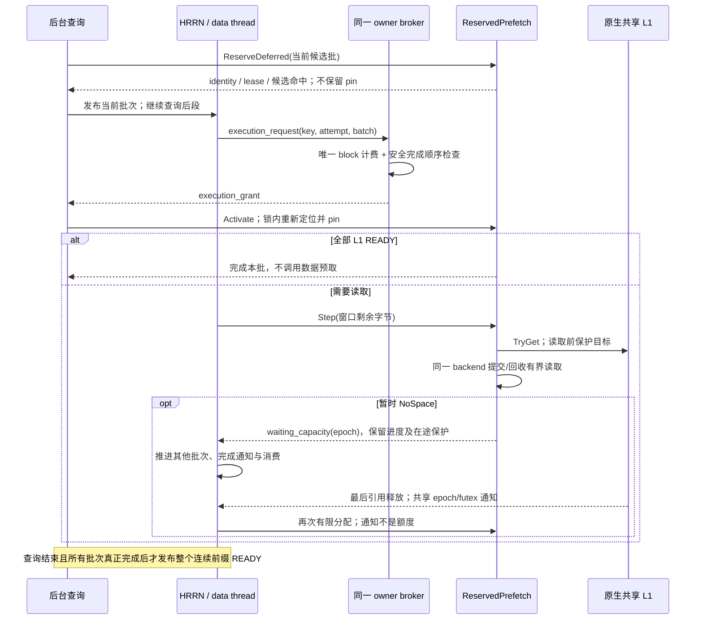
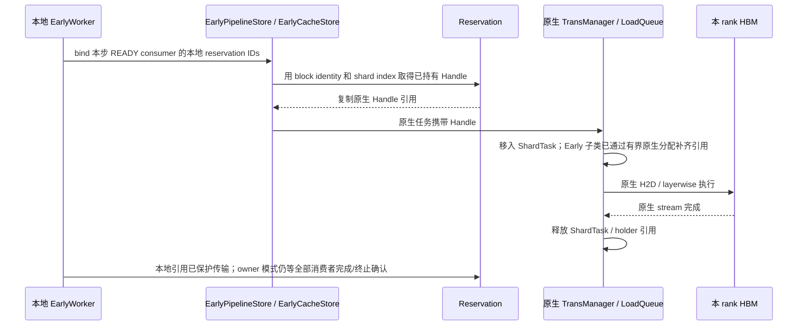
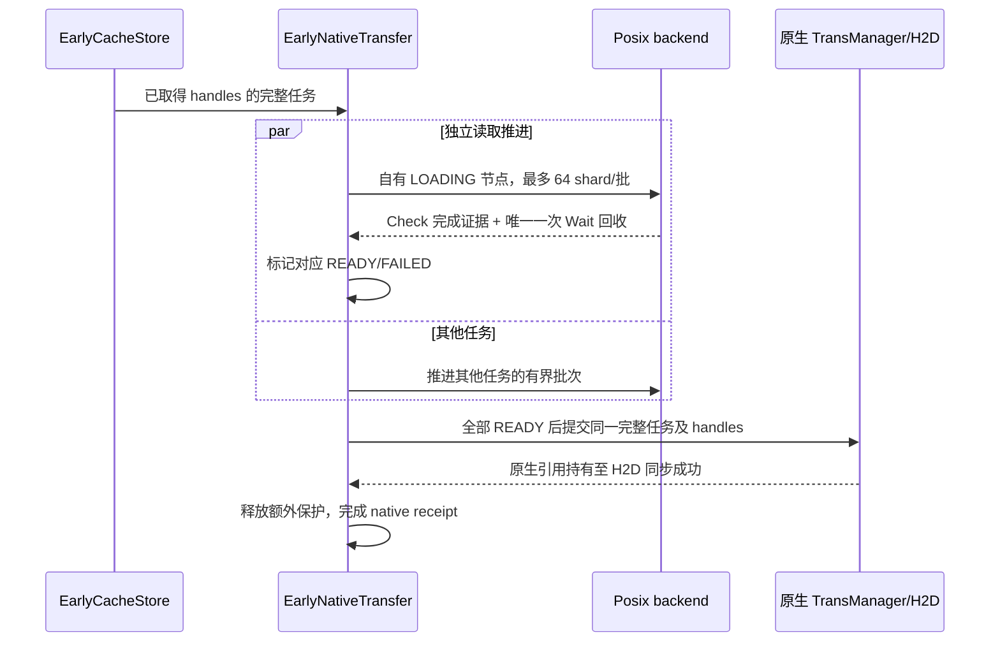
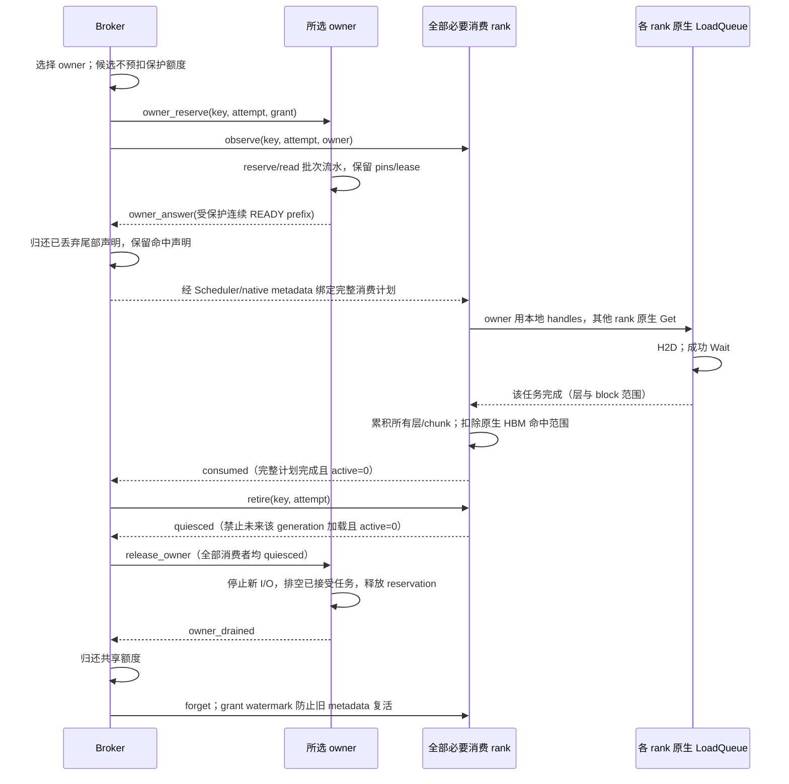

# Early Prefetch：批次流水与原生引用交接

Early 在 UCM 内提前准备当前可用的 KV。Scheduler 继续使用原生 waiting /
skipped_waiting、block allocation 和 metadata；仍需要外部 KV 的 PENDING 返回 `(None, False)`。
若原生 HBM lookup 已达到 `floor((num_tokens - 1) / block_size) * block_size`
的最大完整前缀，则同步返回 `(0, False)`，沿用原生最后一个 block 内重算；取消后台
job，不等待它可能补充的末块 KV。对齐 prompt 也必须保留最后 token 的原生边界。
取消仍经原有排空协议释放，不把尚未 READY 的 L1 当作命中；
保留已取消实例的 identity/hash 直到 finish，使 block allocation 重试无需重新扫描 tokens。
此短路要求后台 hash 已完成：用已保存 IDs 继续执行原生 token / dump metadata
生成，Early Store 只提供“外部命中为零”的本次结果。不能直接跳过 metadata，
否则最后重算出的完整 block 会失去原生 dump。hash 未完成时保持非阻塞 PENDING。
READY 通过保存的 block IDs 和受保护命中结果进入原生 token 计算：已核验共享域由单 owner 给出，其余配置继续汇总所有 rank 的最小命中。
不等待其他请求未来产出，不维护 producer prefix、持久化观察或 producer revalidation。未保护的 L1 位置仍须在执行前重新核验。

## 职责与复用

| 组件 | 职责与关系 |
|---|---|
| EarlyDirectConnector / EarlyLayerWiseConnector | 薄子类；继承原生初始化、metadata、逐层执行和 KV load，只接入请求生命周期与保存结果 |
| EarlyScheduler / EarlyWorker / Control | 请求实例 identity、异步提交、PENDING/READY/FAILED/CANCELLED、Stan HRRN、既有批次线程及传输；非 owner 模式保留 rank 汇总 |
| OwnerBroker : BrokerState | 在既有 broker/job table 上扩展原生共享对象握手、每 generation 单 owner、共享域额度、接管及排空确认 |
| OwnerWorker / Consumer / LoadConsistency | 组合现有 worker 和同一个原生 RankConsistencyManager；关联真实任务完成、消费范围及 generation，不创建另一套加载队列 |
| Early::DomainProvider | EarlyCacheStore 的可选能力接口；查询已创建 buffer 的身份/容量，提交延后 pin 查询并等待同一 buffer 的释放事件 |
| EarlyPipelineStore | 继承原生 builder、load/load_data 参数转换、任务对象和完成检查；组合 `_ReservedLoad` 路由同一个 C++ PipelineStore 的 Load/Dump/Wait，并观察成功完成 |
| EarlyCacheStore | 继承 CacheStore；使用父类已创建的 BufferManager、TransManager；为完整原生 load/dump 任务取得有界引用；复用已有 Handle |
| ReservedPrefetch | 每批连续命中、reservation、定位合并、受保护 block 引用复用、有界位置提示和 worker 内的引用交接 |
| ReservedPrefetch::Batch / Early::Batch | Early 专用的有界推进能力；保存原生 task handle，复用同一 backend 的 Load、Check、Wait；不另建 I/O 线程 |
| BoundBatch | Python 能力对象；保持创建它的原生 Pipeline 与 health wrapper 存活，析构前排空已提交 I/O |
| EarlyBufferPins | 对同一个原生 buffer 批量查找；复用原生 Hash、bucket/节点锁和 Handle，不拥有共享状态 |
| PosixReadLease | 使用原生 SpaceLayout 定位 backend，在既有锁文件中保护 block；GC 仍通过原有删除 guard 与读者互斥 |

`_ReservedLoad` 不创建 Store、buffer 或线程。C++ EarlyLoad 绑定调用原生私有
MakeTaskDesc，通过原有 Self 入口及 health wrapper 提交；不复制参数解析。

## 调度匹配与消费确认

READY 已保存的 block IDs 和受保护命中数通过 Early 的 ContextVar / Store 子类
进入原生匹配方法；不再次 reserve、hash 或执行 L2 lookup。原生继续扣除 HBM 命中、
过滤已知缺失、处理 CP 和 full-hit recompute 并创建 metadata，返回 `(tokens, False)`。
这不是 HBM 命中伪装：外部 KV 的 H2D 仍通过原生 layerwise/direct load 完成。

owner generation 的 key/attempt/grant/expected 随原生 step metadata 传递。无需另发
broker 不使用的 owner handoff 消息；兼容的非 owner 路径仍保留有序 handoff 消息。
metadata 到达不释放保护，仍等每个必要消费者的实际成功 Wait 覆盖全部预期层、
block 和 chunk，再执行 retire / quiesced / owner_drained。

Consumer 按成功完成的 `(layer, block)` 增量扣除 remaining，并保留去重集合；
每次完成只处理本次任务涉及的层和本 generation 的预期 blocks，不重复检查前面
所有层。混合请求任务、重复 chunk 和重复 receipt 不多计。未知 I/O 失败不扣额度并
fencing；已证明未提交 I/O 的容量拒绝走终止/排空协议，不当作成功消费。
step 重新绑定相同计划时复用已建立的 expected 集合；变化的计划仍拒绝。

每个请求首次真正被调度时记录一次 `schedule_match` 汇总：generation key、DP、
owner、READY 接收时刻、首次 PENDING、PENDING 次数、匹配调用数和总耗时、
最后一次 HBM/external token 数、prompt 总长、原生实际 scheduled token 数及
原生 SCHEDULED 时刻。缺失时刻保留 None。
`match_ms` 包含原生 Python token/metadata 处理，不是 C++ reserve 时间；它可能覆盖
多次 allocation 重试，必须结合 match_calls 解读。日志不代表首 token 时间，
需通过 request/key 与客户端流式首 token 记录关联；不相减不同指标的分位数。

## Reservation 与可用前缀

已核验 owner 域使用 `ReserveDeferred`：查询期间只临时取得现有节点引用以确认
连续 L1/L2 命中，返回前释放这些引用；排队的 reservation 只留 block identity、
read lease 和 L2-positive 信息。它不分配缺失节点，也不把候选命中当成 READY。
HRRN 选中批次、共享域资格检查通过后，`Batch.Activate` 复用 Locate/位置提示，
在原生锁内重新取得引用。L2-positive 由原 lease 保护；原 L1-only block 若被淘汰，
再查当前 L2，真正缺失才截断。分配仍在 Step 提交 SSD 读取之前执行。
全 L1 在执行资格通过并重新取得全部引用后直接 READY，不进入 SSD 数据队列。
下面的定位/共享保护机制在 Activate 与兼容的非 owner 路径复用。

候选段从 32 block 开始，连续命中时扩大到 64、128、256 block，随后保持上限。
按段获取 read lease，然后检查该段的 shard。只有全部 shard 已 READY
且持有 pin 的 block 才能直接作为 L1 命中，包括已经不在 L2 的 block。
其余 block 通过原生 LookupOnPrefix 判断当前 L2 可用性；遇到第一个两层均不能
满足的 block 后停止后续候选段。没有当前 KV 的部分由原生推理计算。

每段是独立 reservation，持有本段 lease。一次获取中，同一 backend 只打开一个
锁文件描述符。后段定位与前段读取可以并行，因此不修改已发布 lease；不再需要
Extend 或保存 layout 指针。获取中途失败时，RAII 释放本批已取得的锁，已发布
前批仍有自己的保护。锁文件不随请求删除，实际 GC owner 的 guard 与 unlink
保持同一互斥区间。read lease 不承诺尚未完成的 dump 已经持久化。

EarlyBufferPins 将该段的查询按原生 Hash 分组，同一 bucket 在本批只加锁和遍历
一次。分组数组是临时查询参数，不存储共享 buffer 布局。节点保护、容量限制与
状态判断继续使用原生策略。原生 TransBuffer 不增加 Early 查询方法；既有
friend 声明保留所有原生成员的 private 属性。

同 worker 内，同 block 的并发定位共享短期 ProbeFlight。领导者先完成自身全部
定位并发布结果，再等待其他领导者的结果，避免相反 block 顺序形成等待环。
等待不持有全局或 bucket 锁，沿用已有超时；异常也完成 promise 并唤醒加入者。
这只合并一次当前索引操作，不等待 producer 产生 KV，也不是跨 rank 的位置协议。

只对没有可复用保护的 block 执行批量查询。完整 READY 的 block 使用共享的
BlockPins 所有权，其原生 Handle 只取得一次；同一 worker 中后来的 reservation
可以共享它，不再逐 shard 查询、加锁或增加节点引用。原生节点仍因该组持有
Handle 而无法被淘汰，直到最后一份 BlockPins 所有权结束。readyBlocks_ 对保护组
只保存弱引用，不延长 pin 生命周期。
此机制只复用当前受保护的 READY block，不等待其他请求产出。
复用时仍调用原生 MarkAccessed 更新 CLOCK 热度。这是对已保护位置的原子访问
标记，不重新查 bucket、拿节点锁或增加节点引用，也不是完全没有逐 shard 内存操作。

上一 reservation 释放后，位置提示可以帮助新的请求跳过共享 bucket 查询。提示仅
保存节点序号，不保存裸指针或 pin；条目数不超过原生节点容量可容纳的 block 数。
使用提示时逐节点取得原生节点锁，在同一个临界区内检查容量范围、block identity、
shard index、READY 状态并取得引用。原生 Alloc 在同一节点锁内改写身份，且不能
回收仍有引用的节点。部分检查失败时 RAII 释放已取得的引用，再走正常批量查询。
这条路径仍有逐 shard 节点锁，只省去 bucket 查找；不能把旧位置本身当作可用结果。
提示按访问次序淘汰元数据，不影响 KV 回收、请求准入或 pin/lease 生命周期。
每个 worker 的提示独立；共享 L1 的权威身份与状态仍来自同一个原生共享 buffer。

批量 pin 可借用具有活跃 owner 的 LOADING 位置，不在 reservation 阶段分配新位置
或接管其 I/O。已经借用的位置在 owner 完成、释放后仍有引用保护，预取阶段无需
再次定位。真正不存在的位置不能作为可信的长期负查询结果：进入数据阶段后，
TryGet 必须重新确认其他 rank 是否已经创建同一 shard，再决定获取或分配。

total_hit_blocks 表示连续总命中；remaining_l2_work 是 reservation 时尚未 READY
的 shard 数，包含其他 owner 的在途工作，不等于本 rank 最终的 SSD 读取字节。
HRRN 保持 `1 + waiting_time / max(remaining_l2_work, 1)`。
批次推进时，已完成的本地读取与已观察到的 peer READY 从工作估计中扣除。
尚未观察到的 peer 完成可能仍被计入，因此它是保守估计；实际 SSD 读取另记。

当剩余工作为零时不进入数据队列，不调用 PrefetchReserved。零长度 miss 也满足
这个条件，因此分析日志时必须与正长度的 L1 命中分开。

## 分批搬运

仅 owner 提交读取；READY shard 和其他 owner 的在途 shard 不重复读。
局部 Transfer 容器只保存已提交的原生 task handle。一次 Step 最多定位 64 shard，
窗口仍为 128 shard 的字节数，并由同 worker 的所有在途批次共同使用。健康的
未完成 I/O 不在 Step 内同步 Wait；原生没有完成回调时，数据线程以既有 1 ms
等待节奏调用 Check，不增加 lookup/data 线程或 Posix 并发。

数据队列每请求选取最早的可提交批次。每个有限轮次内，每请求取得一次有界
推进机会；该轮候选按 Stan HRRN 选择前四分之一，完成该轮后才接纳新到候选。
等待完成的批次仍在 active 中回收，不占用提交机会。整请求 PENDING 保持不变；owner 模式等 owner 的完整受保护结果，兼容路径等全部 rank。软化门控不属于此设计。

取消后停止新提交，已接受的任务由 Check/Wait 排空，再标记尚未完成的本地 owner
为 FAILED。非 owner 路径关闭时数据线程继续排空 active，未发布的 lookup 结果立即释放。owner 路径关闭执行下述 generation 排空握手；无法证明排空则停用共享域。
能力对象异常析构也先 Wait；这里沿用原生 Wait 返回前回收 I/O 的契约。
共享位置的失败仍会唤醒消费者进入可回退状态。

## 容量与保护

物理边界仍是同一个原生节点池、引用计数、CanReserve 和有限次 TryGet；原生
load-exclusive 区不用于 Early。协议 5 只在已核验共享域增加执行资格检查，
不在请求到达时扣整个候选前缀，也不代替原生分配。

`ExecutionWindow` 保存每个 generation 的保守完成范围和已获准执行的唯一 blocks。
批准一个批次前，模拟持有者逐个完成、消费、释放：当前唯一占用加某个持有者的
剩余最大需求必须可装入可预取区；删除该持有者后，对剩余持有者重复检查。
所有持有者存在这样的顺序才允许新增保护。重复 block 按并集计费；某个消费者
退出不释放其他持有者的声明。READY 的剩余分配需求为零，但实际声明仍等全部
必要消费者 quiesced、I/O drain、引用释放后才归还。

这会影响哪些候选可执行，HRRN 公式不变。候选最大范围超过池容量时，不把它
当作真实超容量：允许无 pin 查询完成，再用实际连续命中收窄需求。此类请求的
首批 I/O 会等待该查询结束；其余可执行请求保留边查边读流水。若确认命中本身
超过整池，以可容纳的连续唯一 blocks 为明确上限，记录 intrinsic_oversize 和
损失命中量；它与普通 NoSpace 分开。

已获资格的批次若物理 TryGet 暂时失败，保持 PENDING 和 cursor，停止新分配，
继续回收自己的已提交 I/O。后续查询在下一批入口暂停并让出 lookup worker。
数据线程继续服务其他任务。通知来自原生 TransBuffer 最后一个引用释放：节点
锁内减引用，解锁后更新共享 epoch 并 FUTEX_WAKE；本地 buffer 使用同一类型的
本地事件。单独通知线程释放 GIL 后 FUTEX_WAIT，超时只用于检查关闭，不触发
分配重试。失败前读取 epoch、内核比较等待、Python condition 序号共同处理
通知先于等待的竞争。

安全等待依赖完整兼容 cohort：所有 Early 部分分配均通过同域资格检查；已接受
原生 load/dump 已取得完整任务引用，其独立 I/O/传输完成路径不再申请剩余节点。
因而它们可以释放，而等待者不阻塞其完成。未知进程死亡、失联或无法证明 I/O
完成仍 fence 并保留保护，不能用超时猜测性归还额度。未核验 owner 域继续使用
原有兼容路径，本轮不对非 owner/private L1 宣称事件等待推进保证。

`Batch.Cutoff` 是已确认无法安全继续时的异常能力，不由普通 NoSpace 调用。
停止新提交后必须排空已提交尾部，再只保留完整、READY 且持续受保护的前缀。
尚未提交的失败分配用既有 RAII 标记失败并释放；不撤销已经给 Scheduler 的承诺。
4 块池中两个各需 3 块的部分占用环由资格检查提前阻止，不依赖超时解环。
单任务确实超容量则在 Activate 之前限长；取消/错误时原有 Discard/drain 保留。

`protected_bytes` 是 reservation 引用覆盖量，重复 block 可重复计数；broker
`protected_unique_blocks` 是保守执行声明；两者都不等于原生实际物理占用。
资格等待、物理等待恢复、intrinsic_oversize 和 revalidation_miss 分别记录。
READY 仍只覆盖真正完成且受保护的连续前缀。详细状态和证明见
[延后 pin 协议](DEFERRED_PIN_WAIT_PROTOCOL.md)。

## 原生加载交接

同一步相同 reservation ID 集合只建立一次 LoadPlan，索引 block 到对应的
reservation 及 block offset；不再为每个候选 reservation 遍历整个 load task。
每次 load 对实际请求的 block 做一次解析，连续 shard 直接复用已选中的组。
计划仅保存弱引用，不持有资源；READY 状态变化、release 或候选集合变化会使
计划失效，其中 READY/release 仅使包含该 reservation 的计划失效。无关请求
不会触发重建。Release 不扫描整个 READY/hint 表。交接仍检查本地 reservation 存在、未取消、已 READY、block identity
匹配及 shard 范围合法。另一个消费者持有相同 block 不构成本任务的访问授权。

原生 Handle 的复制通过既有节点引用计数取得保护，避免重新查找共享哈希桶。
加载队列接管该引用，继续使用原生 H2D 与完成清理；已有完整 block reservation
的 shard 无需再执行下一 shard 的 Prealloc。没有 reservation handle 的 shard 在
Early 子类中用同一 native 索引做有界定位，随后同样进入原生传输队列；不再调用
队列里的无限 Get 或可无限分配的下一 shard Prealloc。Early 关闭不进入此路径。
即使 reservation 在任务排队期间释放，任务引用仍保护数据直到传输完成。

所有地址与 Handle 只在持有它们的 worker 内使用。MLA shared L1 的创建/挂接、
unique_id、owner、物理范围和容量，以及非 MLA private L1 的语义均交给原生。
不同 rank 从自己的本地映射取得 Handle，并加载到各自 HBM。

Early 关闭继续选择原生工厂。没有预取结果或 FAILED/CANCELLED 时继续走原生
fallback。vLLM 与 LMCache 不增加 Early 状态机、队列或接口。

## 已核验共享域的单 owner 协议

`enable_early_prefetch` 关闭时不进入 Early 工厂。开启后，
`enable_early_owner` 默认为 true，但握手成功前仍使用既有非 owner 路径。
握手读取 **已创建的同一个** native buffer：通过 DataAt/MetaAt 所在 MAP_SHARED
映射核对设备号、inode、文件大小和映射内偏移，并核对当前路径仍指向该对象。
握手还包含 boot ID、IPC/mount namespace、native unique_id、节点容量、
block/shard bytes、tensor sizes、layerwise、CP/block 分组及原生 hash 指纹。
MLA block identity 来自 scheduler 的 rank 0 RequestHasher；worker 握手复用该
原生 hasher 类型与配置生成指纹，不读取仅 scheduler 初始化的 `_seed`，也不以
worker 自己包含 TP rank 的 hasher 指纹判断跨 rank 一致性。
不传播地址、不重建索引、不凭 UUID 或同名文件确认物理共享。

仅启用 MLA/shared L1、CP=1、PP=1、可证明布局一致的完整 DP/TP cohort。每个 DP 的
必要消费者须共享同一个对象；跨 DP 若指向同一对象，统一计费。完整 cohort 的
capability、协议版本、DP/rank 身份及心跳均须满足条件，且原广播模式任务已经
退出，才能开启 owner。缺少握手、private L1、非 MLA 或布局不兼容时记录原因，
保留原模式。启用后出现对象/进程 incarnation 改变则停用域，不能混入无配额广播。
这些检查是同一受信任引擎内的能力协商，不是面向恶意 worker 的认证协议。

broker 为请求实例生成的 UUID key 保存独立 attempt 和单调 grant。请求 ID
只用于原生 metadata 关联，不能授权释放。调度器发送序号防重放；进程 session
变化不允许接续旧任务。owner 从本 DP 的健康合格 rank 轮询选择；select_owner
是策略扩展点。非 owner 只收到 generation/owner 通知，不收到完整候选数组，
不执行 reserve、lease、候选扫描或预取。owner 保持四个后台执行槽位，分为两个 query 与两个 activation worker，避免
activation 排在完整前缀查询之后；仍使用一个 data worker 及原生 I/O 并发，继续自适应批次、reserve/read 重叠和跨请求
有限轮次 HRRN。无需跨 rank 的 handle、reservation ID、节点目录或读取分片。

owner reserve 完成且所有已发布批次 READY 后，broker 发布受保护的连续前缀。
Scheduler 复用已保存 IDs/hit，执行同一原生 HBM 扣除、缺失过滤、token 计算和
metadata 主流程。实际 allocation 前的重试可以刷新原生消费计划；首次 dispatch
后冻结该 generation 的预期 external blocks。失败恢复原生 lookup/load，而不
使用旧 READY 地址。没有运行中迁移或自动换 owner；需要重新处理时由原生重算。

## 共享域与有界推进

协议版本 5 保留内核对象/布局/成员握手和单 owner，执行资格以确认批次为单位。
申请携 key/attempt/batch/begin/count，迟到或重复授权不作用于新 generation。
共享内存事件使用同一原生映射，header magic 为 3；所有成员须全量重建、重启到
同版库，不能挂接旧布局或混用协议版本。不增加另一套共享 identity 或节点索引。

owner 轮询、原有任务数/候选工作量限制、128-shard I/O 窗口不变。资格检查和
物理分配分开；没有固定最大 load/dump 任务余量，也不强行把零容量变为正数。
只有完整 quiesce + drain 才删除执行声明。原生正式任务的容量拒绝语义保持如下。

`EarlyCacheStore` 在原生完整任务入队前复用 reservation handles，并用
`EarlyBufferPins::Acquire` 补齐缺失 handles。后者经现有 friend 入口调用原生
FindAt/Alloc 和引用机制，仅设置已有 Alloc 的有限尝试次数。原生私有访问属性不变。
load 允许使用 native exclusive 区，dump 仍不允许。所有位置取得后仍提交一个
原生任务。缺失回读先由 Early 独立完成，LoadQueue/DumpQueue 继续负责原粒度的
H2D/D2H 与原生 dump，正式任务不拆分；具体时序见下文。

容量不足返回原生 NoSpace，且保证该任务未提交 I/O。EarlyTaskPins RAII 对放弃的
LOADING owner 标记失败再释放，不能将不完整数据标 READY。binding 将提交前
NoSpace 转成继承原生 NotFound 的 EarlyCapacityRejected。load 沿用原生 missing/错误
上报，最终失败或重算由原生 kv_load_failure_policy 决定，不自动改变该配置；
dump 沿用原生错误处理，不上报保存成功。拒绝 receipt 不等于成功接管，
仍须等同 generation 的其他在途加载完成。未知提交/Wait 失败仍隔离共享域。

完整任务预取引用会把其缺失位置的定位前移到入队前。这避免原生无限 Get 与
部分任务占用形成容量死锁，但并非免费优化；大型 fallback 任务可能增加提交开销，
且大于当前可分配池的 dump 会被跳过。实际性能需同版本测量。

`native_get_fallback` 只统计 LoadQueue 内的 Get。Early 子类可能已经为非 owner
执行了有界索引/分配，因此该值为零不代表没有索引工作或跨 rank 复用了 owner
handle；实际 SSD 读量应使用独立 read 计数。

### 有限分配后的读取责任与原生传输交接

`EarlyNativeTransfer` 继承现有 `TaskWrapper`，组合调用同一个原生
`TransManager` 和 backend。它不创建第二个 buffer、共享身份或 H2D/D2H 队列。
`EarlyNativeTask` 保存本次已取得的 handles：LOADING owner 必须提交并回收读取；
LOADING follower 只观察节点状态；READY handle 可直接交给原生。
这里的 shard owner 与 broker 为请求选择的 reserve owner 是两个不同层次。

每轮最多提交 64 个 owner shard，executor 合计最多 128 个 shard 在途。完成检查
不依赖 H2D FIFO；同任务的多个读取及不同任务交错推进。失败或取消停止新的读取，
已接受的读取继续独立检查完成。只有当前整个 native load 所需 handles 都 READY，
才向原生提交原尺寸任务。这里的小批次只用于 backend 读取，没有拆分原生 load/dump。
已有 reservation handle、LOADING ownership 均直接沿用，不再次 reserve、定位或读取。
保留原有 reserve/read 批次流水、HRRN 与跨请求推进。

这种保守交接用于 Early 开启后的正式缺失回读。它减少该 native task 的
SSD/H2D 重叠：H2D 等该 task 的全部数据就绪；不同 task 的 SSD 与 H2D 仍可重叠。
全 READY 路径在 Dispatch 中立即原生提交。READY 调用方与后台准备线程共用
原生 SPSC 入队端，Early 侧仅在非阻塞 Submit 期间持有每 store 的 producer mutex，
保持单生产者约束；不持该锁执行 SSD、H2D/D2H 或等待完成。
额外 guard 引用覆盖原生失败分支，
会增加引用计数操作和短暂保护寿命；不能仅根据消除等待环宣称性能提升。

### I/O 完成证据与异常边界

`CompleteEarlyRead` 是 reserve 批次与正式读取准备共同使用的完成入口。
只有 backend Check 成功且为 true，才由提交方唯一一次 Wait 回收并发布节点状态。
Check 错误不是完成：保留该批次的引用与 lease，异步 Step 不阻塞其他批次。
无法确认完成时，清理/销毁必须等待外部恢复，不能用 TTL 或任务结束推断安全。

原生 Posix AIO 的取消保留完成计数：只有未提交 open 的失败、成功取消回调或
kernel 完成事件能 Done。取消失败的 iocb、fd、callback 与目标引用保持有效。
IoEngineAio 销毁先排空仍在注册的任务，再销毁 open/completion workers。
Harvest 以非阻塞 getevents 回收当前事件，避免取消导致事件数量变化时卡住
唯一完成线程。此处不改变 AIO dump 的异步 rename 或多 shard 提交时序；
read lease 只保护删除，不保证 KV 已写完整，也不恢复 producer 等待。

正式 load 的 SSD 读取不再进入原生 H2D FIFO，因此原生错误分支跳过尾项不会
丢掉这些 SSD 读取的回收责任。EarlyNativeTransfer 对尚有 I/O 的任务保留 handles
和 lease；对 H2D/D2H 失败且无法证明 stream drain 的任务额外保留 guards，
对上报错，由现有消费者协议 fence 共享域，销毁被阻止。必须停止整个域的 workers
并按设备/runtime 恢复流程建立新域；没有猜测性减引用、进程死亡自动恢复或续跑承诺。
Early 关闭仍使用原生队列；原生队列自身失败后的尾项/加速器 drain 保证并未扩展。

容量承诺仍分两阶段：调度前按完成且受保护的连续整块前缀返回；已承诺后的
正式任务只有在全部节点有限获取成功时才接受。提交前 NoSpace 保持现有
EarlyCapacityRejected → 原生缺失 block/失败策略，dump 不记录保存成功。
其他 READY 请求的 pin 不会被强制撤销；默认 fail 策略仍可能使该请求失败，
不能把有限等待解释为任意压力下总能重算或总能成功。

## 全部消费完成后的保守交接

选择原生成功 Wait 作为可靠接管确认点。其之前 LoadQueue 已取得引用并完成
stream synchronize；不通过 metadata、入队、首层或首 chunk 推断保护接管。
消费状态按 `(key, attempt)` 保存每层已完成 block 集合及 active 原生任务数。
`LoadConsistency` 组合 **同一个** RankConsistencyManager，只给 submit_load
建立请求作用域，其余参数转换、提交、错误分类、等待与元数据反馈均调用原对象。
每个 receipt 绑定确实参与该次原生加载的请求，不能用相同前缀替另一个请求确认。

每个 rank 的必要 layers 来自本地原生 layer_ids，必要 blocks 来自 Scheduler
已经过滤且扣除 HBM 命中的完整计划。空计划可直接 consumed。正常 chunked
prefill 的后续 metadata 不覆盖先前未完成层/块；一次 last-layer callback 不
负责 owner 释放。只有 generation 级 broker retire 可以终止消费；原生 worker
只携 request ID 的旧 finish/preempt 通知不能终止复用该 ID 的新请求。forget 按
job 保存的 request ID 和当前映射值定向清理未调度取消的关联，不扫描全表，也
不能删除后来复用该 request ID 的映射。
retire 禁止未来加载，但必须等已经提交的原生任务成功完成才 quiesce。
已退休票据可能再次出现在 decode metadata，绑定允许；尝试再次加载会拒绝。

该策略不按层提前释放 owner pins；峰值寿命更长，由上述确认前缀共享额度及原生有限节点池约束。
在最后一个消费 rank 延迟时，其他 owner 仍不能淘汰它需要的数据。原生引用自身
仍保护 H2D；保守策略在其完成后才释放 owner 保护，没有交接空档。

## 取消、关闭与恢复边界

PENDING 取消先停止新提交，已接受 I/O 沿用 Batch 的 Check/Wait 排空；owner
只有 lookup executor 结束、所有已启动 batch 完成后才 ack drained。READY
取消保留 pins，直到全部消费 rank quiesce。迟到/重复消息核验 key、attempt、
所属 DP 和发送角色；已完成旧 generation 不能影响新请求。正常 shutdown 尝试
同一 worker_retire → quiesced → drain 握手，在原生 timeout 范围内等候。

**原生共享节点 reference 没有 PID 所有权，spinlock 不是 robust 锁。**
控制超时不能证明进程死亡，更不能证明 H2D 已结束。owner/consumer 失联、
进程 session 变化、共享对象变化、失败的原生 Load/Wait 无法证明排空，或关闭
握手超时，都会 fence 整个 cohort：停止新的 Early/native load、传播引擎失败、
保留 pins 和计费，不猜测性释放或迁移。隔离对象保留到进程结束，避免析构触碰
可能由死亡进程持有的锁。恢复须在确认所有成员进程已退出后，通过原生机制以
新的 unique_id/共享对象重启整个 cohort；不在旧对象上原地恢复。

C++ Batch 仍遵守所选原生 backend 的 Load/Wait 契约：仅成功返回的 task 计为
已接受 I/O，Wait 回收后计 completed bytes。原生 AIO dump 提交/rename 时序
是独立风险；read lease 只防删除，不证明 KV 已完成写入，不恢复 producer 等待。

诊断按 key/attempt/DP/owner/consumer、batch/reservation 与 PID/task 关联；记录
队列、lease、定位、L2 查询、首末 I/O、READY、实际 Wait、保护释放及额度峰值。
`references_acquired_by_ns` 是 dispatch 结束的上界，非逐 shard 获取的精确时间。
取消时 wasted_read_upper_bound 是已完成读取的保守上界；submitted 与 completed
分开。没有记录不计零；跨进程阶段差值需要同 boot/time namespace 的时钟证据，
不以两个分位数相减推导阶段耗时。构建、测试和实测结果另见操作文档。

详细 reserve/prefetch/load-handle 阶段记录及逐 native task 提交/完成记录使用原生 DEBUG 级别；
格式化前检查是否启用。INFO 保留 job/batch 关联、额度、READY、消费完成和释放摘要。
`fast_path` 只计正命中且无需数据批的结果；owner 的 `outcome` 区分 zero_hit、
l1_ready、prefetched 和 failed。原生 Get 回退数不代表 SSD 读取数，实际读取需核对
load_l2_read_shards 与 Early 已提交/已完成字节，缺失记录不能记作零。
