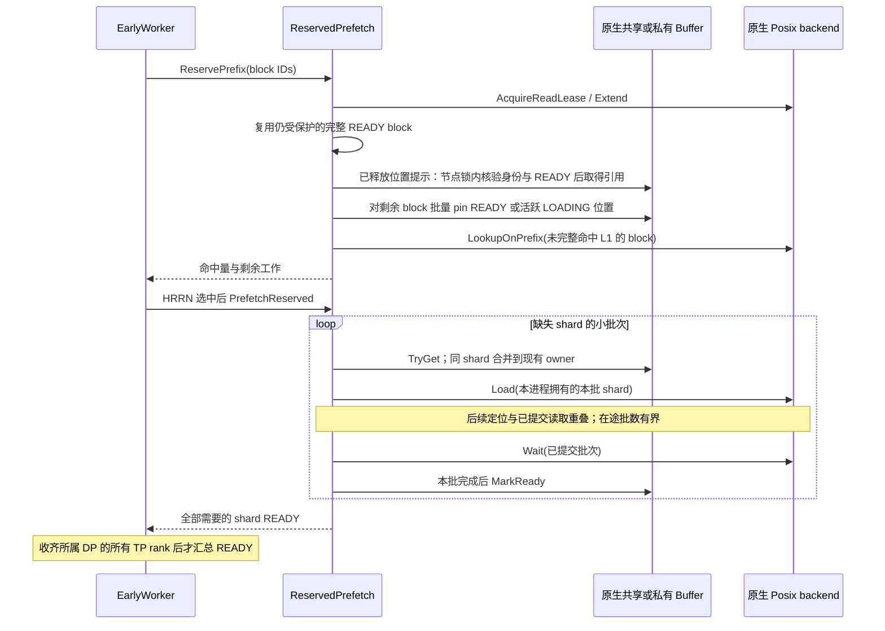
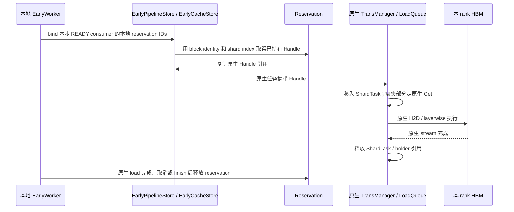

# Early Prefetch：原生加载与引用交接

Early 在 UCM 内提前准备当前可用的 KV。Scheduler 继续使用原生 waiting /
skipped_waiting、block allocation 和 metadata；PENDING 返回 `(None, False)`。
READY 通过保存的 block IDs 和所有 rank 的最小命中结果进入原生 token 计算。
不等待其他请求未来产出，不维护 producer prefix、持久化观察或 revalidation。

## 职责与复用

| 组件 | 职责与关系 |
|---|---|
| EarlyDirectConnector / EarlyLayerWiseConnector | 薄子类；继承原生初始化、metadata、逐层执行和 KV load，只接入请求生命周期与保存结果 |
| EarlyScheduler / EarlyWorker / Control | 请求实例 identity、异步提交、PENDING/READY/FAILED/CANCELLED、Stan HRRN、rank 汇总、handoff 和结束清理 |
| EarlyPipelineStore | 继承原生 builder、load/load_data 参数转换、任务对象和完成检查；组合 `_ReservedLoad` 路由同一个 C++ PipelineStore 的 Load |
| EarlyCacheStore | 继承 CacheStore；使用父类已创建的 BufferManager、TransManager；为原生加载任务附加已有 Handle |
| ReservedPrefetch | reservation、连续命中、工作量快照、受保护 block 引用复用、有界位置提示、分批 L2→L1、worker 内的引用交接 |
| EarlyBufferPins | 对同一个原生 buffer 批量查找；复用原生 Hash、bucket/节点锁和 Handle，不拥有共享状态 |
| PosixReadLease | 使用原生 SpaceLayout 定位 backend，在既有锁文件中保护 block；GC 仍通过原有删除 guard 与读者互斥 |

`_ReservedLoad` 不创建 Store、buffer 或线程。C++ EarlyLoad 绑定调用原生私有
MakeTaskDesc，通过原有 Self 入口及 health wrapper 提交；不复制参数解析。

## Reservation 与可用前缀

候选段从 32 block 开始，连续命中时扩大到 64、128、256 block，随后保持上限。
按段获取 read lease，然后检查该段的 shard。只有全部 shard 已 READY
且持有 pin 的 block 才能直接作为 L1 命中，包括已经不在 L2 的 block。
其余 block 通过原生 LookupOnPrefix 判断当前 L2 可用性；遇到第一个两层均不能
满足的 block 后停止后续候选段。没有当前 KV 的部分由原生推理计算。

Posix lease 的 Extend 继续使用同一 SpaceLayout 与同一组 OFD，避免每段新开 FD。
不支持 Extend 的其他 lease 保持独立 RAII 所有权。追加中途失败时，整个未发布的
reservation 销毁并释放先前及部分追加的保护。锁文件不随请求删除。

EarlyBufferPins 将该段的查询按原生 Hash 分组，同一 bucket 在本批只加锁和遍历
一次。分组数组是临时查询参数，不存储共享 buffer 布局。节点保护、容量限制与
状态判断继续使用原生策略。单 shard 的 Early pin 也由此辅助类提供，原生
TransBuffer 不再含 PinReady 方法；两个 friend 声明保留原成员的 private 属性。

只对没有可复用保护的 block 执行批量查询。完整 READY 的 block 使用共享的
BlockPins 所有权，其原生 Handle 只取得一次；同一 worker 中后来的 reservation
可以共享它，不再逐 shard 查询、加锁或增加节点引用。原生节点仍因该组持有
Handle 而无法被淘汰，直到最后一份 BlockPins 所有权结束。readyBlocks_ 对保护组
只保存弱引用，不延长 pin 生命周期。
此机制只复用当前受保护的 READY block，不等待其他请求产出。
复用时仍调用原生 MarkAccessed 更新 CLOCK 热度。这是对已保护位置的原子访问
标记，不重新查 bucket、拿节点锁或增加节点引用，也不是完全没有逐 shard 内存操作。

上一 reservation 释放后，位置提示可以帮助新的请求跳过共享 bucket 查询。提示仅
保存节点序号，不保存裸指针或 pin；条目数不超过原生节点容量可容纳的 block 数。
使用提示时逐节点取得原生节点锁，在同一个临界区内检查容量范围、block identity、
shard index、READY 状态并取得引用。原生 Alloc 在同一节点锁内改写身份，且不能
回收仍有引用的节点。部分检查失败时 RAII 释放已取得的引用，再走正常批量查询。
这条路径仍有逐 shard 节点锁，只省去 bucket 查找；不能把旧位置本身当作可用结果。
提示按访问次序淘汰元数据，不影响 KV 回收、请求准入或 pin/lease 生命周期。
每个 worker 的提示独立；共享 L1 的权威身份与状态仍来自同一个原生共享 buffer。

批量 pin 可借用具有活跃 owner 的 LOADING 位置，不在 reservation 阶段分配新位置
或接管其 I/O。已经借用的位置在 owner 完成、释放后仍有引用保护，预取阶段无需
再次定位。真正不存在的位置不能作为可信的长期负查询结果：进入数据阶段后，
TryGet 必须重新确认其他 rank 是否已经创建同一 shard，再决定获取或分配。

total_hit_blocks 表示连续总命中；remaining_l2_work 是 reservation 时尚未 READY
的 shard 数，包含其他 owner 的在途工作，不等于本 rank 最终的 SSD 读取字节。
HRRN 保持 `1 + waiting_time / max(remaining_l2_work, 1)`。

当剩余工作为零时不进入数据队列，不调用 PrefetchReserved。零长度 miss 也满足
这个条件，因此分析日志时必须与正长度的 L1 命中分开。

## 分批搬运

仅 owner 提交读取；READY shard 和其他 owner 的在途 shard 不重复读。
局部 Transfer 容器只保存已提交的原生 task handle，不新增 I/O 线程或调度队列。
取消、后续提交失败、准备下一批时抛异常，都先 Wait 回收已接受的任务，再标记
尚未完成的本进程 owner 为 FAILED。此处沿用原生 Wait 返回前回收 I/O 的契约。
共享位置的失败仍会唤醒消费者进入可回退状态。

## 原生加载交接

同一步相同 reservation ID 集合只建立一次 LoadPlan，索引 block 到对应的
reservation 及 block offset；不再为每个候选 reservation 遍历整个 load task。
每次 load 对实际请求的 block 做一次解析，连续 shard 直接复用已选中的组。
计划仅保存弱引用，不持有资源；READY 状态变化、release 或候选集合变化会使
计划失效。交接仍检查本地 reservation 存在、未取消、已 READY、block identity
匹配及 shard 范围合法。另一个消费者持有相同 block 不构成本任务的访问授权。

原生 Handle 的复制通过既有节点引用计数取得保护，避免重新查找共享哈希桶。
加载队列接管该引用，继续使用原生 H2D 与完成清理；已有完整 block reservation
的 shard 无需再执行下一 shard 的 Prealloc。未交接的 shard 完整保留原生路径。
即使 reservation 在任务排队期间释放，任务引用仍保护数据直到传输完成。

所有地址与 Handle 只在持有它们的 worker 内使用。MLA shared L1 的创建/挂接、
unique_id、owner、物理范围和容量，以及非 MLA private L1 的语义均交给原生。
不同 rank 从自己的本地映射取得 Handle，并加载到各自 HBM。

Early 关闭继续选择原生工厂。没有预取结果或 FAILED/CANCELLED 时继续走原生
fallback。vLLM 与 LMCache 不增加 Early 状态机、队列或接口。
