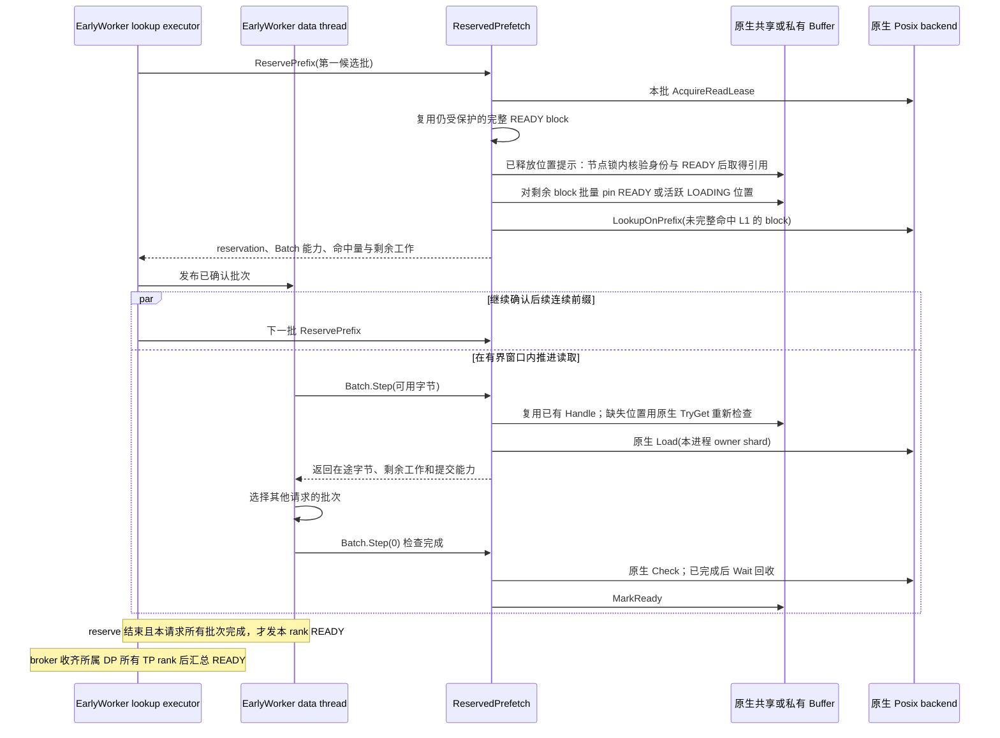
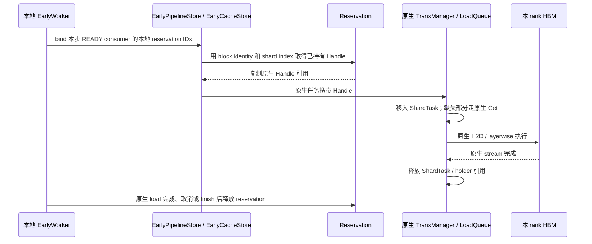

# Early Prefetch：批次流水与原生引用交接

Early 在 UCM 内提前准备当前可用的 KV。Scheduler 继续使用原生 waiting /
skipped_waiting、block allocation 和 metadata；PENDING 返回 `(None, False)`。
READY 通过保存的 block IDs 和所有 rank 的最小命中结果进入原生 token 计算。
不等待其他请求未来产出，不维护 producer prefix、持久化观察或 revalidation。

## 职责与复用

| 组件 | 职责与关系 |
|---|---|
| EarlyDirectConnector / EarlyLayerWiseConnector | 薄子类；继承原生初始化、metadata、逐层执行和 KV load，只接入请求生命周期与保存结果 |
| EarlyScheduler / EarlyWorker / Control | 请求实例 identity、异步提交、PENDING/READY/FAILED/CANCELLED、Stan HRRN、rank 汇总、handoff 和结束清理 |
| EarlyPipelineStore | 继承原生 builder、load/load_data 参数转换、任务对象和完成检查；组合 `_ReservedLoad` 路由同一个 C++ PipelineStore 的 Load |
| EarlyCacheStore | 继承 CacheStore；使用父类已创建的 BufferManager、TransManager；为原生加载任务附加已有 Handle |
| ReservedPrefetch | 每批连续命中、reservation、定位合并、受保护 block 引用复用、有界位置提示和 worker 内的引用交接 |
| ReservedPrefetch::Batch / Early::Batch | Early 专用的有界推进能力；保存原生 task handle，复用同一 backend 的 Load、Check、Wait；不另建 I/O 线程 |
| BoundBatch | Python 能力对象；保持创建它的原生 Pipeline 与 health wrapper 存活，析构前排空已提交 I/O |
| EarlyBufferPins | 对同一个原生 buffer 批量查找；复用原生 Hash、bucket/节点锁和 Handle，不拥有共享状态 |
| PosixReadLease | 使用原生 SpaceLayout 定位 backend，在既有锁文件中保护 block；GC 仍通过原有删除 guard 与读者互斥 |

`_ReservedLoad` 不创建 Store、buffer 或线程。C++ EarlyLoad 绑定调用原生私有
MakeTaskDesc，通过原有 Self 入口及 health wrapper 提交；不复制参数解析。

## Reservation 与可用前缀

候选段从 32 block 开始，连续命中时扩大到 64、128、256 block，随后保持上限。
按段获取 read lease，然后检查该段的 shard。只有全部 shard 已 READY
且持有 pin 的 block 才能直接作为 L1 命中，包括已经不在 L2 的 block。
其余 block 通过原生 LookupOnPrefix 判断当前 L2 可用性；遇到第一个两层均不能
满足的 block 后停止后续候选段。没有当前 KV 的部分由原生推理计算。

每段是独立 reservation，持有本段 lease。一次获取中，同一 backend 只打开一个
锁文件描述符。后段定位与前段读取可以并行，因此不修改已发布 lease；不再需要
Extend 或保存 layout 指针。获取中途失败时，RAII 释放本批已取得的锁，已发布
前批仍有自己的保护。锁文件不随请求删除，实际 GC owner 的 guard 与 unlink
保持同一互斥区间。read lease 不承诺尚未完成的 dump 已经持久化。

EarlyBufferPins 将该段的查询按原生 Hash 分组，同一 bucket 在本批只加锁和遍历
一次。分组数组是临时查询参数，不存储共享 buffer 布局。节点保护、容量限制与
状态判断继续使用原生策略。原生 TransBuffer 不增加 Early 查询方法；既有
friend 声明保留所有原生成员的 private 属性。

同 worker 内，同 block 的并发定位共享短期 ProbeFlight。领导者先完成自身全部
定位并发布结果，再等待其他领导者的结果，避免相反 block 顺序形成等待环。
等待不持有全局或 bucket 锁，沿用已有超时；异常也完成 promise 并唤醒加入者。
这只合并一次当前索引操作，不等待 producer 产生 KV，也不是跨 rank 的位置协议。

只对没有可复用保护的 block 执行批量查询。完整 READY 的 block 使用共享的
BlockPins 所有权，其原生 Handle 只取得一次；同一 worker 中后来的 reservation
可以共享它，不再逐 shard 查询、加锁或增加节点引用。原生节点仍因该组持有
Handle 而无法被淘汰，直到最后一份 BlockPins 所有权结束。readyBlocks_ 对保护组
只保存弱引用，不延长 pin 生命周期。
此机制只复用当前受保护的 READY block，不等待其他请求产出。
复用时仍调用原生 MarkAccessed 更新 CLOCK 热度。这是对已保护位置的原子访问
标记，不重新查 bucket、拿节点锁或增加节点引用，也不是完全没有逐 shard 内存操作。

上一 reservation 释放后，位置提示可以帮助新的请求跳过共享 bucket 查询。提示仅
保存节点序号，不保存裸指针或 pin；条目数不超过原生节点容量可容纳的 block 数。
使用提示时逐节点取得原生节点锁，在同一个临界区内检查容量范围、block identity、
shard index、READY 状态并取得引用。原生 Alloc 在同一节点锁内改写身份，且不能
回收仍有引用的节点。部分检查失败时 RAII 释放已取得的引用，再走正常批量查询。
这条路径仍有逐 shard 节点锁，只省去 bucket 查找；不能把旧位置本身当作可用结果。
提示按访问次序淘汰元数据，不影响 KV 回收、请求准入或 pin/lease 生命周期。
每个 worker 的提示独立；共享 L1 的权威身份与状态仍来自同一个原生共享 buffer。

批量 pin 可借用具有活跃 owner 的 LOADING 位置，不在 reservation 阶段分配新位置
或接管其 I/O。已经借用的位置在 owner 完成、释放后仍有引用保护，预取阶段无需
再次定位。真正不存在的位置不能作为可信的长期负查询结果：进入数据阶段后，
TryGet 必须重新确认其他 rank 是否已经创建同一 shard，再决定获取或分配。

total_hit_blocks 表示连续总命中；remaining_l2_work 是 reservation 时尚未 READY
的 shard 数，包含其他 owner 的在途工作，不等于本 rank 最终的 SSD 读取字节。
HRRN 保持 `1 + waiting_time / max(remaining_l2_work, 1)`。
批次推进时，已完成的本地读取与已观察到的 peer READY 从工作估计中扣除。
尚未观察到的 peer 完成可能仍被计入，因此它是保守估计；实际 SSD 读取另记。

当剩余工作为零时不进入数据队列，不调用 PrefetchReserved。零长度 miss 也满足
这个条件，因此分析日志时必须与正长度的 L1 命中分开。

## 分批搬运

仅 owner 提交读取；READY shard 和其他 owner 的在途 shard 不重复读。
局部 Transfer 容器只保存已提交的原生 task handle。一次 Step 最多定位 64 shard，
窗口仍为 128 shard 的字节数，并由同 worker 的所有在途批次共同使用。健康的
未完成 I/O 不在 Step 内同步 Wait；原生没有完成回调时，数据线程以既有 1 ms
等待节奏调用 Check，不增加 lookup/data 线程或 Posix 并发。

数据队列每请求选取最早的可提交批次。每个有限轮次内，每请求取得一次有界
推进机会；该轮候选按 Stan HRRN 选择前四分之一，完成该轮后才接纳新到候选。
等待完成的批次仍在 active 中回收，不占用提交机会。整请求 PENDING 与全 rank
READY 保持不变；软化门控不属于此设计。

取消后停止新提交，已接受的任务由 Check/Wait 排空，再标记尚未完成的本地 owner
为 FAILED。关闭时数据线程继续排空 active，未发布的 lookup 结果立即释放。
能力对象异常析构也先 Wait；这里沿用原生 Wait 返回前回收 I/O 的契约。
共享位置的失败仍会唤醒消费者进入可回退状态。

## 容量与保护

共享 BlockPins 持有一份字节额度；同 worker 的多个消费者共享该额度，最后一个
释放时返还。额度包含缺失位置，以保守约束将要保护的 buffer。上限来自同一原生
buffer 的 CanReserve 范围，排除原生 load-exclusive 区域；不在 Python 复制布局。
额度不足直接返回原生 NoSpace 并回退，不持有部分 pin 等待额度，避免整请求
READY 语义下发生容量等待死锁。没有新增 H/R 请求数量限制。

此额度是每 worker 的保守预算，不是跨进程物理占用计数。跨 rank 的真实安全性
由原生共享节点引用、CanReserve 与 TryGet 保证。所有批次的 I/O 在途字节受到
另一个 worker 级窗口限制；两种计数不能相加当作实际物理 L1 占用。

## 原生加载交接

同一步相同 reservation ID 集合只建立一次 LoadPlan，索引 block 到对应的
reservation 及 block offset；不再为每个候选 reservation 遍历整个 load task。
每次 load 对实际请求的 block 做一次解析，连续 shard 直接复用已选中的组。
计划仅保存弱引用，不持有资源；READY 状态变化、release 或候选集合变化会使
计划失效，其中 READY/release 仅使包含该 reservation 的计划失效。无关请求
不会触发重建。Release 不扫描整个 READY/hint 表。交接仍检查本地 reservation 存在、未取消、已 READY、block identity
匹配及 shard 范围合法。另一个消费者持有相同 block 不构成本任务的访问授权。

原生 Handle 的复制通过既有节点引用计数取得保护，避免重新查找共享哈希桶。
加载队列接管该引用，继续使用原生 H2D 与完成清理；已有完整 block reservation
的 shard 无需再执行下一 shard 的 Prealloc。未交接的 shard 完整保留原生路径。
即使 reservation 在任务排队期间释放，任务引用仍保护数据直到传输完成。

所有地址与 Handle 只在持有它们的 worker 内使用。MLA shared L1 的创建/挂接、
unique_id、owner、物理范围和容量，以及非 MLA private L1 的语义均交给原生。
不同 rank 从自己的本地映射取得 Handle，并加载到各自 HBM。

Early 关闭继续选择原生工厂。没有预取结果或 FAILED/CANCELLED 时继续走原生
fallback。vLLM 与 LMCache 不增加 Early 状态机、队列或接口。
