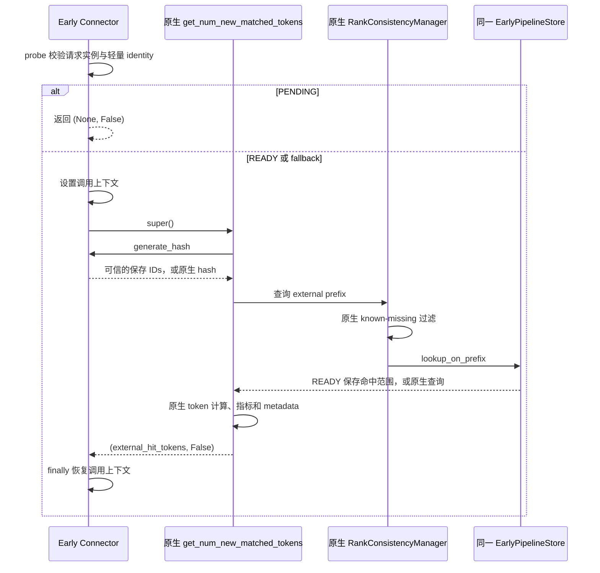

# Early 已准备结果的消费

本文描述 Early 子类如何复用请求的 block IDs 和多 rank 命中结果。后台
reservation、pin、read lease、READY 汇总与 handoff 继续由已有 Early 组件负责。

## 继承与调用边界

`EarlyDirectConnector` 与 `EarlyLayerWiseConnector` 共用 `_EarlyConnectorMixin`，
分别继承原生 Direct 与 LayerWise Connector。它们调用原生
`get_num_new_matched_tokens()` 完成 token 计算、重算尾部、指标与 `RequestMeta`
写入。原生方法及其所属类不增加扩展函数。

Early 在已有的 `generate_hash()` 与 `EarlyPipelineStore.lookup_on_prefix()`
方法上提供覆盖。Store 是原生工厂已经创建的同一实例；结果消费不创建第二个
Store、RankConsistencyManager、backend、buffer、队列或资源保护协议。

## 上下文和命中范围

`LookupContext` 只保存本次调用的 Connector、Request、已校验 Job 和 HBM 命中
hash 数。`ContextVar` 让 Connector 与 Store 在原生调用期间看到同一结果，调用
结束或异常时恢复前一值。它不是第二份请求状态表，也不拥有 pin 或 lease。
后台 hash 线程没有这一调用上下文，继续执行原生 hash。

PENDING 在进入原生方法前返回。READY 使用 `job.blocks`，Store 返回的连续命中
数为 `min(max(job.hit - hbm_hit_hashes, 0), len(filtered_prefix))`；沿用原生
Store 的末个命中下标约定，返回该数量减一。这里 `job.hit` 与 `hbm_hit_hashes`
的单位都是 hash block，原生方法继续完成 CP 换算与 token 计算。

原生 known-missing 过滤可进一步缩短命中前缀；即使该记录已过时，也不绕过该
过滤。它仅扫描保存的 block IDs，不重新扫描 tokens、查询底层 Store 或读取
L2。最终结果不会超出多 rank 已保护的范围。READY 还跳过原生 hotness prefetch
入口，避免再次触发存储操作。

FAILED/CANCELLED 使用原生查询；只要 `probe()` 确认请求实例、token view 和
identity 仍可信，hash IDs 可以复用。无 job 或 identity 已变化时使用原生 hash
与查询。请求 ID 相同不足以复用结果。

## Trace

原生 Config 仍给 `enable_record_traces` 赋值。Early 子类属性保存这个值，仅在
本实例的 token 查询上下文内关闭原生内联 trace；EarlyScheduler 沿用每请求
实例的去重集合，使用保存的配置值记录一次。READY 重试不重新构造 hash 文本。
上下文在 `finally` 中恢复，其他 Connector 和后台线程不受这一临时控制影响。

Early 关闭时，已有工厂选择原生 Connector，以上覆盖不参与执行。
