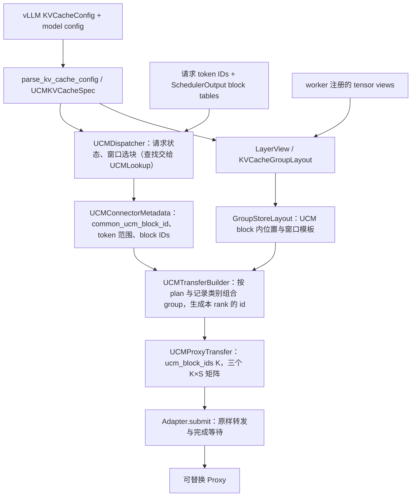

# UCM Connector v2 详细设计

更新时间：2026-10-15。源码基准：`dev_connector` 的 `3c23ec11` 上未提交改动，目录 `ucm/integration/vllm/v2/`。本批仅静态检查，未运行组件/模型测试；历史验收不代表本批。

本文描述当前实现。2026-09-26 增加 layerwise 回调和显式 commit；异步任务边界已接入，当前文件 Proxy 仍同步执行。文中的 UCM block 是一个 ucm_block_id 对应的存储记录，vLLM block 是 KV 池中的物理块，两者不是同一个概念。本文不描述旧版 `ucm/integration/vllm/ucm_connector.py` 的实现。

## 1. 目标与当前状态

v2 将不同模型的 Full Attention、Sliding Window 和 Mamba 状态统一成三类工作：

1. scheduler 根据 UCM block id、缓存命中和 block table，决定恢复或保存哪些窗口。
2. worker 根据已经注册的 tensor views，将窗口转换为源/目标内存地址、长度和 UCM block 内位置。
3. Proxy 按这些字节描述符搬运数据。

当前关键约定：

- 单请求的 ucm_block_ids 按唯一处理。worker 不扫描唯一性，不维护 ucm_block_id 校验缓存，也不对一个 plan 做重复 ucm_block_id 分区。
- 每个非空且有选中数据的 plan 生成一个二维 Transfer；不同请求独立提交。跨请求相同 ucm_block_id 可以对应不同 load 目标，不能丢掉其中一个目标。
- 原生 `Adapter.submit` 原样转发四个字段，不做逐元素校验或 dtype 转换。
- 地址和大小主要用 NumPy 批量计算，但仍有请求、plan、group 级 Python 循环，不等于多核或设备端并行。
- worker 默认使用同步 bulk load/dump；`use_layerwise: true` 启用逐层传输和按层等待，步末等待保存任务并 commit。
- `SimpleFileUCMProxy` 是可替换的开发后端，不是多级存储管理器；存储层的解析策略不决定寻址层设计。

Layout 的对象关系、初始化、view 分段、寻址矩阵与外存模板详见 qyh 文档分支的 [Layout 图文详细设计](https://github.com/qyh111/unified-cache-management/blob/docs/v2-layout/docs/connector-v2-layout-design.md)；HTML、SVG 和生成脚本统一维护在该分支。

## 2. 模块职责与数据流



| 文件/对象 | 负责 | 不负责 |
|---|---|---|
| `ucm_connector.py / UCMConnector` | 对接 vLLM hooks，初始化组件，转发 metadata、错误与完成信息 | 手工解释 head strides 或拼接存储位置 |
| `ucm_scheduler.py / UCMDispatcher` | hash、请求状态、维护 block tables、生成计划（plan 携带 common_ucm_block_id） | Store 访问、local_ucm_block_id、worker 指针 |
| `ucm_lookup.py / UCMLookup` | 按记录类别与分片查询 Store，求恢复终点 | 请求状态、plan |
| `ucm_sharding.py / UCMSharding` | 记录类别、各 rank 的分片键与副本 | id 编码、IO |
| `ucm_block_id.py` | ucm_block_id 编码、写入分工（按 hash） | 拓扑、调度 |
| `layout/kv_cache.py / UCMKVCacheSpec` | group 分类、token 粒度、tail、持久化与恢复规则 | 请求、plan、proxy |
| `layout/kv_cache.py / UCMKVCacheLayout` | 汇总元数据、HBM group layouts、store layouts 和层索引 | 解析 plan、生成 Transfer |
| `layout/__init__.py` | 绑定 worker native spec/descriptor，统一布局入口 | 请求调度 |
| `layout/view.py` | 将逻辑 tensor views 分解为可连续寻址的 segments | ucm_block_id、UCM block 排布 |
| `layout/group.py` | group 物理几何、layers、层选择、vLLM block id 到 segment 起始地址、token→byte 换算 | ucm_block_id 和目标存储位置 |
| `layout/store_layout.py` | 持有 group_layout；每个 group 在 UCM block 中的源 byte offsets、sizes、外存 offsets、合并条件 | 文件格式、异步任务调度 |
| `ucm_kv_cache.py / UCMTransferBuilder` | 关联 plan 与 layouts，生成二维 Transfer | 存储实现细节 |
| `ucm_proxy.py` | Transfer 契约、下发适配、当前文件后端 | scheduler 的窗口语义 |

源码入口：[connector](../ucm/integration/vllm/v2/ucm_connector.py)、[scheduler](../ucm/integration/vllm/v2/ucm_scheduler.py)、[元数据与 Layout](../ucm/integration/vllm/v2/layout/kv_cache.py)、[plan 与 Transfer](../ucm/integration/vllm/v2/ucm_kv_cache.py)、[物理 group](../ucm/integration/vllm/v2/layout/group.py)、[view](../ucm/integration/vllm/v2/layout/view.py)、[store layout](../ucm/integration/vllm/v2/layout/store_layout.py)、[Proxy](../ucm/integration/vllm/v2/ucm_proxy.py)。

## 3. 核心概念与单位

| 名称 | 含义 | 单位/范围 |
|---|---|---|
| `scheduler_block_size` | vLLM `resolve_kv_cache_block_sizes` 返回的 scheduler 粒度 | tokens，不直接照抄原始配置值 |
| `ucm_cache_block_size`，下称 U | 一个 UCM block 覆盖的 token 数；一个 FA ucm_block_id 的 token 范围 | tokens |
| `group.token_block_size`，下称 T | 该 group 一个物理 block ID 覆盖的 token 数 | tokens |
| `storage_block_size` | 一个 layer 的逻辑 block 实际包含多少 stored states | states，压缩缓存不等于 tokens |
| `tail_tokens` | WA 在一个边界保存的尾部范围 | tokens |
| `tail_blocks`，下称 R | 一个 ucm_block_id 在一个 group 中涉及的物理块数 | FA 为 ceil(U/T)，WA 为 ceil(tail/T)，State 为 1 |
| `layer_name` | vLLM 注册的一个缓存名字 | 同一个模型层可能有 attention/indexer/state 等多个名字 |
| `layer_id` | 模型层编号 | 一个编号可关联多个名字和多个 group |
| component view | 一个已注册的 tensor 逻辑视图 | 不意味着一块独立物理分配 |
| `MemorySegment` | 一个逻辑 block 内可按连续 state/token 范围寻址的字节段 | 一个 view 可以有多个 segments |
| `block_byte_offsets` | 从源 block 内 segment 起点跳过的字节数 | 源内存偏移 |
| `group_block_offsets` | 完整 vLLM block 的各 segment 在 group 内的目标排布 | bytes |
| `ucm_block_offsets` | 某个 ucm_block_id 的各段在 UCM block 中的位置 | bytes；group 模板内先相对 group，最终加 group 基址 |
| `store_bytes` | 一个 ucm_block_id 中某个 group 窗口占用的总空间 | bytes，选择部分层不会改变它 |

区分两类重复：不同 UCM ucm_block_ids 可以引用同一个物理 block 的不同 token 范围；这不等于同一请求出现重复 ucm_block_id。

## 4. 初始化与配置解析

### 4.1 Connector 初始化

`UCMConnector.__init__`：

1. 通过共用的 `ucm.utils.Config` 读取启动配置，支持已有配置文件/输入形式。
2. 调用 vLLM 的 `resolve_kv_cache_block_sizes` 获取解析后的 scheduler 粒度。
3. 建立运行上下文：role、device_type、rank、world_size、engine_id。
4. 从模型配置读取压缩比与层数，补足 scheduler representative spec 可能丢失的 DSV4 逐层信息。
5. 解析 `UCMKVCacheSpec`。scheduler 与 worker 使用相同语义规则。
6. 建立当前文件 Proxy 和 Adapter；仅 scheduler 建立 `UCMDispatcher`。
7. worker 在 `register_kv_caches` 收到实际 views 后，才建立物理 layout 与 record templates，并向 Proxy 注册 storage。

Store 只接收 ucm_block_id，connector 不向 Store 传任何路径或 namespace；每个进程只建一套 Proxy。会改变记录字节的配置（device、model dtype、schema digest、scheduler/U 块大小、并行拓扑、layerwise、id 版本 `UCM_BLOCK_ID_VERSION`）拼成 namespace 折进哈希种子：`base_seed = hasher(("UCM_HASH_SEED", namespace))`；rank 编在 ucm_block_id 的 tag 里（见 5.1）。

测试用 `test_file` Store 的目录只来自它自己的 `path` 配置；默认配置时取 `v2_storage_path`，否则取唯一 `ucm_connectors` 配置项 `storage_backends` 的第一个路径。多个 `test_file` Store 不能配置相同 `path`。

### 4.2 公共元数据与 worker 绑定

`parse_kv_cache_config` 只解析逻辑元数据，返回 `UCMKVCacheSpec` 与 `UCMKVCacheGroupInfo`。公共 spec 拥有 `ucm_cache_block_size`，每个 group 的 `tail_blocks` 记录一个 UCM block 引用的 vLLM block 数，不含 tensor 指针。要存的 group 取原生 prefix_cacheable_group_ids；其余是 transient group，保留原生 ID，`tail_blocks` 为 0。持久项只允许已支持的 FA/MLA/Sink、SWA 与 align State；其他语义明确拒绝。

- 将 group 的统一或逐层 spec 展开为 `UCMLayerSpec`，分类 attention/sliding/state。
- 官方 0.29 的 `KVCacheTensor.layers/offset/layer_stride/block_stride` 转成 `TensorDescriptor`；旧 Ascend 入口没有相同声明时以实际 views 为依据。
- Ascend attention 的 `compress_ratio` 与官方 0.29 的 `tokens_per_state` 归一为 token/state 关系。不能仅看 shape 推导业务上的 token 跨度。
- 根据名字提取模型层编号；Longcat 按原生 `num_attn_module=2` 编号，Ascend MTP 局部编号按模型层数调整。
- 不支持的 spec（chunked local、cross、encoder-only、UNKNOWN）明确拒绝，Sink Full Attention 明确允许。
- Mamba 当前要求 `mamba_cache_mode='align'`。只有 State 的模型没有 FA 前缀，可以从任意完整块恢复。
- 普通 `swa_cache` 的 tail 使用整个 window；压缩状态的 tail 使用 window 减对应层的 attention 压缩比。tail 为零的 group 不进入 WA 存储路由。

U 默认等于 vLLM 的 scheduler 粒度，即各 group 块大小的最小公倍数（DCP 下已乘 dcp）。配置了 `ucm_cache_block_size` 时使用配置值，并打一条 INFO 日志。DeepSeek V4 这类块很大的模型，可以调小 vLLM 的 block size 控制命中粒度（例如 Ascend 上 block size 32 时为 4K tokens）；也可以把 `ucm_cache_block_size` 配得比 FA 块小，一个 vLLM block 拆成多个 UCM block 存储（FA 子块，见 8.2）。

整除约束（解析配置时检查）：
- FA group：T 整除 U（一个 UCM block 含整数个 vLLM block），或 U 整除 T 且 U 是该 group 每个 state 覆盖 token 数（`tokens_per_state`）的整数倍（FA 子块）。
- State 与 tail 非零的 WA group：T 必须整除 U。

要存哪些 group 直接取 vLLM 的 `KVCacheConfig.prefix_cacheable_group_ids`，其余是 transient group（scratch ring、开启有限回放的滑窗等），不存，也不限制 U；scratch 怎么重建由引擎负责。

FA 子块的其他限制：
- 物理布局必须 token 连续。多头 HNC 按 head 排列，注册 KV cache 时报错。
- 不支持 DCP，`apply_context_parallel` 会拒绝。DeepSeek V4 本身也不支持 DCP。
- DeepSeek V4.1 开启 SWA 有限回放时，vLLM 会把外部命中向下取整到 scheduler 粒度，子块不会带来更细的命中，启动时打 warning。

scheduler 的 `groups_by_attention_type(spec)` 按 AttentionType（FA → WA → State）分组，只保留非空类别。WA 只包含 tail>0 的 group。plan.vllm_block_ids_by_group 的位置必须与该分组的 group 顺序一致。

## 5. Hash、lookup 与 scheduler 计划

### 5.1 Hash 与 ucm_block_id

`RequestHasher` 在 MD5 输入中加入 model 名称末段、TP size、model dtype、rank 参数、speculative 配置和 sparse 开关。token ID 先转 Python int，避免 NumPy 标量改变序列化结果。

```text
parent_0       = hasher("UCM_HASH_SEED")
parent_i       = hasher((parent_(i-1), 当前 U 个 token 的 tuple))
ucm_block_id_i = parent_i[:12] + 4 字节 tag(attention type, 记录类别, 分片键)
```

不足 U 个 token 的尾部不产生 block hash。scheduler 把每个 block hash 截成前 12 字节，叫 common_ucm_block_id，所有 rank 相同；plan 只携带 common_ucm_block_id。local_ucm_block_id 是 common_ucm_block_id 直接拼上 4 字节 tag，只在访问 Store 处生成：`UCMLookup` 为每个记录类别、每个分片生成，worker 的 `UCMTransferBuilder` 为本 rank 的分片生成。Store 只看到 local_ucm_block_id。

id 编码只在 `ucm_block_id.py` 内部，其他模块只调用 `make_common_ucm_block_ids(block_hashes)` 和 `make_local_ucm_block_ids(common_ucm_block_ids, attention_type, record_class, shard_key)`，看不到 tag 与位布局。`make_local_ucm_block_ids` 要求输入正好 12 字节，传入 local id 会报错。tag 当前为 `type(2) | record_class(4) | pp(5) | head(6) | token(7) | reserved(8)`；启动时由 `validate_shard_key_encoding` 检查拓扑能否编码，超出直接报错。id 格式版本 `UCM_BLOCK_ID_VERSION` 是 namespace 的一部分并哈希进 block hash，不同版本的 id 不会冲突；改 id 或记录格式时递增。

单请求 ucm_block_ids 唯一是当前输入契约，不另做运行时碰撞检测。跨请求共享前缀可拥有相同 ucm_block_ids，仍使用各自 block tables。

### 5.2 Lookup

`lookup` 建立/更新 `RequestState`，保存 HBM 命中、external 命中、已处理边界、common_ucm_block_ids、各 group block tables 和 `load_pending`。查找本身由 `UCMLookup` 完成：某 attention type 的一个 block 命中，要求该类型每个记录类别的每个分片都已提交；FA 的连续前缀按分片拆开算：对每个 (记录类别, 分片) 调用 `lookup_on_prefix`（Store 查到第一个不命中就返回），取最短的前缀，后面的分片只扫到当前最短前缀为止。WA/State 对每个 (记录类别, 分片) 调用 `lookup_on_reverse`（Store 从后往前查到第一个命中就返回），取最早的那个最近命中；后面的分片只扫到这个位置以下。Store 协议提供 `lookup_on_prefix` / `lookup_on_reverse`，`PipelineProxy` 直接转给 Store，`ParallelProxy` 按 id 原始顺序切成连续的同 Store 段，正序逐段查前缀、倒序逐段查最近命中。

- 查找上界：`floor((num_tokens - recompute_tokens)/U)`，默认保留一个 token 重算余量。
- FA 调 `lookup_on_prefix`：Store 返回最后一个连续命中 ucm_block_id 的相对下标，`-1` 表示无命中；`UCMLookup` 内部把它换算成命中范围的结束块号（不含），后面的计算只用块号。
- WA/State 在 FA 可恢复范围内找所有边界类型、所有分片都命中的最右块。
- 恢复终点从 FA 终点开始：取所有边界类型、所有分片最近命中中最早的那个，收缩终点后再查一轮，直到每个分片最近命中的都是同一块；任一分片无命中则不恢复。
- external 命中量不超过 `load_tokens_threshold` 时抑制本次 load。

边界说明：各分片缺失的位置不一致时，“各自最近命中的最小值”本身不保证是共同命中，所以算法会在收缩后的范围内再查一轮，只有所有分片最近命中的都是同一块才结束，结束时这一块被所有分片共同命中。

### 5.3 Block table 与 metadata

`build_from_scheduler_output` 从 0.30 的 kv_connector_block_state.get_block_ids 每步替换完整 group block tables；State dump 仅使用 boundary_state_offloads 的精确交接。`update_state_after_alloc` 不重复维护表。

```python
UCMGroupDispatchPlan(
    attention_type=AttentionType.FA | AttentionType.WA | AttentionType.STATE,
    common_ucm_block_ids=tuple[bytes, ...],
    token_start=int,
    token_end=int,
    vllm_block_ids_by_group=tuple[np.ndarray, ...],
)
```

`vllm_block_ids_by_group[g]` 是 uint64 一维数组，逻辑上为 `[K,R_g]` 后展平；每个 ucm_block_id 的窗口按老块到新块排列。传递的是 vLLM block ids，不是虚拟地址。`RequestDispatchMeta` 分别持有 load/dump plans，`UCMConnectorMetadata` 再按 request_id 组织，并携带 preempted/finished IDs。

每步 `_request_meta`：

- 有待加载且本步有 scheduled tokens 时，产生 HBM 终点到 external 终点的 load plans，并清除 `load_pending`。
- dump 区间从 `token_processed` 到本步处理终点，终点不超过 lookup 时记录的 token 数。
- 生成计划后推进 `token_processed`；finished/preempted 请求移出 dispatcher 状态表。

### 5.4 选 ucm_block_id 与选 block

对于区间 `[token_start, token_end)`：`first=floor(token_start/U)`，`last=floor(token_end/U)`。若 last<=first，无完整新边界，不生成 plan。

| 类别 | ucm_block_ids | 每个 ucm_block_id 保存的窗口 |
|---|---|---|
| FA | `[first,last)` 中所有 ucm_block_ids | ucm_block_id 覆盖的 U tokens |
| WA | 仅 `last-1` | `last*U` 边界之前各 group 的 tail |
| State load | 仅恢复边界 key | CUDA 导入边界与运行槽，Ascend 后续 copy 的源边界槽 |
| State dump | 精确 offload 给出的完整边界 keys | 交接指定的完整状态页，过滤初次命中前缀中的快照 |

WA 若边界小于该路由最大的 tail，跳过整个 plan，避免负下标与不完整记录。

选块公式：FA ucm_block_id k 的末 token 为 `(k+1)*U-1`；WA 使用最新边界 `last*U-1`。State 使用平台的加载目标或精确保存的交接点，不按普通 tail 表推断。除以 T 得到 block table 的逻辑位置，从该位置向前取 R 个 entries，转换为物理 block IDs。只将实际窗口覆盖的 table 子区间转成 ndarray，避免小 WA 窗口扫描整张长表。

## 6. 物理 view：shape、stride 与 segment

### 6.1 对象关系

```text
KVCacheGroupLayout
  layer_views[layer_name] -> LayerView
    components -> ComponentView × 1..n
      shape / strides
      segments -> MemorySegment × 1..n
```

这里的 component 是逻辑 view，多个 components 可以共享同一个 storage。`LayerView` 不分配 KV 内存；`tensor.data_ptr()` 已包含该 view 的 storage offset，不能再加一遍。

`MemorySegment` 保存 block-0 基址、block 字节步长、每块 state 数、每 state 字节数和完整 payload 字节数。segment 的基址可以是某个 head 的起点，不一定是整个 tensor 的起点。

### 6.2 vLLM 0.30 的布局解释

官方 0.30 的逻辑轴固定为整体 `[L,B,H,N,C]`、单层 `[B,H,N,C]`；物理布局枚举描述轴在内存中的顺序。N 对压缩 attention 可以是 stored states，而非原始 tokens。

例如无 padding、单层 shape `[4,2,8,16]`：

| 物理布局 | 单层逻辑 shape | 元素 stride |
|---|---|---|
| LBNHC | `[4,2,8,16]` | `[256,16,32,1]` |
| LBHNC | `[4,2,8,16]` | `[256,128,16,1]` |

两者都用 `view[b,h,n,c]`，地址均为 `data_ptr + element_size*(b*sB+h*sH+n*sN+c*sC)`，变化的是 sH/sN。layout 选定后，vLLM 用 `compute_layout_strides` 和 `torch.as_strided` 建立 view；创建 view 不搬运数据，后续内核按支持的布局读写。

因此 `token_axis=2, head_axis=1` 描述官方 0.30 view 的逻辑 ABI，不代表物理布局只能是 LBHNC。Ascend 普通 GQA 在 LBHNC/HND 下采用 BHNC，其余为 BNHC；MLA/SFA 采用 BNHC，cache-only/HiddenState 采用 BHNC。入口显式绑定并归一化，不靠 shape 猜测。

### 6.3 为什么一个 view 会拆成多个 ptrs

- NHC 连续：一个 token 的所有 heads 连续，可把一个 view 当作一个 segment。
- HNC 连续：完整 block 保留连续 span；多 head 的部分 token 访问明确拒绝，不临时按 head 拆片。
- LHBNC/BHLNC：head 之间还可能夹其他 block/layer；同样使用真实 head stride 计算各 segment 基址。
- 当前要求 channels 连续、strides 为正。多个 kernel rows 可以在密集排列时折算成一个逻辑块；分离 heads 支持按 row/head 展开并合并物理相邻段，但只接受完整 block。
- Mamba/State 不按 token 切片。匹配 spec 的 components 或支持的原始字节页形式按整页解析，保留必要的 page stride/padding 语义。

整个 block 的字节连续，不代表该 block 中任意 token 子区间也连续；这是必须区分 view 与 segment 的原因。

## 7. HBM 求址与 Store 范围模板

KVCacheGroupLayout 按 `(layer_index, layer_name)` 排序，并把实际 components/segments 展开为 base_ptrs、block_strides、states_per_block、payload_bytes 几何列。它不接收 group 信息，不知道 `ucm_cache_block_size`、tail 或重复窗口。

```python
mask = group_layout.segment_mask(layer_ids=[7])
bases = group_layout.resolve_ptrs(vllm_block_ids, segment_mask=mask)
# bases[b,j] = base_ptr[j] + vllm_block_id[b] * block_stride[j]
offsets, ptrs, sizes = store_layout.resolve_matrices(
    vllm_block_ids, token_starts,
    segment_mask=mask,
)
```

GroupLayout 的 layers 保存逐层声明，layer_views 保存实际物理视图；vLLM block id 信任引擎的计划，不逐批扫描范围。GroupStoreLayout 持有 group 信息与 group_layout，依据 group.tail_blocks 编译 `[window block, segment]` 的源 byte offsets/sizes 和外存 offsets。运行时组织为 `[UCM block, window block, segment]`，添加固定/动态偏移，再展平为二维 IO 矩阵。HBM 中不再有 BlockAccess/compile_access。

HBM 的 `tokens_to_bytes` 直接计算 `bytes_j(t) = t * payload_j // T`，先乘后整除，不经过 stored states；逻辑 span T 由 Store 传入。Store 在初始化编译固定范围时检查完整 entry 对齐及整组部分访问能力，states_per_block 只用于该检查，删除无其他用途的 state_strides。UCM block 的起点都是 k×U，继承初始化确认的对齐，不在运行时重复验证。全部组件的部分访问能力取 all；按层选择不绕过整组限制。

starts/counts 在 build 内由 block span 和余数直接构造，范围与正长度由构造保证，删除 _compile_ranges 包装及其重复检查；仅部分块检查整组切片能力与完整 entry 对齐。transfer builder 算出的起点都是 k×U，初始化保证 U 与 T 互相整除：U<T 时块内起点最大为 T-U、长度为 U，U>=T 时起点余数为0，因此运行时不重复检查动态 payload 边界。SWA 使用已验证的固定 tail 模板；State 要求 T 整除 U。HBM 不重复检查引擎给出的 block ID 范围；所有模板在初始化编好，运行时不重复编译 sizes。ptrs 是本次独立数组。

必须整除，不能切半个压缩 state。相同转换用于 start 的跳过字节和 count 的长度。

### 7.2 运行时解引用

对于窗口行 r、输入 block b、segment j：

```text
ptr[b,j] = base_ptr[j]
         + vllm_block_id[b] * block_stride[j]
         + fixed_byte_offset[r,j]
         + bytes_j(token_start[b] % T)   # 仅 FA 子块
size[b,j] = compiled_segment_bytes[r,j]
```

HBM 层（`KVCacheGroupLayout`）只计算 `base_ptr + vllm_block_id * block_stride` 和 token→byte 换算；固定范围和 FA 子块的块内偏移由 `GroupStoreLayout` 添加。代码先选择列，再批量生成地址；没有长期缓存所有 block 的 ptrs。

部分 token 能力和 state 对齐在 Store 初始化编译固定范围时检查。运行时不再检查 vLLM block id 是否越界，信任引擎给出的计划；Adapter 仍检查 UCM block id 的长度。

Ascend 组件可能是独立 K/V 或去 padding 的实际 view，不能要求其 stride 等于原始整页 descriptor；CUDA/CPU 保留原生 descriptor 对应校验。Ascend typed State 从稠密物理 payload 零拷贝归一化为 byte page，支持 dense permutation 并保留 storage offset/block stride。

## 8. UCM block 排布与块内切片

`GroupStoreLayout` 将物理 segment 映射到一个 ucm_block_id 对应的存储位置，物理 group 不需要理解存储 offsets。

```text
一个 FA ucm_block_id -> 一个 UCM block
  group 0
    window block 0（最老）
      layer 0 / component / segment ...
      layer 1 / component / segment ...
    window block 1
      layer 0 / component / segment ...
      layer 1 / component / segment ...
  group 1
    window block 0
      ...
```

WA/State 使用各自路由的 groups 和窗口，不混进 FA ucm_block_id 中。通用模板始终按 segment 有效 payload 紧凑累加，layerwise 使用此模板。仅 use_layerwise=False、完整块且已有 BlockFirstView 时，单独使用 offset0/整组 span 的 bulk 路径，保留 padding。

### 8.1 三种 FA 关系

| 关系 | R | 块内起点 | 长度 |
|---|---:|---|---|
| U=T | 1 | 0 | 完整块 |
| U>T，T 整除 U | U/T | 各块为 0 | 多个完整块 |
| U<T，U 整除 T（FA 子块） | 1 | `(key_index*U) % T` | 固定 U tokens |

WA 的第一块可能是部分块：count=`tail%T`，start=`T-count`；其余块完整。余数为零时所有块完整。State 一页不可拆。

长度在初始化时编译成固定模板。只有 FA 子块在运行时改变块内起点：transfer builder 由 plan 的 `token_start` 和行号算出每个 UCM block 的起始 token，Store 用 `token_start % T` 得到块内偏移，广播到这个 UCM block 的各个 vLLM block。SWA 保留固定 tail 模板。

### 8.2 数字例子：16384-token block 切成 512-token UCM blocks

配置 `ucm_cache_block_size=512`，vLLM 的 FA block 为 16384 tokens。假设一个 group 有两层，每层每 token 4 bytes，两个 layer 的 block-0 基址分别为 1,000,000 和 2,000,000，每块步长为 65,536 bytes。两个不同 ucm_block_ids 引用物理 block 2 的相邻片段：

```text
ucm_block_ids       = [A, B]
block_ids  = [2, 2]
starts     = [0, 512]           # tokens
count      = 512               # tokens，固定

ptrs = [[1131072, 2131072],
        [1133120, 2133120]]
sizes = [[2048, 2048],
         [2048, 2048]]
ucm_block_offsets = [[0, 2048],
                     [0, 2048]]
```

选择第二层后只保留第二列，offset 仍为 2048，不重新变成零。逻辑 block ID 取决于 vLLM 分配，不必等于 key_index。

### 8.3 Block First 合并

CUDA/CPU 仅在 resolved BLHNC/BLNHC 下探测本组 Block First；NPU 跳过。原生 descriptor 必须存在，满足 `0<layer_stride<block_stride`，且本组 block_stride 相同；信任 native allocator，不重复验证 descriptor 首尾相接与逐层地址。

store 模板仅在 `use_layerwise=False`、BlockFirstView 存在且覆盖完整块时选择 offset0/整组 span 路径，包含组内 padding，State 同样适用。layerwise 与部分块保留有效 payload 的通用紧凑模板。实际按层筛选仍使用 segments，不能把 bulk 的源地址相对偏移误当成 layerwise 存储模板。

## 9. Transfer 构造与 Proxy 边界

### 9.1 二维契约

```python
@dataclass(frozen=True)
class UCMProxyTransfer:
    ucm_block_ids: tuple[bytes, ...]         # [K]，plan 内唯一
    ptrs: np.ndarray               # uint64 [K,S]
    sizes: np.ndarray              # uint64 [K,S]，字节数
    ucm_block_offsets: np.ndarray  # uint64 [K,S]，完整 UCM block 内字节偏移
```

S 是这次选择后每个 ucm_block_id 的搬运段数，不一定等于层数。一般为各参与 group 的 `R_g * selected_segments_g` 之和；合并整块时该 group 可降为 R_g。

对第 k 行第 s 列：

```text
dump：从 ptrs[k,s] 读 sizes[k,s] 字节，写到 ucm_block_id[k] 的 ucm_block_offsets[k,s]
load：从 ucm_block_id[k] 的该位置读相同字节数，写入 ptrs[k,s]
```

### 9.2 构造流程

`build_load_transfers` / `build_dump_transfers` → `_build_transfers` → `_iter_class_segments`（位于外部 UCMTransferBuilder）：

1. 遍历请求的各 plans，根据 attention_type 找参与的 groups。
2. 对每个 group 归一化 vLLM block id dtype，按 K×R 交给 Store。
3. 根据 layer_name 或 layer_id 选择 segments；算出每个 UCM block 的起始 token 交给 Store，FA 子块用它确定块内偏移。
4. `resolve_matrices` 返回该 group 的 `[K,S_g]` offsets/ptrs/sizes。
5. offsets 加上前面 groups 的完整 store_bytes；即使某个 group 没有选中层，其空间也不能被压掉。
6. group 列合并；单 group 直接使用结果，多 group ptrs concatenate，sizes/offsets 拼接一行模板再广播。
7. 直接关联 `plan.ucm_block_ids` 生成 Transfer。不同 plan 分开，不 padding、不跨请求去重。

`layer_name` 只选一个注册名字；`layer_id` 选择该模型层在所有 groups 中的相关名字。两者不能同时传。Store 编译整组范围模板，运行时 segment_mask 可以选择多层；高层 Transfer builder 当前只接收单个 layer_id。

### 9.3 数组所有权

- ptrs 为本次计算产生的独立数组；不在下一次 dispatch 中覆盖复用。
- sizes/offsets 从本次调用独立的一维 backing broadcast 到 `[K,S]`，通常第一维 stride=0、只读、不连续；不要求每个 ucm_block_id 复制同一行。
- 后端必须接受这些数组，不修改它们，不假定 C-contiguous。
- frozen dataclass 不代表 NumPy 数据完全不可变。当前每次模板 backing 独立，避免调用者修改某次 backing 污染编译模板或其他批次。
- 描述符的存活与 KV 源内存的在途保护是两件事；异步化必须同时处理，不能只保留 ptrs 数组。

### 9.4 下发与替换 Proxy

```python
for transfer in transfer_builder.build_load_transfers(metadata, layer_id=7):
    adapter.submit("load", transfer)

# 实际后端参数顺序：
proxy.load(transfer.ucm_block_ids, transfer.ucm_block_offsets,
           transfer.ptrs, transfer.sizes)
```

`submit` 仅选择 load/dump、跳过空 ucm_block_ids、原样调用、处理返回 task 和异常。它不检查 shape/dtype/非零/溢出/重复 ucm_block_ids，不创建 ndarray 副本。构造层拥有描述符契约。

后端返回 None 表示本次调用完成；返回 handle 时，Adapter 的 `enqueue` 保存 handle 和 Transfer，worker 在对应层回调或步末调用 `wait`。bulk 使用 `submit`，仍立即等待。任务不跨调度步；真实计算/IO 重叠还取决于后端设备同步实现，需要实机验证。

旧 UCMProxyBatch、batch builder 和四参数 flat adapter 已删除。worker、model-check 与 NPU probe 共用二维 Transfer；测试中的地址断言在测试侧展开矩阵，不再保留单独的生产兼容路径。

## 10. Worker 生命周期和错误处理

| hook | 当前行为 |
|---|---|
| `register_kv_caches` | 建 layout，注册 tensor storage |
| `start_load_kv` | bulk 同步加载；layerwise 按请求、模型层提交加载，状态层在返回前等待 |
| `wait_for_layer_load` | layerwise 等待对应 layer_id 的加载，包含同层 indexer 等缓存；重复回调不重复等待 |
| `save_kv_layer` | layerwise 只保存当前 layer_name，避免同层其他缓存尚未计算完成；同一步重复回调跳过 |
| `wait_for_save` | layerwise 补存未触发回调的缓存，等待全部保存任务后 commit；bulk 完整 dump 后 commit |
| `build_connector_worker_meta` | 回报并清空 load_failed_reqs |
| `get_block_ids_with_load_errors` | 回报并清空无效 block IDs |
| `update_connector_output` | scheduler 删除失败请求的 dispatcher 状态 |
| `handle_preemptions` | 空操作；所有任务必须在本步 wait_for_save 返回前完成 |
| `request_finished_all_groups` | 返回 `(False,None)`，不额外保留 blocks |

load 中的 `UCMProxyError` 按请求捕获，标记该请求相关 plan 的 blocks 无效，走 vLLM 的失败回报渠道，不立即从该 hook 抛出。构造阶段异常不在这个 Proxy 错误捕获范围内。dump 失败继续向上传播。

当前 `SimpleFileUCMProxy`：一个 ucm_block_id 一个 `.ucm` 文件。`dump` 按 UCM block offset 累积写入该 ucm_block_id 的私有 `.tmp` 文件；`commit(ucm_block_ids)` 将指定 ucm_block_id 的临时文件 rename 为可见文件。完整性由调用方保证，发布按 ucm_block_id 原子执行。Adapter 的 `enqueue` 返回持有 Transfer 和后端 handle 的任务，`wait` 等待完成；`submit` 保留同步语义，commit 也等待完成。`TorchTensorByteAccess` 负责注册 storage、将裸地址转成 torch byte view 和同步设备。

layerwise 在 start_load 提交本步所有层加载，不是只预取下一层；因此异步 Proxy 下描述符峰值覆盖所有在途加载。逐层 wait 后释放该层任务。保存提交或等待失败时，会等待其余已提交保存任务，然后抛出错误，不 commit；加载失败按请求上报，并排除该请求的后续保存和发布。重复 wait_for_save 不重复提交已完成的本步。

未触发 save 回调的缓存在步末补存，要求其内容持续有效到 forward 结束；跨层复用物理缓冲区的专用后端需额外接入生产者/消费者同步，当前没有声称支持该场景。Proxy 必须保证异步搬运与设备计算之间的依赖，当前同步文件后端通过设备同步满足这一点。

layerwise 只传输有效 payload，不复制 Block First 的 slot padding。文件缓存使用独立的 `-layerwise` namespace，暂不与 bulk 文件互用。model-check 沿用原来的实际引擎、tensor 分配和 Scheduler 路径；layerwise 下改为按 layer_name 的 payload 填充/比对，bulk 仍比较完整 span。该检查仍共用 UCM 的寻址逻辑，不是完全独立的地址 oracle。

### 10.1 同拓扑并行分片与副本

`ParallelLayout` 负责 TP/PP/PCP/DCP 参数与 CP 逻辑页换算；world size 为 TP×PP×PCP。vLLM 给出的 `spec.block_size` 是每个 rank 的物理块大小；块覆盖的 token 数由 `resolve_dcp_kv_block_size` 换算，只有 `dcp_sharded` 的 cache 乘 DCP。UCM 的 `apply_context_parallel` 与之一致，只放大 `dcp_sharded` group 的块大小。PCP 只切分 prefill 计算，不切 KV。DCP 合法取值与 vLLM 一致：PCP=1 时为 TP 子组，PCP>1 时为 1、PCP 或 TP×PCP。

所有 rank 共用一套 Proxy/Store，`UCMSharding` 决定记录如何划分：

- 每个 group 的切分方式来自 spec：`max_tp_shards`（TP 上的不同副本数，MLA 为 1）与 `dcp_sharded`（是否按 DCP 切 token）；Ascend MLA 规格缺 `max_tp_shards` 时按 1；Ascend 的 replicated SFA indexer 和 MLA 在同一个 group，随 group 按 DCP 切分，所以每个 DCP 分片都会存一份完整的 indexer（已知冗余，暂不处理）；Mamba/KDA state 的 `dcp_sharded` 为 False，不切 DCP；`tp_replicated=True` 的 state 每个 TP rank 都存整份，按 1 个分片处理，否则按 TP 切。spec 未声明时按每个 TP rank 都不同处理，不会丢数据。
- 记录类别：同一 attention type 内切分方式相同的 group 合成一条记录，不同的分开（例如开 DCP 时 MLA 主 cache 与 DCP 复制的 indexer）。同一 KV cache group 内成员切分不同（GLM-5.3 的 MLA 主 cache 与 indexer 同组）时取最细切分，较粗成员在每个分片里各存一份，是已知的剩余冗余。
- 分片键 `(head, token, pp)`：head = `tp_rank × tp_shards / TP`，token = 按 vLLM 规则算出的 dcp_rank（不切 DCP 时为 0）。分片键相同的 rank 互为副本，例如 MLA 在 TP 上、只开 PCP 时的各 PCP rank。
- 写入：副本按 common_ucm_block_id 分工（`writer_rows`），每个 block 只由一个副本写一次；connector 用 `_owned_rows` 选出本 rank 负责的行，transfer builder 只为这些行生成矩阵，commit/abort 也只针对这些行。读取：所有副本按同一个分片 id 读同一条记录。
- PP 某 stage 没有某记录类别的 group 时，由负责写入的副本提交零字节标记，使 lookup 只需"每个分片都已提交"。

只支持相同拓扑恢复，不支持 reshard。CP 暂限 FA 整页，PCP 无当前引擎运行时证据。详见 [并行设计与验证](connector-v2-parallel-validation-20260926.md)。

## 11. 性能模型与当前优化

初始化成本包括解析 views/segments、编译范围、建立 record 模板。每次构造主要分配 K×S 的 ptrs，做 broadcast 算术和必要的列合并。固定 sizes/offsets 保持小模板；源范围与 block IDs 的检查仍会读取相应数组。

已经实现：

- 不展开重复的 segment-to-ucm_block_id 列表，ucm_block_ids 只保存 K 个。
- 先筛层再计算地址，不缓存全层 ptrs 后取子集。
- 单 group 避免多余 concatenate，固定 offsets/sizes 广播。
- 移除 Adapter 字段扫描、归一化和 ucm_block_id 缓存。
- 移除构造层单请求 ucm_block_ids 唯一性扫描、缓存及重复分区。

尚未实现：多 group 直接写入同一最终 ptr buffer、真实异步重叠、C++/设备侧地址生成。没有证据要求现在引入这些实现。

### 历史性能结果的解释

2026-09-19 容器复测口径为“从已有 metadata 构造 Transfer → Adapter → 空后端返回”，排除 Proxy 解析、设备搬运和 IO。8192 ucm_block_ids、32 层、单 group：

| 当时场景 | CPU 栈 | NPU 栈 |
|---|---:|---:|
| bulk warm | 1.411 ms | 1.471 ms |
| 单层 warm | 0.128 ms | 0.138 ms |
| 32 层逐层 warm 合计 | 3.989 ms | 4.289 ms |
| 32 层逐层 cold 合计 | 5.033 ms | 5.294 ms |

这是删除 Adapter 校验后、删除 layout ucm_block_id 唯一性扫描之前的版本。当时 cold/warm 专指 ucm_block_id 校验缓存状态；当前已删除这两处缓存，这个定义不再适用。不得将表中数字标为当前源码重新测得的结果。NPU 栈也在 CPU 上运行 NumPy，不代表 NPU 计算寻址。

## 12. 验证、限制与待确认项

### 12.1 历史证据与当前检查范围

- 2026-10-19 合并 dev_connector 后本地验证：186 项 connector v2 组件测试（含 59 个子测试）通过。
- 历史 2026-09-26 验证：111 项 connector v2 组件测试、8 项 toolkit 测试通过；并行运行时矩阵和精确源码快照见 [并行验证记录](connector-v2-parallel-validation-20260926.md)。
- 用例覆盖逻辑/物理 layout、FA 子块、WA 尾部、State、模型层跨名字选择、二维 offsets、跨请求共享 ucm_block_ids 保留目标、原对象透传、保留批次独立性和 wait 期间描述符存活。
- 历史四模型双栈 model-check 通过数：CPU GLM/MiniMax/Kimi/DSV4 比较块数 1092/434/93/8，NPU 为 1638/868/186/168。该全模型轮次早于最后几次 Adapter/ucm_block_id 扫描简化，不能声称当前精确源码已做同轮 8/8 回归。
- 官方 vLLM 0.29 使用 CPU 替代 CUDA 验证；NPU 使用已有 Ascend 0.26 RC 检出，精确 rc1 身份未确认。真实 CUDA 卡尚未验收。model-check 验证真实 KV 分配与字节往返，不等于带模型权重的推理精度测试。

测试入口：[test_ucm_connector_v2.py](../test/suites/Unit/test_ucm_connector_v2.py)。无完整运行时依赖的本地测试用 stub 隔离框架；不能用其代替后端集成验证。

### 12.2 当前明确边界

| 项目 | 当前状态 |
|---|---|
| 一个 layer_name 多个逻辑 views | 支持；可以共享 storage |
| 官方 BHNC view 下不同物理 strides | 支持已实现的密集 token/head 分段规则，不保证任意 strided tensor |
| 多 kernel rows 且 head 分离 | 整块按物理段处理，部分 token 拒绝；本批未运行验证 |
| 多 kernel rows 带行 padding | 密集行路径明确拒绝 |
| 压缩状态部分切片 | 必须落在完整 state 边界 |
| Mamba 非 align / State 部分页 | 不支持 |
| layerwise 地址构造与 worker 回调 | 已接入；本地 103 项测试及 CPU/NPU 各四组 TP1 model-check 通过，见 [2026-09-26 验证记录](connector-v2-layerwise-validation-20260926.md) |
| 自定义多 group U | 支持公共 token 粒度，服从整除/恢复约束；本批未运行验证 |
| 非阻塞任务生命周期 | 支持 enqueue/按层 wait/步末 drain；当前文件 Proxy 同步，异步后端用测试替身验证 |
| Worker rank 的物理存储隔离 | 拓扑折进哈希种子、rank 编进 tag，全 rank commit 后命中；改为单 Proxy 后尚未重跑 TP2/PP2 双栈 |
| CP | FA 完整分布式页；DCP2 双栈通过，PCP 被当前引擎拒绝，尚未运行时验收 |
| KV cache dtype namespace 隔离 | schema 摘要含 KV/Mamba dtype、模型配置、layout 和参与 groups |
| 不齐 chunked prefill 的 WA dump | 需验证边界之后旧窗口块是否已被 HMA 淘汰/复用 |
| 多边界 ucm_block_id type 不一致缺失 | lookup 会反复收缩直到所有分片共同命中，有单元测试覆盖，尚未在真实 Store 上验证 |

### 12.3 调试入口

- `UCM_V2_DUMP_CONFIG=<path>`：导出原始 KVCacheConfig；路径可带 `%d` 或 `%s` 区分 rank。
- `UCM_V2_LAYOUT_DEBUG=1`：导入时开启布局/计划日志；不是 Proxy 字节数据 dump。
- 比较 layout 时同时记录 shape、stride、dtype、element_size、data_ptr、storage offset 和原始 spec；仅看 shape 数字不能还原 token/head 语义。

## 13. 阅读和修改建议

理解布局可按 `layout/kv_cache.py → layout/__init__.py → view.py → group.py → store_layout.py` 阅读；理解一次请求则按 `UCMConnector → UCMDispatcher → metadata → Transfer → Proxy` 阅读。

新增物理布局时应先确认注册 view 的逻辑 ABI与 strides，再决定 segment 分解；修改 UCM block 字节顺序应集中在 record 层，并检查 namespace/存量兼容；替换 Proxy 应遵守二维数组与生命周期契约，无需让 Proxy 理解 Group、Layer 或 vLLM strides。

相关材料：

- [布局接口说明与示例](../ucm/integration/vllm/v2/layout/README.md)
- [工作区交接入口（仓库外）](../../connector_v2_0917/HANDOFF.md)
- [移除 Adapter 校验的历史性能复测](../../connector_v2_0917/DISPATCH_PASSTHROUGH_PERFORMANCE_20260919.md)
- [此前二维接口实现与演进记录](../../connector_v2_0917/MATRIX_PROXY_20260919.md)

仓库外链接仅在当前多仓工作区有效，不随 UCM 仓库单独分发。旧设计和性能文档用于追溯，当前行为以本文和对应源码为准。
