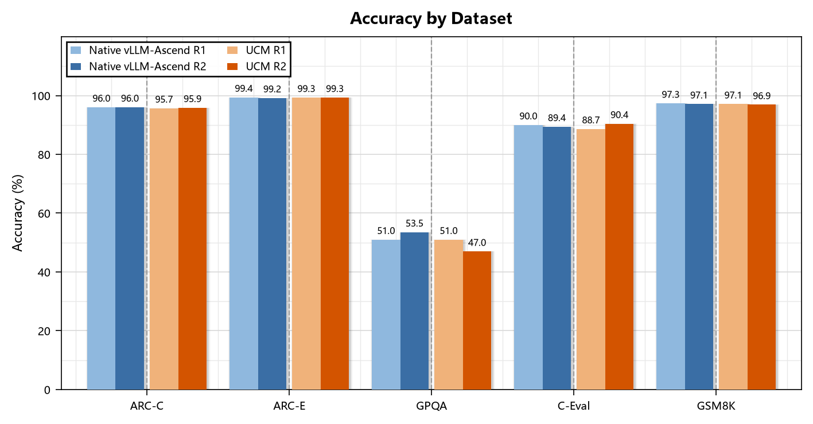
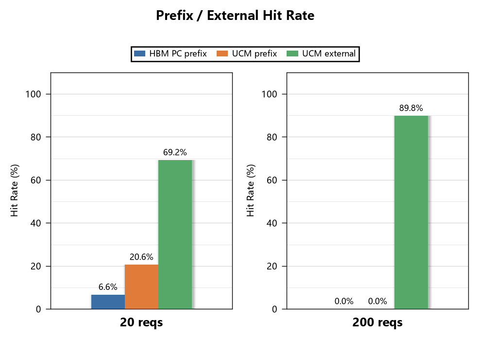

# AISBench Performance Testing — GLM-5.3 on A2-8 with PD Disaggregation and UCM

This document records the complete process and results of accuracy and performance testing with AISBench after deploying GLM-5.3 in a PD-disaggregated architecture with UCM enabled on A2-8 machines (8 nodes, each with 8×Ascend910B).

The test side uses AISBench: accuracy testing is evaluated on standard datasets (e.g., ARC-c, ARC-e, GPQA_diamond, C-Eval, GSM8K), while performance testing follows a "prefill → formal test → before/after hit-rate comparison" workflow, focusing on TTFT, TPOT, and throughput changes brought by prefix caching and UCM hits.

# Benchmark Results

## Accuracy Testing

Accuracy testing verifies whether model outputs remain consistent with native vLLM-Ascend after UCM is enabled. The test covers five datasets: AI2 Reasoning Challenge – Challenge Set (ARC-C), AI2 Reasoning Challenge – Easy Set (ARC-E), Graduate-Level Google-Proof Q&A Benchmark (GPQA), C-Eval, and Grade School Math 8K (GSM8K), recording two rounds each for native and UCM configurations. As shown in the comparison chart, UCM accuracy is essentially on par with native across all datasets, with differences within normal fluctuation ranges and no systematic degradation, indicating that enabling UCM has no substantive impact on inference correctness.

<p align="center">
  
</p>

## Performance Testing

This performance test, under the conditions of input length 65536, output length 512, prefill rate 90%, and maximum concurrency 76, compares HBM PC and PC+UCM configurations on TTFT, TPOT, and per-card throughput at two request counts, in order to observe the performance gains from UCM. The two request counts correspond respectively to the case where HBM is not overwhelmed, and the case where HBM is completely ineffective and only the UCM external storage layer provides hits.

1. **Basis for selecting 20 requests**: In this task, GLM-5.3 is deployed in a 1P4D manner (4 machines for Prefill, 4 machines for Decode). The available GPU KV Cache size per node is 336,384 tokens, which accommodates 5 requests per node based on per-request KV Cache occupancy; with Prefill and Decode each occupying 4 machines, a total of 20 requests can be accommodated. Therefore, 20 is selected as the request-count baseline for this case.

2. **Basis for selecting 200 requests**: The request scale significantly exceeds the HBM capacity limit of 20 requests, causing the HBM prefix cache to be completely overwhelmed and the prefix hit rate to drop to zero, thereby allowing separate observation of performance when only the UCM external storage layer provides hits.

<p align="center">
  
</p>

As shown in the figure, the benefits of UCM are mainly reflected in TTFT and per-card throughput, while TPOT remains essentially unchanged. Specifically:

1. **TTFT**: PC+UCM is significantly lower than HBM PC, indicating that UCM prefix hits effectively reduce computation in the prefill stage, with greater benefits at higher loads.
2. **TPOT**: The difference between the two configurations is very small; UCM is slightly higher, which is a minor overhead in the decode stage and does not affect overall usability.
3. **Per-card throughput**: PC+UCM is significantly higher than HBM PC.

The specific hit-rate values are compared below:

<p align="center">
  
</p>

The following analysis can be drawn from the figure:

1. **At 20 requests**: HBM and UCM still hit cooperatively, with HBM prefix hit rate and UCM external hit rate jointly constituting the hit sources.
2. **At 200 requests**: The HBM prefix cache is completely overwhelmed due to insufficient capacity, with prefix hit rate dropping to zero, while UCM external hit rate remains at a high level and becomes the sole hit source.

It should be noted that DP4/TP8 instances externally expose only the prefill0 service address. Requests entering this address are distributed to the 4 machines according to the default random load-balancing policy, so the first-round requests and the replayed requests may not land on the same machine, causing HBM to fail to hit completely. This phenomenon is caused by the multi-instance deployment architecture. Under this multi-instance scenario, the HBM hit rate for the 20-request case drops substantially and exhibits randomness, ultimately presenting hit rates of 6.6% and 20.6%.

In summary, UCM can effectively absorb evicted prefix caches under high-load scenarios where HBM capacity is constrained, maintaining a high external hit rate and thereby reducing TTFT and improving per-card throughput; the slight increase in TPOT is a normal overhead in the decode stage and does not affect overall usability. For long-input, high-concurrency inference scenarios, UCM can serve as an effective extension layer for HBM cache, providing stable performance gains when cache capacity becomes the bottleneck.

### Detailed Performance Data

| Total Requests | TTFT HBM PC (ms) | TTFT PC+UCM (ms) | TPOT HBM PC (ms) | TPOT PC+UCM (ms) | Per-Card Throughput HBM PC (TPS) | Per-Card Throughput PC+UCM (TPS) | HBM PC Avg Concurrency | HBM PC prefix hit rate | PC+UCM Avg Concurrency | PC+UCM prefix hit rate | PC+UCM external hit rate |
|---|---|---|---|---|---|---|---|---|---|---|---|
| 20 | 46751.2 | 30052.0 | 40.8 | 42.5 | 208.54 | 318.82 | 14 | 6.64% | 16 | 20.59% | 69.23% |
| 200 | 219718.7 | 125638.9 | 41.2 | 42.5 | 265.63 | 449.98 | 62 | 0.00% | 64 | 0.00% | 89.82% |

# Test Environment Overview

| Item | Configuration / Parameter |
|---|---|
| Model | GLM-5.3 (`GLM-5.3-w8a8c8`, Ascend quantization) |
| Hardware Platform | 8×Ascend910B, 8 nodes in total |
| Deployment Architecture | PD disaggregation |
| Parallel Strategy | TP=8, DP=4, DP-local=1, EP enabled |
| KV Transfer | `MooncakeConnectorV1` + `mooncake` router, `kvPortBase=36000` |
| UCM | Enabled (`UcmPipelineStore` + `Cache\|Posix`, dual hostPath disks) |
| Inference Engine | vLLM (V1 engine, `VLLM_USE_V1=1`) |
| Benchmark | AISBench |

# Deployment Guide

## Model Parameters

| Parameter | Value | Description |
|---|---|---|
| `shmSize` | `800Gi` | Shared memory |
| `dataParallelMode` | `standard` | Data parallel mode |
| `recoveryPolicy` | `None` | No automatic recovery |
| `restartGracePeriodSeconds` | `60` | Restart grace period |
| `containerPort` | `8000` | Engine service port |
| `quantization` | `ascend` | Ascend quantization |
| `max-model-len` | `262144` | Maximum context 256K |
| `gpu-memory-utilization` | `0.92` | GPU memory utilization |

## KV-transfer Configuration

1. **Prefill Nodes:**
```
--kv-transfer-config '{"kv_connector": "MultiConnector", "kv_role": "kv_producer", "engine_id": "0", "kv_connector_extra_config": {"connectors": [{"kv_connector": "MooncakeConnectorV1", "kv_role": "kv_producer", "kv_port": "37000", "kv_connector_extra_config": {"use_ascend_direct": true, "prefill": {"dp_size": 4, "tp_size": 8}, "decode": {"dp_size": 4, "tp_size": 8}}}, {"kv_connector": "UCMConnector", "kv_role": "kv_both", "kv_connector_module_path": "ucm.integration.vllm.ucm_connector", "kv_connector_extra_config": {"UCM_CONFIG_FILE": "/vllm-workspace/UnifiedCache/config/ucm_config.runtime.yaml"}}]}}'
```

2. **Decode Nodes:**
```
--kv-transfer-config '{"kv_connector":"MooncakeConnectorV1", "kv_role":"kv_consumer", "kv_port":"37100", "kv_connector_extra_config":{"use_ascend_direct": true, "prefill":{"dp_size":4,"tp_size":8}, "decode":{"dp_size":4,"tp_size":8}}}'
```

## Prefill Nodes & Decode Nodes

For detailed parameters, see [vLLM Ascend Official Documentation — Getting Started — GLM-5.2 & GLM-5.3](https://docs.vllm.ai/projects/ascend/en/latest/tutorials/models/GLM5.2.html).