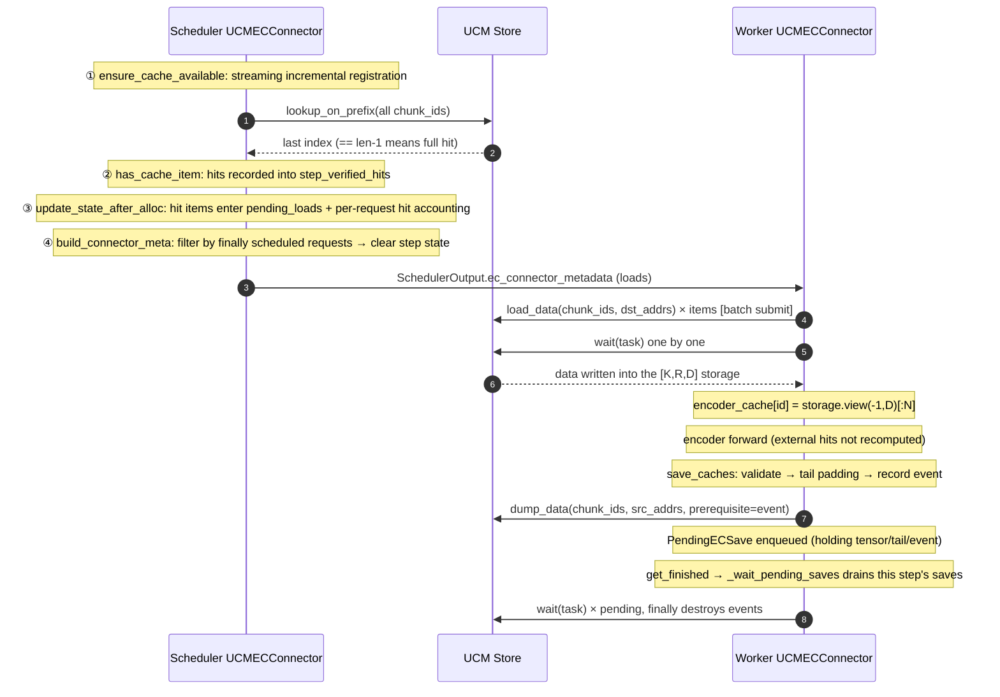

# UCM EC Connector Design

**EC Connector positioning**: it splits the variable-length `[N, D]` encoder output tensors of the vLLM multimodal Encoder Cache (EC) into fixed-size chunks of a fixed row count and stores them in the UCM Store. Within the same model instance, EC items with identical media content can be reused across requests, and hits skip encoder recomputation.

**Key features of this version**:

1. **Pipelined loads**: within a single `start_load_caches()` call the Worker first submits all `load_data` requests in batch, then waits on them one by one; submission and waiting are decoupled, and any failure still guarantees that already-submitted tasks are drained.
2. **Asynchronous saves**: `save_caches()` records a device event and submits asynchronously via `dump_data(prerequisite_handle=...)`; the task and the source tensor references go into `_pending_saves`, which is drained uniformly by `get_finished()` (end of every step) and `shutdown()`.
3. **Key isolation**: the hash metadata of a chunk key is the compact JSON `("ucm:ec:v2", model identity, deepstack layer indexes)`; the physical layout (width, dtype, rows_per_chunk) goes explicitly into every chunk key, so deployments with different layouts are mutual misses instead of misreading each other's data.
4. **Streaming incremental registration**: the Scheduler incrementally processes media features appended by streaming requests using `processed_feature_count`, with a two-phase commit (full validation first, then reference-counted commit); row-count conflicts fail fast.
5. **Final scheduling filter**: before metadata is sent down, loads are filtered by the final set of scheduled requests with `num_scheduled_tokens > 0`; preempted requests do not trigger useless loads.
6. **Full-hit predicate**: `lookup_on_prefix()` only counts as an EC hit when the return value reaches the last chunk index (`len-1`); any partial prefix hit is treated as a miss.
7. **Fail-closed on load failure**: a load failure blocks the current execution (engine-level error); no incomplete data is inserted into `encoder_cache`, and there is no automatic encoder recomputation.

**Planned evolution** (see Section 10 for details):

- Request-level handling of load failures with automatic recomputation — the recovery protocol for the current fail-closed behavior; the core gap;
- Request-level error isolation — errors such as layout conflicts end only the affected request instead of taking down the engine;
- Asynchronous loads — `transfer_id`, event dependency from the load stream to the compute stream, multi-rank completion aggregation;
- Prometheus metrics and a self-check on real device startup;
- Dynamic layout support such as multimodal pruning.

---

## 1. Overall code structure

### 1.1 File layout

| File | Responsibility |
| --- | --- |
| `ucm/integration/vllm/ucm_ec_connector.py` | The EC connector itself: layout parsing, chunk keys, all Scheduler/Worker interfaces, Store assembly |
| `examples/ucm_ec_config.yaml` | EC configuration example |
| `test/test_ucm_ec_config.py` | Unit tests (CPU tensors + Mock Store I/O) |

### 1.2 Component overview

The connector instantiates one `UCMECConnector` on each of the Scheduler and Worker processes:

- The **Scheduler side** maintains four state containers (`req_to_state`, `identifier_to_blocks`, `step_verified_hits`, `pending_loads`) and completes the registration, hit lookup, load-plan generation, and dispatch within a scheduling step via `ensure_cache_available → has_cache_item → update_state_after_alloc → build_connector_meta`; request finalization is reclaimed by `request_finished`.
- The **Worker side** completes external loading, asynchronous saving, and end-of-step draining via `bind_connector_metadata → start_load_caches → save_caches → get_finished`, producing the writes into vLLM's `encoder_cache`.
- The two sides communicate through `UCMECConnectorMetadata(loads)` carried with `SchedulerOutput`; Store I/O uses only the four interfaces `lookup_on_prefix`, `load_data`, `dump_data (+prerequisite event)`, and `wait`.

For the complete call sequence and state updates, see the sequence diagram in Section 5.1.

### 1.3 Roles and gating

| Dimension | Value | Source and purpose |
| --- | --- | --- |
| `role` | `SCHEDULER` / `WORKER` | Decides whether to initialize the device and the Store's GC/IO parameters |
| `is_producer` / `is_consumer` | From `ec_transfer_config` | Only the producer saves; only the consumer looks up and submits loads |
| `is_save_rank` | WORKER only: `pp_first && tp_rank==0 && pcp_rank_in_group==0` | The unique dump rank within a DP domain; self-validated inside `save_caches()`, does not rely on the outer runner |
| `gc_owner` | `role==SCHEDULER && dp_rank==0` | The sole holder of the Store's `posix_gc_enable` |

---

## 2. Main data structures (data description)

### 2.1 Structure definitions

| Structure | Definition | Role | Lifetime | Notes |
| --- | --- | --- | --- | --- |
| `EncoderCacheLayout` | `frozen dataclass: width:int, dtype:torch.dtype, rows_per_chunk:int, chunk_bytes:int` | Both sides | Process lifetime, immutable | The physical interpretation of an EC item; `chunk_bytes = rows_per_chunk × width × element_size` |
| `IdentifierState` | `dataclass: num_embeds:int, chunk_ids:tuple[bytes,...], request_ref_count:int=0` | Scheduler | While referenced by at least one active request | All chunk keys of one EC item; `num_chunks = len(chunk_ids)`; derivable fields are not stored redundantly |
| `RequestState` | `dataclass: processed_feature_count:int=0, identifier_states:dict[str,IdentifierState], hit_identifiers:set[str]` | Scheduler | Request lifetime (deleted on finish/abort/cancel) | Records how many streaming features have been validated; `hit_identifiers` aggregates the items confirmed hit for this request |
| `ECLoadSpec` | `frozen dataclass: num_embeds:int, chunk_ids:tuple[bytes,...]` | Scheduler→Worker | A single scheduling step | The complete description of one external load |
| `UCMECConnectorMetadata` | `dataclass(ECConnectorMetadata): loads:dict[str,ECLoadSpec]` | Scheduler→Worker | A single model execution step | Sent down with `SchedulerOutput.ec_connector_metadata` |
| `PendingECSave` | `dataclass: identifier:str, task:Task, tensor:Tensor, tail:Tensor\|None, event_handle:int` | Worker | From submission until drained by `_wait_pending_saves` | Holds the source tensor and tail references to prevent release; `event_handle` pending destruction |

### 2.2 Connector instance state

| Field | Role | Purpose | Cleanup timing |
| --- | --- | --- | --- |
| `req_to_state: dict[str, RequestState]` | Scheduler | request → reference state | popped in `request_finished()`; cleared in `shutdown()` |
| `identifier_to_blocks: dict[str, IdentifierState]` | Scheduler | item → shared state (the same object reused across requests) | deleted when ref count reaches 0; cleared in `shutdown()` |
| `step_verified_hits: set[str]` | Scheduler | Hits confirmed by Store lookup in this step | cleared in `build_connector_meta()` |
| `pending_loads: dict[str, ECLoadSpec]` | Scheduler | The load plan to dispatch in this step | filtered in `build_connector_meta()`, handed to metadata, replaced with a new dict |
| `_pending_saves: list[PendingECSave]` | Worker | Asynchronous saves not yet drained | drained by `get_finished()` / `shutdown()` |
| `_connector_metadata` | Worker | Base-class field, bound by `bind_connector_metadata` | `clear_connector_metadata()` (does not clear `_pending_saves`; they are unrelated) |

### 2.3 Error types

| Exception | Base class | Payload | Usage |
| --- | --- | --- | --- |
| `EncoderCacheLayoutError` | `ValueError` | Message text | Configuration/layout violations: width, chunk_size, pruning, row-count conflict, feature shortening, invalid load metadata, dump tensor shape mismatch |
| `UCMEncoderCacheError` | `RuntimeError` | `.identifier` (the failing item) | Store I/O failures, hit items missing Scheduler state, and other runtime errors bound to a specific identifier |

---

## 3. Interface definitions

### 3.1 vLLM EC Connector interfaces

`UCMECConnector` inherits `ECConnectorBase` and implements the following interfaces; `bind_connector_metadata` / `clear_connector_metadata` use the base-class implementations directly.

| Interface | Role | vLLM call timing | Behavior in this implementation |
| --- | --- | --- | --- |
| `__init__(vllm_config, role)` | Both sides | Engine constructs the connector | fail-fast validation → parse layout → build hasher → build Store |
| `ensure_cache_available(request, num_computed_tokens)` | Scheduler | Before a waiting request is scheduled (chunked prefill / re-entry after preemption) | Streaming incremental item registration; `num_computed_tokens` ignored |
| `has_cache_item(identifier)` | Scheduler | While scanning encoder inputs | `lookup_on_prefix` full-hit predicate; hits recorded into `step_verified_hits` |
| `update_state_after_alloc(request, index)` | Scheduler | After local encoder cache `allocate()` succeeds | Hit items written into `pending_loads` and per-request hit accounting |
| `build_connector_meta(scheduler_output)` | Scheduler | When constructing `SchedulerOutput` | Filter loads by finally scheduled requests → metadata; clear step state |
| `request_finished(request)` | Scheduler | On finish/abort/cancel release | Delete request state, decrement ref counts, emit hit summary log |
| `start_load_caches(encoder_cache, **kwargs)` | Worker | Before model forward | Batch submit loads → wait one by one → publish truncated views |
| `save_caches(encoder_cache, mm_hash, **kwargs)` | Worker | After new encoder output entries are produced | Gating → validation → tail padding → event before submission → async dump submission |
| `get_finished(finished_req_ids)` | Worker | End of every step | Drain `_pending_saves`; always returns `(None, None)` |
| `shutdown()` | Both sides | Process exit | Drain saves first, then clear state and close the Store |
| `register_caches(ec_caches)` | Worker | Initialization registration phase | Not overridden; inherits base-class no-op (no upstream caller yet) |
| `update_connector_output(output)` | Scheduler | After Worker output is received | Not overridden; inherits base-class no-op (to be implemented when the P1-3 failure reporting hooks in) |
| `has_pending_push_work()` | Scheduler | Engine polling | Not overridden; inherits base class `False` (a pull model has no push work) |
| `build_connector_worker_meta()` | Worker | End of step | Not overridden; inherits base class `None` (to be implemented when the P1-3 failure reporting hooks in) |

### 3.2 UCM Store V1 interfaces used

```python
lookup_on_prefix(block_ids: list[bytes]) -> int
    # Prefix scan; returns the index of the last contiguously existing chunk; -1 means all missing.
load_data(block_ids: list[bytes], shard_index: list[int],
          dst_addr: np.ndarray) -> Task                  # Submit a batched device→Store read
dump_data(block_ids: list[bytes], shard_index: list[int],
          src_addr: np.ndarray,
          prerequisite_handle: int = 0) -> Task           # Submit a batched Store←device write;
                                                          # the Store copy stream waits on this event before D2H
wait(task: Task) -> None                                  # Block until the task completes
```

Constraints: each chunk has exactly one shard, so `shard_index` is always `[0] * n`; addresses use the raw device-pointer form of `load_data/dump_data` (`np.ndarray(uint64)` column vectors); EC does not pre-register GPU buffers (`use_gdr` forced to `False`). The Store's `lookup`, `lookup_on_reverse`, `prefetch`, `check`, and tensor-shaped `load/dump` are unused in this EC version.

### 3.3 Configuration interfaces

**vLLM entry point** (`ECTransferConfig`, passed via `--ec-transfer-config`), complete serve example:

```bash
vllm serve Qwen/Qwen2.5-VL-7B-Instruct \
    --tensor-parallel-size 2 \
    --ec-transfer-config '{
        "ec_connector": "UCMECConnector",
        "ec_role": "ec_both",
        "ec_connector_module_path": "ucm.integration.vllm.ucm_ec_connector",
        "ec_connector_extra_config": {
            "UCM_CONFIG_FILE": "/workspace/ucm_ec_config.yaml"
        }
    }'
```

Field descriptions (corresponding to `vllm/config/ec_transfer.py`'s `ECTransferConfig`):

| Field | Required | Description |
| --- | --- | --- |
| `ec_connector` | Yes | Connector class name, loaded via `ec_connector_module_path` |
| `ec_role` | Required when `ec_connector` is set | `ec_producer` / `ec_consumer` / `ec_both`; decides the `is_producer`/`is_consumer` gating |
| `ec_connector_module_path` | Yes | Connector module path; the UCM implementation is `ucm.integration.vllm.ucm_ec_connector` |
| `ec_connector_extra_config.UCM_CONFIG_FILE` | Yes | Path of the EC-specific YAML (the file containing the `ucm_ec_connector` section below) |

**EC-specific YAML** (`Config.load_ec_config()` reads the `ucm_ec_connector` section and returns it as-is):

```yaml
ucm_ec_connector:
  ucm_connector_name: "UcmPipelineStore"        # Required, selects the Store via UcmConnectorFactoryV1
  ucm_connector_config:                          # Required, passed through to the Store
    store_pipeline: "Cache|Posix"
    storage_backends: "/mnt/test"                # Colon-separated string, split on ":" into a list before creation
    posix_capacity_gb: 10240
    posix_io_engine: "psync"
    posix_data_trans_concurrency: 128
    cache_buffer_capacity_gb: 32                 # Default 128; /dev/shm capacity checked before creation
  encoder_cache_config:                          # Required
    chunk_size: 128                              # Required, number of rows R per chunk
    # Optional: encoder_cache_hidden_dim / cache_namespace / store_unique_id
    # When omitted, width is inferred, namespace is constructed, and unique_id is generated via cross-process handshake
```

| Field | Required | Default behavior | Validation |
| --- | --- | --- | --- |
| `ucm_connector_name` | Yes | — | In producer mode additionally requires `UcmPipelineStore` with a pipeline head ∈ {Cache, Mooncake, YuanRong}, otherwise `ValueError` |
| `ucm_connector_config.store_pipeline` | No | `""` | Decides the GC block size derivation branch (`YuanRong\|Posix` handled specially) |
| `ucm_connector_config.use_gdr` | No | Forced to `False` | Configuring this key only emits a warning and takes no effect |
| `encoder_cache_config.chunk_size` | Yes | — | Must be a positive integer (bool rejected), otherwise `EncoderCacheLayoutError` |
| `encoder_cache_config.encoder_cache_hidden_dim` | No | Inferred from the model structure | An explicit value must be positive |
| `encoder_cache_config.cache_namespace` | No | Constructed from the model identity tuple | An explicit namespace still gets the deepstack layer-index salt |
| `encoder_cache_config.store_unique_id` | No | `{handshake uuid}.ec.dp{dp_rank}` (same cross-process handshake as KV) | Store sharing/isolation domain: the same id shares shared memory and namespace |

### 3.4 Chunk key encoding format

```text
meta   = json.dumps(("ucm:ec:v2", identity_source, deepstack_indexes),
                    ensure_ascii=False, separators=(",", ":"))          # connector-level constant
identity_source = explicit cache_namespace value
                | (model, revision, code_revision, tokenizer_revision,
                   hf_config._commit_hash, tuple(architectures),
                   multimodal_config.compute_hash())                    # auto-constructed

chunk_id[i] = md5(meta_bytes + pickle.dumps(
                  (width, str(dtype), rows_per_chunk,
                   identifier, num_embeds, i))).digest()      # 16 raw bytes
K = ceil(num_embeds / rows_per_chunk)
```

Design points:

- `num_embeds` enters the key, preventing a short object with the same identifier from falsely hitting the prefix of a long object when N differs abnormally;
- The layout triple (width/dtype/rows_per_chunk) enters the key, so deployments with different layouts are mutual misses rather than misreading data;
- The deepstack layer index is kept even with an explicit namespace — equal-width EC selected from different layers must not be reused;
- The key excludes KV-specific deployment semantics such as TP/PCP/DP rank, speculative decoding, and KV sparse;
- After the EC key format upgrade (`ucm:ec:v2`), old persisted objects naturally miss and are evicted by the Store's existing reclamation mechanism; there is no fallback to the old format.

---

## 4. Algorithm execution flow (core algorithm design)

### 4.1 Width resolution (`resolve_encoder_cache_layout`)

The EC output width D is resolved with the following priority, never branching on model names/paths:

1. The explicit `encoder_cache_hidden_dim` configuration;
2. Reuse vLLM's canonical implementation `_get_encoder_cache_hidden_dim` (`vllm/distributed/ec_transfer/ec_connector/cpu/common.py`; vllm-ascend's EC connector reuses it as well): only when `out_hidden_size` and a **non-empty** `deepstack_visual_indexes` both exist, `D = out_hidden_size × (1 + len(deepstack_visual_indexes))` — this multiplication rule is specific to models that concatenate deepstack features into the cache tensor (e.g., the Qwen3-VL family);
3. All other cases (`out_hidden_size` missing, or present without deepstack) fall back to `model_config.get_inputs_embeds_size()`. A lone `out_hidden_size` is not evidence of a wide EC entry: the EC stores the post-merger embedding, whose width usually equals the LLM hidden size.

Then: `dtype = model_config.dtype`; `rows_per_chunk = chunk_size` (strict int validation); `chunk_bytes = R × D × element_size`. `D <= 0` raises `EncoderCacheLayoutError`.

### 4.2 EC item → fixed chunk mapping

An EC item is a variable-length 2D tensor `[N, D]`, while the UCM Store uses fixed-size blocks as its addressing and I/O unit. The connector splits it by a fixed row count into K chunks whose logical shape is always `[R, D]`, so that each chunk maps to exactly one UCM block. The four symbols:

| Symbol | Meaning | Source |
| --- | --- | --- |
| N | The number of encoder embedding rows of the item (tensor first dimension) | Scheduler takes it from `request.get_num_encoder_embeds(index)`; Worker dump uses the actual tensor first dimension. When the two sides disagree, it manifests as a miss because `N` is in the chunk key — data is never misread |
| D | The encoder output width (tensor second dimension), fixed for the instance lifetime | Resolved at startup: explicit `encoder_cache_hidden_dim` → `_get_encoder_cache_hidden_dim` (vLLM canonical: multiply only with non-empty deepstack) → `get_inputs_embeds_size()` (see 4.1) |
| R | rows_per_chunk, the number of rows per chunk along the first dimension | Configuration `encoder_cache_config.chunk_size`, must be a positive integer |
| K | The number of chunks an item is split into | `K = ceil(N / R)`, i.e., the length of the chunk_id list |

**Why chunk by a fixed chunk_size**:

- **Fits the Store's fixed-block interface**: the Store does not support variable-length objects; with a fixed R rows, each chunk's byte size is always `chunk_bytes = R × D × element_size`, directly reusing the same I/O alignment derivation as the KV connector (shard/block size), with no new Store capability needed for EC;
- **Metadata-free**: chunk keys are deterministically hashed from `(layout, identifier, N, chunk_index)` (see Section 3.4); Scheduler and Worker each independently derive the same set of keys, with no manifest to persist or synchronize;
- **Simple and safe hit semantics**: an item counts as hit only when all K chunks exist — an EC item missing any row of embeddings cannot reconstruct the output, so partial prefix reuse is not done (see Section 4.3);
- **Layout isolation**: D, dtype, and R enter the key explicitly, so deployments with different layouts are mutual misses and never misread each other's data.

The costs and trade-offs are in Section 6: too small an R inflates block counts, lookups, and Posix small-I/O pressure; too large an R wastes tail padding, coarsens eviction granularity, and increases single-transfer latency.

**Dump side** (actual tensor `[N, D]`, N taken from the tensor's first dimension):

- `K = ceil(N / R)`; the first `K-1` chunks directly use contiguous memory ranges of the original tensor;
- The tail chunk, if `N % R != 0`: allocate a `[R, D]` zero tensor, copy in the valid rows, and replace the last source address with the tail pointer — the Store always accesses the full `chunk_bytes` and out-of-bounds reads are never allowed;
- Address computation `_chunk_addresses`: `offset[i] = uint64(data_ptr) + i × chunk_bytes` (the logical chunk byte size, not the Store-aligned physical shard size), producing a `(K, 1)` uint64 array.

**Load side** (metadata carries `num_embeds` and `chunk_ids`):

- Allocate the `[K, R, D]` padded storage in one shot;
- The K chunk destination addresses are contiguous offsets within that storage;
- After a successful wait, publish `storage.view(-1, D)[:N]` — the view references the padded storage and is released with the vLLM encoder cache lifetime.

**Padding and accounting skew**:

```text
Padding waste per dump/load item < chunk_bytes
Scheduler accounting bytes = Σ N_i × D × element_size
Worker    actual    bytes  = Σ ceil(N_i / R) × R × D × element_size
Upper bound of skew = len(L) × chunk_bytes   (L is the active item set of external loads)
```

Capacity planning must reserve slightly less than one chunk of device memory per active external-load item.

### 4.3 Full-hit predicate

`has_cache_item()` treats `lookup_on_prefix()` as an "all chunks exist" predicate:

| Chunk state in Store | `lookup_on_prefix` return | Verdict |
| --- | --- | --- |
| `[T, T, T]` | `2 == len-1` | **hit** |
| `[T, T, F]` | `1` | miss |
| `[F, F]` | `-1` | miss |

An EC item missing any encoder embedding cannot reconstruct the output, so partial prefix reuse is not done. Choosing `lookup_on_prefix` over `lookup` is a pure performance choice (one int return instead of a bool array return plus aggregation); the semantics are equivalent. Hit results only enter this step's `step_verified_hits`, which `build_connector_meta()` always clears, so no stale hits survive across steps.

### 4.4 Store assembly (`create_ucm_ec_store`)

```text
chunk_bytes = R × D × element_size
                │
      _get_store_io_sizes(chunk_bytes, chunk_bytes)      # 4096 alignment
                │
  store_shard_size, store_block_size                    # Worker's tensor_size_list/shard/block
                │
      _get_store_gc_block_size(pipeline, [chunk_bytes], shard, block)
                │            ├─ normal pipeline: gc_block = store_block_size
                │            └─ YuanRong|Posix: gc_block = Σtensor_size × shard_count (actual persisted object size)
                ▼
store_config injection: unique_id / device_id / local_rank_size=TP / use_gdr=False
                   / share_buffer_enable=True / posix_gc_enable=gc_owner
                   + Worker: tensor_size_list=[chunk_bytes], shard_size, block_size
                   + gc_owner Scheduler: block_size=gc_block_size
                ▼
      UcmConnectorFactoryV1.create_connector(name, store_config)
```

- The default `unique_id` is generated via the same cross-process handshake as the KV connector (Worker rank0 generates a uuid and broadcasts it over the world group, writing `/dev/shm/ucm_ec_uniqueid_{ppid}`; the Scheduler reads it back; `ucm_connector.py: _worker_generate_unique_id / _scheduler_read_unique_id` with `prefix="ucm_ec"`), plus a `.ec.dp{dp_rank}` suffix: the Scheduler and this DP domain's Workers align to the same shared-memory domain, isolated across DP domains. EC and KV use separate file slots with their own prefixes (KV keeps `ucm_`), so a dual-connector engine does not overwrite each other; `instance_id` is a timestamp value from each VllmConfig construction and is not guaranteed consistent across processes, so it is no longer used for alignment; use an explicit `store_unique_id` override to share the Posix cold tier across DP.
- `local_rank_size = TP size`: with the shared buffer, ranks traverse chunks in staggered order to improve hot-tier hit distribution; each rank still loads the full EC (single writer unchanged).
- `cache_buffer_capacity_gb` defaults to 128; `_check_shm_capacity` validates `/dev/shm` capacity before creation and startup fails if insufficient.
- The Store config is injected after a shallow copy; the user YAML is never modified.

---

## 5. Processing flow

### 5.1 End-to-end flow of one execution step




### 5.2 External hit path and the miss-then-save path

```text
[EXTERNAL HIT]
waiting request → ensure_cache_available (incremental N / chunk_ids registration)
  → has_cache_item → lookup_on_prefix == len-1 → step_verified_hits
  → encoder_cache_manager.allocate → update_state_after_alloc → pending_loads
  → build_connector_meta (final scheduling filter) → Worker
  → start_load_caches: allocate [K,R,D] → batch load_data → wait one by one
  → encoder_cache[id] = view(-1,D)[:N] → consumed by the model, encoder not recomputed

[MISS → LOCAL COMPUTE → SAVE]
has_cache_item is miss → item enters the encoder compute path
  → update_state_after_alloc produces no load
  → Worker runs the encoder → encoder_cache[id] = [N,D]
  → the wrapper (V2 diff-save or legacy eager-save) calls save_caches
  → gating (producer·save_rank) → layout validation → tail padding → record event
  → dump_data(prerequisite=event) → enqueued into _pending_saves
  → drained at end of step by get_finished / shutdown
  → subsequent requests hit on the next lookup
```

Key sequencing constraints:

- A `has_cache_item()` hit does not mean this step necessarily schedules the item; only `update_state_after_alloc()` after a successful `allocate()` generates a load, keeping lookup and metadata decoupled;
- The V2 wrapper runs `start_load_caches()` before recording `cached_hashes`; entries loaded externally are not dumped again by diff-save;
- The save event is recorded **after** the tail-padding `copy_()` and **before** the dump submission, ensuring the Store copy stream waits for the device write to complete before reading the raw pointer;
- UCM GC is independent of Scheduler memory state: after GC deletes data, the next `has_cache_item()`'s real lookup naturally misses; no delete notification is needed.

### 5.3 Key function descriptions

**Connector initialization `UCMECConnector.__init__`**

- Inputs: `vllm_config: VllmConfig`, `role: ECConnectorRole`
- Output: a fully initialized connector (layout, hasher, Store, role state)
- Dependencies: `Config.load_ec_config`, `build_ec_hash_meta`, `resolve_encoder_cache_layout`, `create_ucm_ec_store`, vLLM parallel groups (`get_world_group` / `get_pp_group` / `get_pcp_group` / `get_tensor_model_parallel_rank`), `create_device`
- Behavior: ① detect multimodal pruning and refuse; ② load the EC YAML; ③ in producer mode validate that the Store supports "queued event waiting" (`UcmPipelineStore` with head ∈ {Cache, Mooncake, YuanRong}, otherwise `ValueError` — `Dram/Delegator` wait inside Dump while other stages may ignore events; better to fail before opening the Store than to introduce a blocking-save fallback); ④ build the hasher and layout; ⑤ Scheduler keeps `-1/-1/None`, Worker resolves `local_rank/device_id/device`; ⑥ build the Store; ⑦ initialize state dicts; the Worker also creates `_save_device` and determines `is_save_rank`; ⑧ emit the startup log (role/producer/consumer/layout/hash seed/save_rank).

**Streaming registration `ensure_cache_available`**

- Inputs: `request: Request`, `num_computed_tokens` (ignored)
- Output: `True` (registration completed normally); raises on failure
- Dependencies: `request.mm_features`, `request.get_num_encoder_embeds(index)`, `make_chunk_ids`, `self.req_to_state`, `self.identifier_to_blocks`
- Behavior: two-phase incremental processing. Phase one only traverses new features in `[processed_feature_count, len(mm_features))`: check request history / this batch first, then the global shared table; if neither has it, construct a new `IdentifierState` (generate chunk ids); a row-count mismatch raises `EncoderCacheLayoutError` (distinguishing "within request" from "across active requests" conflicts). Phase two commits only after the whole batch validates — global table `setdefault` + `request_ref_count += 1` + write into request history. A shortened `mm_features` raises; no new features returns O(1); preemption re-entry does not double-count.

**Hit lookup `has_cache_item`**

- Input: `identifier: str`
- Output: `bool` (whether all chunks hit)
- Dependencies: `self.identifier_to_blocks`, `self.store.lookup_on_prefix`, `self.step_verified_hits`
- Behavior: non-consumer or missing state is an immediate miss; with state, batch lookup returns `== len(chunk_ids)-1` as hit, recorded into this step. A closed Store raises `RuntimeError`.

**Load planning `update_state_after_alloc`**

- Inputs: `request: Request`, `index: int`
- Output: none (side effects update `pending_loads` and `hit_identifiers`)
- Dependencies: `step_verified_hits`, `identifier_to_blocks`, `req_to_state`
- Behavior: effective only for consumer and when the identifier belongs to this step's hit set; per-request hit accounting first (before the dedup check, so every request sharing the item is counted in the summary), then dedup via `pending_loads`; missing state raises `UCMEncoderCacheError` (the Scheduler has already skipped encoder compute; silently skipping would defer the error into missing encoder outputs).

**Metadata dispatch `build_connector_meta`**

- Input: `scheduler_output: SchedulerOutput`
- Output: `UCMECConnectorMetadata` (loads may be empty but the object is never None, ensuring producer Workers still enter the EC wrapper to save outputs)
- Dependencies: `scheduler_output.num_scheduled_tokens`, `scheduler_output.free_encoder_mm_hashes`, `req_to_state`, `pending_loads`
- Behavior: filter `pending_loads` by the identifier union of finally scheduled requests with `num_scheduled_tokens > 0`, then exclude final evictions in `free_encoder_mm_hashes` so Workers do not reload entries after deleting their allocations. Valid sharing is retained; vLLM excludes items reallocated in the same step from its final eviction list, so these items can still load. Then clear `pending_loads` and `step_verified_hits`.

**Request finalization `request_finished`**

- Input: `request: Request`
- Output: `(False, None)`
- Dependencies: `req_to_state`, `identifier_to_blocks`
- Behavior: pop the request state; on the consumer side, emit a per-request hit summary log (`mm_items` and `hits_total`, also 0 on all-miss); decrement the ref count of each referenced identifier and delete the global state immediately at zero. Only memory state is cleared; Store data is never deleted.

**Batch loading `start_load_caches`**

- Input: `encoder_cache: dict[str, torch.Tensor]` (vLLM's local cache, written in place)
- Output: none (successful entries written into `encoder_cache` as `view(-1,D)[:N]`)
- Dependencies: `_get_connector_metadata`, `layout`, `device`, `store.load_data/wait`, `_chunk_addresses`
- Behavior: ① skip identifiers already present locally; ② validate metadata (`num_embeds > 0`, chunk count matches N); ③ allocate the `[K,R,D]` storage and compute addresses; ④ **submit all** `load_data` first (submission failures wrapped as `UCMEncoderCacheError`); ⑤ in `finally`, **wait on each submitted task to drain** — on success publish the view and accumulate stats; on failure pop the entry, record the first error, but never skip the remaining waits; ⑥ after the loop, if any wait errored, raise `UCMEncoderCacheError` uniformly (fail-closed). At no stage is incomplete data inserted into `encoder_cache`.

**Saving `save_caches`**

- Inputs: `encoder_cache: dict[str, torch.Tensor]`, `mm_hash: str` (the identifier)
- Output: none (async submission; tasks go into `_pending_saves`)
- Dependencies: `is_producer`, `is_save_rank`, `_validate_encoder_tensor`, `make_chunk_ids`, `_chunk_addresses`, `_save_device.get_event_handle`, `store.dump_data`
- Behavior: return immediately when gating fails; fetching the tensor, layout validation (2-D / positive rows / width / dtype / contiguous), and chunk id generation happen outside `try` (exceptions propagate along the runner call chain); chunking and padding, address computation, event recording, `dump_data` submission, and enqueuing happen inside `try` (on exception destroy the event, log, and return — saving is a best-effort side optimization).

**Draining saves `_wait_pending_saves`**

- Input: none (consumes `self._pending_saves`)
- Output: none
- Dependencies: `store.wait`, `_save_device.destroy_event_handle`
- Behavior: swap out the whole list first, then `wait` one by one; a single failure logs and keeps waiting for the rest (best-effort, no cross-interference); the event handle is destroyed in `finally`. Called by `get_finished()` (every step) and `shutdown()`.

**Shutdown `shutdown`**

- Inputs/outputs: none
- Dependencies: `_wait_pending_saves`, all state containers, `store.close()`
- Behavior: drain in-flight saves first, then clear load/hit/request/identifier state and `clear_connector_metadata()`, finally close the Store (calling `close` only if it exists). Sets `self.store = None` so later I/O triggers a clear `RuntimeError`.

**No-op interfaces**: `register_caches` (no upstream caller yet), `update_connector_output` (no Worker completion metadata), `has_pending_push_work` (a pull model is always False), and `build_connector_worker_meta` (no Worker→Scheduler metadata in this version) are four hooks not explicitly overridden, inheriting base-class defaults (semantics in the §3.1 table); `get_finished` is overridden but still returns `(None, None)`, keeping the real `_pending_saves` draining logic. The latter two hooks are reserved extension points for the failure-reporting protocol (§10.1) and will be overridden with real implementations when that lands.

---

## 6. Performance and resource design (design constraints)

| Topic | Design and constraints |
| --- | --- |
| Chunk granularity trade-off | Too small an R: more blocks/lookups/descriptors, heavy Posix small-I/O pressure; too large an R: tail padding waste, coarser eviction granularity, higher single-transfer latency. Tune based on measured results with the model width and dtype (example uses 128 rows) |
| Batch pipelining | Loads are all submitted before waiting, hiding the serial overhead of per-item submission; saves are submitted asynchronously so the model proceeds immediately, with draining concentrated at the end of the step |
| Single writer | Only `is_save_rank` dumps within a DP domain; every participating TP/PCP rank loads the full EC itself |
| Shared-memory hot tier | `share_buffer_enable` forced on; capacity defaults to 128 GB with a `/dev/shm` precheck; `local_rank_size=TP` staggers traversal order across ranks |
| GC consistency | The unique GC owner (DP0 Scheduler) uses a `gc_block_size` matching the actual persisted object size, keeping capacity accounting and eviction accurate |
| Device memory | Loads use padded storage + view publication; each item costs less than 1 extra chunk; capacity planning in the 4.2 formula |
| Lookup cost | Item registration is O(M) first time, O(ΔM) on appends, O(1) with no appends; chunk keys are generated once per identifier globally; the main cost is the Store lookup |

---

## 7. Error handling

### 7.1 Error classification and current handling

| Stage | Error | Exception type | Current handling | Blast radius |
| --- | --- | --- | --- | --- |
| Startup | Multimodal pruning enabled | `EncoderCacheLayoutError` | Refuse initialization, no Store created | Startup failure |
| Startup | YAML missing/empty/invalid section | `ValueError` | Raised at `Config.load_ec_config` boundary | Startup failure |
| Startup | `chunk_size` not a positive integer (bool included) / non-positive width | `EncoderCacheLayoutError` | Refuse initialization | Startup failure |
| Startup | Producer configured with a Store/pipeline that does not support event waiting | `ValueError` | Refuse before opening the Store | Startup failure |
| Startup | Insufficient `/dev/shm` capacity | `RuntimeError` | `_check_shm_capacity` reports actionable info | Startup failure |
| Startup | Platform not CUDA-alike/NPU | `RuntimeError` | Device helper raises | Startup failure |
| Scheduler | `mm_features` shortened | `EncoderCacheLayoutError` | Raised (append-only contract broken) | Engine-level |
| Scheduler | Identifier row-count conflict (within request / across requests) | `EncoderCacheLayoutError` | Raised; whole batch validated first, no partial commit | Engine-level |
| Scheduler | Hit item missing global state | `UCMEncoderCacheError` (with identifier) | Raised; silent skipping not allowed | Engine-level |
| Worker load | Invalid metadata (N≤0 / chunk count mismatch) | `EncoderCacheLayoutError` | Raised, nothing submitted | Engine-level |
| Worker load | `load_data` submission failure | `UCMEncoderCacheError` | `finally` drains submitted tasks before raising | Engine-level |
| Worker load | `wait` failure | `UCMEncoderCacheError` (first error) | Pop entry, log stack, keep draining the rest, raise uniformly at the end | Engine-level |
| Worker save | `encoder_cache[mm_hash]` missing key / layout validation failure / key construction failure | `KeyError` / `EncoderCacheLayoutError` | **Currently outside `try`; the exception propagates along the runner call chain** (not degraded; listed in future plans) | Engine-level |
| Worker save | Chunking / event recording / `dump_data` submission failure | Any | Destroy the created event, `logger.exception`, swallow and return | Only that item is not persisted |
| Worker save | `wait` failure of a submitted task | Any | Log and keep waiting for the rest; event handles destroyed in `finally` | Only that item is not persisted |
| Lifecycle | Store used after close | `RuntimeError` | `has_cache_item` / `start_load_caches` / `save_caches` / `_wait_pending_saves` explicitly check `store is None` | Engine-level |

**Overall semantics of load failure**: the Scheduler has already chosen the external-load path for hit items and arranged no encoder compute, so the Worker cannot safely recompute; this version is therefore fail-closed — the exception travels from `start_load_caches()` through `execute_model()` and is treated by EngineCore as a fatal error; the current and subsequent requests fail, usually requiring a service restart. **This version has no request-level handling or automatic recomputation for load failures**; the related protocol is listed in Section 10.

**Overall semantics of save failure**: dumping is a best-effort cache optimization; apart from the three pre-stages "fetch tensor / validate / key construction" whose errors propagate, all other save failures are only logged; a submitted task's failure does not guarantee no partial chunks landed, but subsequent visibility is still gated by `has_cache_item()`'s real lookup, so false hits cannot occur.

---

## 8. Test design

### 8.1 Test strategy and testability

Layered strategy:

1. **Unit tests (built)**: `test/test_ucm_ec_config.py`, 57 cases. Environmental constraint: CPU tensors + Mock Store I/O — no real GPU/NPU or real Store processes.
2. **Integration tests (to build)**: real `UcmPipelineStore(Cache|Posix)`, real devices, TP/PCP/DP multi-rank startup self-checks and end-to-end dump-load-compare.
3. **End-to-end tests (to build)**: verify actual EC shapes, hit rates, and performance on target multimodal models.

Testability design (seams built into the code):

- The Store is created via the `UcmConnectorFactoryV1.create_connector` factory → patching the factory captures all injected parameters (unique_id/device_id/size derivation/GC config, etc.);
- `_check_shm_capacity` is a module-level function → independently patchable;
- `ECConnectorRole` and vLLM config objects can be faked with `SimpleNamespace`, no real engine needed;
- load/dump use raw-address interfaces → tests provide `cpu_chunk(address, layout)` to read memory back by pointer, completing bit-exact dump→load round trips with CPU tensors;
- Tensor lifetimes asserted with `weakref` (holding a reference after save completion should be released);
- Event handles covered by a stub device (`get_event_handle` returns controllable 0/valid values) for failure branches.

### 8.2 Test point design

| Test point | Test category | Test factors (focus) | Factor combination (focus) | Coverage |
| --- | --- | --- | --- | --- |
| EC YAML loads independently, not through KV parameter adaptation | Config loading | File valid/empty/invalid YAML/missing `ucm_ec_connector` section | Equivalence partitioning | Statement + branch |
| Three-level width resolution priority | Layout parsing | Explicit width × (with/without `out_hidden_size`) × (deepstack empty/missing/non-empty) | Full combination | Branch |
| `chunk_size` rows preserved verbatim, invalid rejected | Layout parsing | Positive integer / 0 / negative / bool / non-integer; different widths and dtypes | Boundary + equivalence | Branch |
| Pruning model rejected at startup without creating a Store | Startup validation | Multimodal config with/without pruning switch | Equivalence partitioning | Branch |
| Hash meta keeps model identity; explicit namespace bypasses identity | Key algorithm | Auto identity / explicit namespace × deepstack indexes | Pairwise | Condition |
| Chunk keys isolated by layout / N / index / deepstack layer; independent of KV deployment fields | Key algorithm | Same/different layout, same/different N, same/different index, equal-width different layers, KV field perturbation | Orthogonal | Condition |
| Scheduler keys consistent with saved chunks and load round-trips | Key algorithm + I/O | Producer/consumer same origin | Scenario | Statement |
| Store parameter injection correct without mutating the YAML | Store assembly | Backends splitting, shm default and check, GDR disable warning, GC owner override, YR\|Posix gc size, unique_id handshake role branches and explicit override | Decision table | Branch |
| Producer must use an event-waiting Store | Startup validation | Store name × pipeline head (Cache/Mooncake/YuanRong/Dram/others) | Full combination (enumerated) | Branch |
| Streaming append incremental registration and shared reuse | Scheduler state | Append new/old items, in-request duplicates, cross-request sharing, fast return without appends, append after empty requests | Scenario | Branch |
| Row-count conflict produces no partial commit | Scheduler state | In-batch conflict / cross-request conflict / duplicate conflict within new batch; old references and counts preserved | Pairwise | Branch |
| Feature shortening rejected without losing references | Scheduler state | Original refs unchanged after shortening | Boundary | Branch |
| `lookup_on_prefix` full-hit predicate | Hit decision | Return value ∈ {-1, len-2, len-1} (miss path zero loads, zero hit counts) | Boundary | Condition (`test_lookup_boundary_returns_drive_the_full_hit_predicate`) |
| Final scheduling filter for loads | Metadata dispatch | Request preempted / local sharing survivor without alloc callback / empty schedule | Scenario | Branch |
| Load batch submit, drain, and publish | Worker load | Submit success/exception, wait success/failure, local-exists skip, only successful items published, first error retained | Decision table | Branch |
| Load debug logs (per-item + per-step summary, with failure counts) | Observability | Mixed success/failure | Equivalence partitioning | Statement |
| Address arithmetic correctness | Worker load | uint64 high-bit (sign-bit) addresses, storage offset, logical chunk byte stride | Boundary | Statement |
| Save gating (producer × save_rank) | Worker save | producer/not × save/not save rank | Full combination | Branch |
| Event recorded after padding and before submission; event=0 skips dump | Worker save | With/without tail × event success/failure | Decision table | Branch |
| Invalid layout not submitted, does not affect draining prior tasks | Worker save | Validation failure × earlier tasks in flight | Scenario | Branch |
| Pending save lifecycle | Worker save | wait failure does not skip the rest, event release, clear metadata does not clear pending, shutdown drains before closing Store | Scenario | Branch |
| Request completion hit summary | Lifecycle | With hits / all miss (counts 0) / unregistered request | Equivalence partitioning | Statement |
| shutdown clears streaming and step state | Lifecycle | All containers cleared | — | Statement |
| Real Store / multi-rank / real model (**to build**) | Integration + end-to-end | TP/PCP/DP combinations, Cache hot/Posix cold hits, GC race injection, target-model EC shapes | Staged coverage | Service-level acceptance |

---

## 9. Observability (current implementation)

- Startup logs: role, producer/consumer, width, dtype, rows_per_chunk, chunk_bytes, hash seed (hex), save_rank — used to verify producer/consumer layout and namespace consistency on both sides;
- Per-request hit summary (consumer): `EC request cache hits: req=…, mm_items=N, hits_total=H`, also 0 on all-miss;
- DEBUG logs: `EC load item` (shape/chunks/bytes/wait_ms), `EC loads` (submitted/loaded/failed/skipped/chunks/bytes/submit_ms/wait_ms), `EC dump item` (shape/chunks/tail_rows/bytes/submit_ms);
- Structured metrics (Prometheus counters/histogram families) are not yet wired into the EC path; listed in future plans.

---

## 10. Future plans and outlook

Ordered by priority; the first two items relate directly to load failure handling.

### 10.1 Request-level load failure handling with automatic recomputation (core gap)

Status quo: load failures are fail-closed, engine-level fatal, with no recomputation or request isolation. The target protocol extends vLLM's EC scheduling chain:

```text
Worker confirms the load failure before model consumption (already detectable synchronously today)
  → report the failure by identifier/transfer (requires Worker→Scheduler metadata, modeled on the
     KV connector's ECConnectorWorkerMetadata.aggregate aggregation)
  → Scheduler releases the failed encoder cache allocation and clears this step's hit state
  → next step forcibly treats that identifier as an external miss, re-entering the encoder compute path
  → when recomputation is impossible (e.g., inputs already freed), fail that request with a
     request-level error instead of taking down the engine
```

Companion sub-items: a Store reservation/pin between lookup and load (eliminating the GC race); failure classification (missing chunk / I/O error / invalid metadata); a visibility convention for partially persisted dumps from submitted tasks.

### 10.2 Request-level error isolation

Separate errors attributable to a single request (row-count conflicts, streaming append violations) from engine-level errors: reuse vLLM's failed-request registration/reporting mechanism (`failed_requests` + `take_unavailable_requests` → `finish_requests(FINISHED_ERROR)`) so healthy requests continue; save-side pre-validation (missing key, invalid shape/dtype) degrades to "skip write-back, keep the local result". Define error classes explicitly — input conflicts, broken internal invariants, and I/O errors each get their own policy instead of broadly swallowing exceptions.

### 10.3 Asynchronous loads (Phase 2B)

- `ECLoadSpec` gains a monotonic `transfer_id`; the Worker keeps an inflight load table;
- An event dependency from the load stream to the compute stream must be established (not simply removing `wait`); if the Store cannot provide a waitable event, stay synchronous;
- Completion/failure aggregation across participating TP/PCP ranks (the same transfer_id reported by multiple ranks; any failure fails the transfer);
- `update_connector_output` / `build_connector_worker_meta` overridden with real implementations (currently base-class defaults).

### 10.4 Other evolution

- **Metrics**: lookup/load/dump counts and latencies, byte volumes, identifier entry counts, failure counts (without request_id/identifier labels);
- **Startup self-check**: on real devices, run a full/tail dump→load→compare self-check with runtime-allocated addresses; refuse to start EC offload on failure;
- **Multimodal pruning support**: if positional channels can be split and recomputed on the cache tensor, the current rejection can be lifted;
- **Partial chunk reuse / background backfill**: partial reuse of prefix hits needs cross-step item-level consistency; not planned for now.
