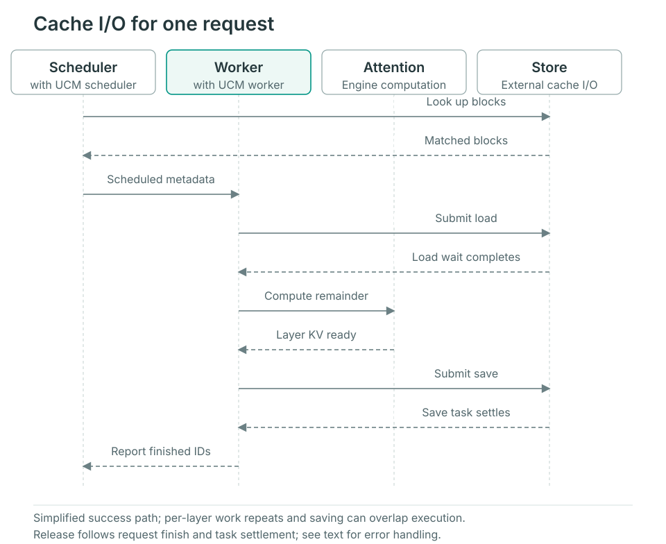

# Request lifecycle

Follow a regular vLLM prefix-cache request. Scheduler and Worker each own a UCM Connector and cooperate through engine-carried metadata, not a shared Python request object. Model-specific layouts and other engines differ as described below.

## Startup preparation

`UCMConnector` reads configuration and selects an implementation using KV layout, parallel execution and `use_layerwise`. After the engine creates KV buffers, `register_kv_caches()` gives the Worker tensor layouts and device addresses. These mappings serve multiple requests; each request's load/save range is determined after scheduling.

## From lookup to completion

The figure simplifies one successful reuse followed by saving. The Worker includes the engine's UCM hooks; Attention remains engine computation.



### 1. Scheduler finds a reusable prefix

The engine checks its own cache before calling `get_num_new_matched_tokens()`. The Connector generates UCM identifiers, queries external blocks after the already-computed portion, records request matches and returns additional reusable tokens.

The regular path returns `False` as the second result: it does not use the scheduling mode that resumes a request after asynchronous load completion. Store transfers can still be asynchronous, and the Worker must wait before consumption. `update_state_after_alloc()` is a no-op in the regular direct implementation; block mappings are created from scheduling output in the next step.

### 2. Scheduling output becomes Worker metadata

`build_connector_meta()` reads scheduled new/cached requests and engine block IDs to construct `UCMConnectorMetadata`. Load/save records map UCM identifiers to engine block positions, which the Worker resolves into device addresses.

A new request may load existing blocks and save new ones. Continuing chunked prefill usually saves newly completed blocks; resumption after preemption must reconsider loading. Metadata describes this step's work, not completed movement.

### 3. Worker loads; Attention waits before use

`start_load_kv()` submits loads using metadata and registered layouts. The direct implementation waits for this step's loads in that method; `wait_for_layer_load()` performs no additional per-layer wait.

The layerwise implementation submits the first layer in `start_load_kv()`. Before each Attention layer, `wait_for_layer_load()` waits for that layer and submits the next, allowing next-layer transfer to overlap current-layer computation. Invalid-block reports and Worker metadata carry load failures back to the engine and Scheduler instead of treating lookup hits as usable device data.

### 4. Save new blocks and track asynchronous tasks

The layerwise path submits saves in `save_kv_layer()`; the direct path primarily submits whole-block saves in `wait_for_save()`. Submission passes device synchronization events and source addresses so transfer reads data only after the required compute dependency.

`wait_for_save()` also polls earlier saves. Returning from the method does not mean every external write has ended. The Connector tracks pending tasks, associated requests and synchronization events. Store `check()` and `wait()` provide task completion checks.

### 5. Finish the request and release KV buffers

When the Scheduler calls `request_finished()`, the Connector checks whether asynchronous saving is involved. Returning `True` asks the engine to defer releasing the corresponding KV blocks. The Worker later waits for related pending saves in `get_finished()` and reports request IDs so the engine can continue resource reclamation.

This feedback ends transfer ownership; failed tasks also need a completed resource lifecycle. Verify errors and [restart/replay behavior](../user-guide/observability/verify-cache.md) to establish persistence. Permission to release a buffer does not establish a successful cache write.

## Layout and engine differences

| Path | What to inspect |
| --- | --- |
| MLA, CP and hybrid attention | Connector selection, rank consistency, shard layouts and model-specific save rules; `use_layerwise` alone does not identify the full path |
| SGLang | HiCache provides host buffers and the storage adapter uses Posix; follow its storage calls |

Start at `UCMConnector` in `ucm/integration/vllm/ucm_connector.py`, then follow `UCMDirectConnector`, `UCMLayerWiseConnector` and the selected model Connector. See [Store extension](extending-store.md) for task and error semantics.

## Experimental dump source fences

The Ascend V4.1 FAWA connector normally drains earlier dumps in
`handle_preemptions()`, before the engine can zero, recycle, load or overwrite
device KV pages. Running requests also require this protection: sliding-window
and compressed state can be updated in place without an explicit preemption.

For an A3 build using Cache2 SDMA Direct, an experimental option replaces the
current dump's host completion wait with device-stream dependencies:

```yaml
enable_event_sync: true
enable_async_dump_source_fence: true  # default: false
use_layerwise: false
ucm_connectors:
  - ucm_connector_name: UcmPipelineStore
    ucm_connector_config:
      store_pipeline: "Cache|Posix"
      storage_backends: "/path/to/kv-cache"
      cache_buffer_capacity_gb: 32
      posix_io_engine: psync
```

The existing upstream `handle_preemptions()` hook is unchanged. The engine and
vLLM Ascend do not import UCM types or need new callbacks. The option is limited
to the Ascend V4.1 FAWA layout and requires event synchronization. Other stores,
Cache implementations and copy streams without the optional fence capability
retain host waits. Turn the option off to restore the original behavior.

### Ordering and ownership

1. The compute stream records the producer-ready event after writing the old KV.
2. Every Cache copy stream waits for that event, submits its source reads, then
   records its own completion event. The dispatcher publishes the fence only
   after all record calls have returned; a created but unrecorded event is never
   exposed to the consumer.
3. In `handle_preemptions()`, the connector waits for record **submission**, then
   queues waits for all copy-stream events on the current compute stream. The
   CPU can continue input and metadata preparation before the copies complete.
4. A consumer acknowledgement is recorded immediately after those waits. The
   connector retains the native fence until that acknowledgement completes.
   Copy completion alone is insufficient to destroy events still referenced by
   queued compute-stream waits.
5. Ordinary Store `check()`/`wait()`, rank-consistency failure tracking and
   request-finish reporting remain authoritative for task completion. Finishing
   requests still drain their tasks and acknowledgements before releasing KV.
   The existing upstream `shutdown()` hook is forwarded by the outer UCM
   connector and drains outstanding FAWA fences during graceful worker shutdown.

The optional C++ `DumpSourceFenceProvider` interface leaves `StoreV1` unchanged.
Its default Python counterpart returns `None`. The health breaker forwards
fence requests for existing tasks even after opening, because those source
buffers still require protection. Rebuild the complete UCM package when using
the new native/Python interfaces together.

This version keeps the dispatcher's existing stream synchronization and SDMA
descriptor lifetime. It does not pipeline multiple tasks through a busy copy
dispatcher: waiting for submission can still block behind an earlier task or
cache/back-end pressure. Devices still wait before overwriting KV; metadata
device operations on the same compute stream also remain behind the fence.
This optimization targets CPU preparation overlap and does not remove those
data dependencies or guarantee a throughput improvement.

### Validation before enabling

Validate on the actual A3 deployment, including its main/auxiliary writer
streams, draft/speculative work, graph mode and other MultiConnector children.
All later KV writers must execute on the guarded stream or inherit its
dependency. Independently submitted writer streams are not protected by this
option. Loads retain their existing synchronization.

Compare cache contents and generated outputs with the option disabled, cover
chunked prefill, SWA/ring reuse, preemption, request completion and repeated
external cache hits, and collect a trace for the same workload. Confirm that
CPU metadata starts earlier, all D2H reads precede subsequent KV writes, and
event handles/task counts remain bounded. CPU-only tests and a successful
native build do not establish these device properties or performance gains.
