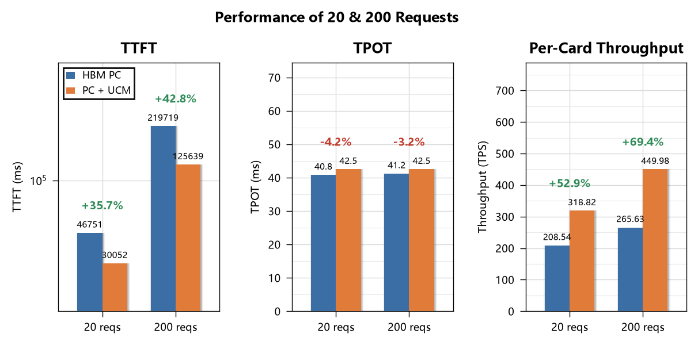

# AISBench性能测试——使用UCM的GLM5.3+A2-8机PD分离

本文记录在 A2-8 机（每节点 8×Ascend910B，共 8 节点）上，以 PD 分离架构部署 GLM-5.3 并启用 UCM后，使用 AISBench 进行精度与性能测试的完整过程与结果。

测试侧使用 AISBench：精度测试在标准数据集（如 ARC-c、ARC-e、GPQA_diamond、C-Eval、GSM8K）上评测，性能测试执行“预埋 → 正式测试 → 命中率前后对比”流程，重点观察前缀缓存与 UCM 命中带来的 TTFT、TPOT 与吞吐变化。

# 基准测试结果

## 精度测试

精度测试用于验证 UCM 接入后模型输出结果是否与原生 vLLM-Ascend 保持一致。测试覆盖 AI2 Reasoning Challenge – Challenge Set（ARC-C）、AI2 Reasoning Challenge – Easy Set（ARC-E）、Graduate-Level Google-Proof Q&A Benchmark（GPQA）、C-Eval、Grade School Math 8K（GSM8K）五个数据集，分别记录原生与 UCM 各两轮结果。从对比图可见，UCM 在各数据集上的精度与原生基本持平，差异处于正常波动范围内，未出现系统性下降，说明启用 UCM 未对模型推理正确性产生实质影响。

<p align="center">
  
</p>

## 性能测试

此处性能测试在输入长度 65536、输出长度 512、预埋率 90%、最大并发 76 的条件下，对比两种测试请求数下 HBM PC 与 PC+UCM 两种配置在 TTFT、TPOT 与单卡吞吐三项指标上的表现，以观察 UCM 的性能收益。两种请求数分别对应 HBM 未被击穿，以及 HBM 完全失效、仅由 UCM 外部存储层提供命中的工况。

1. **20 请求数的选取依据**：本次任务中 GLM-5.3 模型采用 1P4D（4 机 Prefill、4 机 Decode）方式部署，单节点可用 GPU KV Cache 容量为 336,384 tokens，按单条请求的 KV Cache 占用折算，每节点可容纳 5 条请求；Prefill 与 Decode 各占 4 机，合计可容纳 20 条请求，故选取 20 作为该工况下的请求数基准。

2. **200 请求数的选取依据**：请求规模显著超出 HBM 可容纳的 20 条请求上限，使 HBM 前缀缓存被完全击穿、prefix hit rate 归零，从而单独考察仅由 UCM 外部存储层提供命中时的性能表现。

<p align="center">
  
</p>

图中可以看出，UCM 的收益主要体现在 TTFT 与单卡吞吐上，TPOT 则基本持平。具体而言：

1. **TTFT**：PC+UCM 明显低于 HBM PC，说明 UCM 前缀命中有效减少了预填充阶段的计算量，负载越高收益越显著。
2. **TPOT**：两种配置差异很小，UCM 侧略有上升，属于解码阶段的小幅开销，不影响整体可用性。
3. **单卡吞吐**：PC+UCM 显著高于 HBM PC。

命中率具体数值对比如下：

<p align="center">
  
</p>

如图可得如下分析：

1. **请求数为 20 时**：HBM 与 UCM 尚能协同命中，HBM prefix hit rate 与 UCM external hit rate 共同构成命中来源。
2. **请求数为 200 时**：HBM 前缀缓存因容量不足被完全击穿，prefix hit rate 归零，UCM external hit rate 仍维持较高水平，成为唯一命中来源。

需注意，DP4、TP8 实例对外仅暴露 prefill0 服务地址，请求按默认随机负载均衡分发至 4 台机器，首轮与重放请求不一定落在同一台机器上，导致 HBM 无法完全命中。该多实例架构使 20 请求工况的 HBM 命中率大幅下降且具有随机性，最终呈现 6.6% 与 20.6% 的命中率。

综上，UCM 在 HBM 容量受限的高负载场景下能够有效承接被驱逐的前缀缓存，维持较高的外部命中率，从而降低 TTFT、提升单卡吞吐；TPOT 的轻微上升属解码阶段的正常开销，不影响整体可用性。对于长输入、高并发的推理场景，UCM 可作为 HBM 缓存的有效扩展层，在缓存容量成为瓶颈时提供稳定的性能收益。

### 详细性能数据

| 总请求数 | TTFT HBM PC (ms) | TTFT PC+UCM (ms) | TPOT HBM PC (ms) | TPOT PC+UCM (ms) | 单卡吞吐 HBM PC (TPS) | 单卡吞吐 PC+UCM (TPS) | HBM PC 平均并发 | HBM PC prefix hit rate | PC+UCM 平均并发 | PC+UCM prefix hit rate | PC+UCM external hit rate |
|---|---|---|---|---|---|---|---|---|---|---|---|
| 20 | 46751.2 | 30052.0 | 40.8 | 42.5 | 208.54 | 318.82 | 14 | 6.64% | 16 | 20.59% | 69.23% |
| 200 | 219718.7 | 125638.9 | 41.2 | 42.5 | 265.63 | 449.98 | 62 | 0.00% | 64 | 0.00% | 89.82% |

# 测试环境概述

| 项目     | 配置/参数                                                     |
| -------- | ------------------------------------------------------------- |
| 模型     | GLM-5.3（`GLM-5.3-w8a8c8`，Ascend 量化）                      |
| 硬件平台 | 8×Ascend910B，共 8 节点                        |
| 部署架构 | PD 分离                                                       |1
| 并行策略 | TP=8、DP=4、DP-local=1、EP 开启                               |
| KV 传输  | `MooncakeConnectorV1` + `mooncake` router，`kvPortBase=36000` |
| UCM      | 启用（`UcmPipelineStore` + `Cache\|Posix`，双 hostPath 盘）   |
| 推理引擎 | vLLM（V1 引擎，`VLLM_USE_V1=1`）                              |
| 测试基准 | AISBench                                                      |

# 部署指南

## 模型参数

| 参数                        | 值                                         | 说明                            |
| --------------------------- | ------------------------------------------ | ------------------------------- |
| `modelSpec.name`            | `glm-53`                                   | K8s 资源名片段，小写字母/数字/- |
| `modelPath`                 | `/mnt/model/GLM-5.3-w8a8c8`                | 模型权重路径                    |
| `modelName`                 | `glm-53`                                   | 服务内模型名                    |
| `shmSize`                   | `800Gi`                                    | 共享内存                        |
| `dataParallelMode`          | `standard`                                 | 数据并行模式                    |
| `recoveryPolicy`            | `None`                                     | 不自动恢复                      |
| `restartGracePeriodSeconds` | `60`                                       | 重启宽限期                      |
| `containerPort`             | `8000`                                     | 引擎服务端口                    |
| `quantization`              | `ascend`                                   | Ascend 量化                     |
| `max-model-len`             | `262144`                                   | 最大上下文 256K                 |
| `gpu-memory-utilization`    | `0.92`                                     | 显存利用率                      |
| `safetensors-load-strategy` | `prefetch`                                 | 权重加载策略                    |
| `seed`                      | `1024`                                     | 随机种子                        |
| 投机推理                    | `deepseek_mtp`，`num_speculative_tokens=1` | MTP 投机解码                    |
| 工具/推理解析器             | `glm47` / `glm47`                          | tool-call 与 reasoning parser   |


## KV-transfer 配置

1. **Prefill节点：**
```
--kv-transfer-config '{"kv_connector": "MultiConnector", "kv_role": "kv_producer", "engine_id": "0", "kv_connector_extra_config": {"connectors": [{"kv_connector": "MooncakeConnectorV1", "kv_role": "kv_producer", "kv_port": "37000", "kv_connector_extra_config": {"use_ascend_direct": true, "prefill": {"dp_size": 4, "tp_size": 8}, "decode": {"dp_size": 4, "tp_size": 8}}}, {"kv_connector": "UCMConnector", "kv_role": "kv_both", "kv_connector_module_path": "ucm.integration.vllm.ucm_connector", "kv_connector_extra_config": {"UCM_CONFIG_FILE": "/vllm-workspace/UnifiedCache/config/ucm_config.runtime.yaml"}}]}}'
```

2. **Decode节点：**
```
--kv-transfer-config '{"kv_connector":"MooncakeConnectorV1", "kv_role":"kv_consumer", "kv_port":"37100", "kv_connector_extra_config":{"use_ascend_direct": true, "prefill":{"dp_size":4,"tp_size":8}, "decode":{"dp_size":4,"tp_size":8}}}'
```

## Prefill节点 & Decode节点
具体参数详见 [vLLM Ascend 官网 Getting Started —— GLM-5.2 & GLM-5.3 板块](https://docs.vllm.ai/projects/ascend/en/latest/tutorials/models/GLM5.2.html)