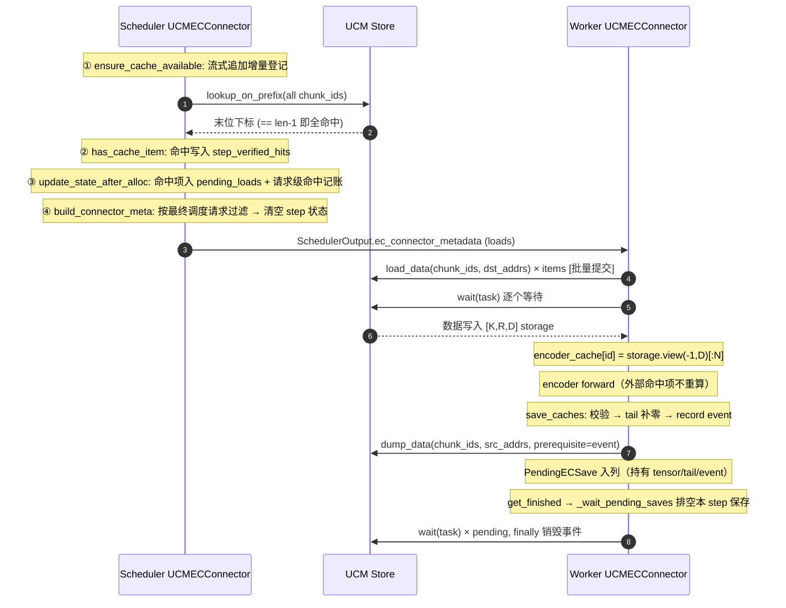

# UCM EC Connector 设计

**EC Connector 功能定位**：把 vLLM 多模态 Encoder Cache（EC）中变长的 `[N, D]` encoder 输出张量，按固定行数切成若干固定尺寸 chunk 存入 UCM Store；同一模型实例内，相同媒体内容的 EC item 可跨请求复用，命中时跳过 encoder 重算。

**版本关键特性**：

1. **Load 流水化**：Worker 在一次 `start_load_caches()` 调用内先批量提交全部 `load_data`，再逐个 `wait`，提交与等待解耦；任一环节失败都保证已提交任务被排空。
2. **Save 异步化**：`save_caches()` 记录设备事件后通过 `dump_data(prerequisite_handle=...)` 异步提交，任务与源张量引用入 `_pending_saves`；由 `get_finished()`（每 step 末尾）和 `shutdown()` 统一排空。
3. **Key 隔离**：chunk key 的哈希元数据为紧凑 JSON `("ucm:ec:v2", 模型身份, deepstack 层索引)`，物理布局（width、dtype、rows_per_chunk）显式进入每个 chunk key，不同布局部署互为 miss。
4. **流式增量登记**：Scheduler 侧按 `processed_feature_count` 增量处理流式追加的媒体特征，两阶段提交（先全量校验，后引用计数提交），行数冲突 fail-fast。
5. **最终调度过滤**：metadata 下发前按 `num_scheduled_tokens > 0` 的最终请求集合过滤 loads，被撤销请求不触发无效加载。
6. **全命中判定**：`lookup_on_prefix()` 返回值到达最后一个 chunk 下标（`len-1`）才判 EC 命中，部分前缀命中一律按 miss 处理。
7. **load 失败 fail-closed**：load 失败会阻断本次执行（引擎级错误），不向 `encoder_cache` 插入未完成数据；无自动 encoder 重算。

**后续演进计划**（详见第 10 节）：

- load failure 请求级处理与自动重算——当前 fail-closed 的恢复协议，核心缺口；
- 请求级错误隔离——布局冲突等错误只结束相关请求，不拖垮引擎；
- 异步 load——`transfer_id`、load 流到 compute 流的事件依赖、多 rank 完成聚合；
- Prometheus 指标接入与真实设备启动自检；
- multimodal pruning 等动态布局支持。

---

## 1. 总体代码结构

### 1.1 文件布局

| 文件 | 职责 |
| --- | --- |
| `ucm/integration/vllm/ucm_ec_connector.py` | EC connector本体：layout 解析、chunk key、Scheduler/Worker 全部接口、Store 组装 |
| `examples/ucm_ec_config.yaml` | EC 配置示例 |
| `test/test_ucm_ec_config.py` | 单元测试（CPU 张量 + Mock Store I/O） |

### 1.2 组件概览

connector在 Scheduler 与 Worker 两个进程各有一个 `UCMECConnector` 实例：

- **Scheduler 侧**维护四类状态容器（`req_to_state`、`identifier_to_blocks`、`step_verified_hits`、`pending_loads`），经 `ensure_cache_available → has_cache_item → update_state_after_alloc → build_connector_meta` 完成一个调度 step 内的登记、命中查询、load 计划生成与下发；请求收尾由 `request_finished` 回收。
- **Worker 侧**经 `bind_connector_metadata → start_load_caches → save_caches → get_finished` 完成外部加载、异步保存与 step 末排空，产出写入 vLLM 的 `encoder_cache`。
- 两侧通过 `UCMECConnectorMetadata(loads)` 随 `SchedulerOutput` 传递；Store I/O 只使用 `lookup_on_prefix`、`load_data`、`dump_data(+prerequisite event)`、`wait` 四个接口。

完整的调用时序与状态更新过程见 5.1 节的时序图。

### 1.3 角色与门控

| 维度 | 取值 | 来源与作用 |
| --- | --- | --- |
| `role` | `SCHEDULER` / `WORKER` | 决定是否初始化 device、Store 的 GC/IO 参数 |
| `is_producer` / `is_consumer` | 来自 `ec_transfer_config` | producer 才执行 save；consumer 才执行 lookup/提交 load |
| `is_save_rank` | 仅 WORKER 判定：`pp_first && tp_rank==0 && pcp_rank_in_group==0` | 同一 DP 域内唯一 dump rank，`save_caches()` 内部自校验，不依赖外层 runner |
| `gc_owner` | `role==SCHEDULER && dp_rank==0` | Store 的 `posix_gc_enable` 唯一持有者 |

---

## 2. 主要数据结构（数据描述）

### 2.1 结构定义

| 结构 | 定义 | 角色 | 生命周期 | 说明 |
| --- | --- | --- | --- | --- |
| `EncoderCacheLayout` | `frozen dataclass: width:int, dtype:torch.dtype, rows_per_chunk:int, chunk_bytes:int` | 两侧 | 进程生命周期，不可变 | EC item 的物理解释方式；`chunk_bytes = rows_per_chunk × width × element_size` |
| `IdentifierState` | `dataclass: num_embeds:int, chunk_ids:tuple[bytes,...], request_ref_count:int=0` | Scheduler | 被至少一个活跃请求引用期间 | 一个 EC item 的全部 chunk key；`num_chunks = len(chunk_ids)`，不冗余存储可推导字段 |
| `RequestState` | `dataclass: processed_feature_count:int=0, identifier_states:dict[str,IdentifierState], hit_identifiers:set[str]` | Scheduler | request 生命周期（finish/abort/cancel 时删除） | 记录已校验到第几个流式 feature；`hit_identifiers` 汇总本请求被确认命中的 item |
| `ECLoadSpec` | `frozen dataclass: num_embeds:int, chunk_ids:tuple[bytes,...]` | Scheduler→Worker | 单个调度 step | 一次外部 load 的完整描述 |
| `UCMECConnectorMetadata` | `dataclass(ECConnectorMetadata): loads:dict[str,ECLoadSpec]` | Scheduler→Worker | 单个 model execution step | 随 `SchedulerOutput.ec_connector_metadata` 下发 |
| `PendingECSave` | `dataclass: identifier:str, task:Task, tensor:Tensor, tail:Tensor\|None, event_handle:int` | Worker | 提交后到 `_wait_pending_saves` 排空前 | 持有源张量与 tail 引用防止释放；`event_handle` 待销毁 |

### 2.2 connector实例状态

| 字段 | 角色 | 用途 | 清理时机 |
| --- | --- | --- | --- |
| `req_to_state: dict[str, RequestState]` | Scheduler | request → 引用状态 | `request_finished()` pop；`shutdown()` 清空 |
| `identifier_to_blocks: dict[str, IdentifierState]` | Scheduler | item → 共享状态（跨请求复用同一对象） | ref count 归 0 删除；`shutdown()` 清空 |
| `step_verified_hits: set[str]` | Scheduler | 本 step 经 Store lookup 确认的命中 | `build_connector_meta()` 清空 |
| `pending_loads: dict[str, ECLoadSpec]` | Scheduler | 本 step 待下发的 load 计划 | `build_connector_meta()` 过滤后移交给 metadata 并换新 dict |
| `_pending_saves: list[PendingECSave]` | Worker | 未排空的异步保存 | `get_finished()` / `shutdown()` 排空 |
| `_connector_metadata` | Worker | 基类字段，`bind_connector_metadata` 绑定 | `clear_connector_metadata()`（不清 `_pending_saves`，二者无关） |

### 2.3 错误类型

| 异常 | 基类 | 携带信息 | 使用场景 |
| --- | --- | --- | --- |
| `EncoderCacheLayoutError` | `ValueError` | 消息文本 | 配置/layout 违例：宽度、chunk_size、pruning、行数冲突、feature 缩短、load 元数据非法、dump 张量形状不符 |
| `UCMEncoderCacheError` | `RuntimeError` | `.identifier`（出错 item 标识） | Store I/O 失败、命中项缺 Scheduler 状态等与特定 identifier 绑定的运行期错误 |

---

## 3. 接口定义描述

### 3.1 vLLM EC Connector 接口

`UCMECConnector` 继承 `ECConnectorBase`，实现以下接口；`bind_connector_metadata` / `clear_connector_metadata` 直接使用基类实现。

| 接口 | 角色 | 调用时机（vLLM 侧） | 本实现行为 |
| --- | --- | --- | --- |
| `__init__(vllm_config, role)` | 两侧 | 引擎构造 connector | fail-fast 校验 → 解析 layout → 建 hasher → 建 Store |
| `ensure_cache_available(request, num_computed_tokens)` | Scheduler | waiting 请求被调度前（chunked prefill/抢占后重复进入） | 流式增量登记 item 状态，`num_computed_tokens` 忽略 |
| `has_cache_item(identifier)` | Scheduler | 扫描 encoder 输入时 | `lookup_on_prefix` 全命中谓词；命中写入 `step_verified_hits` |
| `update_state_after_alloc(request, index)` | Scheduler | 本地 encoder cache `allocate()` 成功后 | 命中项写入 `pending_loads` 与请求命中记账 |
| `build_connector_meta(scheduler_output)` | Scheduler | 构造 `SchedulerOutput` 时 | 按最终调度请求过滤 loads → metadata；清 step 状态 |
| `request_finished(request)` | Scheduler | finish/abort/cancel 释放请求时 | 删 request 态、递减 ref count、输出命中汇总日志 |
| `start_load_caches(encoder_cache, **kwargs)` | Worker | model forward 前 | 批量提交 load → 逐个等待 → 发布截断视图 |
| `save_caches(encoder_cache, mm_hash, **kwargs)` | Worker | encoder 输出新 entry 产生后 | 门控 → 校验 → tail 补零 → 事件前置 → 异步提交 dump |
| `get_finished(finished_req_ids)` | Worker | 每 step 末尾 | 排空 `_pending_saves`；恒返 `(None, None)` |
| `shutdown()` | 两侧 | 进程退出 | 先排空保存，再清状态、关 Store |
| `register_caches(ec_caches)` | Worker | 初始化注册期 | 不覆写，继承基类 no-op（上游暂无调用方） |
| `update_connector_output(output)` | Scheduler | 收到 Worker 输出后 | 不覆写，继承基类 no-op（P1-3 失败上报接入时实现） |
| `has_pending_push_work()` | Scheduler | engine 轮询 | 不覆写，继承基类 `False`（pull 模型无 push 工作） |
| `build_connector_worker_meta()` | Worker | step 末尾 | 不覆写，继承基类 `None`（P1-3 失败上报接入时实现） |

### 3.2 使用的 UCM Store V1 接口

```python
lookup_on_prefix(block_ids: list[bytes]) -> int
    # 前缀扫描，返回最后一个连续存在 chunk 的下标；-1 表示全缺。
load_data(block_ids: list[bytes], shard_index: list[int],
          dst_addr: np.ndarray) -> Task                  # 提交设备→Store 的批量读
dump_data(block_ids: list[bytes], shard_index: list[int],
          src_addr: np.ndarray,
          prerequisite_handle: int = 0) -> Task           # 提交 Store→设备 的批量写；
                                                          # Store 拷贝流先等待该事件再 D2H
wait(task: Task) -> None                                  # 阻塞至任务完成
```

约束：每个 chunk 只有一个 shard，`shard_index` 恒为 `[0] * n`；地址采用 `load_data/dump_data` 的裸设备指针形态（`np.ndarray(uint64)` 列向量），EC 不预注册 GPU buffer（`use_gdr` 强制 `False`）。Store 的 `lookup`、`lookup_on_reverse`、`prefetch`、`check`、tensor 形态的 `load/dump` 在本版 EC 中未使用。

### 3.3 配置接口

**vLLM 入口**（`ECTransferConfig`，经 `--ec-transfer-config` 传入），完整 serve 示例：

```bash
vllm serve Qwen/Qwen2.5-VL-7B-Instruct \
    --tensor-parallel-size 2 \
    --ec-transfer-config '{
        "ec_connector": "UCMECConnector",
        "ec_role": "ec_both",
        "ec_connector_module_path": "ucm.integration.vllm.ucm_ec_connector",
        "ec_connector_extra_config": {
            "UCM_CONFIG_FILE": "/workspace/ucm_ec_config.yaml"
        }
    }'
```

字段说明（与 `vllm/config/ec_transfer.py` 的 `ECTransferConfig` 对应）：

| 字段 | 必填 | 说明 |
| --- | --- | --- |
| `ec_connector` | 是 | connector 类名，经 `ec_connector_module_path` 加载 |
| `ec_role` | 指定 `ec_connector` 时必填 | `ec_producer` / `ec_consumer` / `ec_both`；决定 `is_producer`/`is_consumer` 门控 |
| `ec_connector_module_path` | 是 | connector 模块路径，UCM 实现为 `ucm.integration.vllm.ucm_ec_connector` |
| `ec_connector_extra_config.UCM_CONFIG_FILE` | 是 | EC 专用 YAML 路径（即下文的 `ucm_ec_connector` 段所在文件） |

**EC 专用 YAML**（`Config.load_ec_config()` 读取 `ucm_ec_connector` 段并原样返回）：

```yaml
ucm_ec_connector:
  ucm_connector_name: "UcmPipelineStore"        # 必填, 经 UcmConnectorFactoryV1 选择 Store
  ucm_connector_config:                          # 必填, 透传给 Store 的参数
    store_pipeline: "Cache|Posix"
    storage_backends: "/mnt/test"                # 冒号分隔字符串, 创建前按 ":" 切分为列表
    posix_capacity_gb: 10240
    posix_io_engine: "psync"
    posix_data_trans_concurrency: 128
    cache_buffer_capacity_gb: 32                 # 缺省 128; 创建前检查 /dev/shm 容量
  encoder_cache_config:                          # 必填
    chunk_size: 128                              # 必填, 每个 chunk 的行数 R
    # 可选: encoder_cache_hidden_dim / cache_namespace / store_unique_id
    # 未配置时宽度自动推导, namespace 自动构造, unique_id 经跨进程握手生成
```

| 字段 | 必填 | 缺省行为 | 校验 |
| --- | --- | --- | --- |
| `ucm_connector_name` | 是 | — | producer 模式下额外要求 `UcmPipelineStore` 且 pipeline 首段 ∈ {Cache, Mooncake, YuanRong}，否则 `ValueError` |
| `ucm_connector_config.store_pipeline` | 否 | `""` | 决定 GC block size 推导分支（`YuanRong\|Posix` 特殊处理） |
| `ucm_connector_config.use_gdr` | 否 | 强制 `False` | 用户配置该键仅输出 warning，不生效 |
| `encoder_cache_config.chunk_size` | 是 | — | 必须为正整数（拒绝 bool），否则 `EncoderCacheLayoutError` |
| `encoder_cache_config.encoder_cache_hidden_dim` | 否 | 按模型结构推导 | 显式值必须为正 |
| `encoder_cache_config.cache_namespace` | 否 | 由模型身份元组构造 | 显式 namespace 仍叠加 deepstack 层索引盐 |
| `encoder_cache_config.store_unique_id` | 否 | `{握手 uuid}.ec.dp{dp_rank}`（KV 同款跨进程握手） | Store 共享/隔离域：同 id 共享共享内存与命名空间 |

### 3.4 Chunk key 编码格式

```text
meta   = json.dumps(("ucm:ec:v2", identity_source, deepstack_indexes),
                    ensure_ascii=False, separators=(",", ":"))          # connector 级常量
identity_source = cache_namespace 显式值
                | (model, revision, code_revision, tokenizer_revision,
                   hf_config._commit_hash, tuple(architectures),
                   multimodal_config.compute_hash())                    # 自动构造

chunk_id[i] = md5(meta_bytes + pickle.dumps(
                  (width, str(dtype), rows_per_chunk,
                   identifier, num_embeds, i))).digest()      # 16 字节 raw bytes
K = ceil(num_embeds / rows_per_chunk)
```

设计要点：

- `num_embeds` 进入 key，防止同一 identifier 异常对应不同 N 时短对象误命中长对象前缀；
- layout 三元组（width/dtype/rows_per_chunk）进入 key，不同布局部署互为 miss 而非误读数据；
- deepstack 层索引即使使用显式 namespace 也保留——等宽不同层选取的 EC 不能复用；
- key 不含 TP/PCP/DP rank、speculative、KV sparse 等 KV 专属部署语义；
- EC key 格式升级（`ucm:ec:v2`）后旧持久化对象自然 miss，由 Store 既有回收机制淘汰，不做旧格式回退。

---

## 4. 算法执行流程（核心算法设计）

### 4.1 宽度解析（`resolve_encoder_cache_layout`）

按以下优先级解析 EC 输出宽度 D，不按模型名称/路径选择分支：

1. 显式配置 `encoder_cache_hidden_dim`；
2. 复用 vLLM 规范实现 `_get_encoder_cache_hidden_dim`（`vllm/distributed/ec_transfer/ec_connector/cpu/common.py`，vllm-ascend 的 EC 连接器同样复用）：仅当 `out_hidden_size` 与**非空** `deepstack_visual_indexes` 同时存在时，`D = out_hidden_size × (1 + len(deepstack_visual_indexes))`——该乘法规则专用于把 deepstack 特征拼接入缓存张量的模型（如 Qwen3-VL 家族）；
3. 其余情况（`out_hidden_size` 缺失，或存在但无 deepstack）一律兜底 `model_config.get_inputs_embeds_size()`。孤立的 `out_hidden_size` 不作为宽 EC 条目的证据：EC 存的是 merger 之后的 embedding，宽度通常等于 LLM hidden size。

随后：`dtype = model_config.dtype`；`rows_per_chunk = chunk_size`（严格 int 校验）；`chunk_bytes = R × D × element_size`。`D <= 0` 抛 `EncoderCacheLayoutError`。

### 4.2 EC item → 固定 chunk 映射

一个 EC item 是变长的二维张量 `[N, D]`，而 UCM Store 以固定大小 block 为寻址与 I/O 单位；connector按固定行数把它切成 K 个逻辑 shape 恒为 `[R, D]` 的 chunk，使每个 chunk 恰好映射为一个 UCM block。四个符号的含义：

| 符号 | 含义 | 来源 |
| --- | --- | --- |
| N | 该 item 的 encoder embedding 行数（张量第一维） | Scheduler 取自 `request.get_num_encoder_embeds(index)`；Worker dump 以实际张量第一维为准。两侧不一致时因 `N` 进入 chunk key 而表现为 miss，不会误读数据 |
| D | encoder 输出宽度（张量第二维），实例生命周期内固定 | 启动期解析：显式 `encoder_cache_hidden_dim` → `_get_encoder_cache_hidden_dim`（vLLM 规范：仅 deepstack 非空才乘）→ `get_inputs_embeds_size()`（见 4.1 节） |
| R | rows_per_chunk，每个 chunk 沿第一维的行数 | 配置 `encoder_cache_config.chunk_size`，必须为正整数 |
| K | 一个 item 被切成的 chunk 数量 | `K = ceil(N / R)`，即 chunk_id 列表长度 |

**按 chunk_size 固定切块的目的**：

- **适配 Store 的固定 block 接口**：Store 不支持变长对象；固定 R 行后每个 chunk 的字节数恒为 `chunk_bytes = R × D × element_size`，可直接套用与 KV connector 相同的 I/O 对齐推导（shard/block size），无需为 EC 增加任何 Store 能力；
- **免元数据**：chunk key 由 `(layout, identifier, N, chunk_index)` 确定性哈希得出（见 3.4 节），Scheduler 与 Worker 各自独立推导出同一组 key，不需要持久化或同步 manifest；
- **命中语义简单且安全**：全部 K 个 chunk 都存在才判 item 命中——EC 缺任何一行 embedding 都无法构造完整输出，因此不做部分前缀复用（见 4.3 节）；
- **布局隔离**：D、dtype、R 显式进入 key，不同布局的部署互为 miss，不会误读彼此的数据。

代价与权衡见第 6 节：R 过小会放大 block 数量、lookup 次数与 Posix 小 I/O 压力；R 过大则尾部 padding 浪费、淘汰粒度变粗、单次传输延迟增加。

**Dump 侧**（实际张量 `[N, D]`，N 以张量第一维为准）：

- `K = ceil(N / R)`；前 `K-1` 个 chunk 直接使用原张量的连续内存区间；
- 尾 chunk 若 `N % R != 0`：分配 `[R, D]` 零张量，拷入有效行，最后一个源地址替换为 tail 指针——Store 始终按完整 `chunk_bytes` 访问，绝不允许越界读；
- 地址计算 `_chunk_addresses`：`offset[i] = uint64(data_ptr) + i × chunk_bytes`（逻辑 chunk 字节数，不是 Store 对齐后的物理 shard size），输出 `(K, 1)` 的 uint64 数组。

**Load 侧**（metadata 携带 `num_embeds` 与 `chunk_ids`）：

- 一次性分配 `[K, R, D]` padded storage；
- K 个 chunk 的目标地址为该 storage 内的连续偏移；
- 等待成功后发布 `storage.view(-1, D)[:N]`——视图引用 padded storage，随 vLLM encoder cache 生命周期释放。

**padding 与记账偏差**：

```text
每个 dump/load item 的 padding 浪费 < chunk_bytes
Scheduler 记账 bytes = Σ N_i × D × element_size
Worker  实际 bytes  = Σ ceil(N_i / R) × R × D × element_size
偏差上界 = len(L) × chunk_bytes   （L 为外部 load 的活跃 item 集合）
```

容量规划需为每个外部 load 活跃 item 预留不足一个 chunk 的显存余量。

### 4.3 全命中谓词

`has_cache_item()` 将 `lookup_on_prefix()` 当作"全部 chunk 存在"的判定使用：

| Store 中 chunk 状态 | `lookup_on_prefix` 返回 | 判定 |
| --- | --- | --- |
| `[T, T, T]` | `2 == len-1` | **hit** |
| `[T, T, F]` | `1` | miss |
| `[F, F]` | `-1` | miss |

EC item 缺任何 encoder embedding 都无法构造完整输出，因此不做部分前缀复用。选用 `lookup_on_prefix` 而非 `lookup` 是纯性能选择（一次 int 回传替代 bool 数组回传与聚合），语义等价。命中结果只进本 step 的 `step_verified_hits`，`build_connector_meta()` 必然清空，不会跨 step 产生陈旧命中。

### 4.4 Store 组装（`create_ucm_ec_store`）

```text
chunk_bytes = R × D × element_size
                │
      _get_store_io_sizes(chunk_bytes, chunk_bytes)      # 4096 对齐
                │
  store_shard_size, store_block_size                    # Worker 的 tensor_size_list/shard/block
                │
      _get_store_gc_block_size(pipeline, [chunk_bytes], shard, block)
                │            ├─ 普通 pipeline: gc_block = store_block_size
                │            └─ YuanRong|Posix: gc_block = Σtensor_size × shard_count（持久化对象实际大小）
                ▼
store_config 注入: unique_id / device_id / local_rank_size=TP / use_gdr=False
                   / share_buffer_enable=True / posix_gc_enable=gc_owner
                   + Worker: tensor_size_list=[chunk_bytes], shard_size, block_size
                   + gc_owner Scheduler: block_size=gc_block_size
                ▼
      UcmConnectorFactoryV1.create_connector(name, store_config)
```

- `unique_id` 缺省经 KV 连接器同款跨进程握手生成（Worker rank0 生成 uuid 并经 world group 广播、写入 `/dev/shm/ucm_ec_uniqueid_{ppid}`，Scheduler 读回；`ucm_connector.py: _worker_generate_unique_id / _scheduler_read_unique_id` 的 `prefix="ucm_ec"` 调用），再加 `.ec.dp{dp_rank}` 后缀：Scheduler 与本 DP 域 Worker 对齐到同一共享内存域，DP 域间隔离。EC 与 KV 使用各自前缀的文件槽（KV 保持 `ucm_`），同引擎双连接器互不覆盖；`instance_id` 为每次 VllmConfig 构造时的时间戳值，不保证跨进程一致，故不再作为对齐依据；需要跨 DP 共享 Posix 冷层时用显式 `store_unique_id` 覆盖。
- `local_rank_size = TP size`：共享 buffer 场景下各 rank 按错开顺序遍历 chunk，提高热层命中分布；每个 rank 仍加载完整 EC（单 writer 不变）。
- `cache_buffer_capacity_gb` 缺省 128，创建前用 `_check_shm_capacity` 校验 `/dev/shm` 容量，不足时启动失败。
- Store 配置为浅拷贝后注入，不修改用户 YAML。

---

## 5. 处理流程描述

### 5.1 一个执行 step 的端到端流程




### 5.2 外部命中路径与 miss 后保存路径

```text
【外部命中】
waiting 请求 → ensure_cache_available（增量登记 N / chunk_ids）
  → has_cache_item → lookup_on_prefix == len-1 → step_verified_hits
  → encoder_cache_manager.allocate → update_state_after_alloc → pending_loads
  → build_connector_meta（最终调度过滤）→ Worker
  → start_load_caches：分配 [K,R,D] → 批量 load_data → 逐个 wait
  → encoder_cache[id] = view(-1,D)[:N] → 模型消费，encoder 不重算

【miss → 本地计算 → 保存】
has_cache_item 为 miss → item 进入 encoder compute 路径
  → update_state_after_alloc 不产生 load
  → Worker 执行 encoder → encoder_cache[id] = [N,D]
  → wrapper（V2 diff-save 或 legacy eager-save）调用 save_caches
  → 门控(producer·save_rank) → 布局校验 → tail 补零 → record event
  → dump_data(prerequisite=event) → 入 _pending_saves
  → step 末 get_finished / shutdown 时排空 wait
  → 后续请求重新 lookup 即可命中
```

关键时序约束：

- `has_cache_item()` 命中 ≠ 本 step 一定调度该 item；只有 `allocate()` 成功后的 `update_state_after_alloc()` 才生成 load，因此 lookup 与 metadata 解耦；
- V2 wrapper 在记录 `cached_hashes` 之前执行 `start_load_caches()`，外部 load 进来的 entry 不会被 diff-save 再次 dump；
- 保存的事件在 tail padding `copy_()` **之后**记录，保证 Store 拷贝流等待设备写入完成后才读裸指针；
- UCM GC 与 Scheduler 内存状态无关：GC 删数据后，下一次 `has_cache_item()` 的真实 lookup 自然返回 miss，不需要删除通知。

### 5.3 关键函数描述

**connector初始化 `UCMECConnector.__init__`**

- 输入：`vllm_config: VllmConfig`、`role: ECConnectorRole`
- 输出：初始化完成的 connector（layout、hasher、Store、角色状态）
- 依赖：`Config.load_ec_config`、`build_ec_hash_meta`、`resolve_encoder_cache_layout`、`create_ucm_ec_store`、vLLM 并行组（`get_world_group` / `get_pp_group` / `get_pcp_group` / `get_tensor_model_parallel_rank`）、`create_device`
- 行为：① 检测 multimodal pruning 并拒绝；② 加载 EC YAML；③ producer 模式校验 Store 支持"队列化事件等待"（`UcmPipelineStore` 且首段 ∈ {Cache, Mooncake, YuanRong}，否则 `ValueError`——`Dram/Delegator` 在 Dump 内部等待，其他 stage 可能忽略事件，宁可在打开 Store 前失败也不引入阻塞保存回退）；④ 建 hasher 与 layout；⑤ Scheduler 保留 `-1/-1/None`，Worker 解析 `local_rank/device_id/device`；⑥ 建 Store；⑦ 初始化状态字典；Worker 另建 `_save_device` 并判定 `is_save_rank`；⑧ 输出启动日志（role/producer/consumer/layout/hash seed/save_rank）。

**流式登记 `ensure_cache_available`**

- 输入：`request: Request`、`num_computed_tokens`（忽略）
- 输出：`True`（正常登记完成）；失败抛异常
- 依赖：`request.mm_features`、`request.get_num_encoder_embeds(index)`、`make_chunk_ids`、`self.req_to_state`、`self.identifier_to_blocks`
- 行为：两阶段增量处理。第一阶段只遍历 `[processed_feature_count, len(mm_features))` 的新增 feature：先查请求历史/本批次，再查全局共享表；都没有则构造新 `IdentifierState`（生成 chunk ids），行数不一致抛 `EncoderCacheLayoutError`（区分"请求内"与"跨活跃请求"冲突）；第二阶段在整批校验通过后才提交——全局表 `setdefault` + `request_ref_count += 1` + 写入请求历史。`mm_features` 缩短抛异常；无新增时 O(1) 返回；preemption 重入不重复计数。

**命中查询 `has_cache_item`**

- 输入：`identifier: str`
- 输出：`bool`（是否全 chunk 命中）
- 依赖：`self.identifier_to_blocks`、`self.store.lookup_on_prefix`、`self.step_verified_hits`
- 行为：非 consumer 或无状态直接 miss；有状态则批量 lookup，返回值 `== len(chunk_ids)-1` 判命中并记录到本 step。Store 已关闭抛 `RuntimeError`。

**load 计划 `update_state_after_alloc`**

- 输入：`request: Request`、`index: int`
- 输出：无（副作用更新 `pending_loads` 与 `hit_identifiers`）
- 依赖：`step_verified_hits`、`identifier_to_blocks`、`req_to_state`
- 行为：仅 consumer 且 identifier 属于本 step 命中集时生效；先做请求级命中记账（在去重判断之前，保证共享同一 item 的每个请求都计入汇总），再以 `pending_loads` 去重；状态缺失抛 `UCMEncoderCacheError`（此时 Scheduler 已跳过 encoder compute，静默跳过会把错误延迟成缺失 encoder 输出）。

**元数据下发 `build_connector_meta`**

- 输入：`scheduler_output: SchedulerOutput`
- 输出：`UCMECConnectorMetadata`（loads 可能为空但对象非 None，保证 producer Worker 仍进入 EC wrapper 保存输出）
- 依赖：`scheduler_output.num_scheduled_tokens`、`scheduler_output.free_encoder_mm_hashes`、`req_to_state`、`pending_loads`
- 行为：取 `num_scheduled_tokens > 0` 的最终请求的 identifier 并集，过滤 `pending_loads`，再排除 `free_encoder_mm_hashes` 中最终已淘汰的条目，避免 Worker 删除后重新加载未分配的条目。保留本步合法共享；vLLM 的最终淘汰列表排除了同一步重新分配的条目，因此这些条目仍可加载。随后清空 `pending_loads` 与 `step_verified_hits`。

**请求收尾 `request_finished`**

- 输入：`request: Request`
- 输出：`(False, None)`
- 依赖：`req_to_state`、`identifier_to_blocks`
- 行为：pop 请求态；consumer 侧输出每请求命中汇总日志（`mm_items` 与 `hits_total`，全 miss 也输出 0）；对引用的每个 identifier 递减 ref count，归 0 立即删除全局态。只清内存状态，不删 Store 数据。

**批量加载 `start_load_caches`**

- 输入：`encoder_cache: dict[str, torch.Tensor]`（vLLM 本地缓存，原地写入）
- 输出：无（成功条目以 `view(-1,D)[:N]` 形式写入 `encoder_cache`）
- 依赖：`_get_connector_metadata`、`layout`、`device`、`store.load_data/wait`、`_chunk_addresses`
- 行为：① 跳过本地已存在的 identifier；② 校验元数据（`num_embeds > 0`、chunk 数与 N 匹配）；③ 分配 `[K,R,D]` storage 并计算地址；④ **先提交全部** `load_data`（提交失败包装为 `UCMEncoderCacheError` 抛出）；⑤ `finally` 中**逐个 `wait` 排空已提交任务**——成功发布视图并累计统计，失败 pop 条目、记录首个错误但不跳过后续等待；⑥ 循环结束后若存在等待错误，统一抛 `UCMEncoderCacheError`（fail-closed）。任何阶段失败都不向 `encoder_cache` 插入未完成数据。

**保存 `save_caches`**

- 输入：`encoder_cache: dict[str, torch.Tensor]`、`mm_hash: str`（即 identifier）
- 输出：无（异步提交，任务入 `_pending_saves`）
- 依赖：`is_producer`、`is_save_rank`、`_validate_encoder_tensor`、`make_chunk_ids`、`_chunk_addresses`、`_save_device.get_event_handle`、`store.dump_data`
- 行为：门控不满足直接返回；取张量、布局校验（2 维/正行数/宽度/dtype/连续）、生成 chunk ids 在 `try` 之外（异常沿 runner 调用链传播）；切块与 padding、地址计算、事件记录、`dump_data` 提交、入列在 `try` 内（异常销毁事件、记录日志、不影响当前请求——保存是旁路优化）。

**排空保存 `_wait_pending_saves`**

- 输入：无（消费 `self._pending_saves`）
- 输出：无
- 依赖：`store.wait`、`_save_device.destroy_event_handle`
- 行为：先整体换出新列表再逐个 `wait`；单个失败记日志继续等待后续（best-effort 不互相拖累）；`finally` 销毁事件句柄。由 `get_finished()`（每 step）与 `shutdown()` 调用。

**关闭 `shutdown`**

- 输入/输出：无
- 依赖：`_wait_pending_saves`、各状态容器、`store.close()`
- 行为：先排空在途保存，再清空 load/hit/request/identifier 状态、`clear_connector_metadata()`，最后关闭 Store（存在 `close` 方法才调用）。置 `self.store = None` 使后续 I/O 触发明确的 `RuntimeError`。

**无操作接口**：`register_caches`（上游暂无调用方）、`update_connector_output`（无 Worker 完成元数据）、`has_pending_push_work`（pull 模型恒 False）、`build_connector_worker_meta`（本版无 Worker→Scheduler 元数据）四个钩子不显式覆写，直接继承基类默认值（语义见 §3.1 表）；`get_finished` 覆写后仍返回 `(None, None)`，但保留排空 `_pending_saves` 的真实逻辑。后两个钩子为失败上报协议（§10.1）预留扩展点，实现时以真实版本覆写。

---

## 6. 性能与资源设计（设计约束）

| 主题 | 设计与约束 |
| --- | --- |
| chunk 粒度权衡 | R 过小：block 数/lookup/descriptor 增多，Posix 小 I/O 压力大；R 过大：尾部 padding 浪费、淘汰粒度粗、单次传输延迟高。推荐结合模型宽度与 dtype 实测调整（示例 128 行） |
| 批量流水 | load 全部提交后再等待，隐藏逐个提交的串行开销；保存异步提交，模型可立即进入下一阶段，排空集中在 step 末尾 |
| 单 writer | 同一 DP 域仅 `is_save_rank` dump；所有参与 TP/PCP rank 各自加载完整 EC |
| 共享内存热层 | `share_buffer_enable` 强制开启；容量缺省 128 GB 并预检 `/dev/shm`；`local_rank_size=TP` 错开各 rank 遍历顺序 |
| GC 一致性 | 唯一 GC owner（DP0 Scheduler）使用与持久化对象实际大小一致的 `gc_block_size`，保证容量统计与淘汰准确 |
| 显存 | load 采用 padded storage + 视图发布，每 item 额外占用 < 1 chunk；容量规划见 4.2 公式 |
| 查询成本 | item 登记首次 O(M)、追加 O(ΔM)、无追加 O(1)；chunk key 每个 identifier 全局只生成一次；主要成本在 Store lookup |

---

## 7. 错误处理

### 7.1 错误分类与当前处理

| 阶段 | 错误 | 异常类型 | 当前处理 | 影响范围 |
| --- | --- | --- | --- | --- |
| 启动 | 启用 multimodal pruning | `EncoderCacheLayoutError` | 拒绝初始化，不创建 Store | 启动失败 |
| 启动 | YAML 缺失/为空/段非法 | `ValueError` | `Config.load_ec_config` 边界抛出 | 启动失败 |
| 启动 | `chunk_size` 非正整数（含 bool）/宽度非正 | `EncoderCacheLayoutError` | 拒绝初始化 | 启动失败 |
| 启动 | producer 配了不支持事件等待的 Store/pipeline | `ValueError` | 打开 Store 前拒绝 | 启动失败 |
| 启动 | `/dev/shm` 容量不足 | `RuntimeError` | `_check_shm_capacity` 报可操作信息 | 启动失败 |
| 启动 | 平台非 CUDA-alike/NPU | `RuntimeError` | device helper 抛出 | 启动失败 |
| Scheduler | `mm_features` 缩短 | `EncoderCacheLayoutError` | 抛出（append-only 契约被破坏） | 引擎级 |
| Scheduler | identifier 行数冲突（请求内/跨请求） | `EncoderCacheLayoutError` | 抛出；整批校验先行，不产生部分提交 | 引擎级 |
| Scheduler | 命中项缺全局状态 | `UCMEncoderCacheError`（含 identifier） | 抛出，不允许静默跳过 | 引擎级 |
| Worker load | metadata 非法（N≤0 / chunk 数不匹配） | `EncoderCacheLayoutError` | 抛出，不提交 | 引擎级 |
| Worker load | `load_data` 提交失败 | `UCMEncoderCacheError` | `finally` 先排空已提交任务再抛出 | 引擎级 |
| Worker load | `wait` 失败 | `UCMEncoderCacheError`（首个错误） | pop 条目、日志记堆栈、继续排空其余任务，结束后统一抛出 | 引擎级 |
| Worker save | `encoder_cache[mm_hash]` 缺 key / 布局校验失败 / key 构造失败 | `KeyError` / `EncoderCacheLayoutError` | **当前在 `try` 之外，异常沿 runner 调用链传播**（未降级，列入后续计划） | 引擎级 |
| Worker save | 切块/事件记录/`dump_data` 提交失败 | 任意 | 销毁已建事件、`logger.exception`、吞掉返回 | 仅该 item 不落盘 |
| Worker save | 已提交任务的 `wait` 失败 | 任意 | 记日志继续等待后续任务；事件句柄在 `finally` 中销毁 | 仅该 item 不落盘 |
| 生命周期 | Store 已关闭后仍被调用 | `RuntimeError` | `has_cache_item` / `start_load_caches` / `save_caches` / `_wait_pending_saves` 显式检查 `store is None` | 引擎级 |

**load 失败的整体语义**：Scheduler 已为命中项选择 external-load 路径且未安排 encoder compute，Worker 侧无法安全重算，因此本版选择 fail-closed——异常从 `start_load_caches()` 穿过 `execute_model()`，被 EngineCore 视为 fatal error，当前及后续请求失败，通常需要重启服务。**本版没有 load failure 的请求级处理与自动重算**，相关协议列入第 10 节后续计划。

**save 失败的整体语义**：dump 是旁路缓存优化，除"取张量/校验/key 构造"三段前置错误会传播外，其余保存失败仅记录日志；已提交任务的失败不保证无部分 chunk 落盘，但后续可见性仍由 `has_cache_item()` 的真实 lookup 把关，不会产生假命中。


---

## 8. 测试设计

### 8.1 测试策略与可测试性

分层策略：

1. **单元测试（已建设）**：`test/test_ucm_ec_config.py`，57 个用例。环境约束为 CPU 张量 + Mock Store I/O——不依赖真实 GPU/NPU 与真实 Store 进程。
2. **集成测试（待建设）**：真实 `UcmPipelineStore(Cache|Posix)`、真实设备、TP/PCP/DP 多 rank 的启动自检与端到端 dump-load-compare。
3. **端到端测试（待建设）**：目标多模态模型上验证实际 EC shape、命中率与性能。

可测试性设计（代码内置的接缝）：

- Store 经 `UcmConnectorFactoryV1.create_connector` 工厂创建 → 测试 patch 工厂即可捕获全部注入参数（unique_id/device_id/size 推导/GC 配置等）；
- `_check_shm_capacity` 为模块级函数 → 可独立 patch；
- `ECConnectorRole` 与 vLLM 配置对象可由 `SimpleNamespace` 伪造，无需真实引擎；
- load/dump 走裸地址接口 → 测试提供 `cpu_chunk(address, layout)` 直接按指针回读内存，配合 CPU 张量完成 dump→load 的比特级往返验证；
- 张量生命周期用 `weakref` 断言（保存完成后持有引用应释放）；
- 事件句柄用桩设备（`get_event_handle` 可控返回 0/有效值）覆盖失败分支。

### 8.2 测试点设计

| 测试点描述 | 选择测试专项 | 测试因子描述（重点） | 选择测试因子组合方式（重点） | 逻辑覆盖程度 |
| --- | --- | --- | --- | --- |
| EC YAML 独立加载，不经过 KV 参数适配 | 配置加载 | 文件有效/为空/非法 YAML/缺 `ucm_ec_connector` 段 | 等价类划分 | 语句 + 分支覆盖 |
| 宽度解析三级优先 | 布局解析 | 显式宽度 × (有/无 `out_hidden_size`) × (deepstack 空/缺失/非空) | 全组合 | 分支覆盖 |
| `chunk_size` 行数原样保留与非法拒绝 | 布局解析 | 正整数 / 0 / 负数 / bool / 非整数；不同宽度与 dtype | 边界值 + 等价类 | 分支覆盖 |
| pruning 模型启动即拒绝且不建 Store | 启动校验 | 多模态配置有/无 pruning 开关 | 等价类 | 分支覆盖 |
| hash meta 保留模型身份；显式 namespace 旁路身份 | key 算法 | 自动身份 / 显式 namespace × deepstack 索引 | 两两组合 | 条件覆盖 |
| chunk key 按 layout / N / index / deepstack 层隔离；与 KV 部署字段无关 | key 算法 | 同/异 layout、同/异 N、同/异 index、等宽不同层、KV 字段扰动 | 正交组合 | 条件覆盖 |
| Scheduler key 与保存 chunk 一致且可 load 往返 | key 算法 + I/O | 生成侧/使用侧同源 | 场景法 | 语句覆盖 |
| Store 参数注入正确且不改 YAML | Store 组装 | backends 切分、shm 默认与检查、GDR 禁用告警、GC owner 覆盖、YR\|Posix gc 尺寸、unique_id 握手角色分支与显式覆盖 | 判定表 | 分支覆盖 |
| producer 必须使用支持事件等待的 Store | 启动校验 | Store 名 × pipeline 首段（Cache/Mooncake/YuanRong/Dram/其他） | 全组合（枚举型） | 分支覆盖 |
| 流式追加增量登记与共享复用 | Scheduler 状态 | 追加新/旧 item、请求内重复、跨请求共享、无追加快速返回、空请求后追加 | 场景法 | 分支覆盖 |
| 行数冲突不产生部分提交 | Scheduler 状态 | 本批次冲突 / 跨请求冲突 / 新批次内重复冲突；旧引用与计数保持 | 两两组合 | 分支覆盖 |
| feature 缩短拒绝且引用不丢失 | Scheduler 状态 | 缩短后原 ref 不变 | 边界值 | 分支覆盖 |
| `lookup_on_prefix` 全命中谓词 | 命中判定 | 返回值 ∈ {-1, len-2, len-1}（miss 路径零 load、零命中计数） | 边界值 | 条件覆盖（`test_lookup_boundary_returns_drive_the_full_hit_predicate`） |
| 最终调度过滤 load | 元数据下发 | 请求被撤销 / 本地共享幸存者无 alloc 回调 / 空调度 | 场景法 | 分支覆盖 |
| load 批量提交、排空与发布 | Worker load | 提交成功/异常、wait 成功/失败、本地已存在跳过、仅成功项发布、首错误保留 | 判定表 | 分支覆盖 |
| load 调试日志（条目级 + step 级汇总，含失败计数） | 可观测 | 成功/失败混合 | 等价类 | 语句覆盖 |
| 地址运算正确性 | Worker load | uint64 高位（符号位）地址、storage offset、逻辑 chunk 字节步进 | 边界值 | 语句覆盖 |
| save 门控（producer × save_rank） | Worker save | producer/非 × save/非 save rank | 全组合 | 分支覆盖 |
| 事件在 padding 之后、提交之前记录；event=0 跳过 dump | Worker save | 有/无 tail × 事件成功/失败 | 判定表 | 分支覆盖 |
| 非法布局不提交且不影响已提交任务排空 | Worker save | 校验失败 × 先前任务在途 | 场景法 | 分支覆盖 |
| pending save 生命周期 | Worker save | wait 失败不跳过后续、事件释放、clear metadata 不清 pending、shutdown 先排空再关 Store | 场景法 | 分支覆盖 |
| 请求完成命中汇总 | 生命周期 | 有命中 / 全 miss（计 0）/ 未登记请求 | 等价类 | 语句覆盖 |
| shutdown 清空流式与 step 状态 | 生命周期 | 全容器清空 | — | 语句覆盖 |
| 真实 Store / 多 rank / 真实模型（**待建设**） | 集成 + 端到端 | TP/PCP/DP 组合、Cache 热/Posix 冷命中、GC 竞态注入、目标模型 EC shape | 阶段覆盖 | 服务级验收 |

---

## 9. 可观测性（当前实现）

- 启动日志：role、producer/consumer、width、dtype、rows_per_chunk、chunk_bytes、hash seed（hex）、save_rank——用于核对 producer/consumer 双侧 layout 与 namespace 一致性；
- 请求级命中汇总（consumer）：`EC request cache hits: req=…, mm_items=N, hits_total=H`，全 miss 输出 0；
- DEBUG 日志：`EC load item`（shape/chunks/bytes/wait_ms）、`EC loads`（submitted/loaded/failed/skipped/chunks/bytes/submit_ms/wait_ms）、`EC dump item`（shape/chunks/tail_rows/bytes/submit_ms）；
- 结构化指标（Prometheus 计数/直方图族）尚未接入 EC 路径，列入后续计划。

---

## 10. 后续计划与展望

按优先级排序；前两项与 load failure 处理直接相关。

### 10.1 Load failure 请求级处理与自动重算（核心缺口）

现状：load 失败 fail-closed，引擎级 fatal，没有重算与请求隔离。目标协议需要扩展 vLLM 的 EC 调度链路：

```text
Worker 在模型消费前确认 load 失败（当前已能同步检测）
  → 按 identifier/transfer 上报失败（需引入 Worker→Scheduler 元数据，参照 KV connector 的
     ECConnectorWorkerMetadata.aggregate 聚合机制）
  → Scheduler 释放失败的 encoder cache allocation，清除本 step 命中状态
  → 下一 step 强制将该 identifier 视为 external miss，重新进入 encoder compute 路径
  → 不可重算（如输入已释放）时按请求级错误结束该请求，而不是拖垮引擎
```

配套子项：lookup-load 之间的 Store reservation/pin（消除 GC 竞态）；失败原因分类（chunk 缺失 / I/O 错误 / 元数据非法）；已提交 dump 部分落盘的可见性约定。

### 10.2 请求级错误隔离

将可归因到单个请求的错误（行数冲突、流式追加违例）与引擎级错误分离：复用 vLLM 的失败请求登记/上报机制（`failed_requests` + `take_unavailable_requests` → `finish_requests(FINISHED_ERROR)`），保证健康请求继续；保存侧前置校验（缺 key、非法 shape/dtype）降级为"跳过写回、保留本地结果"。明确错误分类：输入冲突、内部不变量破坏、I/O 错误分别定义策略，不宽泛吞异常。

### 10.3 异步 load（Phase 2B）

- `ECLoadSpec` 增加单调 `transfer_id`，Worker 建 inflight load 表；
- 必须建立 load 流到 compute 流的 event 依赖（不是简单去掉 `wait`）；若 Store 无法提供可等待事件则保持同步；
- TP/PCP 参与 rank 的完成/失败聚合（同一 transfer_id 多 rank 重复上报，任一失败即失败）；
- `update_connector_output` / `build_connector_worker_meta` 以真实实现覆写（当前继承基类默认值）。

### 10.4 其他演进

- **指标接入**：lookup/load/dump 计数与延迟、字节量、identifier 条目数、失败数（不含 request_id/identifier 标签）；
- **启动自检**：真实设备上以运行期分配地址完成 full/tail 的 dump→load→compare 自检，失败拒绝启动 EC offload；
- **multimodal pruning 支持**：若位置通道可拆分并在缓存张量上重算，可解除当前拒绝；
- **部分 chunk 复用 / 后台回填**：前缀命中的部分复用需要跨 step 的 item 级一致性机制，暂不规划。
