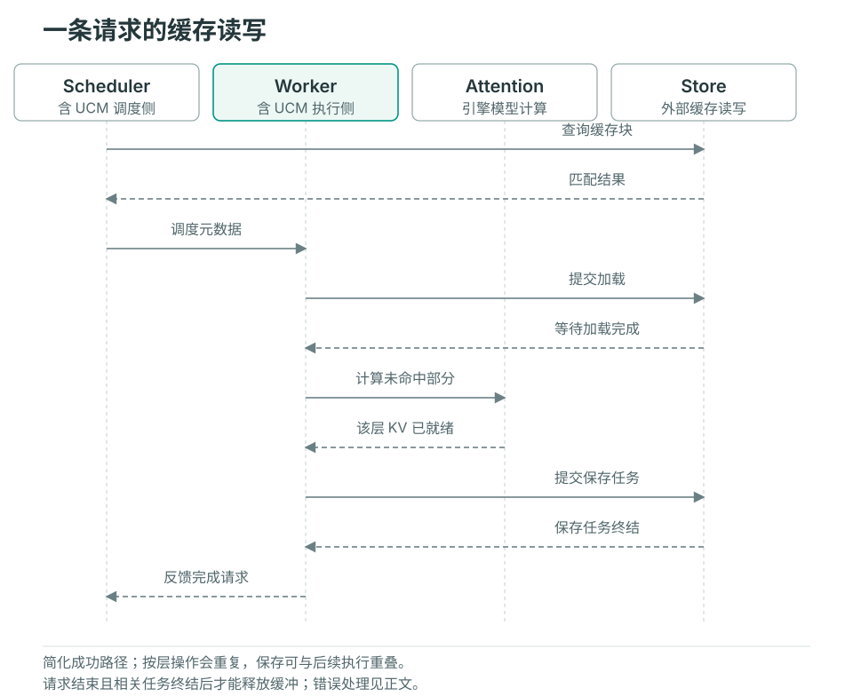

# 请求生命周期

本页跟随一条常规 vLLM 前缀缓存请求。Scheduler 和 Worker 各有自己的 UCM Connector；它们通过引擎传递的元数据协作，不共享同一个 Python 请求对象。模型专用布局和其他引擎的差异在文末说明。

## 启动时准备什么

`UCMConnector` 读取运行配置，并按模型 KV 布局、并行方式和 `use_layerwise` 选择具体实现。引擎创建 KV 缓冲后，`register_kv_caches()` 将张量布局和设备地址交给 Worker。此时建立的是可供多个请求使用的缓冲映射；请求本身的加载和保存范围要等调度后才能确定。

## 从查找到完成

图中简化展示一次成功复用及后续保存。Worker 一栏包含引擎的 UCM hook，Attention 的计算仍由推理引擎执行。



### 1. Scheduler 查询可以复用的前缀

引擎先检查自己的缓存，再调用 `get_num_new_matched_tokens()`。Connector 生成 UCM 块标识，查询引擎已计算部分之后的外部块，记录请求的匹配信息，并返回额外可复用 token 数。

常规路径返回的第二个值为 `False`，不采用异步加载完成后再由 Scheduler 恢复请求的调度方式；数据传输仍可能由 Store 异步执行，Worker 必须在使用前等待。`update_state_after_alloc()` 在常规 direct 路径中是空实现，实际块映射在下一步读取调度结果时生成。

### 2. 调度结果转换为 Worker 元数据

`build_connector_meta()` 读取本轮新请求、缓存请求和对应的引擎块编号，生成 `UCMConnectorMetadata`。其中的加载与保存记录把 UCM 块标识映射到引擎块位置，Worker 据此找到目标设备地址。

新请求可能同时需要加载已有块和保存新块；继续执行的 chunked prefill 通常只需保存新完成部分；被抢占后恢复的请求需要重新考虑加载。元数据描述本轮工作，不代表数据已经搬运。

### 3. Worker 加载，Attention 按需等待

`start_load_kv()` 使用元数据和启动时注册的布局，向 Store 提交加载。在 direct 路径中，该方法会等待本轮加载；`wait_for_layer_load()` 不再执行逐层等待。

在 layerwise 路径中，`start_load_kv()` 提交首层加载。每层 Attention 前，`wait_for_layer_load()` 等待该层任务，然后提交下一层加载。这样下一层传输可以与当前层计算重叠。失败的加载通过无效块和 Worker 元数据反馈给引擎及 Scheduler，避免把查询命中直接当作可用设备数据。

### 4. 保存新块并跟踪异步任务

layerwise 路径在 `save_kv_layer()` 提交当前层的保存任务；direct 路径主要在 `wait_for_save()` 提交整块保存。提交时将设备同步事件和源缓冲地址交给传输路径，保证设备数据满足读取条件。

`wait_for_save()` 还会轮询已有保存任务。方法返回不等于所有外部写入已经结束；待完成任务、关联请求和同步事件仍由 Connector 跟踪。Store 的 `check()` 和 `wait()` 承担任务完成检查。

### 5. 请求结束与缓存缓冲释放

Scheduler 调用 `request_finished()` 时，Connector 检查请求是否涉及异步保存。返回 `True` 会请求引擎延迟释放对应 KV 块。Worker 后续通过 `get_finished()` 等待相关待完成保存并报告请求集合，供引擎继续资源回收。

这条完成反馈用于结束传输占用；失败任务也需要结束资源生命周期。要确认持久化复用成功，还需检查错误并执行[重启重放验证](../user-guide/observability/verify-cache.md)，不能把资源可释放等同于缓存已正确写入。

## 布局和引擎差异

| 路径 | 阅读时需要关注 |
| --- | --- |
| MLA、CP、hybrid attention 等 | Connector 选择、rank 间匹配、分片布局及模型专用保存规则；不能仅根据 `use_layerwise` 推断整个执行路径 |
| SGLang | HiCache 提供主机缓冲，存储适配器对接 Posix；使用其存储接口调用链 |

源码从 `ucm/integration/vllm/ucm_connector.py` 的 `UCMConnector` 进入，再沿 `UCMDirectConnector`、`UCMLayerWiseConnector` 和所选模型 Connector 阅读。Store 的完成与错误语义见[扩展 Store](extending-store.md)。

## 实验性 dump 源读取完成事件 {#experimental-dump-source-fences}

Ascend V4.1 FAWA Connector 通常在 `handle_preemptions()` 中等待之前的 dump 完成，
随后引擎才能清零、复用、加载或覆盖设备 KV 页。运行中的请求也需要这层保护：
滑动窗口和压缩状态即使没有发生显式抢占，也可能被原地更新。

对于使用 Cache2 SDMA Direct 的 A3 构建，可以通过实验性选项将当前 dump 的 Host Wait
改为设备 stream 依赖：

```yaml
enable_event_sync: true
enable_async_dump_source_fence: true  # 默认 false
use_layerwise: false
ucm_connectors:
  - ucm_connector_name: UcmPipelineStore
    ucm_connector_config:
      store_pipeline: "Cache|Posix"
      storage_backends: "/path/to/kv-cache"
      cache_buffer_capacity_gb: 32
      posix_io_engine: psync
```

上游现有的 `handle_preemptions()` 调用位置保持不变，vLLM 和 vLLM Ascend 不需要导入
UCM 类型或新增回调。该开关仅面向 Ascend V4.1 FAWA 布局，并要求启用事件同步。
其他 Store、Cache 实现或不支持 fence 的复制 stream 继续使用 Host Wait。
关闭选项即可恢复原来的等待方式。

### 时序和资源归属

1. 计算 stream 写完旧 KV 后记录 producer-ready 事件。
2. 每个 Cache 复制 stream 等待该事件，提交源读取，再记录自己的完成事件。
   dispatcher 在所有 record 调用返回后才发布 fence，不能向消费者暴露仅创建、尚未记录的事件。
3. 在 `handle_preemptions()` 中，Connector 等待事件的**提交**完成，随后在当前计算 stream
   插入对所有复制 stream 事件的等待。CPU 可以在设备复制完成前继续准备输入和元数据。
4. Connector 紧接这些等待记录一个消费确认事件，在确认事件完成前保留 native fence。
   复制完成本身不足以证明计算 stream 已经消费等待，不能据此提前销毁事件。
5. Store `check()`/`wait()`、rank 一致性错误跟踪以及请求结束反馈仍以真实任务完成为准。
   请求结束时，仍需排空相关任务和消费确认事件，再允许释放 KV。
   外层 UCM Connector 转发上游已有的 `shutdown()` hook，在 Worker 正常退出时排空 FAWA fence。

可选的 C++ `DumpSourceFenceProvider` 接口保持 `StoreV1` 不变，Python 对应默认方法返回
`None`。即使健康断路器已打开，也会转发已有任务的 fence 请求，因为这些任务的源内存仍需保护。
使用新增 Python/native 接口时，应完整重新编译并安装 UCM。

本版保留 dispatcher 原有的 stream 同步和 SDMA descriptor 生命周期，没有让同一复制
dispatcher 同时流水处理多个任务。获取 fence 时仍可能等待更早的任务、Cache 容量或后端压力。
设备仍需在覆盖 KV 前满足复制依赖，同一计算 stream 上的 metadata 设备算子也仍排在 fence
之后。这项优化针对 CPU 准备阶段的重叠，不会消除这些数据依赖，也不保证吞吐提升。

### 启用前的验证

需在实际 A3 部署上验证主/辅助 KV 写入 stream、draft/speculative 工作、graph 模式及其他
MultiConnector 子项。后续所有 KV 写入必须在受保护的 stream 上执行，或继承该 stream 的依赖。
独立提交、未继承依赖的写入 stream 不受本选项保护。加载路径保留原有同步。

对比开关关闭与开启时的缓存内容和生成结果，覆盖 chunked prefill、SWA/ring 复用、抢占、
请求结束和重复外部缓存命中，并采集相同负载的 trace。确认 CPU metadata 提前执行、所有 D2H
源读取先于后续 KV 写入、事件句柄和任务数量保持有界。CPU 测试和 native 编译成功不能证明
这些设备时序或性能收益。
