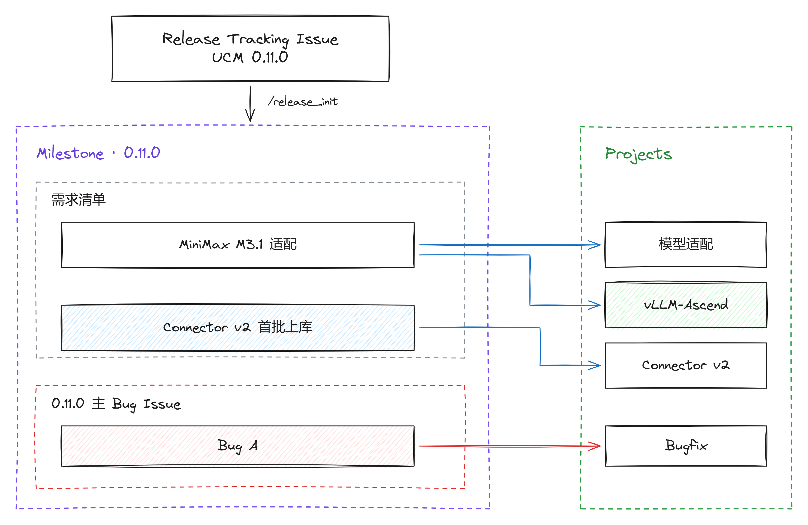

# UCM 版本管理与研发运作方案

UCM 以 Release Checklist Issue 作为版本运作入口。维护者填写版本信息和需求，通过评论命令建立、调整版本；开发者引用 Issue 关联实现；测试人员按发现版本归档 Bug、按 Milestone 安排修复。Bot 维护对象关系、进度总览和版本检查结果，主仓现有发布流程负责版本与产物交付。

## 管理结构



| 对象 | 管理内容 | 维护方式 |
| --- | --- | --- |
| Release Issue | 版本信息、需求范围、测试清单、操作结果 | 每个版本创建一张 Release Checklist |
| Milestone | 目标交付版本、目标修复版本、计划发布日期 | 初始化建立，后续同步日期和关联对象 |
| 需求 Issue | 能力范围、实现讨论、验收内容 | 在 Release Requirements 中创建或引用 |
| Bug Archive | 本版本发现的 Bug | 初始化创建，挂在 Release Issue 下 |
| Bug Issue | 复现、影响、修复与复测 | 作为发现版本 Bug Archive 的 Sub-issue |
| PR | 实现与修复变更 | 引用需求或 Bug，自动同步归属 |
| Project | 工作方向、负责人、进度 | 跨版本复用，需求在侧栏手动选择 Project |

需求内部使用 GitHub 原生 Sub-issue 拆解。需要单独纳入本版管理的子需求，也在 Requirements 中列出；父子关系由维护者建立。Bot 按清单中的 Issue 管理版本归属。

实现与测试完成后，维护者关闭对应需求或 Bug。重新打开的 Issue 会重新进入版本待办。Project 看板用于推进工作，Issue 和 PR 的实际状态用于汇总与检查。

## 版本入口与填写规则

在仓库 Issues 中选择 **Release Checklist**。版本信息、Requirements、Release Notes、Functional Tests、Documentation Tests、Artifacts 和 Change Log 共同构成入口正文。

| 版本字段 | 填写方式与作用 |
| --- | --- |
| `version` | 如 `0.11.0`，对应 Milestone；初始化后绑定该版本 |
| `branch` | 当前版本检查使用的分支，填写已存在的分支名 |
| `release_manager` | 一个 `@username` 或留空；填写时分配到 Release Issue |
| `test_lead` | 一个 `@username` 或留空；与版本负责人一同写入 Milestone 描述 |
| `release_date` | `YYYY-MM-DD`、`TBD` 或留空；同步 Milestone Due date |

版本信息示例：

```markdown
### Release Information

version: 0.11.0
branch: develop
release_manager: @username
test_lead:
release_date: TBD
```

可以先用 `develop` 推进开发，创建发布分支后，将 `branch` 改为对应分支并执行 `/update`。下一次版本检查会确认相关合入提交是否已包含在该分支中。将日期改为具体日期后执行 `/update`，会设置 Milestone 截止日；改回 `TBD` 或留空会清空截止日。日期同步方向为 Release 正文到 Milestone。

Requirements 使用外层任务列表加内层 Details。Issue 引用始终可见，GitHub 原生任务列表负责展示引用标题和状态，长描述按需展开。

输入框顶部的 HTML 注释提供一份通用填写模板。复制其中的需求块到注释外，再填写标题、负责人和描述。注释内的示例保持为填写说明，解析与回写会跳过该部分。

```markdown
### Requirements

- [ ] MiniMax M3.1 support
  with vLLM-Ascend v0.32.0

  <details>
  <summary>Details</summary>

  assignee: @username

  description:
    Integrate MiniMax M3.1 with the target engine version.

    Acceptance criteria:
    - Complete model loading and inference.
    - Verify cache reuse.
      - Cover repeated requests.
      - Cover partial-prefix reuse.

  pull_requests:

  </details>

- [ ] Connector v2 integration #123

  <details>
  <summary>Details</summary>

  assignee:

  description:
    Deliver the initial connector interface and implementation.

  pull_requests:

  </details>

### Change Log

reason: Initial scope.
```

填写时遵循以下规则：

- 每项以 `- [ ] ` 开始，多行标题续行缩进两个空格；创建 Issue 时，标题各行通过空格连接。
- 标题末尾有 Issue 编号或链接时复用该 Issue，直接填写标题时创建新 Issue；也支持直接填写 `- [ ] #123`。
- `<details>`、`<summary>Details</summary>`、结束标签和字段均缩进两个空格；字段按 `assignee`、`description`、`pull_requests` 顺序排列。
- `description:` 和 `pull_requests:` 的内容从下一行开始，缩进至少四个空格。描述保留段落、空行和嵌套列表。
- `assignee:` 使用一个 `@username` 或留空，支持后续修改与清空。
- `pull_requests:` 由 Bot 维护。创建后，编号补在外层需求标题末尾，PR 行写在所属 Details 内。
- 勾选状态、PR 清单刷新和描述块末尾空白保持范围修订稳定。

引用支持 `#123`、同仓库完整 Issue URL 和 `[text](Issue URL)`。回写统一使用原生 `#编号`。新 Issue 正文来自描述；已有 Issue 的正文与标题在自身维护，Release 中保存本版计划。

完整可复制正文见 [Release Checklist 示例](../.github/release-operations/examples/release-checklist.md)。

## 全部评论命令与版本流程

每条命令作为 Release Issue 下的一条新评论提交。执行者需要仓库 write、maintain 或 admin 权限。Bot 开始处理时添加 👀，正文底部显示流水线链接和执行状态。

| 命令 | 用途 | 结果 |
| --- | --- | --- |
| `/release_init --dry-run` | 初始化预览 | 校验输入，列出需求创建与复用计划 |
| `/release_init` | 正式初始化 | 创建或复用 Milestone、需求、Bug Archive，设置关联并回写正文 |
| `/update --dry-run` | 计划变更预览 | 比较正文与已同步范围，展示差异 |
| `/update` | 应用计划变更与刷新状态 | 同步需求增删、负责人、版本信息和已有对象关联 |
| `/release_check` | 检查版本待办 | 刷新关联，生成当前需求、Bug、PR、分支和计划差异报告 |

**初始化。** 填好入口后，先评论 `/release_init --dry-run` 审视计划，再评论 `/release_init`。正式执行会：

1. 校验版本格式、分支、用户、Issue 引用和已有归属。
2. 创建或复用版本 Milestone，将 Release Issue 加入本版，并同步日期和角色信息。
3. 创建或复用需求 Issue，设置 Milestone 和负责人，回写 Issue 编号。
4. 创建一张 Bug Archive，将其挂在 Release Issue 下并关联本版 Milestone。
5. 建立 PR 引用索引，根据已有索引和 Development 关联补齐需求内的 PR 清单；历史引用通过后台分批回填。
6. 自动置顶 Release Issue，生成顶部导航、底部总览和执行结果。

正式执行会替换上次预览。重复初始化复用已有对象；已初始化版本的计划变化通过 `/update` 应用。

**调整范围。** 编辑 Requirements 或版本字段，审视需要时先评论 `/update --dry-run`，然后评论 `/update`。编辑正文保存计划，执行命令将计划落实到 GitHub 对象。

| 变化 | `/update` 的处理 |
| --- | --- |
| 新增无引用需求 | 创建 Issue、设置版本与负责人、回写编号 |
| 新增已有 Issue 引用 | 复用并纳入本期范围 |
| 移除需求 | 保留 Issue；仍指向本版的 Milestone 关联会被清理 |
| 修改或清空负责人 | 同步 Issue Assignee |
| 修改计划标题或描述 | 更新范围快照，已有 Issue 内容继续在自身维护 |
| 修改分支、日期或角色 | 更新版本元数据与相应 Milestone 信息 |
| 普通状态刷新 | 对账关联与展示，沿用当前范围修订 |

删除需求时填写 Change Log 的 `reason:`，例如 `reason: Defer the connector extension to the next version.`。存在实际计划变化时，Bot 递增修订并将原因写入 Scope history；原因由维护者按本次决策填写。

**检查版本。** 在冻结、复测完成或交付前评论 `/release_check`。检查以最近一次初始化或更新确认的需求清单、本版 Milestone 和配置分支为基准。

| 检查项 | 识别范围 | 报告级别 |
| --- | --- | --- |
| Feature Issues without PRs | 尚无任何关联 PR 的本版需求 | 人工复核 |
| Open feature Issues | 本版需求仍处于 open | 待处理 |
| Open Bugs targeted for this version | 本版 Milestone 下带 bug 标签且仍开放的问题，包含其他版本发现的问题 | 待处理 |
| Open PRs awaiting merge | 本版相关开放 PR，包含直接分配本版 Milestone 的 PR | 待处理 |
| Closed PRs without merge | 已关闭且未合入的相关 PR | 人工复核 |
| PRs assigned to another version | 关联本版事项，但 PR 自身指向其他 Milestone | 人工复核 |
| PR target-version conflicts | 关联事项目标不同，PR 归属仍未明确 | 待处理 |
| Merged PRs missing from the release branch | 本版已合入 PR 的提交尚未包含在配置分支中 | 待处理 |
| Pending /update | 正文中的需求增删、计划修改或版本字段变化尚待应用 | 待处理 |

版本冲突示例：同一 PR 同时关联目标为 `0.11.0` 和 `0.12.0` 的 Issue，Bot 等待负责人选择 PR Milestone。可以修正 Issue 的目标、删除无关引用，或在 PR 侧栏明确交付版本，然后重新检查。

检查覆盖上一次报告，并保留最近一次请求的快照。日常同步更新进度总览，再次执行 `/release_check` 刷新检查结论。报告有待处理项时，流水线仍可正常执行成功；绿色对勾表示操作完成。

版本负责人根据检查结果完成交付决策，随后推送 Tag，进入 [主仓现有发布流程](../.github/release/README.md)。

## Tag 发布与版本归档

推送 `v*` Tag 时，发布流水线将版本管理接入发布前检查、过程展示和交付归档。`draft/v*`、`nightly/v*` 按各自发布配置运行。入口按 Tag 前缀判断，`v0.12.0`、`v0.12.0rc1` 都进入版本检查，Release Issue 中的 `version` 填写现有 Tag 分类器输出的版本号，如 `0.12.0`、`0.12.0rc1`。

| 阶段 | 执行内容 |
| --- | --- |
| 发布前检查 | 定位唯一的 Release Issue，校验初始化对象，刷新关联并执行版本检查；阻塞项使检查 job 失败，发布核心流程等待检查通过 |
| 发布过程 | 在 Release Issue 底部的 Release Delivery 中维护本 Tag 的状态、流水线链接和重跑次数 |
| 交付归档 | 核验交付回执，补充 GitHub Release 与版本管理对象的双向入口，关闭 Milestone，记录完成时间 |

发布前检查复用 `/release_check` 的检查项目，提交包含关系以 Tag 指向的提交为准。需求范围或版本信息的变更通过 `/update` 确认；检查列出待同步内容。找不到对应版本、存在重复版本入口或尚未初始化时，流水线报告错误。需求缺少 PR、已关闭未合入 PR、人工分配到其他版本的关联 PR 作为审视项展示。

发布状态由发布流水线主动写入。Release Delivery 为每个 Tag 保留一条记录，状态为 Checking、Publishing、Delivered、Failed 或 Cancelled，链接指向对应的运行尝试。手动重跑更新同一条记录；完整重跑重新执行版本检查，只重跑失败 jobs 时复用 GitHub 保留的成功前置 job 结果。运行开始事件补齐部分重跑的起始展示，完成事件补齐取消或中断的结果。运行 ID 与重跑次数决定记录先后，迟到事件保留较新尝试的状态；普通版本同步负责展示这条记录。

成功归档要求发布核心流程成功，并取得 `verify-release-delivery` 生成的 `acceptance.json`，核对仓库、Tag、源提交、运行 ID 和回执所属尝试。回执按运行和尝试分别保存；部分重跑可复用同一次运行中已成功生成的交付回执。归档将 Release Issue、Milestone 和 Bug Archive 链接写入 GitHub Release，保留发布说明及产物区域，并在 Release Issue 中回写 GitHub Release 链接、完成状态和时间。Milestone 随后关闭，Release Issue 与 Bug Archive 保留为版本问题入口。需求和 Bug 由负责人按实现与验证结果关闭。

发布失败或取消时回写对应状态和运行链接，Milestone 保持原状态。重跑成功后补齐归档；重复归档复用同一记录与链接区域。

## 开发、测试与关联管理

开发者在 PR 正文、普通评论、Review 正文或行内评论引用需求或 Bug。GitHub Development 侧栏的原生关联也进入同一关联集合。普通讨论中的 Issue 引用同样参与判定，自动 Bot 评论不作为输入。

| 关联对象 | PR 版本与 Project |
| --- | --- |
| 本版需求 | 采用需求 Milestone，加入需求所属 Projects |
| Bug | 采用 Bug 的目标修复 Milestone，加入 Bugfix |
| 多个需求 | Projects 取并集，版本按目标是否一致判定 |
| 多个来源引用同一 Issue | 合并去重并记录来源链接 |

PR 正文、评论及 Review 的变化触发对应 PR 的引用刷新，Development 关联在对账中读取。流水线结合持久索引计算当前引用集合。一处引用移除后，其余来源继续维持关系；最后一处移除后，清理该关系产生的自动 Milestone、Project 关联和 PR 展示行。人工指定或清空的 PR Milestone、已有手工 Project 归属以及手工移除的受控 Project 成员关系会被保留。

需求在 Issue 侧栏选择 Project，相关 PR 随之同步。Project 看板用于维护工作进度，Release 总览读取 Issue 与 PR 的真实状态。

**缺陷发现与修复。** 普通缺陷和版本测试缺陷统一使用现有 Bug report 模板。在本版 Bug Archive 下创建原生 Sub-issue，或将已有 Bug 挂到对应归档下，流水线会根据父关系识别发现版本。

| 表单字段 | 填写内容 |
| --- | --- |
| Your current environment | 操作系统、硬件、推理引擎与版本、UCM 配置 |
| Describe the bug | 问题描述、影响与出现条件 |
| Tested commit or image | 复现时的提交、软件包版本或镜像 |
| Related requirement | 关联需求 Issue，可选 |
| Reproduction steps | 最小复现步骤、命令、配置和输入 |
| Expected result | 预期结果 |
| Actual result | 实际结果、相关日志或完整 traceback |
| Frequency | 问题出现频率，可选 |

父关系建立后，在下一次同步中关联默认 Milestone 和 Bugfix；需要立即刷新时执行 `/update` 或手动运行 Release operations。

父 Issue 记录发现版本，Milestone 记录目标修复版本。新 Bug 默认采用发现版本的 Milestone；维护者可以调整到其他版本或清空目标。Bug 与修复 PR 自动加入 Bugfix，修复 PR 引用 Bug 后同步其目标版本。

| Bug 情况 | Bugfix Status |
| --- | --- |
| 尚无修复 PR | Ready |
| 已关联修复 PR | In progress |
| 已有合入修复，Bug 仍开放 | In review |
| Bug 已关闭 | Done |

复测完成后关闭 Bug；复测发现问题则继续维护或重新打开。测试环境、执行内容、结果和证据保存在对应 Issue、测试清单或报告中。

集中观察时，按 Bug Archive 的 Parent issue 筛选某版本发现的问题，按 Milestone 筛选某版本计划修复的问题，按 Assignee 和 Status 查看负责人、未分配事项和等待复测的缺陷。延期修复时调整 Milestone，父归档继续保留发现版本。

## 触发、展示与执行保障

日常管理使用 [Release operations](../.github/workflows/release-operations.yml) 和 [Release review observer](../.github/workflows/release-review-observer.yml)。发布通过 [Tag 发布入口](../.github/workflows/release-tag.yml) 调用版本检查与结果归档，[Release delivery status](../.github/workflows/release-delivery-status.yml) 根据发布运行事件补齐重跑与取消状态。

| 触发入口 | 执行内容 |
| --- | --- |
| Release Issue 中的新命令评论 | 执行初始化、更新或检查 |
| PR 创建、正文编辑、重开、关闭、草稿状态变化 | 刷新关联和 PR 状态 |
| PR 普通评论新增、编辑、删除 | 重算引用集合 |
| 含 Issue 引用的 Review 与行内评论变化 | Observer 传递 PR 编号，默认分支控制器定向刷新 |
| Issue 创建、编辑、打标签、改 Milestone、关闭、重开 | 刷新需求、Bug 与关联状态 |
| 每 15 分钟定期任务 | 补齐未被即时事件覆盖的变化 |
| Actions 中手动运行 Release operations | 主动全量对账 |
| 推送 `v*` Tag | 检查版本后进入发布流程，并回写交付结果 |
| Tag 发布流水线开始或完成 | 补齐部分重跑和取消时的发布状态 |

Development 侧栏关联、Project 成员和仅父子关系的调整，通过后续对账拾取。需要主动刷新时使用 `/update`、`/release_check` 或手动运行。定期任务的实际启动时间由 GitHub Actions 调度决定。

正文顶部维护 Milestone 与 Bug Archive 导航。底部 Release Overview 汇总 Issue、Pull requests、Assignee、State，并显示最近操作的流水线链接：运行中为 🔄，完成为 ✅，失败为 ❌ 并附简短原因。PR 普通引用评论和有效命令评论开始处理时收到 👀。

Bot 只更新受控导航、总览、引用与 PR 清单。自定义正文和清单内容继续保留。Scope history 展示最近的范围修订；机器评论保存完整对象映射、所有权与命令游标，并折叠展示。

执行使用默认分支控制器，将 PR 内容作为数据读取。日常管理使用 contents 和 actions 读取、issues 和 pull-requests 写入权限，actions 读取用于取得 Review 事件携带的 PR 编号。发布归档使用 contents 写入维护 GitHub Release 导航。Project 使用独立凭据。管理测试由 [Release operations contracts](../.github/workflows/release-operations-check.yml) 在相关 PR 中执行；短时版本写入共用仓库串行队列，构建与发布按原有编排运行。

首次建立版本后，Bot 自动创建一张已关闭、带 `release-index` 标签的内部索引 Issue，保存压缩分片和扫描游标。每个版本维护独立的发现窗口，固定以 Release Tracking Issue 的 `created_at` 为起点。候选 PR 按创建时间倒序读取，遇到早于起点的 PR 即停止。自动关联要求 `PR.created_at >= Release.created_at`，需求 Issue 的创建时间不参与筛选；正文、评论、Review 和 Development 关联使用同一规则。版本创建后已经打开的 PR，可以通过引用关联后来补建的需求 Issue。旧 PR 后续编辑或新增评论沿用其原创建时间。

后续定时任务按更新时间补查窗口内的变化，PR 与 Review 事件定向刷新对应对象。默认每轮最多读取 10 个 PR 的讨论，新的 Development 关联和索引迁移共用这一批次上限。窗口外的旧 PR 跳过讨论读取；版本检查等待自身窗口完成。`/update` 增删需求时复用该版本的固定时间窗口和已有索引，各版本的游标相互独立。需求与目标修复 Bug 的变化更新关联范围。

维护者手动将旧 PR 分配到版本 Milestone 后，`/release_check` 检查其开启、合入和提交包含状态。显式版本归属参与交付检查，需求行展示与 Project 跟随继续依赖需求关联。

在 Actions 手动运行 Release operations 时，可将 `reference_batch_size` 设为 `10`、`25` 或 `50`，加快首次回填。配置中的 `sync.prs_per_run` 控制定时任务批次，`sync.max_api_calls` 控制单次运行的 API 调用上限，默认 200。到达调用或运行时间预算时，本轮停止，后续运行沿持久游标继续。写入请求之间至少间隔一秒，降低连续修改触发二级限流的概率。日常事件更新受影响版本，定时任务检查活跃版本并轮转检查一个已归档版本。无变化的 Project 状态、版本机器记录和正文保留原值。

重复请求复用对象；创建响应丢失时，通过来源标记恢复真实 Issue。命令游标补执行尚未处理的请求，记录已完成命令。失败后修正输入并提交新命令可继续恢复，已成功创建的对象会被复用。正文写回前核对最新内容，保留并发编辑；任务失败或中断由最终步骤回写执行状态。

初始化自动置顶 Release Issue，重复初始化或更新重试尚未完成的置顶。人工置顶和取消置顶决定会被保留；已关闭的 Release Issue 跳过自动置顶。

## 配置、调用与维护

版本管理通过 `.github/release-operations/config.json` 配置目标仓库、Projects 和标签，通过 Actions Secret 提供 Project API 凭据。

| 配置 | 用途与要求 |
| --- | --- |
| `repository` | 目标仓库，使用 `owner/repository` 格式，须与实际运行仓库一致 |
| `owner`、`owner_type` | Project 所属账号及类型，组织使用 `Organization` |
| `projects` | Project ID、视图 ID、Status 字段及选项 ID，须与目标 Projects 匹配 |
| `sync` | 历史引用回填批次与每次运行的 API 调用预算 |
| 标签 | 仓库须包含配置中的标签；新增或调整标签时同步维护配置 |
| `UCM_PROJECT_TOKEN` | Actions Secret，提供目标 Projects 的访问与写入权限 |
| Actions | 允许版本管理工作流运行；工作流声明 `contents: read`、`issues: write`、`pull-requests: write` 权限 |

Project 按工作方向扩展，需求在 Issue 侧栏选择所属 Project。Project 的可见性由具备相应权限的管理员设置。

使用个人访问令牌（PAT）时，将令牌保存为仓库 Actions Secret `UCM_PROJECT_TOKEN`。令牌所属账号及令牌授权范围均须具备目标 Projects 的读写权限。

使用组织专用身份时，由组织管理员注册并安装 GitHub App，授予 Organization Projects 读写权限，以及目标仓库 Issues、Pull requests 读取权限。将 Client ID 保存为仓库变量 `UCM_PROJECT_APP_CLIENT_ID`，私钥保存为 Secret `UCM_PROJECT_APP_PRIVATE_KEY`；工作流增加 `actions/create-github-app-token` 步骤，将生成的安装令牌传入控制器的 `UCM_PROJECT_TOKEN` 环境变量。配置方法见 [GitHub App 在 Actions 中的认证方式](https://docs.github.com/en/apps/creating-github-apps/authenticating-with-a-github-app/making-authenticated-api-requests-with-a-github-app-in-a-github-actions-workflow)。

控制器在入口校验目标仓库。工作流将 `GITHUB_TOKEN` 传入 `GH_TOKEN` 环境变量，用于 Issue、Milestone、PR 和评论等仓库元数据操作；`UCM_PROJECT_TOKEN` 用于 Project 成员与状态字段的读写。

Agent 调用入口包括 Issue 评论命令、Actions 手动运行、Controller 方法和 JSON 事件 CLI。核心方法为 `initialize_or_update`、`reconcile`、`release_check`；GitHub 操作集中经过 REST/GraphQL 适配层。

JSON 事件 CLI 示例：

```shell
python .github/release-operations/controller.py --config .github/release-operations/config.json --event event.json --event-name issue_comment
```

`event.json` 使用对应 GitHub webhook 的事件结构。普通对账可以传入空 JSON 对象并选择 `workflow_dispatch`：

```shell
python .github/release-operations/controller.py --config .github/release-operations/config.json --event empty-event.json --event-name workflow_dispatch
```

其中 `empty-event.json` 内容为 `{}`。`--finalize` 是工作流最终步骤的内部入口，用于回写本次失败或中断状态。执行环境需要 `gh`，并通过 `GH_TOKEN` 和 `UCM_PROJECT_TOKEN` 提供仓库及 Project 凭据。

相关文件入口：

| 文件 | 职责 |
| --- | --- |
| `900-release-checklist.yml` | 版本入口表单 |
| `400-bug-report.yml` | 普通与版本测试 Bug 的统一表单 |
| `controller.py` | 鉴权、命令、初始化、更新和状态对账 |
| `syntax.py`、`folding.py`、`taskcards.py` | 结构化输入、引用、格式转换与回写 |
| `associations.py`、`ownership.py` | PR 关联集合与人工归属保留 |
| `reference_index.py` | 历史引用分批发现、增量游标与压缩分片持久化 |
| `checks.py` | 版本待办、计划差异和分支提交检查 |
| `delivery.py` | Tag 版本检查、发布状态、交付回执校验与归档 |
| `presentation.py`、`operations.py`、`pinning.py` | 正文展示、执行状态和置顶 |
| `test_*.py` | 解析、同步、恢复与展示的回归验证 |

修改后运行：

```shell
python -m unittest discover -s .github/release-operations -p "test_*.py" -v
```

仓库已有代码构建、单测、文档和产物工作流按各自配置运行。版本管理提供 Issue/PR/范围与提交包含关系的检查报告，构建测试结果在对应 Actions 中查看；发布与产物分发继续衔接主仓现有流程。
