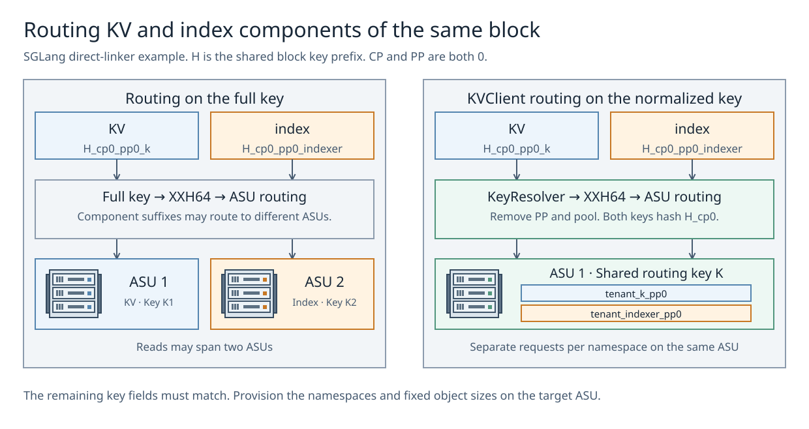
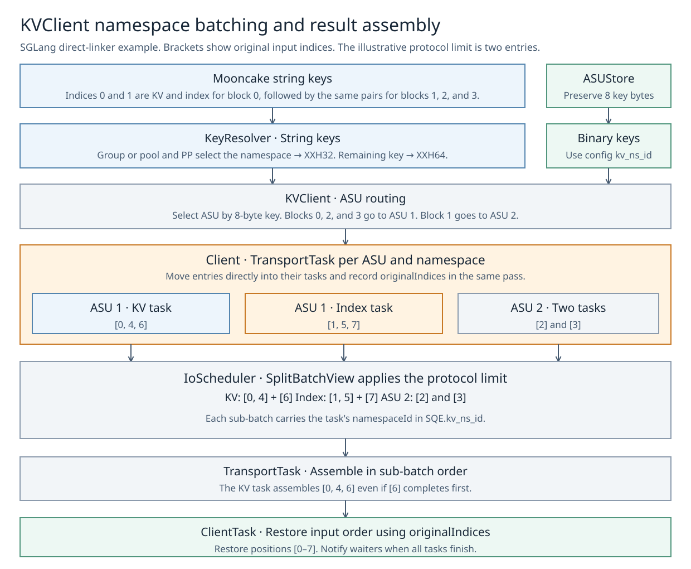

# KVClient KeyResolver Design

[简体中文](../zh/kvclient-key-and-namespace-design.md)

Mooncake Store uses KVClient to connect to external storage, allowing inference engines to store and retrieve KV cache data. KVClient receives string keys and a base namespace from Mooncake and resolves and encodes them before routing requests.

`KeyResolver` converts engine-specific string keys into a common object identifier and namespace ID. It combines fields extracted from the key with the base namespace to form the target namespace name. It encodes the target namespace name as a 32-bit namespace ID and the processed key as an 8-byte key for routing and request grouping.

## 1. KeyResolver design

`KeyResolver` takes a `CacheKey` and a base namespace (`baseKvns`) and produces a `ResolvedCacheKey` containing an 8-byte object identifier and a 32-bit namespace ID. `CacheKey` accepts a string or an 8-byte binary key, and `baseKvns` comes from the request's `IoOptions::kvns`. See the [KeyResolver implementation](../../../src/client/key_resolver.cc).

For string keys, XXH64 encodes the processed key as an 8-byte little-endian value. XXH32 derives the global namespace ID (GNSID) from the target namespace name. Both hashes use seed `5381`.

### 1.1 Key and namespace resolution rules

KVClient uses `inference.engine` to select the resolution rules for string keys.

| Input | Object identifier | Namespace |
| --- | --- | --- |
| vLLM-Ascend string key | Extract and remove `@group:<rank>` and `@pp_rank:<rank>`, then encode the remaining fields | Append `_group<rank>` and `_pp<rank>`, in that order, for fields present in the key |
| SGLang direct-linker string key | Extract and remove the PP and pool suffix from a direct-linker key, then encode the remaining fields | Append `_<pool>_pp<rank>` |
| Generic string key | Encode the full string | Use the base namespace |
| Binary key | Preserve the 8 input bytes | Use `kv_ns_id` from the ASU configuration, defaulting to `0`. ASU configurations for the same client should use the same `kv_ns_id` |

### 1.2 Resolution examples

All examples use `tenant` as the base namespace. Each pair of hexadecimal digits represents one byte, shown in little-endian order.

| Engine | Input key | XXH64 input and 8-byte key | Namespace and GNSID |
| --- | --- | --- | --- |
| vLLM-Ascend | `model@tp_rank:3@group:2@pp_rank:1@cache_role:kv@hash@7` | `model@tp_rank:3@cache_role:kv@hash@7` (`0x44f5a1d66cf87354`) | `tenant_group2_pp1` (`0x6fcb430c`) |
| SGLang direct linker | `model_hash_tp0_cp0_pp1_kv` | `model_hash_tp0_cp0` (`0x2f6e0483c95b6032`) | `tenant_kv_pp1` (`0x0ec33188`) |
| SGLang direct linker | `model_hash_tp0_cp0_pp1_indexer` | `model_hash_tp0_cp0` (`0x2f6e0483c95b6032`) | `tenant_indexer_pp1` (`0xb216fdf5`) |

## 2. Routing and batching resolved keys

KVClient distributes request entries across ASUs using their resolved 8-byte keys. Entries with the same routing key are assigned to the same ASU. Within an ASU, the key and namespace together identify an object. Provision the applicable namespaces and their fixed object sizes on the target ASUs before use.

1. **Build transport tasks.** KVClient creates a `TransportTask` for each ASU and namespace pair. The task holds the protocol `namespaceId` and the `originalIndices` used to assemble results. KVClient moves entries directly into their tasks, and the underlying data buffers remain in place. See the [ClientTaskManager implementation](../../../src/client/task/task_manager.cc).
2. **Split into protocol sub-batches.** The I/O scheduler uses `SplitBatchView` to create views over contiguous task entries, subject to the entry limit for the operation. Each sub-batch inherits the task's `namespaceId` and writes it into the submission queue entry (SQE) as `kv_ns_id`. See the [IoScheduler implementation](../../../src/trans/task/io_scheduler.cc).

The protocol currently uses the GNSID from the string path or the ASU configuration value `kv_ns_id` from the binary path directly. `GetTargetNamespaceId()` is the point at which the protocol ID is selected. View-based translation from global IDs to ASU-local IDs remains unimplemented.

