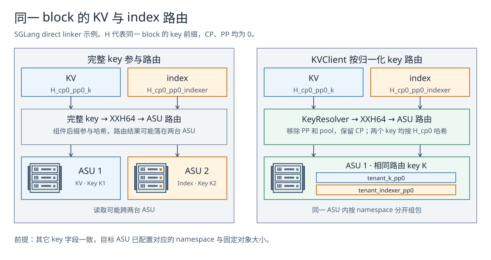
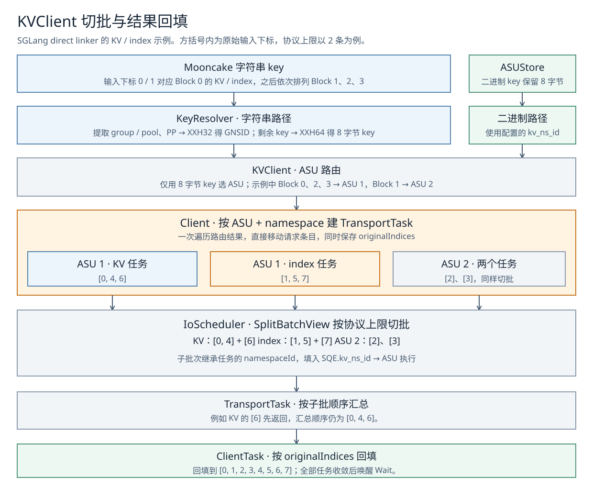

# KVClient KeyResolver 设计

[English](../en/kvclient-key-and-namespace-design.md)

Mooncake Store 通过 KVClient 接入外部存储，为推理引擎的 KV Cache 提供外部存取能力。KVClient 接收 Mooncake 传入的字符串 key 和基础命名空间，并在请求路由前完成解析与编码。

`KeyResolver` 负责将不同引擎格式的字符串 key 转换为统一的对象标识和命名空间 ID。它将从 key 中提取的字段与基础命名空间组合，生成目标命名空间名称。目标命名空间名称和处理后的 key 分别编码为 32 位命名空间 ID 和 8 字节 key，供后续路由与请求分组使用。

## 1. KeyResolver 设计

`KeyResolver` 接收 `CacheKey` 和基础命名空间 `baseKvns`，输出包含 8 字节对象标识和 32 位命名空间 ID 的 `ResolvedCacheKey`。`CacheKey` 支持字符串和 8 字节二进制两种形式，`baseKvns` 来自请求的 `IoOptions::kvns`。参见 [KeyResolver 实现](../../../src/client/key_resolver.cc)。

对于字符串 key，XXH64 将处理后的 key 编码为 8 字节小端值，XXH32 根据目标命名空间名称生成全局命名空间 ID（GNSID）。两种哈希均使用种子 `5381`。

### 1.1 Key 与命名空间解析规则

KVClient 根据 `inference.engine` 选择字符串 key 的解析规则。

| 输入 | 对象标识 | 命名空间 |
| --- | --- | --- |
| vLLM-Ascend 字符串 key | 提取并移除 `@group:<rank>` 和 `@pp_rank:<rank>`，编码其余字段 | 按出现的维度依次追加 `_group<rank>` 和 `_pp<rank>` |
| SGLang direct linker 字符串 key | 对符合 direct linker 格式的 key，提取并移除 PP 和 pool 后缀，编码其余字段 | 追加 `_<pool>_pp<rank>` |
| 通用字符串 key | 编码完整字符串 | 使用基础命名空间 |
| 二进制 key | 保留输入的 8 字节 | 使用 ASU 配置中的 `kv_ns_id`，缺省为 `0`。同一客户端的 ASU 配置应采用相同的 `kv_ns_id` |

### 1.2 解析示例

以下示例的基础命名空间均为 `tenant`。8 字节 key 以小端顺序展示，每两位十六进制数字表示一个字节。

| 引擎 | 原始 key | XXH64 输入与 8 字节 key | 命名空间与 GNSID |
| --- | --- | --- | --- |
| vLLM-Ascend | `model@tp_rank:3@group:2@pp_rank:1@cache_role:kv@hash@7` | `model@tp_rank:3@cache_role:kv@hash@7` (`0x44f5a1d66cf87354`) | `tenant_group2_pp1` (`0x6fcb430c`) |
| SGLang direct linker | `model_hash_tp0_cp0_pp1_kv` | `model_hash_tp0_cp0` (`0x2f6e0483c95b6032`) | `tenant_kv_pp1` (`0x0ec33188`) |
| SGLang direct linker | `model_hash_tp0_cp0_pp1_indexer` | `model_hash_tp0_cp0` (`0x2f6e0483c95b6032`) | `tenant_indexer_pp1` (`0xb216fdf5`) |

## 2. 解析结果的路由与切批

KVClient 使用解析后的 8 字节 key 将请求条目分配到各 ASU。具有相同路由 key 的条目分配到同一 ASU。同一 ASU 内的对象由 key 和命名空间共同标识。部署时应在目标 ASU 上预先配置所用命名空间及其固定对象大小。

1. **创建传输任务。** KVClient 为每个 ASU 和命名空间组合创建一个 `TransportTask`。任务持有协议 `namespaceId` 和用于结果归并的 `originalIndices`。请求条目直接移入所属任务，缓冲区数据留在原位置。参见 [ClientTaskManager 实现](../../../src/client/task/task_manager.cc)。
2. **切分协议子批次。** IoScheduler 通过 `SplitBatchView` 根据操作类型的条目上限，从任务的连续条目中生成子批视图。所有子批次继承任务的 `namespaceId`，并将其写入提交队列条目（SQE）的 `kv_ns_id` 字段。参见 [IoScheduler 实现](../../../src/trans/task/io_scheduler.cc)。

当前协议直接使用字符串路径的 GNSID 或二进制路径的 ASU 配置项 `kv_ns_id`。`GetTargetNamespaceId()` 是确定协议 ID 的位置。全局 ID 到 ASU 本地 ID 的视图映射尚未接入。

