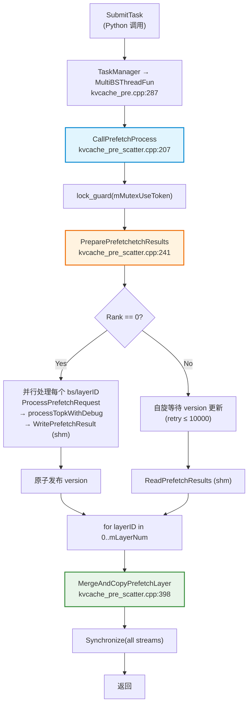
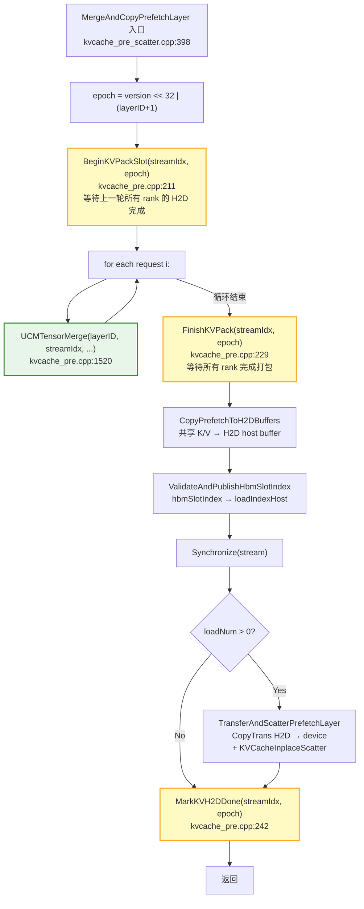
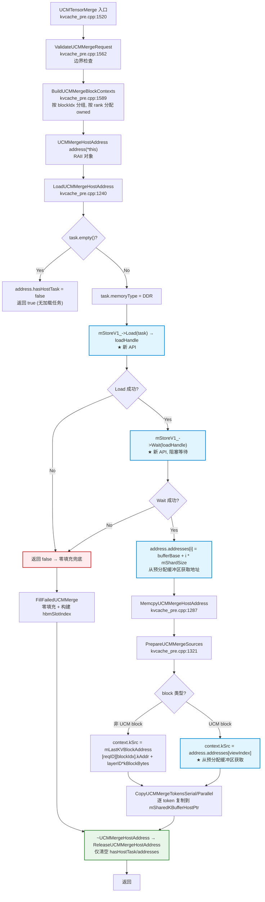
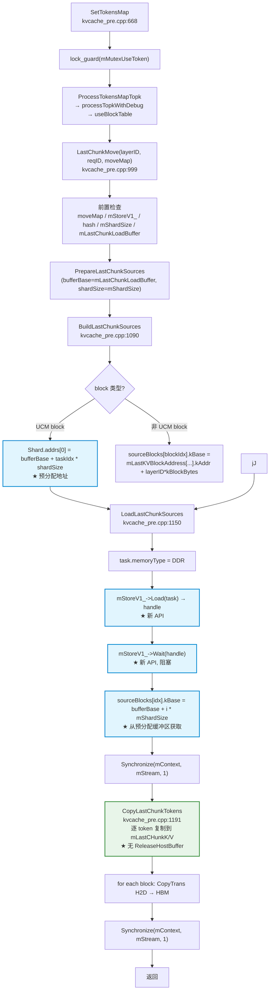
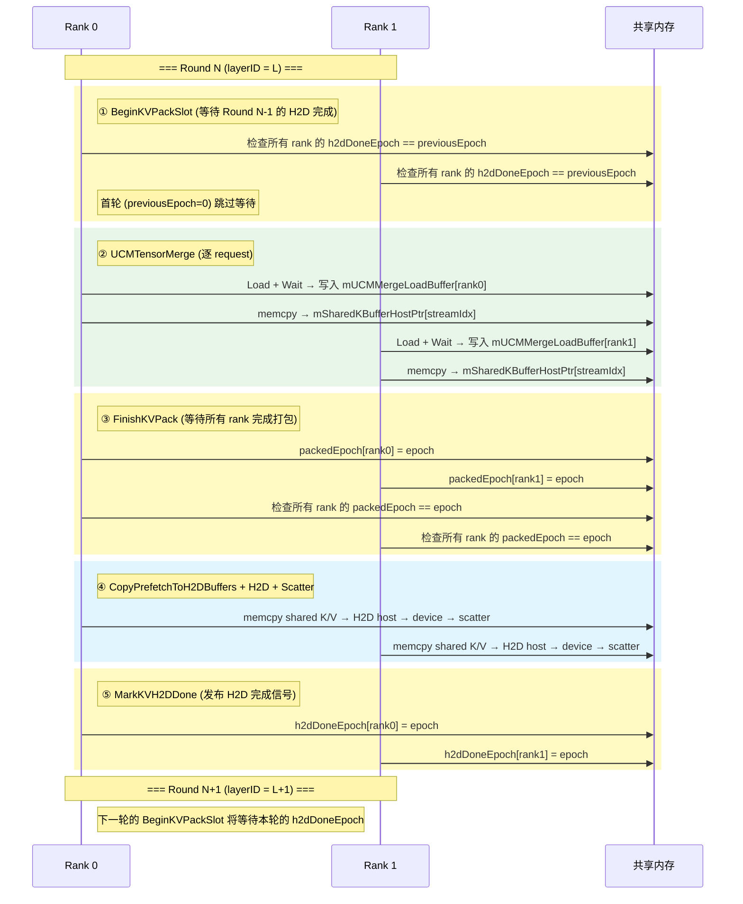
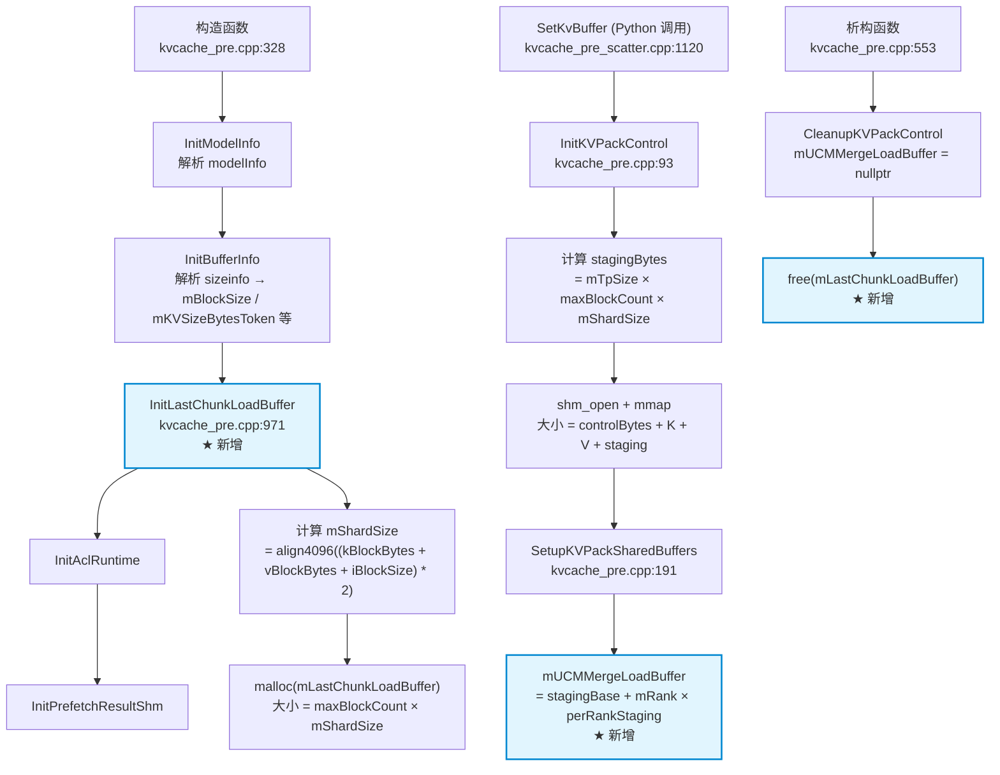
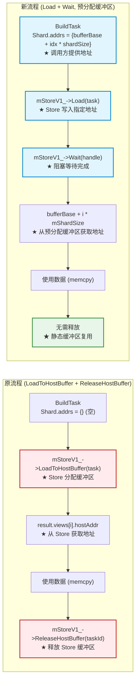
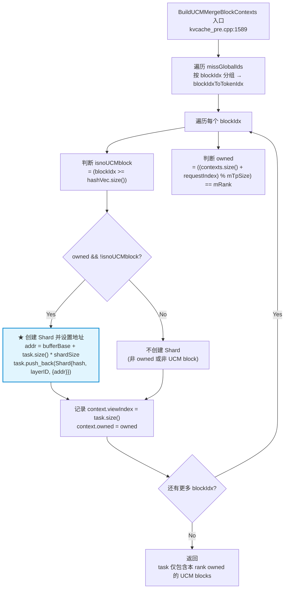
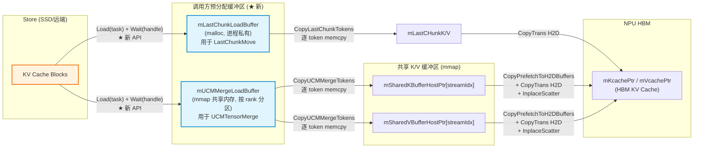

# LoadToHostBuffer → Load+Wait 迁移分析文档

## 1. 背景与目标

### 1.1 需求

GSA Prefetch Engine 原先通过 `mStoreV1_->LoadToHostBuffer` 接口从 Store 加载 KV cache 数据到主机缓冲区，
加载完成后通过 `mStoreV1_->ReleaseHostBuffer` 释放。然而 `StoreV1` 抽象接口（`ucmstore_v1.h`）仅定义了
`Load` / `Wait` / `Check` / `Dump` 等标准异步操作，并不包含 `LoadToHostBuffer` / `ReleaseHostBuffer`。

本次改动的目标是将 `LastChunkMove` 和 `UCMTensorMerge` 两条代码路径中的 `LoadToHostBuffer` + `ReleaseHostBuffer`
替换为标准的 `Load` + `Wait` API，使用**调用方预分配的缓冲区**替代 Store 托管的主机缓冲区。

### 1.2 约束

- **仅允许修改 GSA 文件夹代码**（`ucm/sandbox/sparse/gsav2/`），Store 代码（`ucm/store/`）不得修改。
- `shardSize` 无法从 `StoreV1` 接口查询（无 `GetShardSize()` 方法），需由调用方根据模型参数计算。
- 多 rank 同步逻辑（`BeginKVPackSlot` / `FinishKVPack` / `MarkKVH2DDone`）必须保留。
- Store 的实际 `shardSize_` 取决于 Python 配置（Mindie vs vLLM、layerwise/direct、`blocks_per_chunk`、4096 对齐），
  计算值为安全上限估算。

### 1.3 涉及文件

| 文件 | 路径 | 改动类型 |
|------|------|----------|
| `kvcache_pre_detail.h` | `prefetch/include/` | 结构体清理 |
| `kvcache_pre.h` | `prefetch/include/` | 成员/签名变更 |
| `kvcache_pre.cpp` | `prefetch/src/` | 核心实现变更 |
| `kvcache_prefetch.h` | `prefetch/include/` | UCMKVPrefetch 重构 |
| `pybinds.cpp` | `prefetch/src/` | Python 绑定修复 |

---

## 2. 修改详情

### 2.1 新增成员变量（`kvcache_pre.h`）

```cpp
void* mLastChunkLoadBuffer{nullptr};      // LastChunkMove 专用，malloc 分配，进程内私有
size_t mLastChunkLoadBufferSize{0};       // mLastChunkLoadBuffer 的大小
size_t mShardSize{0};                     // 计算得出的单个 shard 字节大小（4096 对齐）
std::byte* mUCMMergeLoadBuffer{nullptr};  // UCMTensorMerge 专用，mmap 共享内存分区
```

### 2.2 缓冲区初始化（`kvcache_pre.cpp`）

#### 2.2.1 `InitLastChunkLoadBuffer()` — 构造时调用

```
mShardSize = align4096((kBlockBytes + vBlockBytes + iBlockSize) * 2)

其中:
  kBlockBytes = mBlockSize * mKVSizeBytesToken
  vBlockBytes = mBlockSize * mKVSizeBytesTokenRe
  iBlockSize  = mBlockSize * 128 * 2            // indexer 数据，安全余量
  align4096(x) = ((x + 4095) / 4096) * 4096

mLastChunkLoadBuffer = malloc(maxBlockCount * mShardSize)
  maxBlockCount = mMaxLen / mBlockSize
```

调用时机：构造函数中 `InitBufferInfo()` 之后、`InitAclRuntime()` 之前。

#### 2.2.2 共享内存扩展 — `InitKVPackControl()` / `SetupKVPackSharedBuffers()`

原共享内存布局：
```
[Header][States][K_buffers × streamCount][V_buffers × streamCount]
```

新布局：
```
[Header][States][K_buffers × streamCount][V_buffers × streamCount][LoadStaging × mTpSize]
                                                                        ^
                                                        每个 rank 分配 maxBlockCount × mShardSize
```

`SetupKVPackSharedBuffers` 中设置：
```
mUCMMergeLoadBuffer = stagingBase + mRank * (maxBlockCount * mShardSize)
```

`CleanupKVPackControl` 中重置 `mUCMMergeLoadBuffer = nullptr`。

析构函数中释放 `mLastChunkLoadBuffer`（`free`）。

### 2.3 `LastChunkMove` 路径变更

#### 原流程
```
LastChunkMove
├── PrepareLastChunkSources → BuildLastChunkSources
│   └── task.emplace_back(Shard{hash, layerID, {}})         // 无地址
├── LoadLastChunkSources
│   ├── mStoreV1_->LoadToHostBuffer(task)                   // Store 分配缓冲区
│   ├── result.views[i].hostAddr → sourceBlocks[idx].kBase  // 从 Store 获取地址
│   └── 保存 hostTaskId / hasHostTask
├── Synchronize
├── CopyLastChunkTokens
│   └── mStoreV1_->ReleaseHostBuffer(hostTaskId)            // 释放 Store 缓冲区
└── CopyTrans H2D
```

#### 新流程
```
LastChunkMove
├── PrepareLastChunkSources(bufferBase=mLastChunkLoadBuffer, shardSize=mShardSize)
│   └── BuildLastChunkSources
│       └── task.emplace_back(Shard{hash, layerID, {addr}})  // addr = bufferBase + taskIdx * shardSize
├── LoadLastChunkSources
│   ├── task.memoryType = MemoryType::DDR
│   ├── mStoreV1_->Load(task) → handle                       // Store 写入 addr 指定的缓冲区
│   ├── mStoreV1_->Wait(handle)                              // 阻塞等待完成
│   └── sourceBlocks[idx].kBase = bufferBase + i * mShardSize
├── Synchronize
├── CopyLastChunkTokens                                      // 无 ReleaseHostBuffer
└── CopyTrans H2D
```

### 2.4 `UCMTensorMerge` 路径变更

#### 原流程
```
UCMTensorMerge
├── BuildUCMMergeBlockContexts                               // 无地址传入 task
├── LoadUCMMergeHostAddress
│   ├── mStoreV1_->LoadToHostBuffer(task)                   // Store 分配缓冲区
│   ├── address.taskId = result.taskId
│   ├── address.views = result.views
│   └── address.addresses[i] = views[i].hostAddr
├── MemcpyUCMMergeHostAddress → PrepareUCMMergeSources + CopyTokens
└── ~UCMMergeHostAddress → ReleaseUCMMergeHostAddress
    └── mStoreV1_->ReleaseHostBuffer(address.taskId)        // 释放 Store 缓冲区
```

#### 新流程
```
UCMTensorMerge
├── BuildUCMMergeBlockContexts(bufferBase=mUCMMergeLoadBuffer, shardSize=mShardSize)
│   └── task.push_back(Shard{hash, layerID, {addr}})         // addr = bufferBase + taskIdx * shardSize
├── LoadUCMMergeHostAddress
│   ├── task.memoryType = MemoryType::DDR
│   ├── mStoreV1_->Load(task) → handle
│   ├── mStoreV1_->Wait(handle)                              // 阻塞等待完成
│   └── address.addresses[i] = bufferBase + i * mShardSize
├── MemcpyUCMMergeHostAddress → PrepareUCMMergeSources + CopyTokens
│   └── PrepareUCMMergeSources: context.kSrc = address.addresses[viewIndex]
└── ~UCMMergeHostAddress → ReleaseUCMMergeHostAddress
    └── address.hasHostTask = false; address.addresses.clear()   // 仅清理，无 Store 调用
```

### 2.5 `UCMMergeHostAddress` 结构体清理（`kvcache_pre_detail.h`）

移除了以下过时成员：
- `UC::Detail::TaskHandle taskId{}` — 不再需要保存 task handle（Wait 后数据已在调用方缓冲区）
- `std::vector<UC::Detail::HostBufferView> views` — `HostBufferView` 类型在代码库中不存在（属于已回退的 Store 改动）

保留：
- `bool hasHostTask` — 作为加载是否成功的标志位
- `std::vector<const std::byte*> addresses` — 下游 `PrepareUCMMergeSources` 仍需使用

### 2.6 `UCMKVPrefetch` 重构（`kvcache_prefetch.h`）

原实现使用 `LoadSSDToHost` / `WaitSSDToHost`（Store 接口中不存在）和异步等待线程模式。
新实现：
- `StoreInit(storePtr, layerNum)` — 增加层数参数
- `UCMLoadSSD` — 调用 `mStoreV1_->Load`，fire-and-forget（不 Wait），返回状态码
- `UCMLookup` — 异常改为返回空 vector
- 移除 `UCMWait`、`AsyncWaitLoop` 及相关同步成员

### 2.7 `pybinds.cpp` 修复

- `store_init` 绑定增加 `layer_num` 参数
- 移除 `ucm_wait` 绑定（方法已删除）

---

## 3. CallPrefetchProcess 流程分析

### 3.1 整体调用链

```
SubmitTask (Python 调用)
└── TaskManager → MultiBSThreadFun
    └── CallPrefetchProcess(taskInfo, threadInfo)          [kvcache_pre_scatter.cpp:207]
        ├── lock_guard(mMutexUseToken)                      // 与 SetTokensMap/LastChunkMove 互斥
        ├── PreparePrefetchResults(taskInfo)                [:241]
        │   ├── [Rank 0] 并行处理每个 (bs, layerID):
        │   │   └── ProcessPrefetchRequest
        │   │       ├── TokenIndexMapInter (如果开启 indexer offload)
        │   │       ├── processTopkWithDebug → missGlobalToken / loadSlot / useBlockTable
        │   │       └── WritePrefetchResult → 写入共享内存
        │   │   (发布 version 原子变量)
        │   └── [Rank > 0] 自旋等待 version 更新 → ReadPrefetchResults
        │
        ├── for layerID in [0, mLayerNum):
        │   └── MergeAndCopyPrefetchLayer                    [:398]
        │       ├── epoch = (version << 32) | (layerID + 1)
        │       ├── BeginKVPackSlot(streamIdx, epoch)        // 等待上一轮所有 rank 的 H2D 完成
        │       ├── for each request i:
        │       │   └── UCMTensorMerge(layerID, streamIdx, hbmSlotIndex, reqID, i)
        │       ├── FinishKVPack(streamIdx, epoch)           // 等待所有 rank 完成打包
        │       ├── CopyPrefetchToH2DBuffers                 // 共享 K/V → H2D host buffer
        │       ├── ValidateAndPublishHbmSlotIndex           // hbmSlotIndex → loadIndexHost
        │       ├── Synchronize(stream)                      // 等待 H2D memcpy
        │       ├── [if loadNum > 0]:
        │       │   └── TransferAndScatterPrefetchLayer
        │       │       ├── CopyTrans H2D (K, V, Index → device)
        │       │       ├── Synchronize(stream)
        │       │       └── KVCacheInplaceScatter("K" / "V")
        │       └── MarkKVH2DDone(streamIdx, epoch)          // 发布 H2D 完成信号
        │
        └── Synchronize(all streams)
```

### 3.2 UCMTensorMerge 内部流程

```
UCMTensorMerge(layerID, streamIdx, hbmSlotIndex, reqID, requestIndex)  [kvcache_pre.cpp:1520]
│
├── ValidateUCMMergeRequest                                 // 边界检查
│   ├── mStoreV1_ 非空检查
│   ├── missGlobalIds / missSlots 大小匹配
│   ├── hashVec / blockTable 存在性
│   └── finalLoadNum ≤ mLoadIndexBufferLen / mKVBufferLen
│
├── BuildUCMMergeBlockContexts(mUCMMergeLoadBuffer, mShardSize)
│   ├── 按 blockIdx 分组 missGlobalIds → blockIdxToTokenIdx
│   ├── 对每个 blockIdx:
│   │   ├── 判断 isnoUCMblock (blockIdx ≥ hashVec.size())
│   │   ├── 判断 owned = ((contexts.size() + requestIndex) % mTpSize) == mRank
│   │   └── if owned && !isnoUCMblock:
│   │       └── task.push_back(Shard{hash, layerID, {bufferBase + task.size() * shardSize}})
│   └── 每个 context 记录 viewIndex = task.size()（在 task 中的索引）
│
├── UCMMergeHostAddress address(*this)                      // RAII 对象
│
├── LoadUCMMergeHostAddress(task, address, ...)
│   ├── task.memoryType = MemoryType::DDR
│   ├── mStoreV1_->Load(std::move(task)) → loadHandle
│   ├── mStoreV1_->Wait(loadHandle)                         // 阻塞直到数据就绪
│   └── address.addresses[i] = bufferBase + i * mShardSize
│
├── MemcpyUCMMergeHostAddress(address, blockContexts, ...)
│   ├── PrepareUCMMergeSources
│   │   ├── [非 UCM block]: context.kSrc = mLastKVBlockAddress[reqID][blockIdx].kAddr + layerID * kBlockBytes
│   │   └── [UCM block]:    context.kSrc = address.addresses[viewIndex]
│   └── CopyUCMMergeTokensSerial / Parallel
│       └── 逐 token 从 context.kSrc 复制到 mSharedKBufferHostPtr[streamIdx]
│
├── [失败时] FillFailedUCMMerge
│   └── 零填充 owned token + 构建 hbmSlotIndex（所有 token）
│
├── mLoadNum[layerID] = finalLoadNum
│
└── ~UCMMergeHostAddress → ReleaseUCMMergeHostAddress
    └── address.hasHostTask = false; address.addresses.clear()
```

### 3.3 多 Rank 同步机制

| 同步点 | 位置 | 作用 |
|--------|------|------|
| `BeginKVPackSlot` | `MergeAndCopyPrefetchLayer` 开头 | 等待上一轮所有 rank 的 H2D 完成，确保共享 K/V 缓冲区已被消费。首轮（epoch=0）跳过等待。 |
| `FinishKVPack` | `UCMTensorMerge` 循环结束后 | 等待所有 rank 完成共享 K/V 缓冲区的写入，确保数据可见后再执行 H2D 复制。 |
| `MarkKVH2DDone` | `MergeAndCopyPrefetchLayer` 末尾 | 发布本 rank 的 H2D 完成信号，解除下一轮 `BeginKVPackSlot` 中其他 rank 的阻塞。 |

epoch 编码：`(mPrefetchResultVersion << 32) | (layerID + 1)`，保证每轮唯一。

### 3.4 缓冲区隔离分析

| 缓冲区 | 分配方式 | 使用路径 | 跨 rank 隔离 | 跨路径隔离 |
|--------|----------|----------|-------------|-----------|
| `mLastChunkLoadBuffer` | `malloc`，进程私有 | `LastChunkMove` | N/A（进程内） | `mMutexUseToken` 互斥锁 |
| `mUCMMergeLoadBuffer` | `mmap` 共享内存，按 rank 分区 | `UCMTensorMerge` | 每 rank 独立分区 | `mMutexUseToken` 互斥锁 |
| `mSharedKBufferHostPtr` | `mmap` 共享内存，按 stream 分区 | `CopyPrefetchToH2DBuffers` | `BeginKVPackSlot`/`FinishKVPack`/`MarkKVH2DDone` 三重同步 | 同上 |

`LastChunkMove` 在 `SetTokensMap` 中调用（持有 `mMutexUseToken`），`UCMTensorMerge` 在 `CallPrefetchProcess` 中调用（同样持有 `mMutexUseToken`），两者互斥。即使缓冲区地址相同也不会冲突，但实际上使用了完全不同的缓冲区。

### 3.5 UCMTensorMerge 中 buffer 复用安全性

在一次 `MergeAndCopyPrefetchLayer` 调用中，多个 request 串行调用 `UCMTensorMerge`：

```
for (i = 0; i < oneRunBsLen; i++) {
    UCMTensorMerge(layerID, streamIdx, hbmSlotIndex, reqID, i);
}
```

每次调用：
1. 创建局部 `UCMMergeHostAddress address(*this)`
2. `Load` + `Wait`（阻塞，数据写入 `mUCMMergeLoadBuffer`）
3. `MemcpyUCMMergeHostAddress`（从 `mUCMMergeLoadBuffer` 复制到 `mSharedKBufferHostPtr`）
4. `address` 析构（仅清空 vector，不释放缓冲区）

下一次调用复用同一块 `mUCMMergeLoadBuffer`，但上一次的数据已被复制到共享 K/V 缓冲区，不存在覆盖问题。

---

## 4. LastChunkMove 流程分析

### 4.1 调用链

```
SetTokensMap(layerID, reqID, ...)                           [kvcache_pre.cpp:668]
├── lock_guard(mMutexUseToken)
├── [layerID == 0] 初始化 HBMManager / mReqUseBlockTable / mSparseSeqLen
├── ProcessTokensMapTopk (if isNeedInit)
│   └── processTopkWithDebug → useBlockTable
└── LastChunkMove(layerID, reqID, manager.mSlotToGlobal)    [:999]
    ├── 前置检查: moveMap / mStoreV1_ / hash / blockTable / mShardSize / mLastChunkLoadBuffer
    ├── PrepareLastChunkSources(bufferBase, mShardSize)
    │   └── BuildLastChunkSources
    │       ├── task.memoryType = MemoryType::DDR
    │       ├── [UCM block]:  Shard.addrs[0] = bufferBase + taskIdx * shardSize
    │       └── [非 UCM block]: sourceBlocks[blockIdx].kBase = mLastKVBlockAddress[...].kAddr
    ├── LoadLastChunkSources
    │   ├── mStoreV1_->Load(task) → handle
    │   ├── mStoreV1_->Wait(handle)                         // 阻塞
    │   └── sourceBlocks[idx].kBase = bufferBase + i * mShardSize
    ├── Synchronize(mContext, mStream, 1)
    ├── CopyLastChunkTokens                                 // 逐 token 复制到 mLastCHunkK/V
    └── for each block: CopyTrans H2D → HBM
        └── Synchronize(mContext, mStream, 1)
```

### 4.2 与 CallPrefetchProcess 的关系

`LastChunkMove` 在 `SetTokensMap` 中调用，由 Python 侧在 prefill 阶段触发。
`CallPrefetchProcess` 在 `SubmitTask` 中调用，由 Python 侧在 decode 阶段触发。

两者通过 `mMutexUseToken` 互斥，不会同时执行。

---

## 5. 发现的 Bug 及修复

### 5.1 Bug 1 (致命 — 编译错误): `HostBufferView` 类型不存在

- **位置**: `kvcache_pre_detail.h:91`（旧）、`kvcache_pre.cpp:1238, 1246`（旧）
- **问题**: `UCMMergeHostAddress` 结构体中包含 `std::vector<UC::Detail::HostBufferView> views`，
  但 `HostBufferView` 类型在代码库中不存在（属于已回退的 Store 改动残留）。
  这会导致编译失败：`error: no type named 'HostBufferView' in namespace 'UC::Detail'`。
- **修复**: 从 `UCMMergeHostAddress` 中移除 `views` 成员和 `taskId` 成员（同为死代码）。
  更新 `ReleaseUCMMergeHostAddress` 和 `LoadUCMMergeHostAddress` 中对 `views` 的引用。

### 5.2 Bug 2 (致命 — 编译错误): `UCMWait` 方法已删除但仍被 pybind 引用

- **位置**: `pybinds.cpp:138`（旧）
- **问题**: `UCMKVPrefetch::UCMWait` 在 `kvcache_prefetch.h` 重构中被删除，
  但 `pybinds.cpp` 中仍有 `.def("ucm_wait", &ucmprefetch::UCMKVPrefetch::UCMWait, ...)`。
  这会导致编译失败：`error: no member named 'UCMWait' in 'ucmprefetch::UCMKVPrefetch'`。
- **修复**: 移除 `.def("ucm_wait", ...)` 绑定行。

### 5.3 Bug 3 (致命 — 编译错误): `StoreInit` 签名不匹配

- **位置**: `pybinds.cpp:133`（旧）
- **问题**: `StoreInit` 签名从 `(uintptr_t)` 变为 `(uintptr_t, uint32_t)`，
  但 pybind 绑定仍只声明一个参数。
- **修复**: 添加 `pybind11::arg("layer_num")` 参数。

### 5.4 Bug 4 (轻微): `mIndexerSizeBytesBlock` 默认值被意外修改

- **位置**: `kvcache_pre.h:300`
- **问题**: 默认值从 `0` 被改为 `128`，与本次改动无关且不正确
  （该值在 `SetKvTensorIndex` 中从实际 tensor 尺寸正确设置）。
- **修复**: 恢复为 `0`。

### 5.5 Bug 5 (既有问题，未修复): `ValidateUCMMergeRequest` 中 `mStoreV1_` 为空时未返回 false

- **位置**: `kvcache_pre.cpp:1564-1567`
- **问题**: 当 `mStoreV1_` 为 nullptr 时，仅记录错误日志但不 `return false`，
  继续执行后续验证逻辑。虽然 `LoadUCMMergeHostAddress` 会捕获此情况（返回 false → 零填充兜底），
  功能上安全，但属于代码质量问题。
- **状态**: 未修复（既有问题，非本次改动引入）。

---

## 6. 原流程 vs 新流程对比

| 方面 | 原流程 (`LoadToHostBuffer`) | 新流程 (`Load` + `Wait`) |
|------|----------------------------|--------------------------|
| 缓冲区分配 | Store 托管（内部池） | 调用方预分配 |
| 缓冲区生命周期 | 由 `TaskHandle` 跟踪，`ReleaseHostBuffer` 释放 | 静态缓冲区，跨调用复用（无每次分配/释放） |
| API 调用 | `LoadToHostBuffer(task)` → `ReleaseHostBuffer(taskId)` | `Load(task)` → `Wait(handle)` |
| 数据位置 | Store 决定，通过 `HostBufferView.hostAddr` 返回 | Store 写入 `Shard.addrs[0]` 指定的地址 |
| 内存类型标记 | 隐式主机 | 显式 `MemoryType::DDR` |
| LastChunkMove 缓冲区 | Store 池 | `mLastChunkLoadBuffer`（malloc，进程私有） |
| UCMTensorMerge 缓冲区 | Store 池 | `mUCMMergeLoadBuffer`（mmap 共享内存，按 rank 分区） |
| 清理 | `ReleaseHostBuffer`（`CopyLastChunkTokens` 和 `~UCMMergeHostAddress` 中） | 无需清理（静态缓冲区，仅清空地址 vector） |
| Store 接口依赖 | 需要非标准 `LoadToHostBuffer` / `ReleaseHostBuffer` | 仅使用标准 `Load` / `Wait` |

---

## 7. 风险分析

### 7.1 `mShardSize` 计算与 Store 实际 shard size 的差异

**计算公式**:
```
mShardSize = align4096((kBlockBytes + vBlockBytes + iBlockSize) * 2)
```

其中 `iBlockSize = blockSize * 128 * 2` 是 indexer 数据的估算，`* 2` 是安全余量。

**风险**: Store 的内部 `shardSize_`（由 Python 配置决定：Mindie vs vLLM、layerwise/direct、
`blocks_per_chunk`、4096 对齐）可能大于计算值。如果 `store.shardSize_ > mShardSize`，
Store 写入的数据会溢出到相邻 shard 区域，导致数据损坏。

**缓解措施**:
- `* 2` 安全系数覆盖了大部分配置差异
- `iBlockSize` 项覆盖了 indexer 数据
- 4096 对齐与 Store 一致

**遗留风险**: 无法从 `StoreV1` 接口查询实际 shard size，无法做运行时验证。

### 7.2 `UCMLoadSSD` fire-and-forget 未调用 `Wait`

**位置**: `kvcache_prefetch.h:93-97`

**分析**: `UCMKVPrefetch::UCMLoadSSD` 调用 `mStoreV1_->Load(task)` 但不调用 `Wait()`，
返回的 `TaskHandle` 被丢弃。

**评估**: 这是有意设计。`UCMLoadSSD` 是预取提示，用于预热 Store 内部缓存。
实际数据后续通过 `Load` + `Wait`（在 `LoadLastChunkSources` 或 `LoadUCMMergeHostAddress` 中）
使用显式地址加载。fire-and-forget 的 `Load` 仅触发缓存预热，不等待是可接受的。

**潜在问题**: 如果 Store 实现要求 `Wait` 进行资源清理，可能存在资源泄漏。
但 Store 接口文档未明确此要求，且 `Load` 的语义是"启动异步传输"，`Wait` 是"等待完成"，
不调用 `Wait` 仅仅意味着不等待，Store 内部应有超时清理机制。

### 7.3 `mLastChunkLoadBuffer` 分配失败的处理

**位置**: `InitLastChunkLoadBuffer` (`kvcache_pre.cpp:986`)

**分析**: 如果 `malloc` 失败：
- `mLastChunkLoadBuffer = nullptr`，`mShardSize` 已设置
- `LastChunkMove` 在 `:1021` 检查 `mLastChunkLoadBuffer == nullptr` 并提前返回
- `InitKVPackControl` 使用 `mShardSize` 计算 `stagingBytes`（即使 last-chunk buffer 失败）
- `UCMTensorMerge` 在 `:1253` 检查 `mUCMMergeLoadBuffer == nullptr`

**评估**: 代码对 null 缓冲区有防御性检查，OOM 场景下系统进入降级状态（LastChunkMove 跳过、
UCMTensorMerge 走零填充兜底），不会崩溃。但 OOM 本身是系统级问题，需要运维层面处理。

### 7.4 `ValidateUCMMergeRequest` 既有问题

见 Bug 5（`mStoreV1_` 为空时未 `return false`）。功能上由下游兜底保护，但建议修复以提高代码清晰度。

---

## 8. 验证清单

- [x] GSA 文件夹中无 `LoadToHostBuffer` / `ReleaseHostBuffer` / `GetShardSize` 残留引用
- [x] GSA 文件夹中无 `LoadSSDToHost` / `WaitSSDToHost` 残留引用
- [x] GSA 文件夹中无 `HostBufferView` 残留引用
- [x] GSA 文件夹中无 `hostTaskId` / `hasHostTask`（作为函数参数）残留引用
- [x] GSA 文件夹中无 `UCMWait` 残留引用
- [x] `pybinds.cpp` 中 `StoreInit` 绑定参数与签名一致
- [x] `mIndexerSizeBytesBlock` 默认值正确（`0`）
- [x] `UCMMergeHostAddress` 仅保留 `hasHostTask` 和 `addresses` 成员
- [x] `ReleaseUCMMergeHostAddress` 仅清空 `hasHostTask` 和 `addresses`，无 Store 调用
- [x] `LoadLastChunkSources` 使用 `Load` + `Wait`，无 `LoadToHostBuffer`
- [x] `LoadUCMMergeHostAddress` 使用 `Load` + `Wait`，无 `LoadToHostBuffer`
- [x] `CopyLastChunkTokens` 无 `ReleaseHostBuffer` 调用
- [x] 构造函数调用 `InitLastChunkLoadBuffer()`
- [x] 析构函数释放 `mLastChunkLoadBuffer`
- [x] `InitKVPackControl` 计算 `stagingBytes` 并扩展共享内存
- [x] `SetupKVPackSharedBuffers` 设置 `mUCMMergeLoadBuffer`
- [x] `CleanupKVPackControl` 重置 `mUCMMergeLoadBuffer = nullptr`
- [x] `BuildLastChunkSources` 设置 `Shard.addrs = {bufferBase + taskIdx * shardSize}`
- [x] `BuildUCMMergeBlockContexts` 设置 `Shard.addrs = {bufferBase + taskIdx * shardSize}`
- [x] `PrepareUCMMergeSources` 从 `address.addresses[viewIndex]` 获取源地址
- [ ] 编译验证（需要在目标环境执行 `cmake --build`）
- [ ] 运行时验证（需要在 NPU 环境执行端到端测试）

---

## 9. 文件变更清单

```
 ucM/sandbox/sparse/gsav2/prefetch/include/kvcache_pre.h         |  25 ++-
 ucm/sandbox/sparse/gsav2/prefetch/include/kvcache_pre_detail.h  |   4 +-
 ucm/sandbox/sparse/gsav2/prefetch/include/kvcache_prefetch.h    | 119 +++----------
 ucm/sandbox/sparse/gsav2/prefetch/src/kvcache_pre.cpp           | 198 ++++++++++++---------
 ucm/sandbox/sparse/gsav2/prefetch/src/pybinds.cpp               |   6 +-
 5 files changed, 157 insertions(+), 195 deletions(-)
```

---

## 10. 关键代码位置索引

| 功能 | 文件 | 行号 |
|------|------|------|
| 构造函数调用 `InitLastChunkLoadBuffer` | `kvcache_pre.cpp` | 336 |
| `InitLastChunkLoadBuffer` 实现 | `kvcache_pre.cpp` | 971-997 |
| `InitKVPackControl` 扩展共享内存 | `kvcache_pre.cpp` | 103 |
| `SetupKVPackSharedBuffers` 设置 `mUCMMergeLoadBuffer` | `kvcache_pre.cpp` | 207 |
| `CleanupKVPackControl` 重置 buffer | `kvcache_pre.cpp` | 262 |
| 析构函数释放 `mLastChunkLoadBuffer` | `kvcache_pre.cpp` | 567-571 |
| `LastChunkMove` 入口 | `kvcache_pre.cpp` | 999 |
| `BuildLastChunkSources`（设置 Shard.addrs） | `kvcache_pre.cpp` | 1142 |
| `LoadLastChunkSources`（Load + Wait） | `kvcache_pre.cpp` | 1167-1181 |
| `CopyLastChunkTokens`（无 ReleaseHostBuffer） | `kvcache_pre.cpp` | 1191 |
| `ReleaseUCMMergeHostAddress`（仅清理） | `kvcache_pre.cpp` | 1233-1238 |
| `LoadUCMMergeHostAddress`（Load + Wait） | `kvcache_pre.cpp` | 1262-1284 |
| `BuildUCMMergeBlockContexts`（设置 Shard.addrs） | `kvcache_pre.cpp` | 1616 |
| `UCMTensorMerge` 入口 | `kvcache_pre.cpp` | 1520 |
| `CallPrefetchProcess` 入口 | `kvcache_pre_scatter.cpp` | 207 |
| `MergeAndCopyPrefetchLayer` | `kvcache_pre_scatter.cpp` | 398 |
| `PreparePrefetchResults`（多 rank 同步） | `kvcache_pre_scatter.cpp` | 241 |
| `BeginKVPackSlot` / `FinishKVPack` / `MarkKVH2DDone` | `kvcache_pre.cpp` | 211 / 229 / 242 |
| `UCMMergeHostAddress` 结构体 | `kvcache_pre_detail.h` | 81 |
| 新增成员变量声明 | `kvcache_pre.h` | 253, 295-297 |
| `UCMKVPrefetch` 重构 | `kvcache_prefetch.h` | 56 |
| pybind 绑定修复 | `pybinds.cpp` | 131-137 |

---

## 附录 A：流程图与对应代码

### A.1 CallPrefetchProcess 整体调用链



**对应代码 — `CallPrefetchProcess`** (`kvcache_pre_scatter.cpp:207-239`):

```cpp
int GSAPrefetchEngineC::CallPrefetchProcess(const TaskInfo& taskInfo, ThreadInfo& threadInfo)
{
    std::lock_guard<std::mutex> lock(mMutexUseToken);           // 与 SetTokensMap/LastChunkMove 互斥
    auto start = std::chrono::high_resolution_clock::now();
    uint32_t oneRunBsLen = taskInfo.reqIdList.size();

    PreparePrefetchResults(taskInfo);                            // 多 rank 共享 prefetch 结果

    // ... 日志 ...

    for (int layerID = 0; layerID < mLayerNum; layerID++) {
        MergeAndCopyPrefetchLayer(taskInfo, threadInfo, layerID, timing);  // 逐层处理
    }
    Synchronize(threadInfo.context_, threadInfo.stream_, mStreamNum, mLogger);
    return 0;
}
```

**对应代码 — `PreparePrefetchResults` 多 rank 同步** (`kvcache_pre_scatter.cpp:253-284`):

```cpp
    if (mRank == 0) {
        // Rank 0: 并行处理，写入共享内存，发布 version
        for (int layerID = 0; layerID < mTopkIndexerNum; layerID++) {
            for (size_t i = 0; i < oneRunBsLen; i++) {
                ProcessPrefetchRequest(taskInfo, i, layerID, layout);
            }
        }
        __atomic_store_n(versionPtr, mPrefetchResultVersion.fetch_add(1) + 1, __ATOMIC_RELEASE);
    } else {
        // Rank > 0: 自旋等待 version 更新
        uint32_t expectedVersion = mPrefetchResultVersion.load() + 1;
        int retryCount = 0;
        while (__atomic_load_n(versionPtr, __ATOMIC_ACQUIRE) != expectedVersion &&
               retryCount < 10000) {
            if (mKVPackControl->fatalError.load(std::memory_order_acquire) != 0) {
                KVPackAbort(mKVPackControl);
            }
            usleep(100);
            retryCount++;
        }
        ReadPrefetchResults(taskInfo, layout);
        mPrefetchResultVersion.store(expectedVersion);
    }
```

---

### A.2 MergeAndCopyPrefetchLayer 逐层处理流程（含多 Rank 同步）



**对应代码 — `MergeAndCopyPrefetchLayer`** (`kvcache_pre_scatter.cpp:398-440`):

```cpp
void GSAPrefetchEngineC::MergeAndCopyPrefetchLayer(const TaskInfo& taskInfo, ThreadInfo& threadInfo,
                                                   int layerID, PrefetchTiming& timing)
{
    uint32_t oneRunBsLen = taskInfo.reqIdList.size();
    mLoadNum[layerID] = 0;
    int streamIdx = layerID % mStreamNum;
    const uint64_t epoch = (uint64_t(mPrefetchResultVersion.load()) << 32) | uint64_t(layerID + 1);

    // ① 等待上一轮所有 rank 的 H2D 完成
    if (BeginKVPackSlot(streamIdx, epoch) != 0) { KVPackAbort(mKVPackControl); }

    // ② 逐 request 执行 UCMTensorMerge
    for (size_t i = 0; i < oneRunBsLen; i++) {
        std::string oneReqID = taskInfo.reqIdList[i];
        int oneTopkLen = taskInfo.topkLenList[i];
        if (oneTopkLen <= 0) { continue; }
        UCMTensorMerge(layerID, streamIdx, hbmSlotIndex, oneReqID, static_cast<uint32_t>(i));
    }

    // ③ 等待所有 rank 完成共享 K/V 缓冲区写入
    if (FinishKVPack(streamIdx, epoch) != 0) { KVPackAbort(mKVPackControl); }

    // ④ H2D 复制 + scatter
    CopyPrefetchToH2DBuffers(streamIdx, layerID);
    ValidateAndPublishHbmSlotIndex(streamIdx, layerID, hbmSlotIndex);
    Synchronize(threadInfo.context_, ...);

    if (mLoadNum[layerID] == 0) {
        MarkKVH2DDone(streamIdx, epoch);                        // ⑤ 发布 H2D 完成信号
        return;
    }
    TransferAndScatterPrefetchLayer(threadInfo, layerID, streamIdx, timing, syncEnd);
    MarkKVH2DDone(streamIdx, epoch);                            // ⑤ 发布 H2D 完成信号
}
```

---

### A.3 UCMTensorMerge 内部流程



**对应代码 — `UCMTensorMerge`** (`kvcache_pre.cpp:1520-1560`):

```cpp
void GSAPrefetchEngineC::UCMTensorMerge(int layerID, int streamIdx,
                                        std::vector<uint64_t>& hbmSlotIndex,
                                        const std::string& reqID, uint32_t requestIndex)
{
    if (!ValidateUCMMergeRequest(layerID, reqID)) { return; }

    std::map<int, std::vector<size_t>> blockIdxToTokenIdx;
    std::vector<UCMMergeBlockContext> blockContexts;
    UC::Detail::TaskDesc task;

    // 构建 block 上下文，按 rank 分配 owned，设置 Shard.addrs
    BuildUCMMergeBlockContexts(layerID, reqID, requestIndex, blockContexts, task,
                                blockIdxToTokenIdx, mUCMMergeLoadBuffer, mShardSize);

    UCMMergeHostAddress address(*this);                         // RAII
    const char* failedStage = nullptr;

    // ★ Load + Wait 替代原 LoadToHostBuffer
    if (!LoadUCMMergeHostAddress(std::move(task), address, layerID, reqID)) {
        failedStage = "load";
    } else if (!MemcpyUCMMergeHostAddress(address, blockContexts, layerID, streamIdx,
                                           hbmSlotIndex, reqID, previousLoadNum)) {
        failedStage = "prepare/copy";
    }

    if (failedStage != nullptr) {
        FillFailedUCMMerge(blockContexts, layerID, streamIdx, hbmSlotIndex, reqID, previousLoadNum);
    }

    mLoadNum[layerID] = static_cast<uint32_t>(finalLoadNum);
    // ~UCMMergeHostAddress → ReleaseUCMMergeHostAddress (仅清空，无 Store 调用)
}
```

**对应代码 — `LoadUCMMergeHostAddress` (★ 核心变更)** (`kvcache_pre.cpp:1240-1284`):

```cpp
bool GSAPrefetchEngineC::LoadUCMMergeHostAddress(UC::Detail::TaskDesc task,
                                                 UCMMergeHostAddress& address, int layerID,
                                                 const std::string& reqID)
{
    if (address.hasHostTask || !address.addresses.empty()) { return false; }
    const size_t normalBlockCount = task.size();
    if (normalBlockCount == 0) { return true; }
    if (!mStoreV1_) { return false; }
    if (mShardSize == 0 || mUCMMergeLoadBuffer == nullptr) { return false; }

    auto* bufferBase = mUCMMergeLoadBuffer;                     // ★ 预分配共享内存缓冲区

    task.memoryType = UC::Detail::TaskDesc::MemoryType::DDR;   // ★ 显式 DDR
    auto loadResult = mStoreV1_->Load(std::move(task));         // ★ Load (非 LoadToHostBuffer)
    if (!loadResult) { return false; }

    auto loadHandle = loadResult.Value();
    auto waitStatus = mStoreV1_->Wait(loadHandle);              // ★ Wait 阻塞等待
    if (waitStatus.Failure()) { return false; }

    address.hasHostTask = true;
    address.addresses.reserve(normalBlockCount);
    for (size_t i = 0; i < normalBlockCount; ++i) {
        address.addresses.push_back(bufferBase + i * mShardSize);  // ★ 从预分配缓冲区取地址
    }
    return true;
}
```

**对应代码 — `PrepareUCMMergeSources`** (`kvcache_pre.cpp:1321-1350`):

```cpp
bool GSAPrefetchEngineC::PrepareUCMMergeSources(const UCMMergeHostAddress& address,
                                                 std::vector<UCMMergeBlockContext>& blockContexts,
                                                 int layerID, const std::string& reqID)
{
    for (auto& context : blockContexts) {
        if (!context.owned) { continue; }
        if (context.isnoUCMblock) {
            // 非 UCM block: 从 mLastKVBlockAddress 获取
            context.kSrc = reinterpret_cast<const std::byte*>(blockAddress.kAddr) +
                           static_cast<size_t>(layerID) * kBlockBytes;
        } else {
            // ★ UCM block: 从预分配缓冲区 address.addresses 获取
            const auto* shardBase = address.addresses[context.viewIndex];
            context.kSrc = shardBase;
            if (!mISSPAC8) { context.vSrc = shardBase + kBlockBytes; }
        }
    }
    return true;
}
```

---

### A.4 LastChunkMove 流程



**对应代码 — `LastChunkMove`** (`kvcache_pre.cpp:999-1058`):

```cpp
void GSAPrefetchEngineC::LastChunkMove(int layerID, const std::string& reqID,
                                       const std::vector<int>& moveMap)
{
    // ... 前置检查 ...
    if (mShardSize == 0 || mLastChunkLoadBuffer == nullptr) { return; }

    auto* bufferBase = static_cast<std::byte*>(mLastChunkLoadBuffer);  // ★ 预分配缓冲区
    UC::Detail::TaskDesc task;

    if (!PrepareLastChunkSources(layerID, reqID, moveMap, blockTable, sourceBlocks, task,
                                  loadedBlockIndices, bufferBase, mShardSize)) {
        return;
    }
    if (!LoadLastChunkSources(layerID, reqID, task, loadedBlockIndices, sourceBlocks)) {
        return;
    }
    Synchronize(mContext, mStream, 1, mLogger);
    CopyLastChunkTokens(layerID, reqID, moveMap, sourceBlocks);      // ★ 无 ReleaseHostBuffer

    for (size_t i = 0; i < blockCount; ++i) {
        // CopyTrans H2D → HBM
        CopyTrans(static_cast<void**>(&kSrc), static_cast<void**>(&kDst), kBlockBytes, 1, "h2d", mStream);
    }
    Synchronize(mContext, mStream, 1, mLogger);
}
```

**对应代码 — `LoadLastChunkSources` (★ 核心变更)** (`kvcache_pre.cpp:1150-1189`):

```cpp
bool GSAPrefetchEngineC::LoadLastChunkSources(int layerID, const std::string& reqID,
                                               UC::Detail::TaskDesc& task,
                                               const std::vector<int>& loadedBlockIndices,
                                               std::vector<LastChunkSourceBlock>& sourceBlocks)
{
    if (task.empty()) { return true; }
    const size_t normalBlockCount = task.size();
    auto* bufferBase = static_cast<std::byte*>(mLastChunkLoadBuffer);  // ★ 预分配缓冲区

    task.memoryType = UC::Detail::TaskDesc::MemoryType::DDR;       // ★ 显式 DDR
    auto loadResult = mStoreV1_->Load(std::move(task));           // ★ Load (非 LoadToHostBuffer)
    if (!loadResult) { return false; }

    auto loadHandle = loadResult.Value();
    auto waitStatus = mStoreV1_->Wait(loadHandle);                // ★ Wait 阻塞等待
    if (waitStatus.Failure()) { return false; }

    for (size_t i = 0; i < normalBlockCount; ++i) {
        const auto* base = bufferBase + i * mShardSize;           // ★ 从预分配缓冲区取地址
        sourceBlocks[loadedBlockIndices[i]].kBase = base;
        if (!mISSPAC8) { sourceBlocks[loadedBlockIndices[i]].vBase = base + kBlockBytes; }
    }
    return true;
}
```

**对应代码 — `BuildLastChunkSources` (★ Shard.addrs 设置)** (`kvcache_pre.cpp:1139-1144`):

```cpp
        if (!blockAdded[blockIdx]) {
            blockAdded[blockIdx] = 1;
            loadedBlockIndices.push_back(blockIdx);
            void* addr = static_cast<void*>(bufferBase + task.size() * shardSize);  // ★ 预分配地址
            task.emplace_back(
                UC::Detail::Shard{hashVec[blockIdx], static_cast<size_t>(layerID), {addr}});
        }
```

---

### A.5 多 Rank 同步时序图



**对应代码 — `BeginKVPackSlot`** (`kvcache_pre.cpp:211-226`):

```cpp
int GSAPrefetchEngineC::BeginKVPackSlot(int streamIdx, uint64_t epoch)
{
    const uint64_t previousEpoch = mKVPackPreviousEpoch[streamIdx];
    auto* states = KVPackStates(mKVPackControl) + static_cast<size_t>(streamIdx) * mTpSize;
    (void)epoch;
    return KVPackWait(mKVPackControl, [&] {
        if (previousEpoch == 0) { return true; }                // 首轮不等待
        for (size_t rank = 0; rank < mTpSize; ++rank) {
            if (states[rank].h2dDoneEpoch.load(std::memory_order_acquire) != previousEpoch) {
                return false;                                     // 等待其他 rank 的 H2D 完成
            }
        }
        return true;
    });
}
```

**对应代码 — `FinishKVPack`** (`kvcache_pre.cpp:229-239`):

```cpp
int GSAPrefetchEngineC::FinishKVPack(int streamIdx, uint64_t epoch)
{
    auto* states = KVPackStates(mKVPackControl) + static_cast<size_t>(streamIdx) * mTpSize;
    states[mRank].packedEpoch.store(epoch, std::memory_order_release);  // 发布本 rank 打包完成
    return KVPackWait(mKVPackControl, [&] {
        for (size_t rank = 0; rank < mTpSize; ++rank) {
            if (states[rank].packedEpoch.load(std::memory_order_acquire) != epoch) {
                return false;                                     // 等待所有 rank 打包完成
            }
        }
        return true;
    });
}
```

**对应代码 — `MarkKVH2DDone`** (`kvcache_pre.cpp:242-247`):

```cpp
void GSAPrefetchEngineC::MarkKVH2DDone(int streamIdx, uint64_t epoch)
{
    auto* states = KVPackStates(mKVPackControl) + static_cast<size_t>(streamIdx) * mTpSize;
    states[mRank].h2dDoneEpoch.store(epoch, std::memory_order_release);  // 发布 H2D 完成
    mKVPackPreviousEpoch[streamIdx] = epoch;                            // 记录本轮 epoch
}
```

---

### A.6 缓冲区初始化与共享内存布局



**共享内存布局图**:

```mermaid
block-beta
    columns 1
    block:header["SharedKVPackHeader"]:1
    block:states["KVPackRankState × (streamCount × mTpSize)"]:1
    block:kbuf["K_buffers × streamCount"]:1
    block:vbuf["V_buffers × streamCount (SPAC8 时为 0)"]:1
    block:staging["LoadStaging × mTpSize (★ 新增)"]:1
    staging --> staging1["Rank 0: maxBlockCount × mShardSize"]
    staging --> staging2["Rank 1: maxBlockCount × mShardSize"]
    staging --> stagingN["... Rank N: maxBlockCount × mShardSize"]

    style staging fill:#e1f5fe,stroke:#0288d1,stroke-width:2px
```

**对应代码 — `InitLastChunkLoadBuffer` (★ 新增)** (`kvcache_pre.cpp:971-997`):

```cpp
void GSAPrefetchEngineC::InitLastChunkLoadBuffer()
{
    const size_t blockSize = static_cast<size_t>(mBlockSize);
    const size_t kBlockBytes = blockSize * static_cast<size_t>(mKVSizeBytesToken);
    const size_t vBlockBytes = blockSize * static_cast<size_t>(mKVSizeBytesTokenRe);
    const size_t iBlockSize = blockSize * 128 * 2;              // indexer 数据估算
    constexpr size_t kStoreIoAlignment = 4096;
    const size_t rawSize = (kBlockBytes + vBlockBytes + iBlockSize) * 2;
    mShardSize = (rawSize + kStoreIoAlignment - 1) / kStoreIoAlignment * kStoreIoAlignment;

    const size_t maxBlockCount = static_cast<size_t>(mMaxLen) / blockSize;
    const size_t requiredBufferSize = maxBlockCount * mShardSize;
    mLastChunkLoadBuffer = malloc(requiredBufferSize);
    mLastChunkLoadBufferSize = requiredBufferSize;
}
```

**对应代码 — `InitKVPackControl` 共享内存扩展** (`kvcache_pre.cpp:93-104`):

```cpp
int GSAPrefetchEngineC::InitKVPackControl(int dpRank)
{
    // ...
    const size_t maxBlockCount = static_cast<size_t>(mMaxLen) / static_cast<size_t>(mBlockSize);
    const size_t stagingBytes = mTpSize * maxBlockCount * mShardSize;   // ★ 新增 staging 区域
    const size_t bytes = controlBytes + streamCount * (kBytes + vBytes) + stagingBytes;  // ★ 扩展
    // ... shm_open + mmap ...
    SetupKVPackSharedBuffers(controlBytes, streamCount, kBytes, vBytes, stagingBytes);
    return 0;
}
```

**对应代码 — `SetupKVPackSharedBuffers` (★ 新增 staging 分区)** (`kvcache_pre.cpp:191-208`):

```cpp
void GSAPrefetchEngineC::SetupKVPackSharedBuffers(size_t controlBytes, size_t streamCount,
                                                   size_t kBytes, size_t vBytes,
                                                   size_t stagingBytes)
{
    auto* mapping = static_cast<std::byte*>(static_cast<void*>(mKVPackControl));
    auto* kBase = mapping + controlBytes;
    auto* vBase = kBase + streamCount * kBytes;
    auto* stagingBase = vBase + streamCount * vBytes;          // ★ staging 起始地址

    for (size_t i = 0; i < streamCount; ++i) {
        mSharedKBufferHostPtr[i] = reinterpret_cast<uint64_t>(kBase + i * kBytes);
        if (!mISSPAC8) { mSharedVBufferHostPtr[i] = reinterpret_cast<uint64_t>(vBase + i * vBytes); }
    }

    const size_t maxBlockCount = static_cast<size_t>(mMaxLen) / static_cast<size_t>(mBlockSize);
    const size_t perRankStaging = maxBlockCount * mShardSize;
    mUCMMergeLoadBuffer = stagingBase + static_cast<size_t>(mRank) * perRankStaging;  // ★ 按 rank 分区
}
```

---

### A.7 原流程 vs 新流程对比图



---

### A.8 BuildUCMMergeBlockContexts — 按 Rank 分配逻辑



**对应代码 — `BuildUCMMergeBlockContexts` (★ 核心变更)** (`kvcache_pre.cpp:1589-1621`):

```cpp
void GSAPrefetchEngineC::BuildUCMMergeBlockContexts(
    int layerID, const std::string& reqID, uint32_t requestIndex,
    std::vector<UCMMergeBlockContext>& blockContexts, UC::Detail::TaskDesc& task,
    std::map<int, std::vector<size_t>>& blockIdxToTokenIdx,
    std::byte* bufferBase, size_t shardSize)                          // ★ 新增参数
{
    const auto& hashVec = mAllBlocksHash.at(reqID);
    const auto& missGlobalIds = mMissGlobalToken[reqID][mTopkLayerMap[layerID]];

    // 按 blockIdx 分组
    for (size_t i = 0; i < missGlobalIds.size(); ++i) {
        blockIdxToTokenIdx[missGlobalIds[i] / mBlockSize].push_back(i);
    }

    size_t tokenBase = 0;
    for (const auto& [blockIdx, tokenIndices] : blockIdxToTokenIdx) {
        const bool isnoUCMblock = static_cast<size_t>(blockIdx) >= hashVec.size();
        const bool owned =
            ((blockContexts.size() + requestIndex) % mTpSize) == static_cast<size_t>(mRank);

        blockContexts.push_back({&tokenIndices, task.size(), tokenBase, isnoUCMblock, blockIdx,
                                 nullptr, nullptr, owned});

        if (owned && !isnoUCMblock) {
            // ★ 设置预分配地址
            void* addr = static_cast<void*>(bufferBase + task.size() * shardSize);
            task.push_back(UC::Detail::Shard{hashVec[blockIdx], static_cast<size_t>(layerID), {addr}});
        }

        tokenBase += tokenIndices.size();
    }
}
```

---

### A.9 数据流全景图



> **图例说明**: ★ 标记的节点/步骤为本次改动新增或变更的部分。Store 到预分配缓冲区的数据传输使用 `Load` + `Wait` 替代了原来的 `LoadToHostBuffer`，预分配缓冲区替代了 Store 托管缓冲区，消除了 `ReleaseHostBuffer` 调用。
