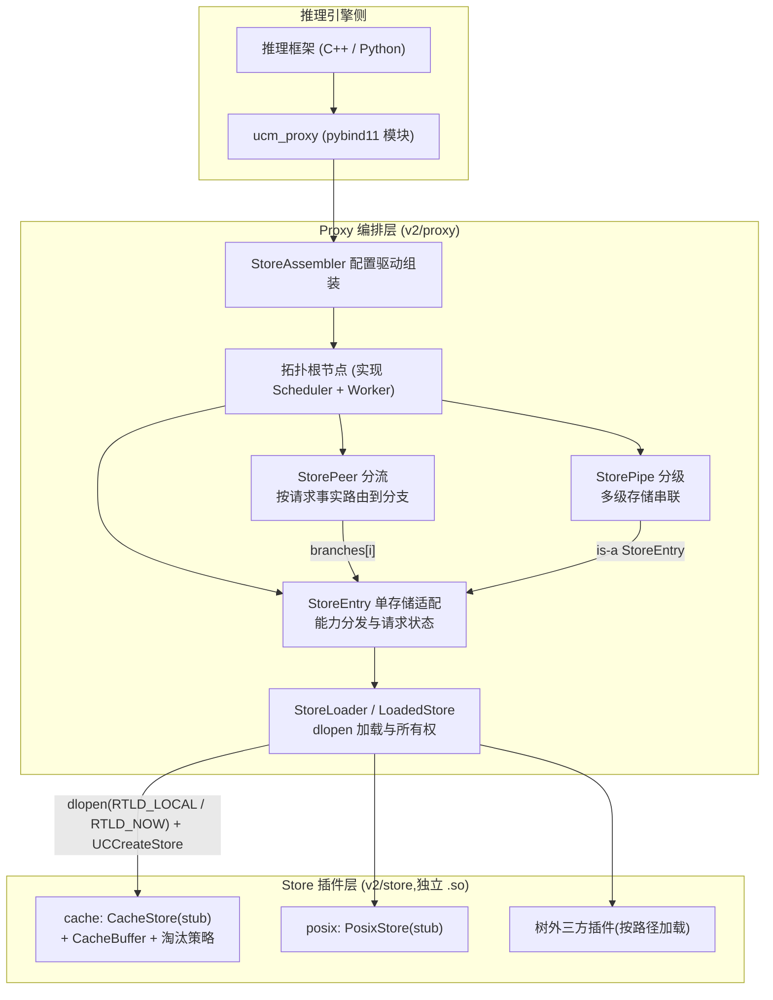
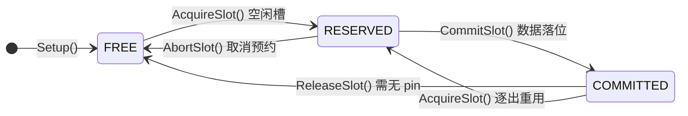
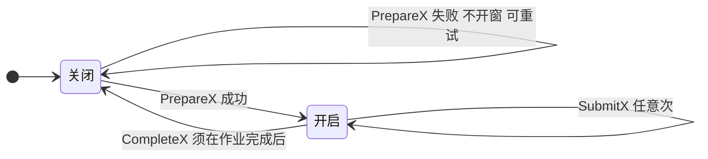
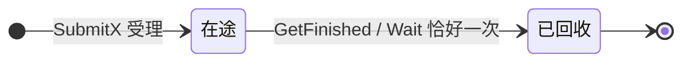
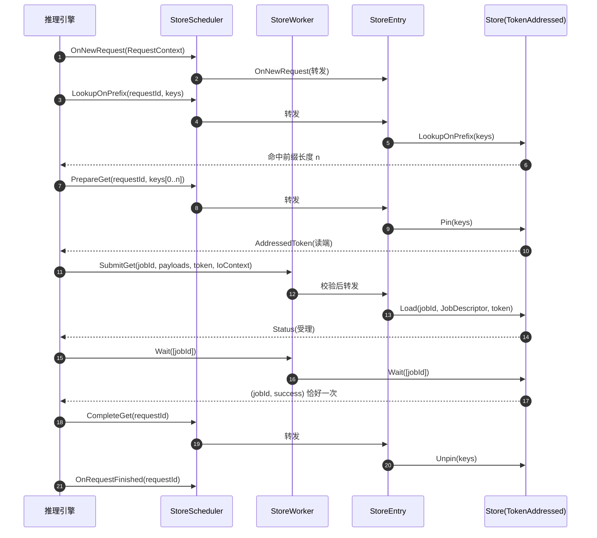
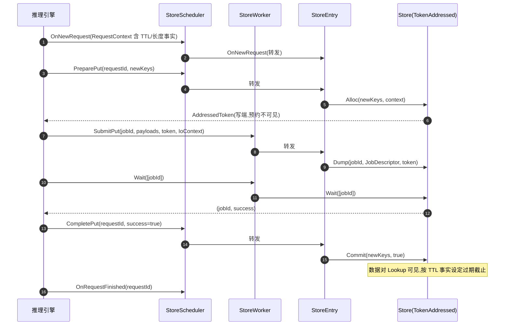
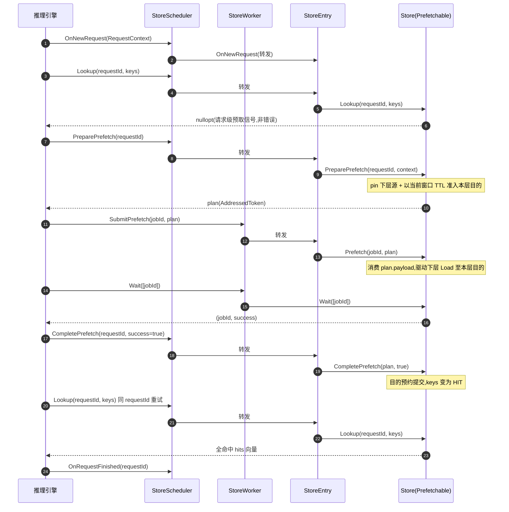
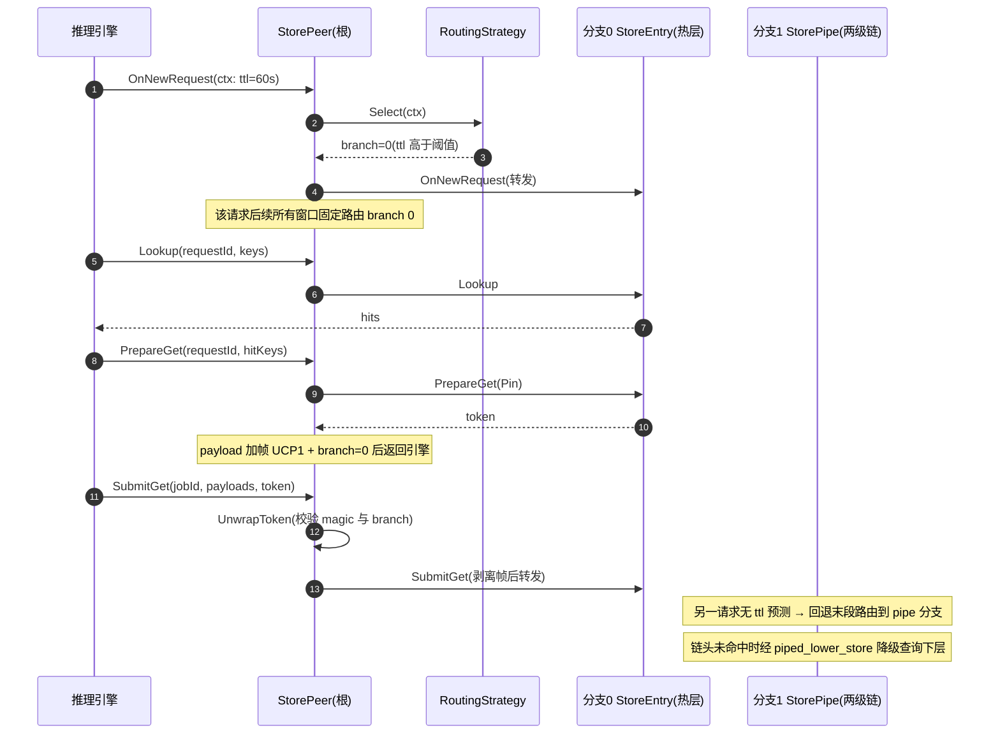

# UCM v2 推理数据卸载/重载系统 —— 接口设计文档

| 项目 | 内容 |
|---|---|
| 仓库 | ucm.v2.intf.cc.2（unified-cache-management v2 接口设计仓） |
| 基线 | commit `737a17d`（问题修复-P2） |
| 规模 | 生产代码 33 个文件 / 约 4656 行；测试代码约 3280 行；153 个用例全部通过 |
| 技术栈 | C++17 / CMake ≥ 3.18 / pybind11 v3.0.1 / fmt 11.2.0 / GoogleTest |
| 本文约定 | 所有接口描述附源码位置引用（文件 + 符号锚点），便于对照评审；接口与代码保留英文原名 |

---

## 目录

- [1. 背景与目标](#1-背景与目标)
- [2. 总体架构](#2-总体架构)
- [3. 分层语义](#3-分层语义)
- [4. 数据模型](#4-数据模型)
- [5. Store 接口](#5-store-接口)
- [6. Proxy 接口](#6-proxy-接口)
- [7. 决策规则](#7-决策规则)
- [8. 参考实现](#8-参考实现)
- [9. 典型时序](#9-典型时序)
- [10. 扩展指南](#10-扩展指南)
- [11. 总结与展望](#11-总结与展望)
- [附录 A 术语表](#附录-a-术语表)

---

## 1. 背景与目标

### 1.1 问题背景

大模型（LLM）推理中，KV Cache 随序列长度线性增长，是显存的主要消耗方：

- **容量压力**：显存（HBM）有限，长上下文、高并发场景下必须将部分 KV Cache **卸载**（offload / Dump）到更大更廉价的层级；
- **前缀复用**：多轮会话与共享前缀场景大量存在，被卸载的 KV Cache 需要被低开销地**重载**（reload / Load）回推理侧，避免重算；
- **分级存储**：推理侧显存 → 主机内存 → 本地 SSD（NVMe）→ 远端 / 分布式存储，各层容量、带宽、成本、语义差异巨大；
- **请求异构**：不同请求的存活时间（TTL）、总长度等先验信息不同，适合放置的层级也不同。

新介质（CXL 内存、RDMA 远端内存等）持续出现，系统必须在不改动主体框架的前提下容纳新的存储实现、新的分层拓扑与新的调度策略。

### 1.2 设计目标

本仓库是 UCM v2 的**接口设计仓**（intf），设计目标围绕**性能、稳定性、扩展性**三个核心诉求展开，并以统一的接口契约承载：

| 目标 | 手段 | 对应章节 |
|---|---|---|
| 高性能传输 | 异步作业模型 + 块级批量接口 + `prerequisiteHandle` 流序前置，传输与计算重叠 | [5.1](#51-基础接口) |
| 稳定可靠 | 恰好一次完成语义、两阶段准入与原子性保证、同堆创建/销毁、`RTLD_LOCAL` 符号隔离 | [3.3](#33-全局语义保证) / [5.5](#55-插件加载契约) |
| 存储介质可插拔 | Store 插件以独立 `.so` 形态 dlopen 动态加载，能力（facet）按需声明 | [5](#5-store-接口) |
| 拓扑可编排 | 单存储（Entry）、分级（Pipe）、分流（Peer）由配置字典递归组装 | [6](#6-proxy-接口) |
| 策略可注册 | 淘汰策略、路由策略走编译期注册表，新增策略零侵入 | [7](#7-决策规则) / [10](#10-扩展指南) |
| 控制面 / 数据面分离 | Scheduler（查询、窗口协议）与 Worker（作业提交、完成回收）解耦，契合推理引擎主循环 | [3](#3-分层语义) |
| 语言无关 | pybind11 暴露 `ucm_proxy` 模块，C++ / Python 双语言接入 | [6.8](#68-python-绑定) |

### 1.3 仓库定位

接口契约 + 参考实现 + 完整单测：

- **接口契约**：Store 基础接口、TokenAddressed / Prefetchable 两个能力 facet、Proxy 侧 Scheduler / Worker 接口；
- **参考实现**：CacheBuffer（块级业务层）与 ReplacementPolicy（LRU / Clock / FIFO 淘汰引擎）为引擎级完整实现；PosixStore / CacheStore 为接口打桩（stub）；
- **预留位**：transfer/file、transfer/memory 为传输引擎预留目录。

---

## 2. 总体架构

### 2.1 架构总览



阅读要点：

- 推理引擎只面向 **StoreScheduler（控制面）+ StoreWorker（数据面）** 两个接口编程，不感知拓扑细节；
- `StoreAssembler` 从 `Dictionary` 配置递归组装出根节点（单存储 / 分级链 / 分流树）；
- `StorePeer` 的分支与 `StorePipe` 的层级最终都落到 `StoreEntry`，后者经 `StoreLoader` 持有插件实例；
- 插件之间彼此隔离：每个 `.so` 只导出 `UCCreateStore` / `UCDestroyStore` 两个 C 入口。

### 2.2 分层职责

| 层 | 目录 | 职责 |
|---|---|---|
| 公共类型层 | `v2/common` | 跨层共享的纯数据类型与错误模型，零行为依赖 |
| 存储接口层 | `v2/store` | 存储侧契约（Store 基础接口 + 能力 facet）与参考实现 |
| 编排层 | `v2/proxy` | 请求生命周期、窗口协议、能力分发、路由分流、拓扑组装、插件加载、Python 绑定 |
| 传输层（预留） | `v2/transfer` | file / memory 传输引擎占位 |
| 测试层 | `v2/test` | 153 个 GoogleTest 用例 |

### 2.3 控制面与数据面

Proxy 对外拆成两个互补接口（`v2/proxy/store_scheduler.h`、`v2/proxy/store_worker.h`）：

- **StoreScheduler（控制面）**：请求注册 / 注销、存在性查询（Lookup 三变体）、热度刷新（Touch）、传输窗口的开启与关闭（PrepareX / CompleteX）。特征是**请求状态敏感、轻量、可同步调用**；
- **StoreWorker（数据面）**：异步作业的提交（SubmitPrefetch / SubmitGet / SubmitPut）与完成回收（GetFinished / Wait）。特征是**只认 jobId 与 token，不感知请求**。

这一拆分使数据面可以脱离请求表运行——Peer 分流正是利用 token 载荷携带路由信息，让 Worker 侧在看不到请求表的情况下正确分发（见 [3.4](#34-层间契约与信息传递)）。

### 2.4 目录结构

```
v2/
├── common/                    # 公共类型层
│   ├── export/export.h        #   UC_EXPORT 符号导出宏
│   ├── status/status.h        #   Status / Expected 错误模型
│   └── type/                  #   BlockId / BlockPayload / AddressedToken
│                              #   RequestContext / Dictionary
├── store/                     # 存储接口层
│   ├── store.h                #   Store 基础接口 + 插件工厂契约
│   ├── token_addressed.h      #   能力 facet:编址与两阶段准入
│   ├── prefetchable.h         #   能力 facet:预取
│   ├── factory.cc.in          #   插件工厂生成模板(CMake configure)
│   ├── posix/posix_store.h    #   PosixStore(stub)
│   └── cache/                 #   CacheStore(stub)+ CacheBuffer
│       └── policy/            #   ReplacementPolicy + LRU/Clock/FIFO + 注册表
├── proxy/                     # 编排层
│   ├── store_scheduler.h      #   控制面接口(窗口协议)
│   ├── store_worker.h         #   数据面接口(作业模型)
│   ├── store_entry.h/.cc      #   单存储适配(能力分发)
│   ├── store_pipe.h           #   分级(多级链)
│   ├── store_peer.h/.cc       #   分流(路由 + token 加帧)
│   ├── store_loader.h/.cc     #   插件加载(dlopen + 内置表)
│   ├── store_assembler.h/.cc  #   配置驱动组装
│   ├── routing/               #   路由策略接口 + 注册表 + ttl/length 实现
│   └── proxy.py.cc            #   pybind11 绑定(ucm_proxy 模块)
├── transfer/                  # 传输层(预留)
│   ├── file/                  #   本地文件传输(占位)
│   └── memory/                #   内存传输(占位)
├── test/                      # GoogleTest(153 用例)
└── vendor/                    # fmt / pybind11 / googletest 依赖拉取
```

### 2.5 架构优势

当前架构的优势来自各设计决策的组合，可归纳为以下几点：

| 优势 | 来源机制 | 详见 |
|---|---|---|
| 接入面极简 | 推理引擎只面向 Scheduler / Worker 双接口与窗口协议编程，无需感知存储介质与拓扑细节 | [2.3](#23-控制面与数据面) |
| 数据面无状态 | Worker 只认 jobId 与 token，分流路由随 token 自携带，无需请求表即可正确分发 | [3.4](#34-层间契约与信息传递) |
| 异构介质统一抽象 | 能力 facet 按需组合，远端纯存储与本地分层缓存共用同一接口模型 | [5.2](#52-能力查询facet-模型) |
| 传输与计算重叠 | 异步作业模型 + 块级批量接口 + `prerequisiteHandle` 流序前置，搬运与推理流水线并行 | [4.5](#45-jobdescriptor--传输作业描述) |
| 数据安全契约 | 两阶段准入、恰好一次完成、原子性保证，杜绝在途传输污染槽位新占用者 | [3.3](#33-全局语义保证) |
| 插件故障隔离 | 实例同堆创建/销毁 + `RTLD_LOCAL` 符号隔离，插件不污染宿主进程符号空间 | [5.5](#55-插件加载契约) |
| 拓扑即配置 | 分级（Pipe）、分流（Peer）组合由配置字典递归驱动，调整拓扑零代码变更 | [6.7](#67-storeassembler--配置组装) |
| 前向兼容 | RequestContext 事实以字段增量扩展，新预测维度平滑引入，存量实现零改动 | [4.4](#44-requestcontext--请求事实快照) |

---

## 3. 分层语义

### 3.1 各层职责边界与不变量

| 层 | 职责（做什么） | 非职责（不做什么） | 关键不变量 |
|---|---|---|---|
| common | 定义跨层共享的值类型与错误模型 | 不含任何业务行为 | 事实型字段（request facts）注册时快照、全周期固定、按前向兼容约定扩展（`v2/common/type/request.h` 前向兼容注释） |
| store（插件） | 落实存储契约：存在性查询、两阶段准入、异步搬运、完成上报 | 不感知拓扑（Peer / Pipe）与其他插件 | 预约在 Commit 前对 Lookup 不可见；完成事件恰好一次；析构前作业必须排空（`v2/store/store.h` `Store` 线程与析构契约注释） |
| proxy（编排） | 请求生命周期、窗口协议、能力分发、路由、组装、插件加载 | 不解释 token payload（除 Peer 帧的封装 / 解封）；不实现任何存储语义 | 每请求每类至多一个开窗；jobId 命名空间唯一；Complete 晚于完成事件回收（`v2/proxy/store_scheduler.h` 窗口协议注释） |
| transfer（预留） | 搬运引擎 | — | — |

### 3.2 生命周期状态机

系统中共有六类显式生命周期。其中槽位、窗口、作业三个以状态图呈现，请求、准入、令牌三个以规约呈现。

**（1） 槽位（Slot）** —— 淘汰引擎的最小管理单元（`v2/store/cache/policy/replacement_policy.h` 槽位生命周期注释）：



要点：**逐出的槽位不回空闲池**，直接从 COMMITTED 转为 RESERVED 交给新准入；被逐出者通过 `AcquiredSlot::evicted` 上报，调用方须先失效其映射（`v2/store/cache/policy/replacement_policy.h` `AcquiredSlot`）。

**（2） 窗口（Window）** —— Get / Put / Prefetch 三类彼此独立，每请求每类至多一个（`v2/proxy/store_scheduler.h` 窗口协议注释）：



**（3） 作业（Job）** —— 完成事件的恰好一次消费（`v2/store/store.h` `GetFinished`/`Wait`）：



**（4） 请求（Request）**：Registered →（任意次窗口开合与查询）→ Finished。注册时快照事实（`RequestContext`），全周期所有窗口看到相同值；Finished 要求窗口全关、在途作业全排空，未关窗口被兜底收尾（`v2/proxy/store_entry.cc` `OnRequestFinished`）。

**（5） 准入（Admission）**：Alloc（预约，不可见）→ Commit（提交可见 / 释放）。并发对同一块的 Alloc 共享一个预约，各持一个引用，最后一个 Commit 到达时才定论（`v2/store/token_addressed.h` `Alloc` 共享预约注释）。

**（6） 令牌（Token）**：mint（Pin / Alloc / PreparePrefetch）→ 持有（pin 或预约持续有效）→ 结论（Unpin / Commit / CompletePrefetch）。

### 3.3 全局语义保证

以下保证贯穿所有层级，是接口契约的核心，任何实现都必须满足：

| 保证 | 语义 | 出处 |
|---|---|---|
| 原子性 | Pin / Alloc 失败时，列表中不得残留任何 pin / 预约 | `v2/store/token_addressed.h` `Pin`/`Alloc` 原子性注释 |
| 可见性 | 卸载预约在 Commit 之前对 Lookup 不可见 | `v2/store/token_addressed.h` `Alloc` 可见性注释 |
| 幂等 | Unpin / Commit 作用于非持有块为 no-op | `v2/store/token_addressed.h` `Unpin` 幂等注释 |
| 恰好一次 | 作业完成事件在 GetFinished 与 Wait 之间不重复、不丢失 | `v2/store/store.h` `GetFinished`/`Wait` 恰好一次注释 |
| 时序约束 | CompleteX / Commit（false） 必须晚于相关作业完成事件被消费——提前释放 pin / 预约可能污染槽位的下一位占用者 | `v2/proxy/store_scheduler.h` 窗口协议注释（时序约束）；`v2/store/token_addressed.h` `Commit` 时序约束注释 |
| 并发冲突 | 同块并发准入由存储串行化，数据冲突 last-writer-wins（与窗口协议的 re-put 规则一致） | `v2/store/token_addressed.h` `Commit` 并发冲突注释 |
| 批次序无关 | Reserve 批内安置结果与 blockIds 顺序无关；批成员不会被自己的批次逐出 | `v2/store/cache/cache_buffer.h` `Reserve` 批次序无关注释 |

### 3.4 层间契约与信息传递

**token 双向流动**。Scheduler 侧铸造（Pin → 读端 / Alloc → 写端 / PreparePrefetch → 计划）→ 引擎持有 → Worker 侧消费（Load / Dump / Prefetch）→ Scheduler 侧结论（Unpin / Commit / CompletePrefetch）。`AddressedToken.payload` 对 Proxy 完全不透明——编址细节由 worker 侧自行打包与解包。

**S 与 W 间的非透明传递（Peer 加帧）**。Worker 侧看不到请求表，分流信息必须随 token 走：`StorePeer` 在铸造侧把路由决定写入 payload，Worker 侧 Submit 时解出（`v2/proxy/store_peer.cc` token 加帧注释）：

```
偏移   0        4                     12
      +----------+-------------------+--------------------+
      | "UCP1"   | branch (uint64 LE)| 原始 payload ...    |
      +----------+-------------------+--------------------+
```

magic 前缀标记“该 payload 经过本 Peer 加帧”，防止未经本 Peer 铸造、恰好能解码出合法分支号的 token 被误路由并截断（`v2/proxy/store_peer.cc` `UnwrapToken` 有完整校验）。

**requestId 作为 join key**。Prefetchable 的 Lookup / PreparePrefetch / CompletePrefetch 以 requestId 关联同一逻辑查询；一个 requestId 只能标识一个块集合，不可复用；返回最终 hit 向量或错误后，请求即告结论，实现可回收其状态（`v2/store/prefetchable.h` requestId 生命周期注释）。

**piped_lower_store 注入**。组装 Pipe 时，组装器在每一级的 Setup 配置字典中注入 `piped_lower_store`（下一层 `Store::Store*` 裸指针），链头以此感知并驱动下层（`v2/proxy/store_assembler.cc` `AssemblePipe`）。

---

## 4. 数据模型

### 4.1 BlockId —— 内容寻址的块标识

```cpp
struct BlockId {
    std::array<std::byte, 16> bytes{};   // 16 字节内容哈希
};
```

- **内容寻址**：相同内容（相同前缀计算状态）的块在任意层级共享同一标识，是跨层去重与命中判定的基础；
- **前缀语义**：接口约定 blockIds 按“请求内位置”有序输入，使 `LookupOnPrefix` / `LookupOnReverse` 这类有序查询成为可能；
- 提供 `std::hash` 特化，可直接作为 `unordered_map/set` 的键（`v2/common/type/block.h` `std::hash<BlockId>` 特化）。

### 4.2 BlockPayload —— 传输就绪的块内容

```cpp
struct BlockPayload {
    std::vector<void*> pointers;               // xPU 字节指针(支持多指针布局)
    std::vector<std::size_t> sizes;            // 每指针字节长度
    std::vector<std::size_t> memoryRegionIndices;  // 可选:注册 MemoryRegion 的索引(RDMA 预留)
    std::vector<std::size_t> groupSizes;       // 可选:注册分组的指针数(分层内存预留)
};
```

一个块可由多个指针构成（多卡 / 多层显存布局）；MR 索引与分组两个可选字段把注册成本从“每次传输”摊薄到“初始化一次”（定义见 `v2/common/type/block.h` `BlockPayload`）。

### 4.3 AddressedToken —— 自寻址不透明凭据

```cpp
struct AddressedToken {
    std::vector<BlockId> keys;         // 覆盖的块,调用方可见
    std::vector<std::byte> payload;    // 自寻址信封,worker 侧作业消费
};
```

`keys` 让调用方（与 Proxy 校验逻辑）知道凭据覆盖哪些块；`payload` 是“制备方 → 提交方”的直通信封，中间层不解释（Peer 帧是唯一例外，见 [3.4](#34-层间契约与信息传递)；定义见 `v2/common/type/token.h` `AddressedToken`）。

### 4.4 RequestContext —— 请求事实快照

```cpp
struct RequestContext {
    RequestId requestId;                                  // 请求标识
    std::optional<std::chrono::milliseconds> ttl;         // 预测存活时间
    std::optional<std::uint64_t> totalBlockCount;         // 预测总块数
};
```

- 事实在注册时快照、全周期固定（`v2/common/type/request.h` `RequestContext` 事实快照注释）；
- **前向兼容扩展约定**：消费者只读自己理解的事实、忽略其余；新事实以字段形式追加而非新增接口参数——这是路由策略与存储保留策略的共同扩展基础；
- TTL 事实的三个消费方：存储准入（设定过期截止）、Touch（延长保留）、预取（目的块继承当前窗口 TTL）。

### 4.5 JobDescriptor —— 传输作业描述

```cpp
struct JobDescriptor {
    std::vector<BlockId> blockIds;         // 参与传输的块
    std::vector<BlockPayload> payloads;    // 与 blockIds 等长配对
    std::string description;               // 可选:人读描述
    std::uintptr_t prerequisiteHandle{0};  // 可选:流前置句柄(如事件/信号量)
};
```

Load 方向 `payloads[i]` 是目的地（推理侧），Dump 方向 `payloads[i]` 是源；`prerequisiteHandle` 支撑流序执行（如 CUDA stream 事件），使搬运可与计算重叠（定义见 `v2/store/store.h` `JobDescriptor`）。

### 4.6 Status / Expected —— 错误模型

错误码经宏列表统一维护：

| 错误码 | 值 | 典型场景 |
|---|---|---|
| Ok | 0 | 成功 |
| General | -1 | 一般错误（工厂返回空实例等） |
| InvalidParam | -50000 | 未知请求 / 重复窗口 / 配置缺项 / token 帧非法 |
| OutOfMemory | -50001 | 实例分配失败 |
| OsApiError | -50002 | dlopen 等系统调用失败 |
| DuplicateKey | -50003 | 预留 |
| Retry | -50004 | 预留 |
| NotFound | -50005 | 块不存在 / 工厂入口缺失 / 注册表未知名 |
| Unsupported | -50008 | stub 未实现 |
| NoSpace | -50009 | 容量不足且无可逐出槽 |
| Timeout | -50010 | 预留 |
| Unhealthy | -50011 | 预留 |

`Expected<T>`（`v2/common/status/status.h` `Expected`）是 `std::variant<Status, T>` 的 Result 语义封装，配合 fmt 格式化的错误消息（`Status::ToString`）。

### 4.7 Dictionary —— 类型擦除配置

以 `std::any` 为底的键值容器，提供 `Set/Get<T>`、int64 / double / 数值向量便捷方法。它是贯穿“组装配置 → 插件 Setup → 策略参数”的统一配置面；数组类型被显式拒绝以防指针静默退化（`v2/common/type/dictionary.h` `Set` 数组拒绝）。

---

## 5. Store 接口

### 5.1 基础接口

| 方法 | 语义 | 关键约定 |
|---|---|---|
| `Setup(config)` | 配置与资源初始化 | 构造后、使用前调用；可重复调用以重置 |
| `Lookup(blockIds)` | 存在性探测 | hits 与输入等长；`hits[i] != 0` 即命中 |
| `LookupOnPrefix(blockIds)` | 前缀命中长度 | 返回最左连续命中的末下标，全不命中为 -1；默认由 Lookup 派生，有序介质可覆写以只查元数据（`v2/store/store.h` `LookupOnPrefix`） |
| `LookupOnReverse(blockIds)` | 最右命中位置 | 不要求连续；默认派生（`v2/store/store.h` `LookupOnReverse`） |
| `Touch(ids, ctx)` | 刷新热度、延长保留 | TTL 事实只延不缩；无 LRU/TTL 语义的实现为 no-op（`v2/store/store.h` `Touch`） |
| `Load(jobId, job)` | 重载：Store → 推理侧 | 异步；Status 仅表示受理 |
| `Dump(jobId, job)` | 卸载：推理侧 → Store | 异步；数据在 Commit 前不可见 |
| `GetFinished()` | 取走自上次调用以来的完成事件 | 恰好一次；消费即清除 |
| `Wait(jobIds)` | 阻塞等待指定作业 | 未知 / 已消费的 id 被忽略 |

**异步作业模型**要点：

- jobId 由调用方分配，在飞行作业中必须唯一（`v2/store/store.h` `Load`）；
- `Load/Dump` 返回的 Status 只表示“受理并已启动”，传输成败由完成事件的 `success` 位携带（`v2/store/store.h` `Load`）；
- **线程契约**：控制面方法须单线程调用或外部串行；完成事件的恰好一次语义隐含单消费者（`v2/store/store.h` `Store` 线程契约注释）；
- **析构契约**：销毁 Store 前必须 Wait 所有在途作业，否则行为未定义（`v2/store/store.h` `Store` 析构契约注释）。

### 5.2 能力查询（facet 模型）

```cpp
virtual Prefetchable*   AsPrefetchable()   { return nullptr; }
virtual TokenAddressed* AsTokenAddressed() { return nullptr; }
```

两个能力 facet 均为可选：不实现则返回 `nullptr`，返回指针的生命周期与 Store 对象一致。Proxy 侧据此做能力分发（见 [7.1](#71-能力分发storeentry)）。能力可自由组合——例如远端对象存储可能两者都不实现（纯基础 Store），分层缓存则两者都实现。

### 5.3 TokenAddressed —— 编址与两阶段准入

**读端**：

- `Pin(blockIds)`：pin 住块使其不可被逐出，并铸造读端 token；失败时全量回滚（原子性）。`payload` 为空表示该 store 自行解析 blockIds（`v2/store/token_addressed.h` `Pin`）；
- `Unpin(blockIds)`：幂等释放（`v2/store/token_addressed.h` `Unpin`）。

**写端（两阶段准入）**：

- `Alloc(blockIds, context)`：预约容量，铸造写端 token。预约**对 Lookup 不可见**；失败全量回滚；每个成功 Alloc 必须被恰好一次 Commit 结论；并发 Alloc 同一块共享一个预约，各持一引用，最后一个 Commit 定论（`v2/store/token_addressed.h` `Alloc`）；
- `Commit(blockIds, success)`：true 提交使数据可见，false 释放预约。数据冲突 last-writer-wins；**Commit（false） 只能在匹配的 Dump 作业完成事件被消费之后发出**——释放的槽位可能立即交给新准入，仍在飞的 Dump 会写坏新主的数据（`v2/store/token_addressed.h` `Commit`）。

**token 承载的传输**：`Load/Dump(jobId, job, token)` 与基础版的差别仅在携带 token；完成事件仍走基础 `GetFinished/Wait`（`v2/store/token_addressed.h` token 版 `Load`/`Dump`）。

### 5.4 Prefetchable —— 预取信号协议

- `Lookup(requestId, blockIds)` 返回 `Expected<optional<hits>>`：
  - **nullopt 是请求级预取信号，不是错误**——查询中含本层可从下层预取的缺失块；
  - Error 才表示查询本身失败；
  - 两个结果通道严格区分（`v2/store/prefetchable.h` `Lookup` 双通道注释）；
- `LookupOnPrefix / LookupOnReverse`：`requestId` 透传，nullopt 信号逐级继承（`v2/store/prefetchable.h` `LookupOnPrefix`/`LookupOnReverse`）；
- 解析协议四步（`v2/store/prefetchable.h` `Lookup` 解析协议注释）：

```
Lookup(requestId, keys)  ──nullopt──▶  PreparePrefetch(requestId, ctx)
                                        │  pin 下层源 + 以 ctx 准入本层目的
                                        ▼
              CompletePrefetch(plan, ok) ◀── Wait ─── Prefetch(jobId, plan)
                                        │              (worker 侧作业:消费 plan.payload,
                                        │               驱动下层 Load 至本层目的)
              Lookup(requestId, keys)  ──hits──▶  已提交 keys 全部 HIT
```

- `PreparePrefetch(requestId, context)`：内部 Alloc 以 context 准入目的块，预取块继承当前窗口的 TTL 事实（`v2/store/prefetchable.h` `PreparePrefetch`）；
- `CompletePrefetch(plan, success)`：成功则目的预约提交、keys 变为 HIT；失败回滚（`v2/store/prefetchable.h` `CompletePrefetch`）；
- `Prefetch(jobId, plan)`：worker 侧作业，逐字消费 plan 的自寻址 payload（约定内含下层 Pin 铸造的源元数据与本层目的元数据），驱动下层 Load——下层是 tokened 则用其 token 版，否则用基础版（`v2/store/prefetchable.h` `Prefetch`）。

### 5.5 插件加载契约

- 入口名统一：`UCCreateStore` / `UCDestroyStore`，一个二进制至多链接一个工厂定义（`v2/store/store.h` 工厂契约注释）；
- 加载方以 `RTLD_LOCAL | RTLD_NOW` dlopen，并在**插件自身句柄**上 dlsym（禁用 RTLD_DEFAULT，避免符号污染）；
- 工厂可被多次调用，每次返回新实例，失败返回 nullptr；
- 实例同堆创建 / 销毁（destroy 归还到 create 的堆）；
- 插件类默认构造，配置经 `Setup()` 传入——工厂签名保持零参数。

---

## 6. Proxy 接口

### 6.1 StoreScheduler —— 控制面

| 方法 | 语义 |
|---|---|
| `OnNewRequest(request)` | 注册请求与事实快照；拒绝重复的活跃 id |
| `OnRequestFinished(requestId)` | 注销请求；对未关窗口兜底收尾 |
| `Lookup / LookupOnPrefix / LookupOnReverse` | 查询，`optional` 结果透传预取信号 |
| `Touch(requestId, keys)` | 热度刷新（携带请求事实） |
| `PreparePrefetch / CompletePrefetch` | 预取窗口开 / 关 |
| `PrepareGet / CompleteGet` | 重载窗口开 / 关 |
| `PreparePut / CompletePut` | 卸载窗口开 / 关 |

**窗口协议**（`v2/proxy/store_scheduler.h` 窗口协议注释，逐请求、逐类型独立）：

1. `PrepareX()` 至多开一个同类窗口；已有开窗时重复 Prepare 被拒绝（InvalidParam）；失败的 Prepare 不开窗、可重试；
2. `SubmitX()`（Worker 侧）可对开窗 token 任意次调用；
3. `CompleteX()` 关窗，且**只能在所提交作业的完成事件被 GetFinished/Wait 消费之后**发出——提前关窗是未定义行为（pin / 预约先于传输释放会污染槽位下一位占用者）；
4. `OnRequestFinished` 要求所有窗口已关、在途作业已排空；残留窗口被尽力收尾（Unpin / Commit（false） / CompletePrefetch（false））作为安全网。

### 6.2 StoreWorker —— 数据面

```cpp
struct IoContext {
    std::uintptr_t prerequisiteHandle{0};   // 流前置句柄,0 表示无
};
struct IoResult {
    std::size_t jobId;
    bool success;
};
```

`SubmitPrefetch(jobId, token)` / `SubmitGet(jobId, payloads, token, ctx)` / `SubmitPut(...)` 提交作业；`GetFinished()` / `Wait(jobIds)` 回收完成。Worker 只认 jobId 与 token，不感知请求——这是 Peer 分流能在数据面工作的前提（定义见 `v2/proxy/store_worker.h` `IoContext`/`IoResult`/`StoreWorker`）。

### 6.3 StoreEntry —— 单存储适配

职责：把 Scheduler / Worker 两个接口适配到**一个** LoadedStore 上。

- **能力探测**：构造时查询 `AsPrefetchable/AsTokenAddressed` 并缓存（`v2/proxy/store_entry.cc` `StoreEntry` 构造函数）；
- **能力分发**：Lookup 族走 prefetchable facet 或基础接口（`v2/proxy/store_entry.cc` `Lookup` 族）；Submit 族走 token 版或基础版（`v2/proxy/store_entry.cc` `SubmitGet`/`SubmitPut`）；分发规则全表见 [7.1](#71-能力分发storeentry)；
- **非 tokened 兜底**：`PrepareGet/PreparePut` 在非 tokened store 上不调存储，直接铸造 keys-only token（payload 为空），统一上层编程模型（`v2/proxy/store_entry.cc` `PrepareGet`/`PreparePut` 非 tokened 分支）；
- **合成完成**：`SubmitPrefetch` 在非 prefetchable store 上不调存储，直接登记 jobId 并合成成功完成事件——上层无需感知“该层不可预取”（`v2/proxy/store_entry.cc` `SubmitPrefetch` 合成完成分支）；
- **请求状态**：每请求记录 prefetch token、pinned 块、reserved 块，支撑窗口互斥与兜底收尾（`v2/proxy/store_entry.h` `RequestState`）；
- **输入校验**（`v2/proxy/store_entry.cc` `ValidateTransfer`）：jobId 不得在途重复；payloads 数须等于 token.keys 数；非 tokened store 收到携带 payload 的 token 直接拒绝。

### 6.4 StorePipe —— 分级

```cpp
struct StorePipeTailsHolder {                       // 先声明:后析构
    std::vector<std::unique_ptr<LoadedStore>> piped_;
};
class StorePipe : private StorePipeTailsHolder, public StoreEntry { ... };
```

- **组装**：自底向上逐级 Setup，每级（除最底）注入 `piped_lower_store` 指向下一层（`v2/proxy/store_assembler.cc` `AssemblePipe`）——链头探测下层时看到的是已配置实例；
- **析构序**：基类按声明逆序析构，`StorePipeTailsHolder` 声明在前故最后析构，保证**链头先于其下层死亡**（链头持有下层裸指针，`v2/proxy/store_pipe.h` 析构序注释 注释）；
- 链头的 Lookup 委托、数据搬运等行为完全由插件自身通过下层指针实现，Proxy 不介入级联逻辑（StubStore 演示了 Lookup 委托，`v2/test/proxy/fixtures/stub_store.cc` `StubStore`）。

### 6.5 StorePeer —— 分流

- **路由时机**：仅在 `OnNewRequest` 时调用 `RoutingStrategy::Select` 一次并缓存在请求状态，该请求所有后续窗口固定路由到该分支（`v2/proxy/store_peer.cc` `OnNewRequest`）；
- **token 加帧 / 解帧**：见 [3.4](#34-层间契约与信息传递)。解帧失败（无 magic / 帧截断 / 分支越界）返回 InvalidParam（`v2/proxy/store_peer.cc` `UnwrapToken`）；
- **jobId 跨分支唯一**：Peer 级在途表统一查重（`v2/proxy/store_peer.cc` `SubmitPrefetch` jobId 查重）；
- **完成聚合**：`GetFinished` 汇聚全部分支；`Wait` 按分支分组下发（`v2/proxy/store_peer.cc` `GetFinished`/`Wait`）。

### 6.6 StoreLoader —— 插件加载

- `LoadedStore`：move-only 所有权句柄，同时持有实例、destroy 入口与 dlopen 句柄；析构顺序为先经插件自身的 `UCDestroyStore` 销毁实例（同堆），再 dlclose（`v2/proxy/store_loader.cc` `LoadedStore::Close`）；`Adopt` 支持收养普通 `new` 出来的实例（测试与嵌入式场景，`v2/proxy/store_loader.cc` `LoadedStore::Adopt`）；
- `StoreLoader::Load(nameOrPath)`：含 `/` 或以 `.so` 结尾视为路径；否则查内置表（CMake 从 `ucm_add_store` 注册自动生成，新增插件无需改 Proxy 侧，`v2/proxy/CMakeLists.txt` 内置表生成）；未知内置名报 InvalidParam 并列出已知项（`v2/proxy/store_loader.cc` `StoreLoader::Load`）；
- 错误分类：dlopen 失败 → OsApiError；入口缺失 → NotFound；工厂返回空 → General。

### 6.7 StoreAssembler —— 配置组装

配置 schema（以 Dictionary / Python dict 表达）：

```
root     := { type: "store", store: <name|path>, config?: {...} }
         |  { type: "pipe",  stores: [ node, ... ] }                  # stores 非空
         |  { type: "peer",  branches: [ branch, ... ],               # 分支不可为 peer
                          routing: { strategy: <name>, config?: {...} } }
branch   := store 节点 | pipe 节点
```

- `Create(config)` 按 type 分发递归组装，未知 type 拒绝（`v2/proxy/store_assembler.cc` `Create`）；
- 分支为 peer 直接拒绝并提示“展平为更宽的 peer”（`v2/proxy/store_assembler.cc` `AssembleBranch`）；
- 路由策略从注册表按名创建，以 `routing.config` 子字典做参数（组装器只解析策略名、不解析参数，`v2/proxy/store_assembler.cc` `AssembleRouting`）；
- 任一环节 Setup 失败则整体组装失败。

### 6.8 Python 绑定

模块名 `ucm_proxy`，暴露 `BlockId / RequestContext / AddressedToken / BlockPayload / IoContext / IoResult / StoreScheduler / StoreWorker / StoreAssembler`。类型映射：

| C++ | Python | 说明 |
|---|---|---|
| `BlockId` 向量 | `bytes`（16 的倍数） | 打包传输，零拷贝语义边界清晰（`v2/proxy/proxy.py.cc` `ToBlockIdVector`） |
| `Expected<T>` | T 或抛 `ucm.UcmError` | RuntimeError 子类（`v2/proxy/proxy.py.cc` `UcmError`/`Unwrap`） |
| `optional<hits>` | `bytes` 或 `None` | nullopt（预取信号）透传为 None（`v2/proxy/proxy.py.cc` `lookup` 绑定） |
| `RequestContext.ttl` | `ttl_ms: int` | 毫秒（`v2/proxy/proxy.py.cc` `ttl_ms` 属性） |
| `BlockPayload.pointers` | `list[int]` | 整数地址（`v2/proxy/proxy.py.cc` `pointers` 属性） |

所有跨 C++ 调用均 `gil_scoped_release`（`v2/proxy/proxy.py.cc` 方法绑定 等），长阻塞传输不占用 GIL。

---

## 7. 决策规则

系统中的决策点分散在各模块，此处汇总成目录。每条规则附触发条件与源码位置。

### 7.1 能力分发（StoreEntry）

| 条件 | 行为 | 源码 |
|---|---|---|
| store 实现 Prefetchable，收到 Lookup 族 | 走 facet 版 `Lookup(requestId, keys)` | `v2/proxy/store_entry.cc` `Lookup` |
| 否则 | 走基础 `Store::Lookup(keys)` | `v2/proxy/store_entry.cc` `Lookup` |
| 非 tokened，收到 PrepareGet | 不调存储，铸造 keys-only token | `v2/proxy/store_entry.cc` `PrepareGet` 非 tokened 分支 |
| tokened，收到 PrepareGet | `Pin(keys)` 铸读端 token | `v2/proxy/store_entry.cc` `PrepareGet` Pin 分支 |
| 非 tokened，收到 PreparePut | 不调存储，铸造 keys-only token | `v2/proxy/store_entry.cc` `PreparePut` 非 tokened 分支 |
| tokened，收到 PreparePut | `Alloc(keys, ctx)` 铸写端 token | `v2/proxy/store_entry.cc` `PreparePut` Alloc 分支 |
| tokened，收到 SubmitGet/SubmitPut | 走 token 版 Load/Dump | `v2/proxy/store_entry.cc` `SubmitGet`/`SubmitPut` token 分发 |
| 否则 | 走基础 Load/Dump | 同上 |
| 非 prefetchable，收到 SubmitPrefetch | 不调存储，合成成功完成事件 | `v2/proxy/store_entry.cc` `SubmitPrefetch` 合成完成分支 |

### 7.2 路由（StorePeer / RoutingStrategy）

| 规则 | 内容 | 源码 |
|---|---|---|
| 路由时机 | 仅 OnNewRequest 时 Select 一次并缓存；后续窗口全周期固定 | `v2/proxy/store_peer.cc` `OnNewRequest` 路由缓存 |
| 阈值合法性 | thresholds 非空且严格递减；分支数 = 阈值数 + 1 | `v2/proxy/routing/ttl_strategy.cc` `TtlRoutingStrategy::Setup`；`v2/proxy/routing/length_strategy.cc` `LengthRoutingStrategy::Setup` |
| ttl 策略 | `ttl > thresholds[i]` → 段 i；无 ttl 事实 → 末段（回退） | `v2/proxy/routing/ttl_strategy.cc` `TtlRoutingStrategy::Select` |
| length 策略 | `totalBlockCount > thresholds[i]` → 段 i；无预测 → 末段；阈值须非负 | `v2/proxy/routing/length_strategy.cc` `LengthRoutingStrategy::Select` |
| 提交侧路由 | Submit 族以 token 帧解出 branch，不依赖请求表 | `v2/proxy/store_peer.cc` `SubmitPrefetch` 解帧路由 |
| 帧校验 | 无 magic / 帧截断 / branch 越界 → InvalidParam | `v2/proxy/store_peer.cc` `UnwrapToken` |

### 7.3 准入与淘汰（CacheBuffer / ReplacementPolicy）

| 规则 | 内容 | 源码 |
|---|---|---|
| 容量前置 | 新块数 > capacity → NoSpace，不触发任何逐出 | `v2/store/cache/cache_buffer.h` `Reserve` 容量前置 |
| 批次两阶段 | 先安置已知块（pending 并入 / committed 转重纳入），后放置新块 → 批内序无关 | `v2/store/cache/cache_buffer.h` `SettleKnownBlocks`/`PlaceNewcomer` |
| 过期优先 | 池满时先 SweepExpired，再咨询淘汰纪律 | `v2/store/cache/cache_buffer.h` `PlaceNewcomer` |
| 槽位获取 | 优先空闲链；耗尽则 SelectVictimSlot 逐出重用 | `v2/store/cache/policy/replacement_policy.h` `AcquireSlot` |
| 逐出保护 | pinned 槽永不成为受害者；策略返回非法受害者视同无受害者 → NoSpace | `v2/store/cache/policy/replacement_policy.h` `AcquireSlot` 受害者校验 |
| 预约保护 | RESERVED 态拒绝 Touch/Pin/ReleaseSlot；预约槽对逐出免疫 | `v2/store/cache/policy/replacement_policy.h` 预约保护不变量注释 |
| 失败回滚 | 批次失败回滚全部预约；被逐出受害者原位恢复（CommitSlot + 恢复映射与截止时间，数据未动） | `v2/store/cache/cache_buffer.h` `Rollback` |

### 7.4 过期与保留（TTL）

| 规则 | 内容 | 源码 |
|---|---|---|
| 截止起点 | Commit 时以单调时钟设定；无 TTL 事实 → 永不过期 | `v2/store/cache/cache_buffer.h` `Commit` 截止起点 |
| 只延不缩 | Touch 仅在 now+ttl 晚于现截止时延长；无截止（永生）块保持永生 | `v2/store/cache/cache_buffer.h` `Touch` |
| 惰性探测 | Lookup/Touch/Pin 时就地校验过期；过期即除名（pinned 除外，先报 miss） | `v2/store/cache/cache_buffer.h` `Lookup` |
| pin 延迟 | 过期但被 pin 的槽：移出堆暂存，每次扫描重排队 | `v2/store/cache/cache_buffer.h` `SweepExpired` |
| 重纳入复活 | 重纳入块在结论时已过期且 success → 以新截止复活并刷新热度；失败 → 任其过期 | `v2/store/cache/cache_buffer.h` `Commit` 重纳入复活 |
| 索引压缩 | 过期堆内陈旧条目数 > 2×committed+16 时重建 | `v2/store/cache/cache_buffer.h` `Commit` 索引压缩 |

### 7.5 窗口与作业（Proxy）

| 规则 | 内容 | 源码 |
|---|---|---|
| 窗口唯一 | 每请求每类至多一个开窗；重复 Prepare → InvalidParam | `v2/proxy/store_entry.cc` `PreparePrefetch`/`PrepareGet`/`PreparePut` 窗口查重 |
| 失败不开窗 | Prepare 失败不改变请求状态（成功后才记录），可重试 | `v2/proxy/store_entry.cc` `PreparePrefetch`/`PrepareGet` 失败不开窗 |
| 关窗时机 | CompleteX 须在所提交作业完成事件被消费之后 | `v2/proxy/store_scheduler.h` 窗口协议注释（时序约束） |
| 作业唯一 | jobId 在途不可重复提交（Entry 内、Peer 跨分支） | `v2/proxy/store_entry.cc` `ValidateTransfer` jobId 查重；`v2/proxy/store_peer.cc` `SubmitPrefetch` jobId 查重 |
| 输入校验 | payloads 数 = token.keys 数；非 tokened store 拒绝带 payload 的 token | `v2/proxy/store_entry.cc` `ValidateTransfer` |
| 完成合并 | GetFinished 聚合各分支与合成事件；Wait 按分支分组、未知 id 忽略 | `v2/proxy/store_peer.cc` `GetFinished`/`Wait`；`v2/proxy/store_entry.cc` `GetFinished`/`Wait` |
| 兜底收尾 | OnRequestFinished 对未关窗口：Unpin / Commit（false） / CompletePrefetch（false） | `v2/proxy/store_entry.cc` `OnRequestFinished` |

### 7.6 组装校验（StoreAssembler）

| 规则 | 内容 | 源码 |
|---|---|---|
| 类型分发 | type ∈ {store， pipe， peer}，未知 → InvalidParam | `v2/proxy/store_assembler.cc` `Create` |
| peer 不可嵌套 | 分支为 peer → 拒绝，提示展平为更宽 peer | `v2/proxy/store_assembler.cc` `AssembleBranch` |
| 必填项 | store 节点需 `store`；pipe 需非空 `stores`；peer 需非空 `branches` 与 `routing.strategy` | `v2/proxy/store_assembler.cc` `AssembleEntry`/`AssemblePipe`/`AssemblePeer` |
| Setup 顺序 | pipe 自底向上；每级注入 `piped_lower_store` | `v2/proxy/store_assembler.cc` `AssemblePipe` |
| 失败传播 | 任一插件 Setup 失败 → 整体组装失败 | `v2/proxy/store_assembler.cc` `AssembleEntry` |

---

## 8. 参考实现

### 8.1 ReplacementPolicy —— 槽位淘汰引擎

**设计模式：模板方法**。基类拥有固定容量槽位池与全部状态管理，子类只贡献淘汰纪律——4 个 `On*` 钩子加一个 `SelectVictimSlot`（`v2/store/cache/policy/replacement_policy.h` On* 钩子）：

| 钩子 | 时机 |
|---|---|
| `OnSetup(capacity)` | 池初始化后 |
| `OnSlotAdmitted(slot)` | CommitSlot（数据落位） |
| `OnSlotTouched(slot)` | Touch（热度刷新） |
| `OnSlotReleased(slot)` | ReleaseSlot 或被逐出 |
| `SelectVictimSlot()` | 池耗尽时排名受害者（纯虚） |

**槽位池**以侵入式空闲链实现：`nextFree_` 每槽双义（占用时为 kNone，空闲时为下一空闲槽，链尾自环），配合 `reserved_` 标志与 `pinCounts_` 计数，O（1） 获取 / 归还，无额外分配（`v2/store/cache/policy/replacement_policy.h` 槽位池私有成员）。

**内置三策略对比**：

| 策略 | 数据结构 | admission | Touch | 受害者选择 | 源码 |
|---|---|---|---|---|---|
| `lru` | 双向链表 + 槽位迭代器向量 | 头插 | splice 到头 | 链尾起首个未 pin | `v2/store/cache/policy/lru_policy.cc` `LruPolicy` |
| `clock` | 环形手 + 引用位 | 置位 | 置位 | 手扫 2×capacity，二次机会，跳过 pin | `v2/store/cache/policy/clock_policy.cc` `ClockPolicy` |
| `fifo` | 队列 + 迭代器向量 | 尾入 | 忽略 | 队首起首个未 pin | `v2/store/cache/policy/fifo_policy.cc` `FifoPolicy` |

三策略经 `UC_STORE_REGISTER_REPLACEMENT_POLICY` 注册进编译期注册表，配置名分别为 `"lru" / "clock" / "fifo"`（`v2/store/cache/policy/replacement_policy_registry.h` `UC_STORE_REGISTER_REPLACEMENT_POLICY` 宏）。

### 8.2 CacheBuffer —— 块级业务层

CacheBuffer 把 TokenAddressed 协议映射到槽位引擎：`Reserve↔Alloc`、`Commit↔Commit`、`Pin↔Pin`、`Lookup/Touch` 为探测（`v2/store/cache/cache_buffer.h` `CacheBuffer` 类注释）。核心数据结构：

| 结构 | 类型 | 用途 |
|---|---|---|
| `committed_` | `unordered_map<BlockId, CommittedEntry>` | 已提交块 → 槽位 / 截止 / 外部 pin 数 |
| `pending_` | `unordered_map<BlockId, PendingEntry>` | 预约 / 重纳入在途：槽位、TTL、refs、anySuccess |
| `occupants_` | `vector<BlockId>` | 槽位 → 占用者（逐出受害者恢复用） |
| `expiryHeap_` | `DeadlineEntry` 小顶堆 | 过期扫描索引（陈旧条目 pop 时校验） |
| `deferredExpiry_` | 向量 | 过期但被 pin 的暂存 |
| journal / sharedRefs | `ReserveBatch` 内 | 批次回滚日志 / 并入他人预约的引用记录 |

**Reserve 两阶段**（`v2/store/cache/cache_buffer.h` `Reserve`）：

1. `SettleKnownBlocks`：pending 块并入既有预约（refs++，TTL last-writer-wins）；committed 块转**重纳入**（保持原槽并 policy pin，直到结论）；
2. `PlaceNewcomer`：池满先 `SweepExpired`，再 `AcquireSlot`；逐出受害者记入 journal。

先安置已知块再放新块，保证**批成员不会被自己的批次逐出**、结果与批内顺序无关（`v2/store/cache/cache_buffer.h` `SettleKnownBlocks` 注释 注释）。

**共享预约**：`refs` 计数 + `anySuccess` 标志；每个 Allocate 调用持一引用、对应自己的 Commit；最后一个 Commit 到达时定论——任一 sharer 成功即提交（`v2/store/cache/cache_buffer.h` `Commit` 共享预约注释）。

**重纳入语义**：已提交块再次 Alloc → 保持槽位不变、policy pin 守护在途重写；结论时若块已过期且 success → 以新 TTL 复活（revive）并刷新热度；失败 → 维持原状任其过期；存活块的保留期只经 Touch 延长（`v2/store/cache/cache_buffer.h` `Reserve`/`Commit` 重纳入注释）。

**TTL 惰性过期**：截止用单调时钟；探测点在 Lookup/Touch/Pin；压力点（池满）先扫过期再咨询淘汰纪律；被 pin 的过期条目移入 deferred 暂存、每次扫描重新入队；堆内陈旧条目（被新截止取代或块已离开）在 pop 时以 deadline 比对校验丢弃，并在数量超阈值时整体压缩（`v2/store/cache/cache_buffer.h` `CompactExpiry`/`SweepExpired`）。

**回滚日志**：Reserve 失败时逆序回放——重纳入条目 Unpin；逐出条目 CommitSlot 原位恢复受害者（失败批次未开始写，槽内仍是旧数据，截止时间原样恢复）；纯新预约 AbortSlot；同时归还并入他人预约的引用（`v2/store/cache/cache_buffer.h` `Rollback`）。

### 8.3 实现现状

| 组件 | 状态 | 说明 |
|---|---|---|
| `CacheBuffer` | 完整 | 引擎级实现：纯内存元数据管理，不含实际搬运 |
| `ReplacementPolicy`（lru/clock/fifo） | 完整 | 可被具体 Store 直接组装复用 |
| `CacheStore` | stub | 骨架：声明 Store + TokenAddressed + Prefetchable 三 facet 组合，方法返回 Unsupported（`v2/store/cache/cache_store.h` `CacheStore`） |
| `PosixStore` | stub | 接口打桩，方法返回 Unsupported（`v2/store/posix/posix_store.h` `PosixStore`） |
| `transfer/file`、`transfer/memory` | 预留 | 空 CMake 占位 |

---

## 9. 典型时序

以下时序图与 `v2/proxy/store_entry.cc` / `v2/proxy/store_peer.cc` 的实际调用路径一致。图中 S 为控制面、W 为数据面、N 为拓扑节点。

### 9.1 重载（Get）



### 9.2 卸载（Put）



### 9.3 预取（Prefetch）



### 9.4 分流 + 分级组合（Peer + Pipe）



---

## 10. 扩展指南

### 10.1 构建

```bash
# 配置(仓库根 CMakeLists.txt)
cmake -B build -DUCM_MAJOR_VERSION=2 -DUCM_BUILD_UNIT_TESTS=ON
cmake --build build -j$(nproc)
ctest --test-dir build        # 153 个用例
```

- `UCM_MAJOR_VERSION=2`：仅构建 v2（为空走 legacy 流程）；
- `UCM_DOWNLOAD_DEPENDENCE=ON`（默认）：经 FetchContent 拉取 fmt 11.2.0 / pybind11 v3.0.1 / googletest，支持 gitcode 镜像自动回退（`v2/vendor/helper.cmake`）；
- 产物：`ucm_proxy.cpython-*.so`（Python 模块）、`libucm_store_cache.so`、`libucm_store_posix.so`（插件）。

### 10.2 扩展点总览

| # | 扩展点 | 机制 | 注册 / 接入方式 | 是否侵入既有代码 |
|---|---|---|---|---|
| 1 | 存储插件 | dlopen + 工厂入口 | 树内 `ucm_add_store()`；树外按路径加载 | 否 |
| 2 | 能力 facet | AsPrefetchable / AsTokenAddressed 可选实现 | 插件内 override | 否 |
| 3 | 淘汰策略 | 编译期注册表 | `UC_STORE_REGISTER_REPLACEMENT_POLICY` 宏 | 否 |
| 4 | 路由策略 | 编译期注册表 | `UC_PROXY_REGISTER_ROUTING_STRATEGY` 宏 | 否 |
| 5 | 拓扑组合 | Dictionary 配置 | type=store/pipe/peer 递归 | 否（纯配置） |
| 6 | 请求事实 | RequestContext 字段增量 | 消费者按需读取、忽略未知 | 否（前向兼容约定） |
| 7 | 传输载荷 | BlockPayload 的 MR/分组字段 | 初始化期注册 | 否 |
| 8 | 传输引擎 | transfer/file、transfer/memory 预留 | 实现后由插件 Load/Dump 委托 | 否 |
| 9 | 语言绑定 | pybind11 模块 | `import ucm_proxy` | — |

### 10.3 新增存储插件（树内）

```cmake
# 1) 新建 v2/store/myengine/CMakeLists.txt
ucm_add_store(myengine my_store.h ::UC::Store::MyStore)

# 2) v2/store/CMakeLists.txt 追加一行
add_subdirectory(myengine)
```

`ucm_add_store`（`v2/store/CMakeLists.txt` `ucm_add_store()`）递归收集源码编译为 OBJECT 库，并由 `factory.cc.in` 生成 `UCCreateStore/UCDestroyStore` 工厂；插件自动进入内置表（`v2/proxy/CMakeLists.txt` 内置表生成），**Proxy 侧零改动**。

```cpp
// v2/store/myengine/my_store.h
#include "store.h"
#include "token_addressed.h"

class MyStore : public UC::Store::Store, public UC::Store::TokenAddressed {
public:
    UC::Status Setup(const UC::Dictionary& config) override;   // 校验配置、初始化资源
    UC::Expected<std::vector<std::uint8_t>> Lookup(
        const std::vector<UC::BlockId>& ids) override;
    UC::Status Load(std::size_t jobId, const UC::JobDescriptor& job) override;
    UC::Status Dump(std::size_t jobId, const UC::JobDescriptor& job) override;
    std::vector<std::pair<std::size_t, bool>> GetFinished() override;
    std::vector<std::pair<std::size_t, bool>> Wait(
        const std::vector<std::size_t>& ids) override;

    // 可选能力:按需 override(默认返回 nullptr)
    UC::Store::TokenAddressed* AsTokenAddressed() override { return this; }
    UC::Store::Prefetchable* AsPrefetchable() override { return nullptr; }

    /* TokenAddressed: Pin/Unpin/Alloc/Commit/token 版 Load/Dump ... */
};
```

**树外插件**：单个 `.cc` 编译为 MODULE，手写两个 `extern "C"` 入口（参考 `v2/test/proxy/fixtures/stub_store.cc` 工厂入口），配置中 `store` 字段直接写 `.so` 路径即可加载。

### 10.4 新增淘汰策略

```cpp
#include "replacement_policy.h"
#include "replacement_policy_registry.h"

class MyPolicy : public UC::Store::ReplacementPolicy {
protected:
    UC::Status OnSetup(std::size_t capacity) override;              // 初始化纪律数据结构
    void OnSlotAdmitted(std::size_t slot) override;                 // 槽位落位
    void OnSlotTouched(std::size_t slot) override;                  // 热度刷新
    void OnSlotReleased(std::size_t slot) override;                 // 槽位离开
    std::optional<std::size_t> SelectVictimSlot() override;         // 排名受害者
};
UC_STORE_REGISTER_REPLACEMENT_POLICY(MyPolicy, "my");
```

只需维护“槽位序”；块映射、准入可见性、TTL 全部由 CacheBuffer 承担（见 [8.1](#81-replacementpolicy--槽位淘汰引擎)）。

### 10.5 新增路由策略

```cpp
#include "routing/strategy.h"
#include "routing/strategy_registry.h"

class MyStrategy : public UC::Proxy::RoutingStrategy {
public:
    UC::Status Setup(const UC::Dictionary& config, std::size_t branchCount) override;
    std::size_t Select(const UC::RequestContext& request) override;
};
UC_PROXY_REGISTER_ROUTING_STRATEGY(MyStrategy, "my");
```

`Setup` 校验参数并绑定分支数（非法参数返回 InvalidParam）；`Select` 的返回值约定恒为合法分支索引——缺事实等场景由策略自带回退语义（参考 ttl 策略回退末段，`v2/proxy/routing/ttl_strategy.cc` `TtlRoutingStrategy::Select`）。

### 10.6 拓扑配置示例

以下 Python 配置组装“按 TTL 三段分流，中段为两级链”的拓扑（键名以各插件 Setup 的文档为准，`cache` 插件当前为 stub，此处为示意）：

```python
import ucm_proxy as ucm

config = {
    "type": "peer",
    "routing": {"strategy": "ttl",
                "config": {"thresholds": [60000, 10000]}},     # ms,严格递减
    "branches": [
        # 段0: ttl > 60s → 热层单存储
        {"type": "store", "store": "cache",
         "config": {"capacity": 1024, "policy": "lru"}},
        # 段1: 10s < ttl <= 60s → 两级链
        {"type": "pipe", "stores": [
            {"store": "cache", "config": {"capacity": 4096, "policy": "clock"}},
            {"store": "posix", "config": {"root": "/data/ucm"}},
        ]},
        # 段2(回退段): 无 ttl 预测 → 持久层
        {"type": "store", "store": "posix", "config": {"root": "/ssd/ucm"}},
    ],
}
assembler = ucm.StoreAssembler(config)
scheduler = assembler.get_scheduler()
worker = assembler.get_worker()
```

### 10.7 Python 完整用法（重载流程）

```python
import ucm_proxy as ucm

# ... assembler 构建同上 ...

ctx = ucm.RequestContext()
ctx.request_id = "req-1"
ctx.ttl_ms = 60000
ctx.total_block_count = 128
scheduler.on_new_request(ctx)

keys = b"".join(block.to_bytes() for block in blocks)     # 16B * n 打包
n = scheduler.lookup_on_prefix("req-1", keys)             # → int(-1 起)
token = scheduler.prepare_get("req-1", keys[:16 * (n + 1)])

payload = ucm.BlockPayload()
payload.pointers = [base_addr]                            # 显存地址
payload.sizes = [block_bytes * (n + 1)]
worker.submit_get(1, [payload], token, ucm.IoContext())

results = worker.wait([1])
assert results[0].success

scheduler.complete_get("req-1")
scheduler.on_request_finished("req-1")
```

### 10.8 请求事实与传输载荷的扩展约定

- **RequestContext**：新事实以字段追加（`v2/common/type/request.h` 前向兼容注释）；老实现“读所懂、忽略其余”，天然前向兼容。例如未来追加“优先级”事实，ttl/length 路由策略与存量存储均无需改动，新策略按需消费；
- **BlockPayload**：`memoryRegionIndices`（注册 MR 索引，面向 RDMA）与 `groupSizes`（分组指针数，面向多指针布局）在初始化期注册、作业按索引引用（`v2/common/type/block.h` `BlockPayload` 的 MR/分组字段），新传输引擎可直接复用这两个通道而无需改 BlockPayload 结构。

---

## 11. 总结与展望

### 11.1 设计取舍

| 取舍 | 选择 | 理由与代价 |
|---|---|---|
| 控制面并发模型 | 单线程 / 外部串行契约（`v2/store/store.h` `Store` 线程契约注释） | 免锁热路径、实现简单；多线程须上层串行化 |
| 完成通知 | 拉取式（GetFinished/Wait）而非回调 | 避免回调重入与线程模型耦合，契合推理引擎主循环轮询；延迟感知晚一拍 |
| 层间信息 | 非透明 token payload（自寻址信封） | 编址细节留给 worker 侧，控制面零解释；Peer 借此复用 payload 通道携带路由帧，代价是引入 magic 校验约定 |
| 配置形态 | Dictionary 弱类型 | 跨语言、跨插件最大兼容面；校验责任下放各 Setup |
| 接口粒度 | 块向量批处理 | 摊薄调用开销；以批次原子性与序无关性作补偿保证 |
| 组装形态 | peer 不可嵌套 peer | 路由语义在两层会组合爆炸；展平为更宽 peer 即可表达 |

### 11.2 演进方向

- **传输引擎落地**：`transfer/file`（本地盘）、`transfer/memory`（主机 / 远端内存）由占位变为实现，Store 插件的 Load/Dump 可委托；
- **具体存储插件补全**：PosixStore / CacheStore 从 stub 转为完整实现，直接组装 CacheBuffer + ReplacementPolicy；
- **更多请求事实**：优先级、租户等按前向兼容约定追加；
- **分布式**：多节点编址可经 BlockPayload 的 MR 通道与 token payload 扩展。

---

## 附录 A 术语表

| 术语 | 含义 |
|---|---|
| KV Cache | 推理解码产生的 Key/Value 缓存张量，按块组织 |
| Block / BlockId | KV Cache 最小管理单元及其 16 字节内容寻址标识 |
| 卸载（Dump / Put） | 推理侧显存 → 低层存储的搬运 |
| 重载（Load / Get） | 低层存储 → 推理侧显存的搬运 |
| 预取（Prefetch） | 下层 → 本层的提前搬运，完成后对上层表现为 HIT |
| 窗口（Window） | 一次 PrepareX 与 CompleteX 之间的传输上下文，每请求每类至多一个 |
| 准入（Admission） | Alloc（预约）→ Commit（提交 / 释放）的两阶段写入协议 |
| Token（AddressedToken） | 自寻址不透明凭据：读端（Pin 铸造）/ 写端（Alloc 铸造）/ 预取计划 |
| 分级（Pipe） | 多级存储串联，容量与速度递阶 |
| 分流（Peer） | 按请求事实将整个请求路由到某分支 |
| 槽位（Slot） | 淘汰引擎固定池的管理单元，三态生命周期 |
| S / W | Scheduler（控制面）/ Worker（数据面） |
| facet | 可选能力接口（TokenAddressed / Prefetchable），经 AsXxx 查询 |
| UCP1 | Peer 加帧的 magic 前缀，标记 payload 经过本 Peer 路由封装 |
| rev / revive | 重纳入块过期后经成功结论以新截止复活 |
